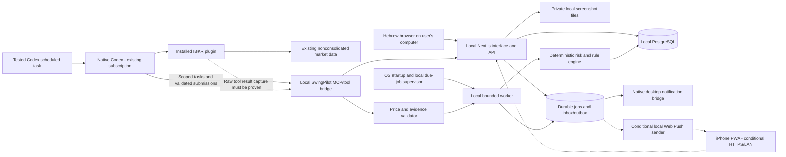

# SwingPilot AI — local architecture, revision 2

Updated17 October2026. Local manual applicationv0.7 is implemented/cloud-tested, with user-reported automated Windowsv0.2 evidence only. Current handoff PHASE7_DELIVERY/PHASE7_WINDOWS. Local owner-auth/SQL ledger/read models/manual review jobs are implemented; full native bridge, market/automatic/mobile/release diagrams below remain gated targets. LOCAL_WORKFLOW records Windows/existing Plus/IBKR/$0 additional service baseline. This cloud workspace is separate from the user computer; backups deferred.

## Recommended technology decisions

| Concern | Revised choice | Boundary |
| --- | --- | --- |
| Frontend/backend | Local Next.js + TypeScript/Node | Hebrew browser UI and same-origin APIs, one modular application; loopback by default. |
| Design | Tailwind + shadcn/ui, RTL root | Preserve14 screen specifications, accessibility and bidi isolation. |
| Database | Local PostgreSQL, reviewed migrations, exact numeric ledger | No hosted database subscription. Transactions, owner composite FKs and RLS retained. |
| Authentication | Single local owner, maintained Auth.js session integration + standard Argon2id verifier | No public registration or SMTP dependency; OS-owner recovery procedure. Protect LAN access if later enabled. Codex sign-in is separate from journal login. |
| Files | Private local screenshot/evidence directory | Outside Git/webroot; owner-checked API streams/uploads, bounded file validation and encrypted backups. |
| AI | Native Codex, existing ChatGPT plan | Included allowance only; no API key, per-token fallback or auto credit spending. Model chosen from currently available compatible plan models after evaluation. |
| Market data | Existing IBKR plugin; US real-time nonconsolidated quotes | Current fee screen totalUSD0. Exact billing mode, history coverage, timestamp semantics and scaling require tests; no new entitlement purchases. |
| Charts | TradingView Lightweight Charts | Preserve attribution/license; data is supplied separately, with coverage/source labels. |
| Codex integration | Narrow local MCP/tool bridge | Gated proof of supported native-plugin access and raw tool event capture. No hidden-token copying, assumed website access to hosted connectors or GUI scraping. |
| Scheduling | Local durable queue/worker + OS supervision, coordinated with tested native Codex schedules | Two calendar-dependent due reasons; computer awake, connected and services running. Native schedule precision/dispatch is measured, not guaranteed. |
| Notifications | Durable local inbox + verified native Codex/OS desktop delivery | Website closed test required; browser page notifications alone do not satisfy it. Phone push is conditional later. |
| iPhone | Private local HTTPS PWA, later Web Push | Device-trusted certificate and network routing required; no paid domain/tunnel assumption. Remote access away from home is not promised. |
| Testing | Vitest, Playwright, real local PostgreSQL, native desktop/iPhone smoke | All tests planned. No production results fabricated. |
| Logging/backups | Local structured logs/health + encrypted export/file copy to existing separate medium | No paid monitoring/backup service. Host-down alert cannot be generated by the down host itself; show missed work on recovery. |

[Codex plan usage](https://help.openai.com/en/articles/11369540-using-codex-with-your-chatgpt-plan), [local schedules](https://developers.openai.com/codex/app/automations), [IBKR current fee/coverage rules](https://www.interactivebrokers.com/en/pricing/market-data-pricing.php), [chart attribution](https://github.com/tradingview/lightweight-charts).

## Components and trust boundaries



The diagram is a design, not evidence that the dotted integrations work. The local worker has no installed-plugin credentials. Native Codex can use its authorized IBKR tools; a supported bridge must capture original provider output and submit it to strict local validation. A model's retyped numbers are not authoritative provider evidence. Gate0 checks that boundary before promising automated scanning. If raw capture or unattended native dispatch is unavailable, mark dependent automation blocked and allow explicit reviewed source import/manual Codex analysis; never substitute a paid API without a user-authorized plan change.

The website records `AWAITING_CODEX` work and shows queued state. A user or a tested native scheduled task lets Codex claim the job through narrow tools. Codex obtains authorized images/journal projections and generates a draft/assessment. Local schemas and deterministic validators decide what can be saved. Only UI-owner commands approve plans, record fills/emotions, change stops and correct a ledger. The bridge has no brokerage-order or ledger-execution tool. Separate analysis consent minimizes sensitive journal text.

Raw market observations are authenticated to the local bridge, hash-bound to the claimed job, source transcript/tool event ID and contract. Store received time separately from source observation time; signatures/hashes prove transfer integrity, not genuine market accuracy alone. A fresh `REALTIME` flag with contradictory units is quarantined. Snapshot receipt does not turn nonconsolidated bid/ask into NBBO or partial volume into full-market volume.

## Repository layout (proposed application folders)

```text
.codex/agents/                 existing six role definitions
AGENTS.md                     working instructions
docs/                         revised specifications and evidence
src/
  app/(auth)/                 local login/recovery help
  app/(app)/                  dashboard/scanner/research/plans/watchlist,
                              positions/journal/analytics/settings
  app/api/                    owner-authenticated local HTTP contracts
  components/ui/              RTL/accessibility primitives
  components/trading/         charts, forms, provenance, job states
  domain/trading/             state transitions and plan validation
  domain/risk/                exact-decimal prospective calculations
  domain/indicators/          versioned history calculations
  domain/monitoring/          interval-compatible predicate evaluation
  domain/data-quality/        units, timestamps, coverage and price guards
  application/                use cases, jobs and transaction orchestration
  contracts/                  strict payload schemas/errors/DSL
  ports/                      data/DB/jobs/notifications/Codex interfaces
  infrastructure/database/    local Postgres clients and repositories
  infrastructure/auth/        maintained session/password integration
  infrastructure/codex/       gated native task/bridge integration
  infrastructure/market-data/ IBKR tool evidence normalization
  infrastructure/files/       private upload/download controls
  infrastructure/notifications/ desktop bridge and optional Web Push
local/
  migrations/                 SQL schema/RLS/transaction commands
  workers/                    due-job queue, validation and outbox delivery
  bridge/                     narrowly scoped local MCP tools
  fixtures/                   synthetic tests, excluded from production
public/                       static assets/optional PWA manifest
config/                       schemas, no secrets
scripts/                      OS startup, health, encrypted backup/restore
  tests/unit/ integration/ contracts/ e2e/ scheduler/ security/ fixtures/
```

Financial dependency direction remains routes/components → application → domain + ports; infrastructure implements ports, composition roots wire it. Domain has no database/framework/AI imports. PostgreSQL numeric commands own authoritative FIFO/cash/ledger replay under locks. TypeScript handles prospective risk, price validation, indicators and predicates; both follow versioned contracts and independent golden fixtures. File storage, local sessions and bridge transports never leak into financial arithmetic. Import-boundary checks prevent client bundles from containing bridge or database credentials.

## Local operations and reliability

Install on the user's computer only after implementation approval and host capability check (OS, RAM, disk, installed runtime, safe autostart). No cloud instance is assumed to remain free indefinitely. Prefer native Postgres/Node install; optional containers must pass local resource/license checks and are not required merely for this plan.

Start database/server/worker automatically under an OS user service. Native Codex desktop must be running in the correct logged-in user session; an OS service cannot assume it can launch authorized desktop work before login. Disable sleep during agreed monitoring hours, retain locked-screen operation only after testing, keep internet and adequate disk space. Sleep/reboot/auth expiry/quota failure creates auditable missed/blocked states. Catch up with fresh data, not historic entry claims. Site closure is supported; full-machine shutdown is not.

Loopback endpoints reject unknown origins. Later LAN access requires authenticated HTTPS, firewall allowlisting and device trust, not public Postgres or an internet-exposed local API. Use standard sessions, Argon2id, CSRF/origin checks, expiry, secure-cookie policy for HTTPS, owner-safe references and redacted logs. Explicit cookie configuration for loopback development must not accidentally become LAN production settings. Back up DB and private files separately with restore tests.

## Zero-service-cost capability gates

G0-L1 native Codex → local bridge and included-usage-only policy; G0-L2 existing IBKR connector data/billing/history rights; G0-L3 raw price timestamp/scale/coverage validation; G0-L4 independent schedules and closed page recovery; G0-L5 native desktop alerts; G0-L6 optional iPhone HTTPS/push. Refer to [VALIDATION_STATUS.md](VALIDATION_STATUS.md), [PRICE_VALIDATION.md](PRICE_VALIDATION.md) and [NOTIFICATIONS.md](NOTIFICATIONS.md). Limited prior read-only quotes and the user-reported fee screen are evidence; the integration gates are still unrun. New subscriptions and paid fallback paths are outside approved scope.

## Implemented Phase8 diagnostics and configuration boundary

The authenticated readiness page uses existing separate restricted auth/app pools for catalog/settings reads. The web process still receives no migration URL. Localdoctor explicitly loads the existing private settings, validates role/host/port/database separation and filesystem location/modes, and opens bounded READ ONLY transactions for migration/runtime/auth diagnostics. Outputs contain only safe version/code/status metadata. No new daemon/worker/service/provider/model request or financial mutation exists.

Readiness and external acceptance are separate: a local catalog PASS cannot verify billing, quota, actual native schedules, desktop receipt, phone or deferred restore. WindowsACLs remain manual even after doctor exit2. Test launcher cannot fall back to inherited personal settings. Resolved private storage roots remain outside project/OneDrive. No migration/dependency change in0.8; full Phase8/release acceptance remains pending. LOCAL_RUNBOOK and PHASE8_WINDOWS own installation/update/incident handoff.
