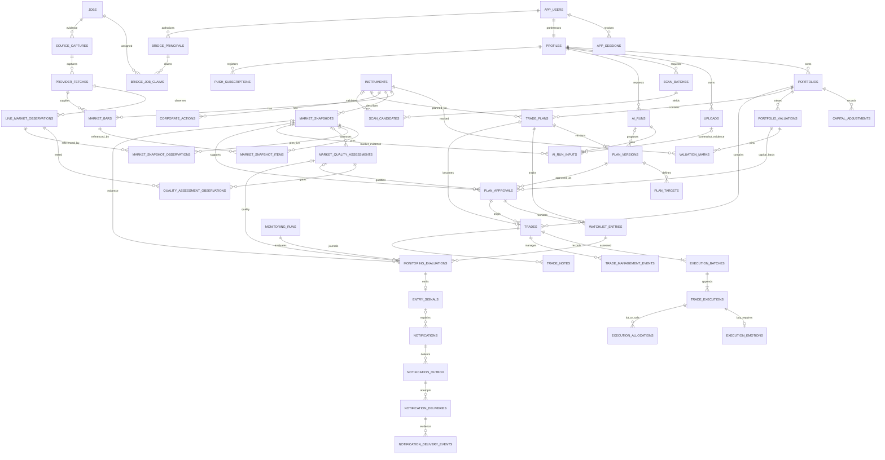

# SwingPilot AI — Proposed Database Design

Status: v0.7 implemented local auth/manual SQL ledger plus separate manual plan/weekly reviews, inactive schedule rehearsals and synthetic desktop tests. New0007 adds analytics read indexes/function and owner-scoped immutable weekly review jobs/commands/events; delivered0001–0006 unchanged. Full market/native AI entities below remain proposed. PHASE7_DELIVERY gives exact implemented scope; actual Windows/native/backup acceptance remains open.

V1 assumptions: one local authenticated owner, one USD portfolio, NYSE/Nasdaq stocks, long positions, manual brokerage execution and integer shares. Existing IBKR read-only plugin observations through native Codex are the proposed LIVE/EOD data source; every usable observation must pass explicit price/coverage/provenance gates. Native plugin/bridge automation is UNRUN; manual user-reviewed import is the fallback and does not establish automatic monitoring. Future ownership/portfolio extensibility must not expose licensed account evidence. Financial calculations follow [RISK_ENGINE.md](RISK_ENGINE.md); AI/provenance follow [AI_SYSTEM.md](AI_SYSTEM.md).

## Implemented v0.4 addition

Forward migration0004 adds `codex_review_jobs`, `codex_review_commands` and `codex_review_events`, with forced owner RLS/composite owner FKs and SELECT-only runtime grants plus bounded `codex_review_command`. Jobs pin immutable JSON manual-plan facts and SHA-256 of PostgreSQL JSONB text, plan/version/policy revisions and an owner journal-command count (excluding notification-read acknowledgments). This command count is monotonic under append-only financial commands and the shared owner lock; it does not change financial tables. Responses are manual unverified text, structurally bound to the job/hash and allowlisted fact IDs. Jobs/events never imply authenticated model origin, market evidence or approval. Existing0001–0003 remain unchanged. JSON journal export currently excludes review history; see PHASE4_DELIVERY for scope and limitations.

## Implemented v0.5 addition

Forward0005 adds monitoring_scenarios, monitoring_rehearsal_runs, monitoring_rehearsal_events and monitoring_rehearsal_commands. These are owner-scoped **manual rehearsals**, not production exchange sessions/worker jobs/signals. A scenario revision preserves manual date/status/close/source note; OPEN computes two immutable due/deadline timestamps in PostgreSQL IANA zones, CLOSED has none. UNIQUE(owner/scenario/reason), partial current-date uniqueness, forced RLS and a bounded command implement idempotency/correction/cancellation/reconciliation. App runtime has SELECT only plus command execution. No financial/review table is changed; no signal/inbox writer or activation exists. Existing0001–0004 remain unchanged. Journal export excludes rehearsal history and is not backup; details in PHASE5_DELIVERY.

## Implemented v0.6 desktop-test addition

Forward0006 adds desktop_test_preferences, desktop_delivery_tests/attempts/events/commands with forced owner RLS and bounded delivery_command. Default-off TEST-only outbox has ten-minute expiry,60-second fencing lease, three explicit known-failure attempts and UNKNOWN handling. Preferences/cancel fence DB completion but cannot atomically recall an external send. Six-digit receipt is hashed with test identity; code, receipt hash and lease token are excluded from owner web DTOs. Wrong receipt counts commit persistently and lock after5; accepted-by-sender and human-reported receipt/context are separate. No financial/review/monitoring mutation; existing0001–0005 unchanged. Existing journal JSON export excludes this auxiliary history and is not backup. Actual Windows proof remains unrun; see PHASE6_DELIVERY.

## 1. Shared conventions

| Concern | Proposed convention |
| --- | --- |
| Identity | UUID primary keys. `owner_id` references local `app_users.id` on every private record. `profiles.id` is that same user ID. Ownership comes from verified local sessions or explicitly owner-scoped service capabilities, never browser/model payloads. |
| Owner-safe references | Private parent tables expose a unique `(owner_id, id)` key. Every private child reference uses a composite foreign key `(owner_id, parent_id) → parent(owner_id, id)`. This applies to plans, versions, approvals, portfolios, trades, executions, uploads, scans, AI runs, evaluations and notifications. An ID-only FK is insufficient even with RLS. |
| Common record fields | Unless described otherwise: `id`, `owner_id` for private rows, `created_at`, and a stable UTC creation timestamp assigned by the database. Mutable aggregates also have `updated_at` and integer `row_version` for optimistic concurrency. Immutable records have no mutable business columns. |
| Financial values | Fixed-decimal `numeric(20,8)` prices, cash amounts and fees; exact decimal operations in the domain engine. Serialize decimals as strings at the API boundary. Final currency presentation is rounded to cents under a documented rounding policy. V1 quantities are positive integer shares within the JavaScript safe-integer range. Ratios are exact decimals internally, rounded only for display. |
| Currency | ISO currency code; `USD` only in V1, checked on portfolios, plans and executions. No implicit FX conversion. |
| Time | `timestamptz` for instants; `date` for exchange sessions. `trading_date` means the US exchange session date in `America/New_York`, not a browser-local date. The scheduled user-facing check uses `Asia/Jerusalem`. |
| JSON | Versioned, strictly validated objects for bounded entry/invalidation conditions, policy snapshots, AI structured output and evidence manifests. JSON never contains executable SQL, JavaScript or arbitrary expressions. Scalar data needed for joins, constraints or accounting uses typed columns. |
| Deletion | Archived plans and superseded versions remain queryable. No cascading delete from a plan into actual trade history. Account deletion is an explicit privileged erasure workflow with a documented backup expiry window. Ordinary clients cannot hard-delete ledger or approval evidence. |
| Schema evolution | Forward migrations, compatibility checks and a schema version on external/AI contracts. Immutable records retain the policy/calculation version used when created. |
| Ownership vs shared facts | Public instrument/calendar metadata can be shared read-only. IBKR captures, observations, bars, corporate-action evidence, snapshots and quality assessments are owner-scoped because source access/entitlements belong to that local account. They cannot become an unrestricted shared cache. |

## 2. Foundation, portfolio and cash records

### `app_users` — local owner identity

- **Fields:** `id` PK; normalized `login_name`; `password_hash` produced by a maintained Argon2id library; `password_changed_at`; `session_epoch`; `state` (`ACTIVE`, `DISABLED`); `created_at`; `updated_at`.
- **Rules:** one enabled local owner at launch; no public signup or SMTP reset service. The password hash is inaccessible to browser/MCP reads and general logs. Auth.js owns supported session-cookie mechanics; do not implement cryptography. Account recovery requires a verified local OS-owner procedure that rotates the session epoch. Never store Codex/IBKR passwords, hidden tokens or cookies.
- **Indexes:** PK and unique normalized login name. Login attempts are rate-limited independently of bridge/worker traffic.

### `app_sessions` — local session revocation evidence

- **Fields:** `id`; `owner_id`; `session_identifier_hash`; `session_epoch`; `issued_at`; `expires_at`; `last_seen_at`; `revoked_at`; minimally retained `device_label`.
- **Rules:** choose and prove a supported Auth.js password/session integration in Phase 1. This registry can provide server-side revocation for library-managed encrypted/signed sessions; it is not a claim that every Credentials-provider/database-adapter combination is supported. Store no raw bearer cookie. The session must match an enabled local owner and current epoch. Logout/recovery revoke sessions; credentials and this registry are inaccessible to the model bridge.
- **Indexes:** unique session hash; `(owner_id, revoked_at, expires_at)`; PK/owner candidate key.

### `profiles` — account preferences

- **Fields:** `id` PK/FK to `app_users`; `display_name`; `locale` (Hebrew default); `timezone` (`Asia/Jerusalem` default); `notification_preferences`; `onboarding_completed_at`; `preferences_schema_version`; `created_at`; `updated_at`; `row_version`.
- **Rules:** validate locale/timezone and notification preference shape. Authentication credentials stay in the local auth boundary; no password or provider secret columns here.
- **Indexes:** PK; no unneeded index on low-cardinality locale.

### `portfolios` — configurable capital and risk policy

- **Fields:** common private/mutable fields; `name`; `currency`; `opening_cash`; `opening_cash_at`; `risk_per_trade_fraction`; `max_position_fraction`; `max_total_exposure_fraction`; `max_sector_fraction`; fixed-USD `cash_buffer`; `policy_version`; `is_default`; `archived_at`.
- **Rules:** cash values are nonnegative at initialization; risk fractions are within permitted domain ranges, risk per trade strictly positive; limits are validated together. Unique owner/default portfolio. V1 permits one nonarchived portfolio per account through the domain rule. Do not edit opening cash after executions exist; use an adjustment.
- **Indexes:** `(owner_id, archived_at)`; unique `(owner_id, id)`; uniqueness for the one default active portfolio.
- **Capital meaning:** portfolio equity is cash plus marked holdings. Risk policy snapshots preserve the equity, valuation freshness, capital basis and buying power used for each approval. Settings do not silently rewrite historical sizing. V1 reserve is the fixed USD cash buffer and pending-order reservations are zero because this manual journal creates no broker orders. Percentage reserves/pending-order reservation rows are later additions.

### `capital_adjustments` — append-only manual cash events and corrections

- **Fields:** common private immutable fields; `portfolio_id`; `kind` (`DEPOSIT`, `WITHDRAWAL`, `DIVIDEND`, `ACCOUNT_FEE`, `TAX`, `REVERSAL`); `flow_class` (`EXTERNAL`, `INTERNAL`); signed nonzero `amount`; `effective_at`; optional `instrument_id`/owner-safe `trade_id`; `reason`; `reverses_adjustment_id` when reversing; `command_id`.
- **Rules:** deposits/dividends have positive cash delta; withdrawals/account fees/taxes negative. Deposits/withdrawals are `EXTERNAL`; dividends/fees/taxes are `INTERNAL`. A reversal carries the exact opposite delta and same flow class of its referenced original event. Reference the owner's portfolio/trade; at most one reversal per original adjustment; never modify an existing cash event. A correction is a reversal plus replacement in one transaction. An actual cash event causing negative available cash requires reconciliation and explicit acknowledgment; it must not conceal an already executed transfer. Only external flows create/destroy performance units; internal events affect return. Separate cash dividends/taxes are not silently added to trade price P&L.
- **Indexes:** `(owner_id, portfolio_id, effective_at, id)`; unique reversal target and command deduplication.
- **Cash projection:** opening cash + effective signed cash events − buy cost − buy fees + sell proceeds − sell fees. Execution fees are already in fills and cannot be duplicated as an account-fee event. No fabricated broker cash balance. The UI states that this is a manual ledger, potentially different from the broker.

### `portfolio_valuations` — immutable dated portfolio valuation evidence

- **Fields:** common private immutable fields; `portfolio_id`; `as_of`; `captured_portfolio_row_version`; `cash_amount`; `cash_projection_hash`; `coverage_status` (`COMPLETE`, `PARTIAL`, `UNPRICED`); `source_mode` (`MANUAL`, `LIVE`, `EOD`, `MIXED`); `equity_amount` nullable unless complete; `policy_version`; `calculation_engine_version`; `snapshot_hash`; `user_acknowledged_limitations`.
- **Rules:** capture cash and the exact holding ledger revisions under a consistent portfolio read/lock. Complete coverage means every open holding has a compatible mark and quantity from that captured revision; stale/manual marks stay visibly classified even when numerically complete. An unpriced holding makes total equity unavailable rather than silently zero. A prospective risk approval cannot use a valuation invalidated by a concurrent fill or undisclosed missing holding.
- **Indexes:** `(owner_id, portfolio_id, as_of DESC, created_at DESC)`; owner-safe `(owner_id, id)` key.
- **MVP policy:** user-entered dated marks support journal-only portfolio sizing/analytics before a provider is available. They are explicitly self-reported, not market-verified, and never usable as monitoring evidence.

### `valuation_marks` — private mark evidence within a valuation snapshot

- **Fields:** common private immutable fields; `portfolio_valuation_id`; `instrument_id`; optional `trade_id`; `kind` (`HOLDING`, `PROPOSED_ENTRY`); `quantity`; `trade_ledger_revision` where applicable; `price` nullable only if unpriced; `source` (`MANUAL`, `LIVE`, `EOD`); `source_as_of`; optional owner-safe `market_snapshot_id`/`live_observation_id`/`quality_assessment_id`; `quality_flags`; `user_note`.
- **Rules:** unique instrument/kind per owner valuation. A holding mark references the same portfolio's owner-scoped trade with its exact positive open quantity/revision. A proposed-entry mark can have zero quantity and no held trade. Positive price when present; EOD/LIVE marks require compatible owner-safe evidence and passing quality gates, while MANUAL forbids claiming verified provider evidence. Each manual mark includes explicit user observation time. Unknown/stale prices produce documented valuation/risk limitations. LAST/BID/ASK valuations retain their field type; do not silently use bid or ask as a last trade.
- **Indexes:** `(owner_id, portfolio_valuation_id)`; trade/evidence reverse-reference indexes.

## 3. Instruments and market evidence

### `instruments` — validated listing identity

- **Fields:** `id` PK; `canonical_symbol`; `exchange_mic` (`XNYS`, `XNAS`); `name`; `asset_type`; `currency`; `sector`; `listing_status`; `valid_from`; `valid_to`; `provider_symbol_mappings`; `last_validated_at`; `validation_source`; `metadata_revision`. Owner-entitled IBKR contract resolution is recorded in the capture/observation evidence rather than exposing an account response as public metadata.
- **Rules:** only supported active US-listed stocks pass V1 validation. Maintain a stable instrument ID across symbol changes; ticker reuse must not attach a new company to an old trade. Canonicalization handles provider formats such as periods vs hyphens. Preserve delisted instruments for old journals.
- **Indexes:** current valid `(canonical_symbol, exchange_mic)` uniqueness; symbol search; `(listing_status, exchange_mic)`.

### `exchange_sessions` — authoritative session schedule

- **Fields:** `exchange_mic`; `trading_date`; `is_open`; `open_at`; `close_at`; `is_early_close`; `calendar_source`; `calendar_version`; `fetched_at`; `verified_at`.
- **Keys/rules:** composite PK `(exchange_mic, trading_date)`; both opening/closing times present for open sessions and `close_at > open_at`; calendar updates are versioned/audited. A holiday has no invented close timestamp.
- **Indexes:** `(close_at)` for dispatch; `(trading_date, is_open)`.

### `provider_fetches` — provider response provenance

- **Fields:** common private immutable fields; `provider` (`IBKR` initially); `source_capture_id`; `endpoint_kind`; `request_fingerprint`; `instrument_id` nullable for batch requests; `requested_session`; `started_at`; `completed_at`; `status`; `entitlement_class`; `coverage_class`; `billing_assurance` (`VERIFIED_INCLUDED`, `UNVERIFIED`, `PROHIBITED`); `freshness_class` (`EOD`, `DELAYED`, `LIVE`, `UNKNOWN`); `rate_limit_retry_at`; `content_hash`; `error_code`; local private `raw_object_key`; `retention_expires_at`.
- **Rules:** only verified supported read-only native IBKR tools are candidates for capture. Exact tool envelopes are transported independently of the model's typed narrative; a model-retyped quote is not provider evidence. Preserve raw values/units/times alongside a sanitized allowed envelope, without account/login identifiers or credentials. No API key/client-login is copied from Codex. Unknown connector request charges block bulk automatic calls; paid regulatory snapshots/subscription/billing mutations are prohibited. Cache reuse preserves the original source observation age.
- **Indexes:** `(owner_id, provider, request_fingerprint, completed_at)`; `(owner_id, status, completed_at)`; source capture FK.

### `source_captures` — exact native tool result or explicit manual import

- **Fields:** common private immutable fields; `job_id`; optional `bridge_principal_id`; `capture_origin` (`NATIVE_TOOL_EVENT`, `USER_REVIEWED_IMPORT`); `provenance_status` (`VERIFIED_NATIVE_CAPTURE`, `USER_REVIEWED_IMPORT`, `UNVERIFIED`); `native_tool_call_id`; `plugin_namespace`; `tool_name`; `tool_version` where observable; `captured_at`; `raw_object_key`; `raw_sha256`; `content_type`; `capture_transport_version`; `verification_gate_id`; `verification_results`; `user_reviewed_at` nullable.
- **Rules:** only a proven supported native tool-event transport may assign `VERIFIED_NATIVE_CAPTURE`; an AI-authored JSON declaration or hash does not authenticate its claimed source. Exact evidence is stored owner-private outside repository/webroot. Manual import records its actual origin and review; it never impersonates native automation or repairs missing field timestamps. A rejected/unverifiable capture remains diagnostic evidence and cannot generate a live signal.
- **Indexes:** `(owner_id, job_id, captured_at)`; unique native event identity within owner/plugin namespace when present; content hash lookup.

### `live_market_observations` — field-level quote evidence

- **Fields:** common private immutable fields; `instrument_id`; `provider_fetch_id`; `source_capture_id`; `contract_id`; `symbol_as_returned`; `currency`; `security_type`; `field_kind` (`LAST`, `BID`, `ASK`); `raw_value`; `raw_unit`; nullable exact `normalized_price`; `normalization_rule_version`; `observed_at` nullable; `timestamp_provenance`; `received_at`; `session_kind` (`REGULAR`, `PREMARKET`, `AFTERHOURS`, `CLOSED`, `UNKNOWN`); `trading_date`; `freshness_class`; `coverage_class` (`NON_CONSOLIDATED`, `CONSOLIDATED`, `UNKNOWN`); `venue_scope`; `source_flags`; `payload_path`; `content_hash`.
- **Rules:** one record per source field with its own source time; capture/receive time is never substituted for missing LAST/BID/ASK observation time. Preserve LAST ≈ 3.43 versus BID/ASK ≈ 343 exactly as an unresolved scale/serialization anomaly. Do not heuristically multiply by 100. A normalization rule requires documented units and independent compatible timestamped reference evidence, approved/versioned through the quality gate. Contract/currency/session mismatch blocks use. NON_CONSOLIDATED is never labeled NBBO or consolidated volume.
- **Indexes:** `(owner_id, instrument_id, field_kind, observed_at DESC)`; source capture/contract lookup; unique source capture/field payload path.

### `market_quality_assessments` — immutable eligibility gate results

- **Fields:** common private immutable fields; typed owner-safe `provider_fetch_id`, `market_snapshot_id` and/or `observation_ids` through typed child membership; `policy_version`; `assessed_at`; `requested_mode` (`LIVE_QUOTE`, `REGULAR_SESSION_EOD`); `outcome` (`PASS`, `BLOCKED`, `REVIEW_REQUIRED`); `rejection_codes`; `checks`; `reference_evidence`; `eligible_predicates`; `expires_at`.
- **Rules:** assess raw provenance, identity, USD units/scale, each field timestamp/freshness, spread/price coherence, feed coverage, interval/session finality and required history/adjustments. Example rejection codes: `SOURCE_UNVERIFIED`, `UNIT_SCALE_UNRESOLVED`, `OBSERVATION_TIME_MISSING`, `OBSERVATION_TIME_INVALID`, `QUOTE_CONFLICT`, `INTERVAL_UNSUPPORTED`, `PRICE_STALE`, `CONTRACT_MISMATCH`, `COVERAGE_UNSUPPORTED`, `HISTORY_UNAVAILABLE`, `SESSION_INCOMPATIBLE`, `PUBLICATION_PENDING`. A PASS is purpose-specific and expires; last-price eligibility does not imply volume/EOD eligibility. Quality logic is deterministic and outside model control.
- **Indexes:** `(owner_id, assessed_at DESC)`; evidence reverse references; outcome/expiry worker index.
- **Membership:** a small `quality_assessment_observations` child holds `(owner_id, assessment_id, observation_id)` PK/FKs instead of relying on unvalidated IDs in JSON. Reference captures/snapshots used for comparisons also require typed owner-safe links or an enforced owner-validated evidence manifest. All historical assessments are preserved when a policy/evidence revision changes.

### `market_bars` — append-only revisions of historical candles

- **Fields:** common private immutable fields; `instrument_id`; `provider`; `provider_fetch_id`; `timeframe`; `trading_date`; `bar_start_at`; `bar_end_at`; `open`; `high`; `low`; `close`; `volume` nullable when unavailable; `coverage_class`; `session_kind`; `adjustment_basis` (`RAW`, `SPLIT_ADJUSTED`, `TOTAL_RETURN`, `UNKNOWN`); `is_final`; `revision_no`; `source_as_of`; `fetched_at`; `content_hash`.
- **Rules:** positive OHLC, nonnegative volume when available, low ≤ open/close ≤ high, start < end. Unique `(owner_id, instrument_id, provider, timeframe, trading_date, session_kind, coverage_class, adjustment_basis, revision_no)` for daily bars. Corrected provider data creates a new revision; approvals and prior analyses keep references to their original evidence. Never mix adjustment/coverage/session bases inside one indicator series.
- **Indexes:** `(owner_id, instrument_id, provider, timeframe, adjustment_basis, trading_date DESC, revision_no DESC)`; `(owner_id, provider_fetch_id)`. Revision uniqueness also includes owner/session/coverage so unlike series cannot collide.
- **Current-series projection:** a query/view selects the latest valid revision. It is replaceable cache behavior, not a mutation of historical analysis inputs.
- **Availability:** historical endpoints/lookback/adjustment and venue-volume coverage are capability gates, not assumed from a successful live quote. Missing history disables dependent indicators/EOD rules. A partial quote is not a completed daily candle and a current quote before close cannot satisfy a finalized close predicate.

### `corporate_actions` — evidence of splits and other material changes

- **Fields:** common private immutable fields; `instrument_id`; `provider`; `provider_fetch_id`; `action_type`; `effective_session`; `ratio_numerator`; `ratio_denominator`; `cash_amount` where applicable; `provider_action_id`; `source_as_of`; `revision_no`; `content_hash`.
- **Rules:** unique source action revision; valid positive split ratio. Action detection sets affected position/data reconciliation to `REVIEW_REQUIRED` until supported reconciliation is completed. V1 must not silently adjust recorded broker executions. Reverse splits creating fractional entitlements, cash in lieu, dividends and unsupported actions require explicit reconciliation before affected analytics or alerts are trusted.
- **Indexes:** `(owner_id, instrument_id, effective_session)`; unique `(owner_id, provider, provider_action_id, revision_no)`.
- **V1 limit:** build detection and blocking behavior; a complete corporate-action ledger is a later feature. A real action cannot be treated as a normal new BUY/SELL or hidden by changing prices.

### `market_snapshots` and `market_snapshot_items` — reproducible analysis inputs

- **Snapshot fields:** common private immutable fields; `instrument_id`; `provider`; `provider_fetch_id`; `snapshot_kind`; `condition_basis` (`LIVE_QUOTE`, `REGULAR_SESSION_EOD`); `trading_date`; `as_of`; `fetched_at`; `freshness_class`; `coverage_class`; `publication_status`; `adjustment_basis`; `indicator_engine_version`; `indicator_values`; `fundamental_values` only if available/licensed; `data_quality_flags`; `series_hash`; `snapshot_hash`; `retention_expires_at`.
- **Item fields:** `owner_id`; `snapshot_id`; `bar_id`; `ordinal`; PK `(owner_id, snapshot_id, ordinal)` with unique `(owner_id, snapshot_id, bar_id)`. `market_snapshot_observations` has `owner_id`, `snapshot_id`, `observation_id`, `ordinal`, composite owner-safe FKs and a PK/unique ordinal; it pins exact typed quote observations for LIVE snapshots.
- **Rules:** snapshots and their ordered membership are immutable. All referenced bars belong to the same instrument/provider/timeframe/basis expected by the snapshot. Indicators include definitions and lookback availability; missing input yields missing output. Facts must distinguish provider observation times from acquisition times. Final EOD readiness requires the exact eligible session's finalized bar, not merely a successful HTTP response.
- **Indexes:** `(owner_id, instrument_id, provider, trading_date DESC, snapshot_kind)`; owner/snapshot hash; bar/observation reverse references for retention checks.
- **Reproducibility:** retain exact referenced bars and a compact value manifest while a plan/trade/AI run depends on them, subject to provider licensing. If licensing prevents durable evidence retention, preserve allowed derived values/hashes and record the limitation; never claim a hash alone can reconstruct unavailable prices.
- **Quality linkage:** quality assessments reference a snapshot; downstream approval/evaluation/signal records pin the applicable assessment. Reassessing an old snapshot does not mutate it or rewrite an earlier result.

## 4. Uploads, screening and AI provenance

### `uploads` — authenticated local screenshot metadata

- **Fields:** common private fields; `object_key`; `mime_type`; `byte_size`; `width`; `height`; `sha256`; `state` (`AWAITING_UPLOAD`, `VALIDATING`, `READY`, `REJECTED`, `DELETED`); `expires_at`; `rejection_code`; `deleted_at`.
- **Rules:** only permitted raster formats, size/pixel limits, actual file-type validation and metadata stripping. Random logical object IDs resolve server-side to files under the owner-private application data directory outside repository/webroot. Reject traversal/symlink escapes and unauthorized file IDs. No arbitrary client/model path or public URL. Authenticated object-specific downloads are the default; any native screenshot transfer is scoped to the assigned bridge job. A screenshot is not executable content. Uncompleted upload intents expire.
- **Indexes:** `(owner_id, created_at DESC)`; `(state, expires_at)`; optional owner/hash index for duplicate warnings.

### `scan_batches` — one weekly research/scanner request

- **Fields:** common private/mutable fields; `portfolio_id`; `job_id`; `requested_session`; `status`; `screening_policy_version`; `requested_extra_count` (five by default); `confirmed_tickers`; `universe_evidence`; `exclude_instrument_ids`; `screened_count`; `eligible_count`; `completion_reason`; `completed_at`.
- **Rules:** preserve which ticker set the user confirmed, the supported universe and coverage used, liquidity/price filters and reasons fewer than five additional candidates qualified. Missing free history/sector/universe capability disables dependent filters/modules and returns honest shortages. No exhaustive US grouped-screen promise or padding with invented candidates. State is a projection of durable job progress.
- **Indexes:** `(owner_id, created_at DESC)`; `(owner_id, status)`.

### `scan_candidates` — extracted and discovered candidates

- **Fields:** common private fields; `scan_batch_id`; `instrument_id` nullable until validated; `source` (`SCREENSHOT`, `USER`, `QUANT_DISCOVERY`); `raw_ticker`; `canonical_ticker`; `recognition_confidence`; `validation_status`; `confirmation_status`; `rank`; `screen_score`; `feature_values`; `screening_reasons`; `exclusion_reasons`; `market_snapshot_id`; `extraction_ai_run_id`; `research_ai_run_id`.
- **Rules:** extraction confidence expresses OCR uncertainty, never investment probability. Unconfirmed/invalid symbols cannot enter analysis. Unique confirmed instrument within a batch; discovered candidates exclude screenshot/user candidates, holdings and exclusions as specified in the screening policy.
- **Indexes:** `(owner_id, scan_batch_id, source, rank)`; owner/instrument history.

### `ai_runs` — immutable request/output audit with a mutable job state projection

- **Fields:** common private fields; `job_id`; `module`; `execution_backend` (`NATIVE_CODEX`, `USER_REVIEWED_IMPORT`); `bridge_principal_id` nullable; `native_run_reference` when supported; `model`/`model_revision` only when observable; `prompt_version`; `prompt_hash`; `output_schema_version`; `policy_version`; `input_manifest_hash`; `status`; `started_at`; `completed_at`; `request_id`; `submission_hash`; `validated_output`; `validation_results`; `refusal_reason`; `error_code`; observable included-usage state (`AVAILABLE`, `LIMIT_REACHED`, `UNKNOWN`); `image_count`; `cache_key`; `cache_source_run_id`; `retention_expires_at`.
- **Rules:** the app stores a request awaiting native Codex; it does not call a model HTTP API. Identity, prompt/input evidence and successful output become immutable after finalization. Successful bridge submissions pass strict local schema/domain/evidence validation; failed output cannot become an approved plan. Never purchase credits, enable overage, configure model API keys or use a token-billed fallback. Unknown/exhausted included usage queues/blocks work rather than inventing quota counters. Store required reproducibility information without exposing private raw prompts in logs or internal model chain of thought. Cached results preserve original creation time/data age. Manual user-reviewed output import is explicitly marked and cannot establish automatic plugin transport.
- **Indexes:** `(owner_id, module, created_at DESC)`; `(owner_id, job_id)`; `(owner_id, cache_key)`; `(status, created_at)` for operational use.

### `ai_run_inputs` — exact inputs consumed by an AI run

- **Fields:** common private immutable fields; `ai_run_id`; `ordinal`; `input_kind`; one of `upload_id`, `source_capture_id`, `market_snapshot_id`, `live_observation_id`, `quality_assessment_id`, `plan_version_id`, `trade_id`, `scan_batch_id`, or `journal_manifest`; `content_hash`; `captured_at`; `redaction_policy_version`; `trade_ledger_revision` where relevant.
- **Rules:** exactly one typed source per row; every private FK includes owner. A journal manifest contains an immutable minimal projection of actual trades, fee/lot calculation version, selected necessary emotions and date range consumed; its source IDs are validated. A trade input includes an immutable holdings/ledger projection at the recorded revision, not a future mutable state. Market snapshots/captures/observations/assessments are owner-private read-only inputs. The bridge returns only the minimum assigned job input, not unrestricted portfolio, auth or file access.
- **Indexes:** unique `(owner_id, ai_run_id, ordinal)`; indexes on each private source FK where deletion/retention or retrieval needs them.
- **Mutation boundary:** AI runs may propose a new draft version or persist an assessment. They do not approve plans, record executions, change stops, or deliver a brokerage order.

### `bridge_principals` and `bridge_job_claims` — narrow native Codex capability

- **Principal fields:** common private/mutable fields; `name`; `transport_kind`; optional locally issued `capability_hash`; `allowed_scopes`; `capability_gate_status`; `created_at`; `expires_at`; `revoked_at`.
- **Claim fields:** common private fields; `job_id`; `bridge_principal_id`; `claim_nonce_hash`; `lease_version`; `claimed_at`; `expires_at`; `completed_at`; `captured_input_hash`; `result_submission_hash`.
- **Rules:** Gate G0-L1 must prove a supported native Codex-to-local bridge transport and raw native tool-event capture; until then mark capability `UNRUN`/`BLOCKED` and use a user-reviewed import workflow. If supported, owner grants a narrowly scoped locally generated capability, never a copied Codex/IBKR token/cookie. Available scopes are assigned-job listing/claiming, minimal input reads, allowed evidence submission, draft/assessment submission and job-status reporting. No SQL executor, arbitrary filesystem reader, plan approval, journal BUY/SELL, stop mutation, broker order, subscription or billing tool exists in this bridge. Claims are bounded/leased, owner-safe and fenced; revoked/expired principals cannot submit results.
- **Indexes:** owner/principal expiry; unique `(owner_id, job_id, lease_version)`; nonce hash unique; owner/claim result dedupe.

## 5. Plans, immutable versions and watchlist

### `trade_plans` — mutable plan container

- **Fields:** common private/mutable fields; `portfolio_id`; `instrument_id`; `title`; `status` (`DRAFT`, `APPROVED`, `ARCHIVED`); `current_version_id`; `active_approval_id` nullable; `archived_at`.
- **Rules:** the current editable version and the actively monitored approval may differ. Editing an approved plan creates a new draft version while the watchlist continues using the previously approved immutable version until explicit reapproval. Display both versions visibly. Archiving does not delete associated executions.
- **Indexes:** `(owner_id, status, updated_at DESC)`; `(owner_id, portfolio_id, instrument_id)`; unique `(owner_id, id)`.

### `plan_versions` — immutable saved plan snapshots

- **Fields:** common private immutable fields; `plan_id`; `version_no`; `source` (`MANUAL`, `AI`, `EDIT`); `source_ai_run_id` nullable; `parent_version_id` nullable; `market_snapshot_id` nullable for manual drafts; `condition_basis` (`LIVE_QUOTE`, `REGULAR_SESSION_EOD`, `JOURNAL_ONLY`); `entry_zone_low`; `entry_zone_high`; `entry_conditions`; `initial_stop`; `invalidation_conditions`; `holding_period_min_days`; `holding_period_max_days`; `thesis`; `risks`; `indicator_evidence`; `target_schema_version`; `condition_schema_version`; `calculation_engine_version`; `proposal_calculations`; `definition_hash`.
- **Rules:** unique `(owner_id, plan_id, version_no)`; entry high ≥ low > 0; positive stop; sensible holding bounds. Drafts can be incomplete only with explicit validation errors; incomplete/unsupported conditions cannot be approved. Approval requires deterministic structural, market freshness and risk validation. JSON conditions are a bounded versioned DSL tied to documented candle semantics. No arbitrary executable formula support.
- **Indexes:** `(owner_id, plan_id, version_no DESC)`; source AI FK; exact `(owner_id, plan_id, id)` candidate key so references can prove version membership in the same plan.

### `plan_targets` — immutable target ladder children

- **Fields:** `id`; `owner_id`; `plan_version_id`; `ordinal`; `target_price`; optional `planned_exit_fraction`; `rationale`.
- **Rules:** unique ordinal per version; positive strictly increasing target prices; intended fractions valid and total ≤ 1. Approval enforces valid reward-to-risk relative to the defined entry reference and initial stop. Target fractions guide the user; manual exits use actual integer shares and actual prices.
- **Indexes:** unique `(owner_id, plan_version_id, ordinal)`; composite owner/version FK.

### `plan_approvals` — append-only approval evidence

- **Fields:** common private immutable fields; `plan_id`; `plan_version_id`; `approved_by` (the owner in V1); `approved_at`; `supersedes_approval_id` nullable; `market_snapshot_id` nullable for journal-only; `quality_assessment_id` required for market-enabled approval; owner-safe `portfolio_valuation_id`; `portfolio_policy_snapshot`; `capital_valuation_snapshot`; `validation_results`; `approved_calculations`; `calculation_engine_version`; `condition_definition_hash`; `approved_condition_basis`; `acknowledged_limitations`.
- **Rules:** references the same owner's same plan/version/evidence. A version's data/targets cannot be updated after creation. Approval captures size/risk, field-level price age/coverage and LIVE/EOD/JOURNAL_ONLY basis. Excessive prospective risk cannot become valid by asking the model again. Market-enabled approval requires passing purpose-specific source/price/history/coverage gates and supported typed predicates. Manual journal-only approval acknowledges unavailable evidence and is ineligible for setup monitoring. A current LAST observation cannot satisfy a daily-close or consolidated-volume predicate.
- **Indexes:** `(owner_id, plan_id, approved_at DESC)`; version FK; unique approval command ID through the idempotency mechanism.

### `watchlist_entries` — monitoring eligibility and lifecycle

- **Fields:** common private/mutable fields; `plan_id`; `approval_id`; `instrument_id`; `status` (`WAITING`, `PAUSED`, `INVALIDATED`, `EXPIRED`, `ENTERED`); `monitoring_eligibility` (`ENABLED`, `JOURNAL_ONLY`, `REVIEW_REQUIRED`, `BLOCKED`); `monitoring_mode` (`LIVE_QUOTE`, `REGULAR_SESSION_EOD`, `JOURNAL_ONLY`); `blocked_reason`; `paused_reason`; `valid_from`; `expires_at`; `last_evaluated_at`; `last_evaluation_id`; `last_signal_id`; `entered_trade_id` nullable.
- **Rules:** one entry per plan in V1; active monitoring references that plan's current active approval. Reapproval replaces the reference in a transaction, supersedes obsolete undelivered signals and increments `row_version`; it never changes an old signal's evidence. A signal does not set `ENTERED`; recording the first actual BUY does. Invalidating a plan does not close a held trade. Past expiry/explicit pause suppresses new signals.
- **Indexes:** `(owner_id, status, updated_at DESC)`; partial worker index on eligible `WAITING` rows; `(owner_id, approval_id)`.

## 6. Trade ledger, corrections and psychology

### `trades` — position aggregate and rebuildable projection

- **Fields:** common private/mutable fields; `portfolio_id`; `plan_id`; `origin_approval_id`; `instrument_id`; `status` (`ACTIVE`, `CLOSED`); `reconciliation_status` (`CLEAR`, `REVIEW_REQUIRED`); `opened_at`; `closed_at`; `open_quantity`; `remaining_cost_basis`; `realized_pnl`; `paid_fees`; `initial_risk_amount`; `initial_risk_basis`; `initial_entry_batch_id`; `current_stop`; `ledger_revision`; `projection_engine_version`; `projection_hash`; `review_flags`.
- **Rules:** one trade per plan and one active trade per instrument/portfolio in V1; another independent trading cycle uses another plan container after the previous position is closed. An ADD to an already held instrument uses its existing trade; do not open a second overlapping ledger. Symbol/portfolio/origin approval are immutable. A trade is active iff effective remaining quantity > 0 and closed iff zero; review status is separate and may coexist with either. Projections are derived from effective execution/management records, never directly edited. Initial risk is the first BUY batch sum of actual quantity × (actual entry − original approved initial stop), excluding fees. It can contain several broker fills recorded together. ADD and later stop changes do not reset it. Corrections affecting an initial-group buy regenerate the projection with an audited before/after revision and preserve its entry-group lineage.
- **Indexes:** unique `(owner_id, plan_id)`; partial unique `(owner_id, portfolio_id, instrument_id)` where status is `ACTIVE`; `(owner_id, portfolio_id, status, opened_at DESC)`; `(owner_id, instrument_id, status)`; unique `(owner_id, id)`.

### `execution_batches` — atomic recording/correction command

- **Fields:** common private immutable fields; `trade_id`; `command_id`; `kind` (`RECORD`, `CORRECTION`); `reason`; `recorded_by`; `expected_ledger_revision`; `resulting_ledger_revision`; `before_projection_hash`; `after_projection_hash`; `breach_acknowledgment`; `breach_flags`.
- **Rules:** unique `(owner_id, command_id)`; a correction requires a reason and includes its reversals/replacements as one committed command. Batch identity proves a reversal cannot be committed without its requested replacement. A reversal-only cancellation is an explicit correction with its own replay/validation, not a delete.
- **Indexes:** `(owner_id, trade_id, created_at, id)`; command uniqueness.

### `trade_executions` — append-only manual execution history

- **Fields:** common private immutable fields; `trade_id`; `batch_id`; `entry_group_id` for BUY; `event_type` (`BUY`, `SELL`, `REVERSAL`); `quantity`; `price`; `fees`; `currency`; `executed_at`; `recorded_at`; `ordering_sequence`; `broker_reference` nullable; `approval_id` for the governing approved/add plan when supplied; `reverses_execution_id` nullable; `replaces_execution_id` nullable for replacement fills; `fill_note`; `calculation_engine_version`.
- **Rules:** BUY/SELL require positive integer quantity, positive price and nonnegative fees. REVERSAL references a prior effective BUY/SELL in the same owner's same trade and carries no second quantity/price. Unique reversal target; no reversal of a reversal. A replacement is a fresh BUY/SELL with its own actual timestamp and evidence; it references the original fill and inherits the original BUY entry group. Original BUYs reference their command batch as the entry group, so an initial multi-fill purchase and its later corrections have a stable initial-risk basis. Optional broker reference supports a duplicate warning, not universal uniqueness because brokers can reuse order IDs for multiple fills.
- **Indexes:** `(owner_id, trade_id, executed_at, ordering_sequence, id)`; batch FK; unique `(owner_id, reverses_execution_id)` when nonnull; broker reference lookup; exact `(owner_id, trade_id, id)` candidate key for reversal/lot membership constraints.
- **Execution truth:** actual completed fills breaching portfolio preferences remain recordable with explicit acknowledgment and review flags. Proposed sizing/approval is blocked by prospective risk limits; the historical journal cannot conceal a real loss or oversize fill. Invalid symbols/quantities, wrong-owner references, duplicate reversals and impossible long-only oversells remain errors. A price at/below the proposed stop produces an undefined initial-R basis and `REVIEW_REQUIRED`; never invent a positive denominator.

### `execution_emotions` — mandatory BUY psychology evidence

- **Fields:** common private immutable fields; `buy_execution_id`; `state_labels` from a versioned controlled vocabulary; nullable `unknown_reason` (`UNAVAILABLE`, `CANNOT_RECALL`); `intensity` (bounded scale); `confidence_level` (bounded scale); `impulsivity_level` optional bounded scale; `note`; `recorded_at`; `emotion_schema_version`.
- **Rules:** exactly one emotion record per BUY, including every ADD, inserted in the same transaction. Controlled categories include `CALM`, `CONFIDENT`, `ANXIOUS`, `FOMO`, `GREED`, `FEAR`, `FRUSTRATION`, explicit `UNKNOWN` with an unavailable/cannot-recall reason, and explicit `DECLINED` when the user chooses not to describe emotions. A special value is selected alone, not combined with known labels. Neither special value is an automatic default; both are excluded from directional psychology claims, and their bounded intensity/confidence fields can be null. A known emotion requires the selected intensity/confidence fields. Only BUY executions can be referenced. Corrections of a BUY include new psychology evidence or explicitly reference a copied user-confirmed previous entry; original evidence remains attached to the old event.
- **Indexes:** unique `(owner_id, buy_execution_id)`; `(owner_id, recorded_at DESC)`.

### `execution_allocations` — immutable FIFO allocation generations

- **Fields:** common private immutable fields; `trade_id`; `ledger_revision`; `sell_execution_id`; `buy_execution_id`; `quantity`; `allocated_entry_fees`; `allocated_exit_fees`; `cost_basis`; `net_proceeds`; `realized_pnl`; `calculation_engine_version`.
- **Rules:** both execution references belong to the same owner/trade and correct side. Unique `(owner_id, trade_id, ledger_revision, sell_execution_id, buy_execution_id)`; positive quantity. At each revision, sell allocations sum exactly to sell quantity and fee totals reconcile under the risk engine's remainder policy. FIFO uses actual execution time plus deterministic tie order, never screenshot/AI order. Replays append a new allocation generation; historical generations remain audit evidence.
- **Indexes:** `(owner_id, trade_id, ledger_revision)`; buy/sell source lookups.
- **V1 projection:** remaining lots are computed from effective BUY records and the current allocation generation. A mutable `trade_lots` cache may be added only if query measurements justify it; it is not required as a second source of truth.

### `trade_management_events` — append-only stop and management history

- **Fields:** common private immutable fields; `trade_id`; `kind` (`STOP_CHANGE`, `MANAGEMENT_NOTE`, `REVIEW_ACKNOWLEDGED`, `REVERSAL`); `effective_at`; `previous_stop`; `new_stop`; `reason`; `source_ai_run_id` nullable; `approval_id` nullable; `reverses_event_id` nullable; `command_id`.
- **Rules:** user action is required for a stop change; AI advice is only provenance. Positive stops and risk validation; loosening a stop needs explicit risk acknowledgment and is flagged for adherence analysis. Stop changes do not rewrite the original plan or initial risk. A correction reverses/replaces the event and rebuilds the current-stop projection. Stops are manual journal values, not broker stop orders.
- **Indexes:** `(owner_id, trade_id, effective_at, id)`; unique reversal target; command deduplication.

### `trade_notes` — versioned journal commentary

- **Fields:** common private fields; `trade_id`; `note_kind` (`GENERAL`, `EXIT_REASON`, `CLOSURE_REVIEW`); `body`; `parent_note_id` nullable; `execution_id` nullable; `ai_run_id` nullable; `created_by`.
- **Rules:** amendments create a new revision referencing the earlier note. Sell/closure reasons link to the relevant execution/batch; AI-generated commentary is visibly marked. Do not overwrite emotions when editing a narrative note.
- **Indexes:** `(owner_id, trade_id, created_at DESC)`; execution lookup.

### Atomic ledger write protocol

1. Authenticate and resolve the owner; validate the command and idempotency key. Use one server-controlled database transaction for all steps below.
2. Acquire the portfolio lock first, then trade lock, then associated watchlist/plan lock when needed, using a fixed lock order everywhere. First BUY locks its portfolio and plan before creating the trade. This serializes position quantity and cross-position cash/exposure checks.
3. Verify `If-Match`/expected ledger revision after locking. For a new fill, build the proposed effective ledger; for a correction, temporarily remove the referenced fill, add replacement(s), and replay all effective events in `(executed_at, ordering_sequence, id)` order.
4. Reject any historical prefix that would produce negative shares. For example, correcting an original 100-share BUY to 40 shares cannot be accepted if a prior 60-share SELL remains effective. Two simultaneous 60-share sells from a 100-share position cannot both commit.
5. Recompute FIFO allocations, fees, cash, realized P&L, open lots, original-R validity and risk flags using exact decimals. Check instrument consistency and required BUY emotions. Require acknowledgment of actual-fill risk breaches. Do not let an AI-generated number bypass validation.
6. Append the batch, executions, emotions, management/notes when supplied, allocation generation and audit event; update only the rebuildable trade/watchlist/cash projections and row/ledger revisions.
7. Write the idempotent response and any notification/job outbox rows in the same transaction. Commit once; roll back every record on failure.

The transaction boundary executes in local PostgreSQL through a narrow authenticated command function. Authoritative ledger replay, FIFO allocation, fee conservation, cash arithmetic and projection commits use SQL `numeric` inside that transaction. The pure TypeScript engine performs prospective sizing, risk previews, technical indicators, price-quality checks and condition evaluation; it is not claimed to execute inside a SQL RPC. Both implementations follow versioned financial contracts and independent golden results, with parity checks where calculations overlap. The trusted server establishes owner context transaction-locally from its verified session and validates captured portfolio/policy versions. Multiple HTTP calls are not atomic. Any security-definer function validates owner context, has a fixed safe search path, validates referenced ownership, exposes no generic SQL executor and revokes broad execution permissions. Bridge principals cannot execute these ledger/approval commands. Locks supplement constraints; a precheck alone cannot prevent oversells.

## 7. Background jobs, evaluations, signals and notifications

### `jobs` — durable leased work queue

- **Fields:** `id`; nullable `owner_id` for system dispatch jobs; nonnull canonical `scope_key` (`owner:<uuid>` or `system`); `kind`; `dedupe_key`; `request_hash`; `payload_schema_version`; minimized `payload`; `state` (`QUEUED`, `AWAITING_CODEX`, `RUNNING`, `WAITING_DATA`, `AUTH_REQUIRED`, `USAGE_LIMIT_REACHED`, `BRIDGE_UNAVAILABLE`, `ENTITLEMENT_UNVERIFIED`, `PRICE_VALIDATION_FAILED`, `MISSED`, `BLOCKED`, `SUCCEEDED`, `FAILED`, `CANCELLED`); `blocked_reason`; `due_at`; `priority`; `available_at`; `deadline_at`; `attempt_count`; `max_attempts`; `lease_token`; `lease_version`; `lease_expires_at`; `last_heartbeat_at`; `progress`; `result_manifest`; `result_retention_expires_at`; `error_code`; `created_at`; `completed_at`.
- **Rules:** unique `(scope_key, kind, dedupe_key)`; scope key must match owner or the worker-only system scope. Owned tables reference only jobs in their owner's scope. No private data in system jobs; dispatch jobs enqueue tenant work by validated ownership. Only workers can claim/update lease columns. Expired leases are reclaimable. Fencing token/version prevents an old worker from completing work after another worker reclaimed it. Typed result manifests contain only owner-safe resource links; export results can include a private owner-prefixed object reference/hash and expiry, converted into a short-lived download URL only on authorized reads.
- **Indexes:** partial runnable `(state, available_at, priority)`; expired-lease `(state, lease_expires_at)`; `(owner_id, created_at DESC)`; dedupe unique key.
- **Delivery:** at least once, with idempotent commands. A local OS-supervised Node worker/dispatcher owns due times/leases; native Codex handles assigned plugin/AI steps only through a proven bridge/user workflow. The computer must remain awake, online and signed into the relevant desktop session with database/server/worker/Codex available. Closing the website is supported; sleep/shutdown is not. Missed jobs are visibly recorded, obsolete setup notices discarded and fresh reevaluation required on recovery. No cloud cron/serverless runtime or undocumented GUI automation is assumed. Native authentication/usage/bridge failures pause work without paid fallback or aggressive retry.

### `monitoring_runs` — scheduled check identity and coverage

- **Fields:** `id`; `schedule_kind` (`JERUSALEM_2240`, `AFTER_CLOSE`, `MANUAL_REVIEW`); `exchange_mic`; `trading_date`; `scheduled_for`; `calendar_version`; `job_id`; `run_key`; `state`; `started_at`; `completed_at`; `eligible_count`; `evaluated_count`; `waiting_data_count`; `price_blocked_count`; `failed_count`; `missed_reason`; `error_code`.
- **Rules:** worker-only system metadata; no private holdings in global payloads. Unique `(schedule_kind, exchange_mic, trading_date, scheduled_for)` or its deterministic `run_key`. Repeated dispatcher wakeups resume the same logical run. Two schedule kinds remain separate even when close is earlier than 22:40; signal deduplication happens at a different layer.
- **Indexes:** unique `run_key`; `(trading_date DESC, schedule_kind)`.
- **Schedule contract:** fixed 22:40 Asia/Jerusalem and an independent exchange regular-close + 15-minute probe, including early closes/DST. Native scheduler dispatch capability and exact calendar wakeups are UNRUN. A delayed wakeup is recorded rather than relabeled on time; unsupported automation remains BLOCKED/manual.

### `monitoring_evaluations` — immutable per-plan assessment

- **Fields:** common private immutable fields; `monitoring_run_id`; `watchlist_entry_id`; `approval_id`; `market_snapshot_id` nullable; `quality_assessment_id` nullable; `condition_basis`; `evaluation_revision`; `condition_definition_hash`; `condition_engine_version`; `outcome` (`LIVE_REVIEW_READY`, `EOD_REVIEW_READY`, `NOT_MET`, `INVALIDATED`, `EXPIRED`, `WAITING_DATA`, `DATA_STALE`, `PRICE_VALIDATION_FAILED`, `AUTH_REQUIRED`, `USAGE_LIMIT_REACHED`, `BRIDGE_UNAVAILABLE`, `REVIEW_REQUIRED`, `INELIGIBLE`); `matched_conditions`; `failed_conditions`; `risk_validation`; `data_as_of`; `evaluated_at`; `retry_job_id` nullable.
- **Rules:** pin approved version, exact owner evidence, field-specific age/coverage and passing purpose-specific quality assessment. Missing current-session EOD yields `WAITING_DATA` (UI `DATA_PENDING`); previous-session data cannot satisfy a current-session trigger. LIVE predicates require fresh supported fields/coverage; a data failure produces only a diagnostic notice. Reevaluation appends evidence rather than changing history. Recheck approval/entry status and quality expiry before signal commit. The model never overrides a blocked scale/timestamp/coverage gate.
- **Indexes:** `(owner_id, watchlist_entry_id, evaluated_at DESC)`; `(monitoring_run_id, outcome)`; dedupe evaluation key.

### `entry_signals` — deduplicated informational setup events

- **Fields:** common private fields; `watchlist_entry_id`; `approval_id`; `evaluation_id`; `quality_assessment_id`; `instrument_id`; `signal_kind` (`EOD_SETUP_REVIEW`, `LIVE_ENTRY_READY`); `trading_date`; `condition_group_key`; `evidence_hash`; `data_as_of`; `freshness_class`; `coverage_class`; `issued_at`; `expires_at`; `state` (`ACTIVE`, `ACKNOWLEDGED`, `SUPERSEDED`, `EXPIRED`); `superseded_reason`.
- **Rules:** unique `(owner_id, approval_id, trading_date, signal_kind, condition_group_key)` for the first-release session-level review policy. Two checks cannot duplicate the same approved setup/session; future repeated live triggers require an explicit tested rearm policy. Evidence is immutable. EOD notices request current broker-price review; LIVE notices remain advisory and require all quality gates, verified field timestamps, LIVE-compatible predicates and entitlement. No stale/delayed/EOD/unknown-time or scale-blocked evidence can produce `LIVE_ENTRY_READY`. NON_CONSOLIDATED is explicitly displayed and never NBBO. Corrected evidence can supersede a signal and create a diagnostic/review notice without changing its original evidence.
- **Indexes:** dedupe key; `(owner_id, state, issued_at DESC)`; `(expires_at, state)`.

### `notification_outbox` — atomic notification intent

- **Fields:** common private fields; `source_kind`; typed `signal_id`, `monitoring_evaluation_id`, `ai_run_id`, `trade_id` or owner-scoped `job_id` as applicable; `notification_id`; `event_key`; `channel`; `state`; `available_at`; `attempt_count`; `lease_token`; `lease_expires_at`; `last_error_code`; `delivered_at`.
- **Rules:** channels `DESKTOP` and conditional `WEB_PUSH`; unique `(owner_id, event_key, channel)`; created with the source event/inbox in one transaction. Desktop delivery requires the proven local OS/native notification bridge, not an open browser tab. Unsupported channels become `BLOCKED` with a visible reason. Transport may duplicate under ambiguous outcomes, so event IDs/display tags deduplicate where supported. Do not claim exactly-once external display.
- **Indexes:** runnable `(state, available_at)`; owner/event unique key.

### `notifications` — durable in-app inbox

- **Fields:** common private fields; `event_key`; `kind`; `title`; `body`; `deep_link`; nullable typed `source_signal_id`, `source_evaluation_id`, `source_ai_run_id`, `source_trade_id`, `source_job_id`; `severity`; `market_as_of` nullable; `freshness_class` nullable; `created_at`; `read_at`; `expires_at`.
- **Rules:** unique `(owner_id, event_key)`; approved relative deep links only. Setup events reference an entry signal; invalidation/risk/data-failure notices reference their evaluation/trade/job evidence rather than manufacturing an entry signal. The inbox exists even if push permission is denied. Push lock-screen text is minimal by default, excluding position size/emotions/private notes.
- **Indexes:** `(owner_id, created_at DESC)`; partial unread `(owner_id, created_at DESC)`.

### `notification_deliveries` — desktop/push acceptance and acknowledgment evidence

- **Fields:** common private/mutable attempt projection fields; `notification_id`; `outbox_id`; `channel` (`DESKTOP`, `WEB_PUSH`); `attempt_no`; `adapter_version`; `attempted_at`; `native_accepted_at`; `os_accepted_at`; `provider_accepted_at`; `display_verified_at`; `user_acknowledged_at`; `outcome` (`PENDING`, `ACCEPTED`, `DISPLAY_VERIFIED`, `ACKNOWLEDGED`, `FAILED`, `BLOCKED`, `EXPIRED`); `evidence_kind`; `receipt_hash`; `error_code`; `acknowledgment_event_id` nullable.
- **Rules:** provider/native submission acceptance is not proof of OS display or user reading. A display test/actual receipt/user attestation records its true evidence kind. `notification_delivery_events` is the append-only evidence child: common owner fields, `delivery_id`, `event_type`, `happened_at`, `evidence_kind`, `evidence_hash`, `idempotent_event_key`; composite owner-safe FK and unique owner/event key. Attempt timestamps/state are derived projections of those evidence events. User acknowledgment is explicit and idempotent; it does not record a trade. Price-blocked/delayed/auth/quota failures contain no entry recommendation. Inbox persistence is independent of desktop/push failure.
- **Indexes:** unique `(owner_id, outbox_id, attempt_no)`; `(owner_id, notification_id, attempted_at)`; channel/outcome for diagnostics.

### `push_subscriptions` — private Web Push device endpoints

- **Fields:** common private/mutable fields; `endpoint_encrypted`; `endpoint_hash`; `p256dh_encrypted`; `auth_encrypted`; `device_label`; `user_agent_family`; `permission_state`; `last_success_at`; `disabled_at`; `failure_count`.
- **Rules:** optional later channel only after the private iPhone trusted-HTTPS/LAN/permission/closed-page delivery gate passes at zero extra fees. Owner-scoped subscription identity; unique endpoint hash with controlled reassignment when a device changes account. Keys/endpoints are capability secrets, excluded from logs. VAPID private keys live in local OS-protected worker secrets, never this table/browser. Delete/disable rejected subscriptions and allow device removal. A push notification may arrive while its private LAN deep link is unreachable away from home; record that limitation.
- **Indexes:** `(owner_id, disabled_at)`; unique endpoint hash.

## 8. Cross-cutting audit and idempotency

### `audit_events`

- **Fields:** `id`; `owner_id` nullable only for system operations; `actor_kind`; `actor_id`; `action`; `entity_type`; `entity_id`; `command_id`; `before_hash`; `after_hash`; minimized `metadata`; `request_id`; `created_at`.
- **Rules:** append-only server/worker writes; private events visible only to their owner or authorized operator. Hashes supplement, rather than replace, actual immutable ledger/evidence. Never log auth tokens, screenshots, full AI prompts, emotions, push secrets or private raw bodies in general operational logs.
- **Indexes:** `(owner_id, entity_type, entity_id, created_at)`; `(request_id)`; retention partitioning only when volume warrants it.

### `idempotency_records`

- **Fields:** `owner_id`; `operation`; `key_hash`; `request_hash`; `state`; `resource_id`; `response_status`; minimized `response_body`; `created_at`; `expires_at`.
- **Keys/rules:** PK `(owner_id, operation, key_hash)`; same key/same normalized request returns the original response; same key/different payload is a conflict. Concurrent duplicate requests serialize on this key. Execution batch command IDs and job/signal unique keys remain permanent protection after response-cache expiry.
- **Indexes:** `(expires_at)` for cleanup.

## 9. Entity relationship diagram

Every private link below is owner-scoped, including broker evidence. Only public instrument/calendar facts use global keys. Some immutable evidence children are omitted from dense cross-links for readability.

## 10. RLS, constraints and privileged boundaries

1. Enable RLS on private tables. For each transaction, the trusted local server sets the transaction-local `app.owner_id` context from its validated Auth.js session or the worker's owner-scoped durable job. Policies compare `owner_id` to this context (`profiles.id` for the profile identity row); missing/invalid context denies access. Auth identity/password rows are restricted to the authentication role/column access rather than ordinary profile reads. A pooled connection must not leak context into another request. No browser/MCP input can select the owner. Preserve composite owner FKs as independent protection.
2. PostgreSQL listens only on local/Unix transport and is never available directly to a browser or LAN client. Separate migration/admin, application command, worker and bridge capabilities; application/worker database roles are not superusers, table owners or `BYPASSRLS` roles. Force RLS where appropriate. The local process holding trusted database credentials is a security boundary; RLS does not sandbox a compromised OS owner.
3. Mutable settings/draft writes and authoritative plan/ledger commands remain narrow server transactions. The bridge cannot call owner approval/BUY/SELL/stop commands or generic SQL. Browser session authorization and bridge authorization are distinct; a model submission cannot substitute a user gesture/approval. Background claims are owner/job-scoped, fenced and revocable.
4. Public instrument/calendar metadata is read-only to authenticated clients. Broker-entitled data/raw captures are owner-private and selectively provided to assigned jobs. Anonymous local/LAN access is denied. No copying Codex auth files, IBKR cookies, native tokens or hidden credentials into the application is allowed.
5. File access resolves logical owner-safe IDs beneath a private local data root; check ownership, canonical path/symlink boundaries, type/size and deletion state on every read/write. Downloads require local session or narrowly scoped assigned-job capability. No repository/webroot placement or arbitrary bridge filesystem tool.
6. Approval/version membership, reversal membership, emotion-to-BUY, quantity sums and immutable evidence require command validation plus database constraints/triggers where FKs/checks cannot express the invariant. Trust context setup cannot be exposed through an arbitrary SQL interface. Each future migration states which layer enforces each invariant.
7. Adversarial tests use at least two synthetic owners despite single-owner release: no cross-owner reads/FKs/files/jobs/notifications; no pooled-context leakage; disabled/expired session or principal denial; no bridge escalation; no server route grants native broker/billing mutations. Foreign-owner/nonexistent private resources return the same API shape.

## 11. Retention, recovery and delivery order

These are proposed local policies, subject to licensed evidence-retention terms and available existing disk/backup media.

| Data | Retention proposal | Recovery/control |
| --- | --- | --- |
| Plans, approvals, effective and reversed executions, mandatory emotions, allocation/audit evidence | Retain while the account exists; archive rather than ordinary delete. Sensitive notes/emotions can be erased through a specific user data-erasure workflow, preserving only permitted accounting facts and an erasure marker. | Encrypted daily database backup/export; periodic restore into an isolated environment and verify ledger hashes, ownership and FIFO totals. |
| Referenced market snapshots/bars and minimal AI inputs | Keep evidence used by active/historical trades where licensing permits; retain allowed derived manifests if raw history cannot be stored. | Restore referenced evidence with the database or clearly mark it unavailable; never silently substitute current prices into an old plan. |
| Unreferenced market cache | Initial rolling 90-day cache policy; needed indicator lookback fetched/retained separately within provider entitlements. TTL is not data freshness. | Rebuild from provider under rate limits; gaps produce `WAITING_DATA`, not invented values. |
| Screenshot originals | Default delete 30 days after completed extraction unless explicitly retained; failed/uncompleted upload intents expire earlier. Extracted tickers/source hashes can remain without originals. | Encrypted private-file backup is separate from database export; track deletion/lifecycle. Erased screenshots cannot be reprocessed. |
| AI raw responses/debug payloads | Short, minimized diagnostic retention, initially 30 days; retain validated outputs/provenance used by plans/trades for account history. | Avoid retaining hidden reasoning. Export only user-authorized private content. |
| Notifications and detailed delivery attempts | Inbox initially 180 days; desktop/push attempts initially 30 days. Signal/quality/trading evidence outlive inbox messages. | Delivery failure never loses the durable inbox/source event; acceptance/display/acknowledgment stay distinct. |
| Completed jobs/idempotent response cache | Completed job detail initially 30 days, failed/blocked jobs 90 days; response cache 24 hours minimum. Permanent command/domain dedupe keys remain. | Reclaimed claims/retries cannot duplicate business effects; stop at included-usage/auth/entitlement limits. No paid retry fallback. |
| Encrypted backups | Proposed 30-day rolling expiry; account erasure completes in live data promptly and in backups as their retention expires. | Restrict backup credentials, keep a separate encrypted copy, verify restore ownership/privacy and delete test restores. |

Proposed recovery targets: RPO ≤ 24 hours and RTO ≤ 4 hours, subject to an actual encrypted daily database export plus screenshots/raw evidence copies to an existing separate drive/location and a verified restore. Same-computer copies are not disaster protection. If separate media is absent, record a release blocker or explicit risk acceptance; do not buy hardware/services or claim free guaranteed protection. Sleeping/offline machines miss backup runs; show last successful backup/restore and actual coverage. A 24-hour RPO can require reconstructing recent manual fills from the broker. Restore app-owned data and rotate local sessions/capabilities where needed; native Codex/IBKR authentication is reestablished through official apps, never backed up by scraping hidden credentials.

Delivery order: Gate 0 proves or blocks local native bridge/raw capture, current included usage, read-only IBKR billing/coverage, price integrity, both schedules, closed-page desktop delivery and optional iPhone HTTPS/push. Foundation creates local users/session revocation, context RLS, private files, portfolios, audit/idempotency and durable jobs; minimal public instrument identities precede plan/trade FKs. Lifecycle adds cash events/manual valuations/plans/immutable ledger/emotions. Data/AI phases add source captures, bridge claims, owner observations/history/snapshots/quality and native Codex runs; unsupported transport remains manual import. Monitoring adds run/evaluation/signal evidence, inbox/outbox and desktop delivery records. Optional zero-fee mobile adds subscriptions only after feasibility; analytics starts with deterministic read models. Each migration includes RLS/constraints/indexes/adversarial tests. Later optional FKs are introduced compatibly; the manual MVP has no dependency on hosted AI or unavailable broker history. No planned table/job here has been implemented or scheduled.

## Implemented0007 analytics and weekly review storage

`analytics_input(date,date)` reads owner SQL projections plus effective nonreversed first-batch fills and pinned approval/version. Indexes cover closed owner/date, trade/batch and reversal lookup. Complete cohort≤10000; no truncation. Journal owner advisory lock19485003 serializes capture/read with commands. Metric version CLOSED_TRADES_V1, DB capture time, period and non-notification-read command count pin inputs. Reports read current corrected projections; snapshots never claim historical knowledge reconstruction.

`weekly_review_jobs` owns immutable full cohort inputs/hash/revision/period, optional aggregate-emotion-sharing choice, manual state/row revision and bounded unverified response. `weekly_review_commands/events` retain idempotency and state history. Forced owner RLS/SELECT-only runtime grants; mutations only through bounded `weekly_review_command`. Same awaiting/pause/terminal states as manual plan reviews;8pending/500total cap. No account/ledger mutations. Inputs include private source emotions even when packet sharing is off; reduced packet omits identifiers and only shares opted-in emotion aggregates. Snapshot export includes source records and is separate from existing schemaVersion1 journal export; neither is a complete DB/files restore backup. New0007 only; previous0001–0006 immutable.

## Phase8 catalog-only readiness — no new migration

v0.8 preserves0001–0007 byte-for-byte. Readiness uses pg_roles/membership/pg_class/pg_namespace/ACL/settings metadata and privilege functions, never journal/auth-secret values. App/auth inspected only through their existing role; localdoctor separately uses the existing migration connection to SELECT installed schema_migrations name/hash. That connection uses BEGIN READ ONLY/ROLLBACK and can report missing/changed/newer history without applying migrations. No new table/function/grant is installed. Fault injection tests alter only disposable fixtures; diagnostics themselves perform no repair. Runtime authority/RLS remains exactly the delivered schema.
