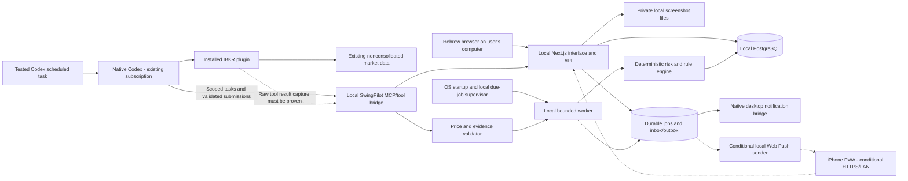
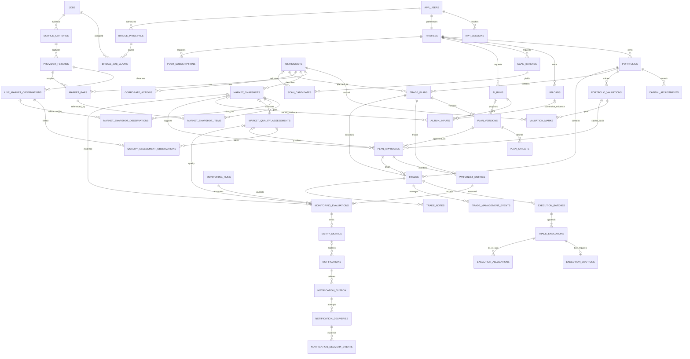
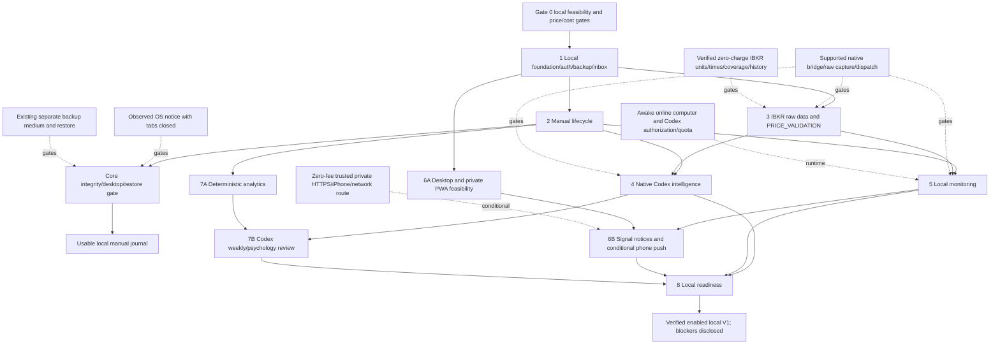

# SwingPilot AI — Complete Revised Local Implementation Plan

Revision2, updated17 October2026. **Status:v0.8 independent Phase8 local readiness diagnostics/hardening cloud-tested; actual Windows/native/device/recovery acceptance still pending. No new migration/dependency/service; backups deferred. Next milestone actual Windows/existing-gate acceptance, zero later numbered phases; full release not yet accepted.**

Windows computer + existing ChatGPT Plus/Codex subscription + existing IBKR plugin; target $0 additional service subscriptions. This does not guarantee unlimited usage, free new hardware, future data pricing or untested native/mobile integration. No paid API/credit/hosting/data fallback is authorized. Manual authentication/ledger/inbox development is delivered in PHASE2_DELIVERY.md. PHASE8_DELIVERY.md, PHASE8_WINDOWS.md and LOCAL_RUNBOOK.md describe the cumulative readiness/manual update; WINDOWS_TODO.md retains manual acceptance tasks. Offline price/calendar diagnostics do not establish market/production validation. The AAPL source discrepancy remains unresolved; native bridge/schedules/Windows desktop/iPhone tests remain unrun. See docs/reviews/PHASE0_FEASIBILITY.md and docs/PHASE0_WINDOWS.md.

This document compiles the active source specifications. Earlier hosted/API-funded vendor research is explicitly superseded and excluded from the active plan. The original requested output order was truncated after the second heading; Executive Summary and Final Technology Stack remain first, followed by all supplied topics and the new validation requirements. Refresh this compilation after source-contract changes.

1. [Executive Summary](#1-executive-summary)
2. [Final Technology Stack](#2-final-technology-stack)
3. [Complete Local System Architecture](#3-complete-local-system-architecture)
4. [Database Design and Entity Relationship Diagram](#4-database-design-and-entity-relationship-diagram)
5. [Native Codex AI System Design](#5-native-codex-ai-system-design)
6. [Complete User Experience and Trading Lifecycle](#6-complete-user-experience-and-trading-lifecycle)
7. [Local Automated Monitoring and Recovery](#7-local-automated-monitoring-and-recovery)
8. [Deterministic Risk and Financial Accounting](#8-deterministic-risk-and-financial-accounting)
9. [Eight Development Phases and Acceptance Gates](#9-eight-development-phases-and-acceptance-gates)
10. [Phase Dependencies, Parallel Work and Critical Paths](#10-phase-dependencies-parallel-work-and-critical-paths)
11. [Product Scope and Local MVP Definition](#11-product-scope-and-local-mvp-definition)
12. [Maintainable Project Structure](#12-maintainable-project-structure)
13. [Local API and Native Bridge Contracts](#13-local-api-and-native-bridge-contracts)
14. [Zero Additional Service Subscription Cost Plan](#14-zero-additional-service-subscription-cost-plan)
15. [Testing and Verification Strategy](#15-testing-and-verification-strategy)
16. [Task Backlog and Development Workflow](#16-task-backlog-and-development-workflow)
17. [Revised Decisions and Approval Boundary](#17-revised-decisions-and-approval-boundary)
18. [Price Validation and Live Data Guards](#18-price-validation-and-live-data-guards)
19. [Notification Validation and Desktop or Conditional Phone Delivery](#19-notification-validation-and-desktop-or-conditional-phone-delivery)
20. [Conversation Baseline, Evidence Status and Planning Review](#20-conversation-baseline-evidence-status-and-planning-review)

## 1. Executive Summary

Revision2, updated17 October2026. v0.8 implements the independent Phase8 local-readiness subset: read-only doctor, actual DB diagnostics, strict separate/private test config and incident/update runbooks. Cloud build/regression passes; full acceptance remains pending. No new migration/dependency/service, model/provider/native task or public exposure. Native market/data/billing/usage/dispatch, actual Windows/browser/device and user-deferred backup/restore gates remain open. PHASE8_DELIVERY/PHASE8_WINDOWS/LOCAL_RUNBOOK are current. Next milestone: Windows acceptance and existing-gate resolution; zero later numbered phases remain, with Phase8/release still incompletely accepted.

### What changes from the original plan

Replace hosted database/auth/storage/hosting, paid AI APIs and a separate EOD provider with local Next.js/Node, local PostgreSQL, private files and native Codex + plugins. A maintained local authentication integration protects journal access. Trading history retains atomic commands, owner validation/RLS, immutable approved versions, FIFO allocation, mandatory BUY emotion, partial exits and auditable corrections. Encrypted backups go to an existing separate location with a restore test.

The six existing role agents provide analysis/review through the same subscription allowance; they are not six independent usage pools. The website creates queued requests for Codex rather than silently calling a metered AI API. Native plugin access and a narrow local bridge must be tested before promising unattended button-driven analysis. No hidden credential extraction, GUI scraping, auto credits or paid fallback is included.

### Live data and22:40

The current user-provided IBKR screen shows fee-waived US real-time NON_CONSOLIDATED quotes, totalUSD0 and API access enabled. Prior read-only AAPL/JPM observations reported REALTIME with recent trade timestamps. That establishes limited current live access, not complete market coverage or future request billing. Nonconsolidated prices/volume are not full-market NBBO/consolidated totals. [IBKR pricing/coverage](https://www.interactivebrokers.com/en/pricing/market-data-pricing.php).

We observed a serious AAPL discrepancy: raw last≈3.43 against bid/ask≈343. Its cause is unresolved. The revised plan adds source/contract/units/per-field timestamp/freshness/coverage/session guards, independent reference checks, bad-price fixtures and fail-closed signal behavior. Never multiply100 without documented adapter semantics. Bid/ask observation timestamps missing from the sample must also be resolved before those fields are used for live triggers.

Both schedules remain fixed22:40 Jerusalem and official regular-session close+15minute probe. When the session is still open, valid live-compatible conditions can be evaluated; finalized daily-close conditions must wait for completed history. Post-close/weekly review needs validated historical data and finality from the existing plugin; missing history/universe blocks dependent features honestly. No paid entitlement is added to fill a gap.

### Notifications and host availability

First release delivers a persistent local inbox and a tested native Codex/OS desktop notification path. Price failures produce operational warnings without entry recommendations. Acceptance requires actual desktop display with the website closed, correct links/acknowledgment, duplicate suppression, permission failure and restart recovery. No existing notification test has passed because the app/bridge is not implemented.

Your computer must stay awake, online, in the relevant user session, with Codex and database/server/worker running and IBKR authorization/subscription usage available. Closing the website is supported; powering off/sleeping the machine is not. Native scheduling precision/raw-evidence dispatch must pass an unattended test. Quota/auth/offline failures queue/stop work and show missed/blocked status; no charges are automatically enabled. [Native scheduled tasks](https://developers.openai.com/codex/app/automations), [included plan usage](https://help.openai.com/en/articles/11369540-using-codex-with-your-chatgpt-plan).

The desired iPhone PWA/push is a later conditional zero-fee milestone: private reachability, device-trusted HTTPS, install, explicit permission and physical-device delivery tests. Local LAN alone does not provide away-from-home web access. No paid domain/tunnel/cloud provider is assumed. If this cannot be proven using existing resources, mark it blocked and keep desktop/inbox working. [WebKit prerequisites](https://webkit.org/blog/13878/web-push-for-web-apps-on-ios-and-ipados/).

### Development and review boundary

Gate0 now prioritizes native Codex/local bridge, free connector request mode, AAPL units/timestamps, calendars/scheduling and notifications. The eight phases still cover foundation, complete ledger, data/price guards, AI, monitoring, notification/mobile, insights and local release reliability. The first real journal cannot defer authorization, transaction safety, arithmetic or backup restoration.

Current status: manual-core development delivered for Windows acceptance, not complete V1 or verified recovery/uptime/native operation. WINDOWS_TODO consolidates merge, prerequisites, isolated tests, personal setup and later market/notification/spending/schedule/device gates. Existing Windows Phase 0 evidence is preserved.

## 2. Final Technology Stack

### Recommended technology decisions

| Concern | Revised choice | Boundary |
| --- | --- | --- |
| Frontend/backend | Local Next.js + TypeScript/Node | Hebrew browser UI and same-origin APIs, one modular application; loopback by default. |
| Design | Tailwind + shadcn/ui, RTL root | Preserve14 screen specifications, accessibility and bidi isolation. |
| Database | Local PostgreSQL, reviewed migrations, exact numeric ledger | No hosted database subscription. Transactions, owner composite FKs and RLS retained. |
| Authentication | Single local owner, maintained Auth.js session integration + standard Argon2id verifier | No public registration or SMTP dependency; OS-owner recovery procedure. Protect LAN access if later enabled. Codex sign-in is separate from journal login. |
| Files | Private local screenshot/evidence directory | Outside Git/webroot; owner-checked API streams/uploads, bounded file validation and encrypted backups. |
| AI | Native Codex, existing ChatGPT plan | Included allowance only; no API key, per-token fallback or auto credit spending. Model chosen from currently available compatible plan models after evaluation. |
| Market data | Existing IBKR plugin; US real-time nonconsolidated quotes | Current fee screen totalUSD0. Exact billing mode, history coverage, timestamp semantics and scaling require tests; no new entitlement purchases. |
| Charts | TradingView Lightweight Charts | Preserve attribution/license; data is supplied separately, with coverage/source labels. |
| Codex integration | Narrow local MCP/tool bridge | Gated proof of supported native-plugin access and raw tool event capture. No hidden-token copying, assumed website access to hosted connectors or GUI scraping. |
| Scheduling | Local durable queue/worker + OS supervision, coordinated with tested native Codex schedules | Two calendar-dependent due reasons; computer awake, connected and services running. Native schedule precision/dispatch is measured, not guaranteed. |
| Notifications | Durable local inbox + verified native Codex/OS desktop delivery | Website closed test required; browser page notifications alone do not satisfy it. Phone push is conditional later. |
| iPhone | Private local HTTPS PWA, later Web Push | Device-trusted certificate and network routing required; no paid domain/tunnel assumption. Remote access away from home is not promised. |
| Testing | Vitest, Playwright, real local PostgreSQL, native desktop/iPhone smoke | All tests planned. No production results fabricated. |
| Logging/backups | Local structured logs/health + encrypted export/file copy to existing separate medium | No paid monitoring/backup service. Host-down alert cannot be generated by the down host itself; show missed work on recovery. |

[Codex plan usage](https://help.openai.com/en/articles/11369540-using-codex-with-your-chatgpt-plan), [local schedules](https://developers.openai.com/codex/app/automations), [IBKR current fee/coverage rules](https://www.interactivebrokers.com/en/pricing/market-data-pricing.php), [chart attribution](https://github.com/tradingview/lightweight-charts).

## 3. Complete Local System Architecture

Updated17 October2026. Local manual applicationv0.7 is implemented/cloud-tested, with user-reported automated Windowsv0.2 evidence only. Current handoff PHASE7_DELIVERY/PHASE7_WINDOWS. Local owner-auth/SQL ledger/read models/manual review jobs are implemented; full native bridge, market/automatic/mobile/release diagrams below remain gated targets. LOCAL_WORKFLOW records Windows/existing Plus/IBKR/$0 additional service baseline. This cloud workspace is separate from the user computer; backups deferred.

### Recommended technology decisions

| Concern | Revised choice | Boundary |
| --- | --- | --- |
| Frontend/backend | Local Next.js + TypeScript/Node | Hebrew browser UI and same-origin APIs, one modular application; loopback by default. |
| Design | Tailwind + shadcn/ui, RTL root | Preserve14 screen specifications, accessibility and bidi isolation. |
| Database | Local PostgreSQL, reviewed migrations, exact numeric ledger | No hosted database subscription. Transactions, owner composite FKs and RLS retained. |
| Authentication | Single local owner, maintained Auth.js session integration + standard Argon2id verifier | No public registration or SMTP dependency; OS-owner recovery procedure. Protect LAN access if later enabled. Codex sign-in is separate from journal login. |
| Files | Private local screenshot/evidence directory | Outside Git/webroot; owner-checked API streams/uploads, bounded file validation and encrypted backups. |
| AI | Native Codex, existing ChatGPT plan | Included allowance only; no API key, per-token fallback or auto credit spending. Model chosen from currently available compatible plan models after evaluation. |
| Market data | Existing IBKR plugin; US real-time nonconsolidated quotes | Current fee screen totalUSD0. Exact billing mode, history coverage, timestamp semantics and scaling require tests; no new entitlement purchases. |
| Charts | TradingView Lightweight Charts | Preserve attribution/license; data is supplied separately, with coverage/source labels. |
| Codex integration | Narrow local MCP/tool bridge | Gated proof of supported native-plugin access and raw tool event capture. No hidden-token copying, assumed website access to hosted connectors or GUI scraping. |
| Scheduling | Local durable queue/worker + OS supervision, coordinated with tested native Codex schedules | Two calendar-dependent due reasons; computer awake, connected and services running. Native schedule precision/dispatch is measured, not guaranteed. |
| Notifications | Durable local inbox + verified native Codex/OS desktop delivery | Website closed test required; browser page notifications alone do not satisfy it. Phone push is conditional later. |
| iPhone | Private local HTTPS PWA, later Web Push | Device-trusted certificate and network routing required; no paid domain/tunnel assumption. Remote access away from home is not promised. |
| Testing | Vitest, Playwright, real local PostgreSQL, native desktop/iPhone smoke | All tests planned. No production results fabricated. |
| Logging/backups | Local structured logs/health + encrypted export/file copy to existing separate medium | No paid monitoring/backup service. Host-down alert cannot be generated by the down host itself; show missed work on recovery. |

[Codex plan usage](https://help.openai.com/en/articles/11369540-using-codex-with-your-chatgpt-plan), [local schedules](https://developers.openai.com/codex/app/automations), [IBKR current fee/coverage rules](https://www.interactivebrokers.com/en/pricing/market-data-pricing.php), [chart attribution](https://github.com/tradingview/lightweight-charts).

### Components and trust boundaries



The diagram is a design, not evidence that the dotted integrations work. The local worker has no installed-plugin credentials. Native Codex can use its authorized IBKR tools; a supported bridge must capture original provider output and submit it to strict local validation. A model's retyped numbers are not authoritative provider evidence. Gate0 checks that boundary before promising automated scanning. If raw capture or unattended native dispatch is unavailable, mark dependent automation blocked and allow explicit reviewed source import/manual Codex analysis; never substitute a paid API without a user-authorized plan change.

The website records `AWAITING_CODEX` work and shows queued state. A user or a tested native scheduled task lets Codex claim the job through narrow tools. Codex obtains authorized images/journal projections and generates a draft/assessment. Local schemas and deterministic validators decide what can be saved. Only UI-owner commands approve plans, record fills/emotions, change stops and correct a ledger. The bridge has no brokerage-order or ledger-execution tool. Separate analysis consent minimizes sensitive journal text.

Raw market observations are authenticated to the local bridge, hash-bound to the claimed job, source transcript/tool event ID and contract. Store received time separately from source observation time; signatures/hashes prove transfer integrity, not genuine market accuracy alone. A fresh `REALTIME` flag with contradictory units is quarantined. Snapshot receipt does not turn nonconsolidated bid/ask into NBBO or partial volume into full-market volume.

### Repository layout (proposed application folders)

```text
.codex/agents/                 existing six role definitions
AGENTS.md                     working instructions
docs/                         revised specifications and evidence
src/
  app/(auth)/                 local login/recovery help
  app/(app)/                  dashboard/scanner/research/plans/watchlist,
                              positions/journal/analytics/settings
  app/api/                    owner-authenticated local HTTP contracts
  components/ui/              RTL/accessibility primitives
  components/trading/         charts, forms, provenance, job states
  domain/trading/             state transitions and plan validation
  domain/risk/                exact-decimal prospective calculations
  domain/indicators/          versioned history calculations
  domain/monitoring/          interval-compatible predicate evaluation
  domain/data-quality/        units, timestamps, coverage and price guards
  application/                use cases, jobs and transaction orchestration
  contracts/                  strict payload schemas/errors/DSL
  ports/                      data/DB/jobs/notifications/Codex interfaces
  infrastructure/database/    local Postgres clients and repositories
  infrastructure/auth/        maintained session/password integration
  infrastructure/codex/       gated native task/bridge integration
  infrastructure/market-data/ IBKR tool evidence normalization
  infrastructure/files/       private upload/download controls
  infrastructure/notifications/ desktop bridge and optional Web Push
local/
  migrations/                 SQL schema/RLS/transaction commands
  workers/                    due-job queue, validation and outbox delivery
  bridge/                     narrowly scoped local MCP tools
  fixtures/                   synthetic tests, excluded from production
public/                       static assets/optional PWA manifest
config/                       schemas, no secrets
scripts/                      OS startup, health, encrypted backup/restore
  tests/unit/ integration/ contracts/ e2e/ scheduler/ security/ fixtures/
```

Financial dependency direction remains routes/components → application → domain + ports; infrastructure implements ports, composition roots wire it. Domain has no database/framework/AI imports. PostgreSQL numeric commands own authoritative FIFO/cash/ledger replay under locks. TypeScript handles prospective risk, price validation, indicators and predicates; both follow versioned contracts and independent golden fixtures. File storage, local sessions and bridge transports never leak into financial arithmetic. Import-boundary checks prevent client bundles from containing bridge or database credentials.

### Local operations and reliability

Install on the user's computer only after implementation approval and host capability check (OS, RAM, disk, installed runtime, safe autostart). No cloud instance is assumed to remain free indefinitely. Prefer native Postgres/Node install; optional containers must pass local resource/license checks and are not required merely for this plan.

Start database/server/worker automatically under an OS user service. Native Codex desktop must be running in the correct logged-in user session; an OS service cannot assume it can launch authorized desktop work before login. Disable sleep during agreed monitoring hours, retain locked-screen operation only after testing, keep internet and adequate disk space. Sleep/reboot/auth expiry/quota failure creates auditable missed/blocked states. Catch up with fresh data, not historic entry claims. Site closure is supported; full-machine shutdown is not.

Loopback endpoints reject unknown origins. Later LAN access requires authenticated HTTPS, firewall allowlisting and device trust, not public Postgres or an internet-exposed local API. Use standard sessions, Argon2id, CSRF/origin checks, expiry, secure-cookie policy for HTTPS, owner-safe references and redacted logs. Explicit cookie configuration for loopback development must not accidentally become LAN production settings. Back up DB and private files separately with restore tests.

### Zero-service-cost capability gates

G0-L1 native Codex → local bridge and included-usage-only policy; G0-L2 existing IBKR connector data/billing/history rights; G0-L3 raw price timestamp/scale/coverage validation; G0-L4 independent schedules and closed page recovery; G0-L5 native desktop alerts; G0-L6 optional iPhone HTTPS/push. Refer to [VALIDATION_STATUS.md](VALIDATION_STATUS.md), [PRICE_VALIDATION.md](PRICE_VALIDATION.md) and [NOTIFICATIONS.md](NOTIFICATIONS.md). Limited prior read-only quotes and the user-reported fee screen are evidence; the integration gates are still unrun. New subscriptions and paid fallback paths are outside approved scope.

### Implemented Phase8 diagnostics and configuration boundary

The authenticated readiness page uses existing separate restricted auth/app pools for catalog/settings reads. The web process still receives no migration URL. Localdoctor explicitly loads the existing private settings, validates role/host/port/database separation and filesystem location/modes, and opens bounded READ ONLY transactions for migration/runtime/auth diagnostics. Outputs contain only safe version/code/status metadata. No new daemon/worker/service/provider/model request or financial mutation exists.

Readiness and external acceptance are separate: a local catalog PASS cannot verify billing, quota, actual native schedules, desktop receipt, phone or deferred restore. WindowsACLs remain manual even after doctor exit2. Test launcher cannot fall back to inherited personal settings. Resolved private storage roots remain outside project/OneDrive. No migration/dependency change in0.8; full Phase8/release acceptance remains pending. LOCAL_RUNBOOK and PHASE8_WINDOWS own installation/update/incident handoff.

## 4. Database Design and Entity Relationship Diagram

Status: v0.7 implemented local auth/manual SQL ledger plus separate manual plan/weekly reviews, inactive schedule rehearsals and synthetic desktop tests. New0007 adds analytics read indexes/function and owner-scoped immutable weekly review jobs/commands/events; delivered0001–0006 unchanged. Full market/native AI entities below remain proposed. PHASE7_DELIVERY gives exact implemented scope; actual Windows/native/backup acceptance remains open.

V1 assumptions: one local authenticated owner, one USD portfolio, NYSE/Nasdaq stocks, long positions, manual brokerage execution and integer shares. Existing IBKR read-only plugin observations through native Codex are the proposed LIVE/EOD data source; every usable observation must pass explicit price/coverage/provenance gates. Native plugin/bridge automation is UNRUN; manual user-reviewed import is the fallback and does not establish automatic monitoring. Future ownership/portfolio extensibility must not expose licensed account evidence. Financial calculations follow [RISK_ENGINE.md](RISK_ENGINE.md); AI/provenance follow [AI_SYSTEM.md](AI_SYSTEM.md).

### Implemented v0.4 addition

Forward migration0004 adds `codex_review_jobs`, `codex_review_commands` and `codex_review_events`, with forced owner RLS/composite owner FKs and SELECT-only runtime grants plus bounded `codex_review_command`. Jobs pin immutable JSON manual-plan facts and SHA-256 of PostgreSQL JSONB text, plan/version/policy revisions and an owner journal-command count (excluding notification-read acknowledgments). This command count is monotonic under append-only financial commands and the shared owner lock; it does not change financial tables. Responses are manual unverified text, structurally bound to the job/hash and allowlisted fact IDs. Jobs/events never imply authenticated model origin, market evidence or approval. Existing0001–0003 remain unchanged. JSON journal export currently excludes review history; see PHASE4_DELIVERY for scope and limitations.

### Implemented v0.5 addition

Forward0005 adds monitoring_scenarios, monitoring_rehearsal_runs, monitoring_rehearsal_events and monitoring_rehearsal_commands. These are owner-scoped **manual rehearsals**, not production exchange sessions/worker jobs/signals. A scenario revision preserves manual date/status/close/source note; OPEN computes two immutable due/deadline timestamps in PostgreSQL IANA zones, CLOSED has none. UNIQUE(owner/scenario/reason), partial current-date uniqueness, forced RLS and a bounded command implement idempotency/correction/cancellation/reconciliation. App runtime has SELECT only plus command execution. No financial/review table is changed; no signal/inbox writer or activation exists. Existing0001–0004 remain unchanged. Journal export excludes rehearsal history and is not backup; details in PHASE5_DELIVERY.

### Implemented v0.6 desktop-test addition

Forward0006 adds desktop_test_preferences, desktop_delivery_tests/attempts/events/commands with forced owner RLS and bounded delivery_command. Default-off TEST-only outbox has ten-minute expiry,60-second fencing lease, three explicit known-failure attempts and UNKNOWN handling. Preferences/cancel fence DB completion but cannot atomically recall an external send. Six-digit receipt is hashed with test identity; code, receipt hash and lease token are excluded from owner web DTOs. Wrong receipt counts commit persistently and lock after5; accepted-by-sender and human-reported receipt/context are separate. No financial/review/monitoring mutation; existing0001–0005 unchanged. Existing journal JSON export excludes this auxiliary history and is not backup. Actual Windows proof remains unrun; see PHASE6_DELIVERY.

### 1. Shared conventions

| Concern | Proposed convention |
| --- | --- |
| Identity | UUID primary keys. `owner_id` references local `app_users.id` on every private record. `profiles.id` is that same user ID. Ownership comes from verified local sessions or explicitly owner-scoped service capabilities, never browser/model payloads. |
| Owner-safe references | Private parent tables expose a unique `(owner_id, id)` key. Every private child reference uses a composite foreign key `(owner_id, parent_id) → parent(owner_id, id)`. This applies to plans, versions, approvals, portfolios, trades, executions, uploads, scans, AI runs, evaluations and notifications. An ID-only FK is insufficient even with RLS. |
| Common record fields | Unless described otherwise: `id`, `owner_id` for private rows, `created_at`, and a stable UTC creation timestamp assigned by the database. Mutable aggregates also have `updated_at` and integer `row_version` for optimistic concurrency. Immutable records have no mutable business columns. |
| Financial values | Fixed-decimal `numeric(20,8)` prices, cash amounts and fees; exact decimal operations in the domain engine. Serialize decimals as strings at the API boundary. Final currency presentation is rounded to cents under a documented rounding policy. V1 quantities are positive integer shares within the JavaScript safe-integer range. Ratios are exact decimals internally, rounded only for display. |
| Currency | ISO currency code; `USD` only in V1, checked on portfolios, plans and executions. No implicit FX conversion. |
| Time | `timestamptz` for instants; `date` for exchange sessions. `trading_date` means the US exchange session date in `America/New_York`, not a browser-local date. The scheduled user-facing check uses `Asia/Jerusalem`. |
| JSON | Versioned, strictly validated objects for bounded entry/invalidation conditions, policy snapshots, AI structured output and evidence manifests. JSON never contains executable SQL, JavaScript or arbitrary expressions. Scalar data needed for joins, constraints or accounting uses typed columns. |
| Deletion | Archived plans and superseded versions remain queryable. No cascading delete from a plan into actual trade history. Account deletion is an explicit privileged erasure workflow with a documented backup expiry window. Ordinary clients cannot hard-delete ledger or approval evidence. |
| Schema evolution | Forward migrations, compatibility checks and a schema version on external/AI contracts. Immutable records retain the policy/calculation version used when created. |
| Ownership vs shared facts | Public instrument/calendar metadata can be shared read-only. IBKR captures, observations, bars, corporate-action evidence, snapshots and quality assessments are owner-scoped because source access/entitlements belong to that local account. They cannot become an unrestricted shared cache. |

### 2. Foundation, portfolio and cash records

#### `app_users` — local owner identity

- **Fields:** `id` PK; normalized `login_name`; `password_hash` produced by a maintained Argon2id library; `password_changed_at`; `session_epoch`; `state` (`ACTIVE`, `DISABLED`); `created_at`; `updated_at`.
- **Rules:** one enabled local owner at launch; no public signup or SMTP reset service. The password hash is inaccessible to browser/MCP reads and general logs. Auth.js owns supported session-cookie mechanics; do not implement cryptography. Account recovery requires a verified local OS-owner procedure that rotates the session epoch. Never store Codex/IBKR passwords, hidden tokens or cookies.
- **Indexes:** PK and unique normalized login name. Login attempts are rate-limited independently of bridge/worker traffic.

#### `app_sessions` — local session revocation evidence

- **Fields:** `id`; `owner_id`; `session_identifier_hash`; `session_epoch`; `issued_at`; `expires_at`; `last_seen_at`; `revoked_at`; minimally retained `device_label`.
- **Rules:** choose and prove a supported Auth.js password/session integration in Phase 1. This registry can provide server-side revocation for library-managed encrypted/signed sessions; it is not a claim that every Credentials-provider/database-adapter combination is supported. Store no raw bearer cookie. The session must match an enabled local owner and current epoch. Logout/recovery revoke sessions; credentials and this registry are inaccessible to the model bridge.
- **Indexes:** unique session hash; `(owner_id, revoked_at, expires_at)`; PK/owner candidate key.

#### `profiles` — account preferences

- **Fields:** `id` PK/FK to `app_users`; `display_name`; `locale` (Hebrew default); `timezone` (`Asia/Jerusalem` default); `notification_preferences`; `onboarding_completed_at`; `preferences_schema_version`; `created_at`; `updated_at`; `row_version`.
- **Rules:** validate locale/timezone and notification preference shape. Authentication credentials stay in the local auth boundary; no password or provider secret columns here.
- **Indexes:** PK; no unneeded index on low-cardinality locale.

#### `portfolios` — configurable capital and risk policy

- **Fields:** common private/mutable fields; `name`; `currency`; `opening_cash`; `opening_cash_at`; `risk_per_trade_fraction`; `max_position_fraction`; `max_total_exposure_fraction`; `max_sector_fraction`; fixed-USD `cash_buffer`; `policy_version`; `is_default`; `archived_at`.
- **Rules:** cash values are nonnegative at initialization; risk fractions are within permitted domain ranges, risk per trade strictly positive; limits are validated together. Unique owner/default portfolio. V1 permits one nonarchived portfolio per account through the domain rule. Do not edit opening cash after executions exist; use an adjustment.
- **Indexes:** `(owner_id, archived_at)`; unique `(owner_id, id)`; uniqueness for the one default active portfolio.
- **Capital meaning:** portfolio equity is cash plus marked holdings. Risk policy snapshots preserve the equity, valuation freshness, capital basis and buying power used for each approval. Settings do not silently rewrite historical sizing. V1 reserve is the fixed USD cash buffer and pending-order reservations are zero because this manual journal creates no broker orders. Percentage reserves/pending-order reservation rows are later additions.

#### `capital_adjustments` — append-only manual cash events and corrections

- **Fields:** common private immutable fields; `portfolio_id`; `kind` (`DEPOSIT`, `WITHDRAWAL`, `DIVIDEND`, `ACCOUNT_FEE`, `TAX`, `REVERSAL`); `flow_class` (`EXTERNAL`, `INTERNAL`); signed nonzero `amount`; `effective_at`; optional `instrument_id`/owner-safe `trade_id`; `reason`; `reverses_adjustment_id` when reversing; `command_id`.
- **Rules:** deposits/dividends have positive cash delta; withdrawals/account fees/taxes negative. Deposits/withdrawals are `EXTERNAL`; dividends/fees/taxes are `INTERNAL`. A reversal carries the exact opposite delta and same flow class of its referenced original event. Reference the owner's portfolio/trade; at most one reversal per original adjustment; never modify an existing cash event. A correction is a reversal plus replacement in one transaction. An actual cash event causing negative available cash requires reconciliation and explicit acknowledgment; it must not conceal an already executed transfer. Only external flows create/destroy performance units; internal events affect return. Separate cash dividends/taxes are not silently added to trade price P&L.
- **Indexes:** `(owner_id, portfolio_id, effective_at, id)`; unique reversal target and command deduplication.
- **Cash projection:** opening cash + effective signed cash events − buy cost − buy fees + sell proceeds − sell fees. Execution fees are already in fills and cannot be duplicated as an account-fee event. No fabricated broker cash balance. The UI states that this is a manual ledger, potentially different from the broker.

#### `portfolio_valuations` — immutable dated portfolio valuation evidence

- **Fields:** common private immutable fields; `portfolio_id`; `as_of`; `captured_portfolio_row_version`; `cash_amount`; `cash_projection_hash`; `coverage_status` (`COMPLETE`, `PARTIAL`, `UNPRICED`); `source_mode` (`MANUAL`, `LIVE`, `EOD`, `MIXED`); `equity_amount` nullable unless complete; `policy_version`; `calculation_engine_version`; `snapshot_hash`; `user_acknowledged_limitations`.
- **Rules:** capture cash and the exact holding ledger revisions under a consistent portfolio read/lock. Complete coverage means every open holding has a compatible mark and quantity from that captured revision; stale/manual marks stay visibly classified even when numerically complete. An unpriced holding makes total equity unavailable rather than silently zero. A prospective risk approval cannot use a valuation invalidated by a concurrent fill or undisclosed missing holding.
- **Indexes:** `(owner_id, portfolio_id, as_of DESC, created_at DESC)`; owner-safe `(owner_id, id)` key.
- **MVP policy:** user-entered dated marks support journal-only portfolio sizing/analytics before a provider is available. They are explicitly self-reported, not market-verified, and never usable as monitoring evidence.

#### `valuation_marks` — private mark evidence within a valuation snapshot

- **Fields:** common private immutable fields; `portfolio_valuation_id`; `instrument_id`; optional `trade_id`; `kind` (`HOLDING`, `PROPOSED_ENTRY`); `quantity`; `trade_ledger_revision` where applicable; `price` nullable only if unpriced; `source` (`MANUAL`, `LIVE`, `EOD`); `source_as_of`; optional owner-safe `market_snapshot_id`/`live_observation_id`/`quality_assessment_id`; `quality_flags`; `user_note`.
- **Rules:** unique instrument/kind per owner valuation. A holding mark references the same portfolio's owner-scoped trade with its exact positive open quantity/revision. A proposed-entry mark can have zero quantity and no held trade. Positive price when present; EOD/LIVE marks require compatible owner-safe evidence and passing quality gates, while MANUAL forbids claiming verified provider evidence. Each manual mark includes explicit user observation time. Unknown/stale prices produce documented valuation/risk limitations. LAST/BID/ASK valuations retain their field type; do not silently use bid or ask as a last trade.
- **Indexes:** `(owner_id, portfolio_valuation_id)`; trade/evidence reverse-reference indexes.

### 3. Instruments and market evidence

#### `instruments` — validated listing identity

- **Fields:** `id` PK; `canonical_symbol`; `exchange_mic` (`XNYS`, `XNAS`); `name`; `asset_type`; `currency`; `sector`; `listing_status`; `valid_from`; `valid_to`; `provider_symbol_mappings`; `last_validated_at`; `validation_source`; `metadata_revision`. Owner-entitled IBKR contract resolution is recorded in the capture/observation evidence rather than exposing an account response as public metadata.
- **Rules:** only supported active US-listed stocks pass V1 validation. Maintain a stable instrument ID across symbol changes; ticker reuse must not attach a new company to an old trade. Canonicalization handles provider formats such as periods vs hyphens. Preserve delisted instruments for old journals.
- **Indexes:** current valid `(canonical_symbol, exchange_mic)` uniqueness; symbol search; `(listing_status, exchange_mic)`.

#### `exchange_sessions` — authoritative session schedule

- **Fields:** `exchange_mic`; `trading_date`; `is_open`; `open_at`; `close_at`; `is_early_close`; `calendar_source`; `calendar_version`; `fetched_at`; `verified_at`.
- **Keys/rules:** composite PK `(exchange_mic, trading_date)`; both opening/closing times present for open sessions and `close_at > open_at`; calendar updates are versioned/audited. A holiday has no invented close timestamp.
- **Indexes:** `(close_at)` for dispatch; `(trading_date, is_open)`.

#### `provider_fetches` — provider response provenance

- **Fields:** common private immutable fields; `provider` (`IBKR` initially); `source_capture_id`; `endpoint_kind`; `request_fingerprint`; `instrument_id` nullable for batch requests; `requested_session`; `started_at`; `completed_at`; `status`; `entitlement_class`; `coverage_class`; `billing_assurance` (`VERIFIED_INCLUDED`, `UNVERIFIED`, `PROHIBITED`); `freshness_class` (`EOD`, `DELAYED`, `LIVE`, `UNKNOWN`); `rate_limit_retry_at`; `content_hash`; `error_code`; local private `raw_object_key`; `retention_expires_at`.
- **Rules:** only verified supported read-only native IBKR tools are candidates for capture. Exact tool envelopes are transported independently of the model's typed narrative; a model-retyped quote is not provider evidence. Preserve raw values/units/times alongside a sanitized allowed envelope, without account/login identifiers or credentials. No API key/client-login is copied from Codex. Unknown connector request charges block bulk automatic calls; paid regulatory snapshots/subscription/billing mutations are prohibited. Cache reuse preserves the original source observation age.
- **Indexes:** `(owner_id, provider, request_fingerprint, completed_at)`; `(owner_id, status, completed_at)`; source capture FK.

#### `source_captures` — exact native tool result or explicit manual import

- **Fields:** common private immutable fields; `job_id`; optional `bridge_principal_id`; `capture_origin` (`NATIVE_TOOL_EVENT`, `USER_REVIEWED_IMPORT`); `provenance_status` (`VERIFIED_NATIVE_CAPTURE`, `USER_REVIEWED_IMPORT`, `UNVERIFIED`); `native_tool_call_id`; `plugin_namespace`; `tool_name`; `tool_version` where observable; `captured_at`; `raw_object_key`; `raw_sha256`; `content_type`; `capture_transport_version`; `verification_gate_id`; `verification_results`; `user_reviewed_at` nullable.
- **Rules:** only a proven supported native tool-event transport may assign `VERIFIED_NATIVE_CAPTURE`; an AI-authored JSON declaration or hash does not authenticate its claimed source. Exact evidence is stored owner-private outside repository/webroot. Manual import records its actual origin and review; it never impersonates native automation or repairs missing field timestamps. A rejected/unverifiable capture remains diagnostic evidence and cannot generate a live signal.
- **Indexes:** `(owner_id, job_id, captured_at)`; unique native event identity within owner/plugin namespace when present; content hash lookup.

#### `live_market_observations` — field-level quote evidence

- **Fields:** common private immutable fields; `instrument_id`; `provider_fetch_id`; `source_capture_id`; `contract_id`; `symbol_as_returned`; `currency`; `security_type`; `field_kind` (`LAST`, `BID`, `ASK`); `raw_value`; `raw_unit`; nullable exact `normalized_price`; `normalization_rule_version`; `observed_at` nullable; `timestamp_provenance`; `received_at`; `session_kind` (`REGULAR`, `PREMARKET`, `AFTERHOURS`, `CLOSED`, `UNKNOWN`); `trading_date`; `freshness_class`; `coverage_class` (`NON_CONSOLIDATED`, `CONSOLIDATED`, `UNKNOWN`); `venue_scope`; `source_flags`; `payload_path`; `content_hash`.
- **Rules:** one record per source field with its own source time; capture/receive time is never substituted for missing LAST/BID/ASK observation time. Preserve LAST ≈ 3.43 versus BID/ASK ≈ 343 exactly as an unresolved scale/serialization anomaly. Do not heuristically multiply by 100. A normalization rule requires documented units and independent compatible timestamped reference evidence, approved/versioned through the quality gate. Contract/currency/session mismatch blocks use. NON_CONSOLIDATED is never labeled NBBO or consolidated volume.
- **Indexes:** `(owner_id, instrument_id, field_kind, observed_at DESC)`; source capture/contract lookup; unique source capture/field payload path.

#### `market_quality_assessments` — immutable eligibility gate results

- **Fields:** common private immutable fields; typed owner-safe `provider_fetch_id`, `market_snapshot_id` and/or `observation_ids` through typed child membership; `policy_version`; `assessed_at`; `requested_mode` (`LIVE_QUOTE`, `REGULAR_SESSION_EOD`); `outcome` (`PASS`, `BLOCKED`, `REVIEW_REQUIRED`); `rejection_codes`; `checks`; `reference_evidence`; `eligible_predicates`; `expires_at`.
- **Rules:** assess raw provenance, identity, USD units/scale, each field timestamp/freshness, spread/price coherence, feed coverage, interval/session finality and required history/adjustments. Example rejection codes: `SOURCE_UNVERIFIED`, `UNIT_SCALE_UNRESOLVED`, `OBSERVATION_TIME_MISSING`, `OBSERVATION_TIME_INVALID`, `QUOTE_CONFLICT`, `INTERVAL_UNSUPPORTED`, `PRICE_STALE`, `CONTRACT_MISMATCH`, `COVERAGE_UNSUPPORTED`, `HISTORY_UNAVAILABLE`, `SESSION_INCOMPATIBLE`, `PUBLICATION_PENDING`. A PASS is purpose-specific and expires; last-price eligibility does not imply volume/EOD eligibility. Quality logic is deterministic and outside model control.
- **Indexes:** `(owner_id, assessed_at DESC)`; evidence reverse references; outcome/expiry worker index.
- **Membership:** a small `quality_assessment_observations` child holds `(owner_id, assessment_id, observation_id)` PK/FKs instead of relying on unvalidated IDs in JSON. Reference captures/snapshots used for comparisons also require typed owner-safe links or an enforced owner-validated evidence manifest. All historical assessments are preserved when a policy/evidence revision changes.

#### `market_bars` — append-only revisions of historical candles

- **Fields:** common private immutable fields; `instrument_id`; `provider`; `provider_fetch_id`; `timeframe`; `trading_date`; `bar_start_at`; `bar_end_at`; `open`; `high`; `low`; `close`; `volume` nullable when unavailable; `coverage_class`; `session_kind`; `adjustment_basis` (`RAW`, `SPLIT_ADJUSTED`, `TOTAL_RETURN`, `UNKNOWN`); `is_final`; `revision_no`; `source_as_of`; `fetched_at`; `content_hash`.
- **Rules:** positive OHLC, nonnegative volume when available, low ≤ open/close ≤ high, start < end. Unique `(owner_id, instrument_id, provider, timeframe, trading_date, session_kind, coverage_class, adjustment_basis, revision_no)` for daily bars. Corrected provider data creates a new revision; approvals and prior analyses keep references to their original evidence. Never mix adjustment/coverage/session bases inside one indicator series.
- **Indexes:** `(owner_id, instrument_id, provider, timeframe, adjustment_basis, trading_date DESC, revision_no DESC)`; `(owner_id, provider_fetch_id)`. Revision uniqueness also includes owner/session/coverage so unlike series cannot collide.
- **Current-series projection:** a query/view selects the latest valid revision. It is replaceable cache behavior, not a mutation of historical analysis inputs.
- **Availability:** historical endpoints/lookback/adjustment and venue-volume coverage are capability gates, not assumed from a successful live quote. Missing history disables dependent indicators/EOD rules. A partial quote is not a completed daily candle and a current quote before close cannot satisfy a finalized close predicate.

#### `corporate_actions` — evidence of splits and other material changes

- **Fields:** common private immutable fields; `instrument_id`; `provider`; `provider_fetch_id`; `action_type`; `effective_session`; `ratio_numerator`; `ratio_denominator`; `cash_amount` where applicable; `provider_action_id`; `source_as_of`; `revision_no`; `content_hash`.
- **Rules:** unique source action revision; valid positive split ratio. Action detection sets affected position/data reconciliation to `REVIEW_REQUIRED` until supported reconciliation is completed. V1 must not silently adjust recorded broker executions. Reverse splits creating fractional entitlements, cash in lieu, dividends and unsupported actions require explicit reconciliation before affected analytics or alerts are trusted.
- **Indexes:** `(owner_id, instrument_id, effective_session)`; unique `(owner_id, provider, provider_action_id, revision_no)`.
- **V1 limit:** build detection and blocking behavior; a complete corporate-action ledger is a later feature. A real action cannot be treated as a normal new BUY/SELL or hidden by changing prices.

#### `market_snapshots` and `market_snapshot_items` — reproducible analysis inputs

- **Snapshot fields:** common private immutable fields; `instrument_id`; `provider`; `provider_fetch_id`; `snapshot_kind`; `condition_basis` (`LIVE_QUOTE`, `REGULAR_SESSION_EOD`); `trading_date`; `as_of`; `fetched_at`; `freshness_class`; `coverage_class`; `publication_status`; `adjustment_basis`; `indicator_engine_version`; `indicator_values`; `fundamental_values` only if available/licensed; `data_quality_flags`; `series_hash`; `snapshot_hash`; `retention_expires_at`.
- **Item fields:** `owner_id`; `snapshot_id`; `bar_id`; `ordinal`; PK `(owner_id, snapshot_id, ordinal)` with unique `(owner_id, snapshot_id, bar_id)`. `market_snapshot_observations` has `owner_id`, `snapshot_id`, `observation_id`, `ordinal`, composite owner-safe FKs and a PK/unique ordinal; it pins exact typed quote observations for LIVE snapshots.
- **Rules:** snapshots and their ordered membership are immutable. All referenced bars belong to the same instrument/provider/timeframe/basis expected by the snapshot. Indicators include definitions and lookback availability; missing input yields missing output. Facts must distinguish provider observation times from acquisition times. Final EOD readiness requires the exact eligible session's finalized bar, not merely a successful HTTP response.
- **Indexes:** `(owner_id, instrument_id, provider, trading_date DESC, snapshot_kind)`; owner/snapshot hash; bar/observation reverse references for retention checks.
- **Reproducibility:** retain exact referenced bars and a compact value manifest while a plan/trade/AI run depends on them, subject to provider licensing. If licensing prevents durable evidence retention, preserve allowed derived values/hashes and record the limitation; never claim a hash alone can reconstruct unavailable prices.
- **Quality linkage:** quality assessments reference a snapshot; downstream approval/evaluation/signal records pin the applicable assessment. Reassessing an old snapshot does not mutate it or rewrite an earlier result.

### 4. Uploads, screening and AI provenance

#### `uploads` — authenticated local screenshot metadata

- **Fields:** common private fields; `object_key`; `mime_type`; `byte_size`; `width`; `height`; `sha256`; `state` (`AWAITING_UPLOAD`, `VALIDATING`, `READY`, `REJECTED`, `DELETED`); `expires_at`; `rejection_code`; `deleted_at`.
- **Rules:** only permitted raster formats, size/pixel limits, actual file-type validation and metadata stripping. Random logical object IDs resolve server-side to files under the owner-private application data directory outside repository/webroot. Reject traversal/symlink escapes and unauthorized file IDs. No arbitrary client/model path or public URL. Authenticated object-specific downloads are the default; any native screenshot transfer is scoped to the assigned bridge job. A screenshot is not executable content. Uncompleted upload intents expire.
- **Indexes:** `(owner_id, created_at DESC)`; `(state, expires_at)`; optional owner/hash index for duplicate warnings.

#### `scan_batches` — one weekly research/scanner request

- **Fields:** common private/mutable fields; `portfolio_id`; `job_id`; `requested_session`; `status`; `screening_policy_version`; `requested_extra_count` (five by default); `confirmed_tickers`; `universe_evidence`; `exclude_instrument_ids`; `screened_count`; `eligible_count`; `completion_reason`; `completed_at`.
- **Rules:** preserve which ticker set the user confirmed, the supported universe and coverage used, liquidity/price filters and reasons fewer than five additional candidates qualified. Missing free history/sector/universe capability disables dependent filters/modules and returns honest shortages. No exhaustive US grouped-screen promise or padding with invented candidates. State is a projection of durable job progress.
- **Indexes:** `(owner_id, created_at DESC)`; `(owner_id, status)`.

#### `scan_candidates` — extracted and discovered candidates

- **Fields:** common private fields; `scan_batch_id`; `instrument_id` nullable until validated; `source` (`SCREENSHOT`, `USER`, `QUANT_DISCOVERY`); `raw_ticker`; `canonical_ticker`; `recognition_confidence`; `validation_status`; `confirmation_status`; `rank`; `screen_score`; `feature_values`; `screening_reasons`; `exclusion_reasons`; `market_snapshot_id`; `extraction_ai_run_id`; `research_ai_run_id`.
- **Rules:** extraction confidence expresses OCR uncertainty, never investment probability. Unconfirmed/invalid symbols cannot enter analysis. Unique confirmed instrument within a batch; discovered candidates exclude screenshot/user candidates, holdings and exclusions as specified in the screening policy.
- **Indexes:** `(owner_id, scan_batch_id, source, rank)`; owner/instrument history.

#### `ai_runs` — immutable request/output audit with a mutable job state projection

- **Fields:** common private fields; `job_id`; `module`; `execution_backend` (`NATIVE_CODEX`, `USER_REVIEWED_IMPORT`); `bridge_principal_id` nullable; `native_run_reference` when supported; `model`/`model_revision` only when observable; `prompt_version`; `prompt_hash`; `output_schema_version`; `policy_version`; `input_manifest_hash`; `status`; `started_at`; `completed_at`; `request_id`; `submission_hash`; `validated_output`; `validation_results`; `refusal_reason`; `error_code`; observable included-usage state (`AVAILABLE`, `LIMIT_REACHED`, `UNKNOWN`); `image_count`; `cache_key`; `cache_source_run_id`; `retention_expires_at`.
- **Rules:** the app stores a request awaiting native Codex; it does not call a model HTTP API. Identity, prompt/input evidence and successful output become immutable after finalization. Successful bridge submissions pass strict local schema/domain/evidence validation; failed output cannot become an approved plan. Never purchase credits, enable overage, configure model API keys or use a token-billed fallback. Unknown/exhausted included usage queues/blocks work rather than inventing quota counters. Store required reproducibility information without exposing private raw prompts in logs or internal model chain of thought. Cached results preserve original creation time/data age. Manual user-reviewed output import is explicitly marked and cannot establish automatic plugin transport.
- **Indexes:** `(owner_id, module, created_at DESC)`; `(owner_id, job_id)`; `(owner_id, cache_key)`; `(status, created_at)` for operational use.

#### `ai_run_inputs` — exact inputs consumed by an AI run

- **Fields:** common private immutable fields; `ai_run_id`; `ordinal`; `input_kind`; one of `upload_id`, `source_capture_id`, `market_snapshot_id`, `live_observation_id`, `quality_assessment_id`, `plan_version_id`, `trade_id`, `scan_batch_id`, or `journal_manifest`; `content_hash`; `captured_at`; `redaction_policy_version`; `trade_ledger_revision` where relevant.
- **Rules:** exactly one typed source per row; every private FK includes owner. A journal manifest contains an immutable minimal projection of actual trades, fee/lot calculation version, selected necessary emotions and date range consumed; its source IDs are validated. A trade input includes an immutable holdings/ledger projection at the recorded revision, not a future mutable state. Market snapshots/captures/observations/assessments are owner-private read-only inputs. The bridge returns only the minimum assigned job input, not unrestricted portfolio, auth or file access.
- **Indexes:** unique `(owner_id, ai_run_id, ordinal)`; indexes on each private source FK where deletion/retention or retrieval needs them.
- **Mutation boundary:** AI runs may propose a new draft version or persist an assessment. They do not approve plans, record executions, change stops, or deliver a brokerage order.

#### `bridge_principals` and `bridge_job_claims` — narrow native Codex capability

- **Principal fields:** common private/mutable fields; `name`; `transport_kind`; optional locally issued `capability_hash`; `allowed_scopes`; `capability_gate_status`; `created_at`; `expires_at`; `revoked_at`.
- **Claim fields:** common private fields; `job_id`; `bridge_principal_id`; `claim_nonce_hash`; `lease_version`; `claimed_at`; `expires_at`; `completed_at`; `captured_input_hash`; `result_submission_hash`.
- **Rules:** Gate G0-L1 must prove a supported native Codex-to-local bridge transport and raw native tool-event capture; until then mark capability `UNRUN`/`BLOCKED` and use a user-reviewed import workflow. If supported, owner grants a narrowly scoped locally generated capability, never a copied Codex/IBKR token/cookie. Available scopes are assigned-job listing/claiming, minimal input reads, allowed evidence submission, draft/assessment submission and job-status reporting. No SQL executor, arbitrary filesystem reader, plan approval, journal BUY/SELL, stop mutation, broker order, subscription or billing tool exists in this bridge. Claims are bounded/leased, owner-safe and fenced; revoked/expired principals cannot submit results.
- **Indexes:** owner/principal expiry; unique `(owner_id, job_id, lease_version)`; nonce hash unique; owner/claim result dedupe.

### 5. Plans, immutable versions and watchlist

#### `trade_plans` — mutable plan container

- **Fields:** common private/mutable fields; `portfolio_id`; `instrument_id`; `title`; `status` (`DRAFT`, `APPROVED`, `ARCHIVED`); `current_version_id`; `active_approval_id` nullable; `archived_at`.
- **Rules:** the current editable version and the actively monitored approval may differ. Editing an approved plan creates a new draft version while the watchlist continues using the previously approved immutable version until explicit reapproval. Display both versions visibly. Archiving does not delete associated executions.
- **Indexes:** `(owner_id, status, updated_at DESC)`; `(owner_id, portfolio_id, instrument_id)`; unique `(owner_id, id)`.

#### `plan_versions` — immutable saved plan snapshots

- **Fields:** common private immutable fields; `plan_id`; `version_no`; `source` (`MANUAL`, `AI`, `EDIT`); `source_ai_run_id` nullable; `parent_version_id` nullable; `market_snapshot_id` nullable for manual drafts; `condition_basis` (`LIVE_QUOTE`, `REGULAR_SESSION_EOD`, `JOURNAL_ONLY`); `entry_zone_low`; `entry_zone_high`; `entry_conditions`; `initial_stop`; `invalidation_conditions`; `holding_period_min_days`; `holding_period_max_days`; `thesis`; `risks`; `indicator_evidence`; `target_schema_version`; `condition_schema_version`; `calculation_engine_version`; `proposal_calculations`; `definition_hash`.
- **Rules:** unique `(owner_id, plan_id, version_no)`; entry high ≥ low > 0; positive stop; sensible holding bounds. Drafts can be incomplete only with explicit validation errors; incomplete/unsupported conditions cannot be approved. Approval requires deterministic structural, market freshness and risk validation. JSON conditions are a bounded versioned DSL tied to documented candle semantics. No arbitrary executable formula support.
- **Indexes:** `(owner_id, plan_id, version_no DESC)`; source AI FK; exact `(owner_id, plan_id, id)` candidate key so references can prove version membership in the same plan.

#### `plan_targets` — immutable target ladder children

- **Fields:** `id`; `owner_id`; `plan_version_id`; `ordinal`; `target_price`; optional `planned_exit_fraction`; `rationale`.
- **Rules:** unique ordinal per version; positive strictly increasing target prices; intended fractions valid and total ≤ 1. Approval enforces valid reward-to-risk relative to the defined entry reference and initial stop. Target fractions guide the user; manual exits use actual integer shares and actual prices.
- **Indexes:** unique `(owner_id, plan_version_id, ordinal)`; composite owner/version FK.

#### `plan_approvals` — append-only approval evidence

- **Fields:** common private immutable fields; `plan_id`; `plan_version_id`; `approved_by` (the owner in V1); `approved_at`; `supersedes_approval_id` nullable; `market_snapshot_id` nullable for journal-only; `quality_assessment_id` required for market-enabled approval; owner-safe `portfolio_valuation_id`; `portfolio_policy_snapshot`; `capital_valuation_snapshot`; `validation_results`; `approved_calculations`; `calculation_engine_version`; `condition_definition_hash`; `approved_condition_basis`; `acknowledged_limitations`.
- **Rules:** references the same owner's same plan/version/evidence. A version's data/targets cannot be updated after creation. Approval captures size/risk, field-level price age/coverage and LIVE/EOD/JOURNAL_ONLY basis. Excessive prospective risk cannot become valid by asking the model again. Market-enabled approval requires passing purpose-specific source/price/history/coverage gates and supported typed predicates. Manual journal-only approval acknowledges unavailable evidence and is ineligible for setup monitoring. A current LAST observation cannot satisfy a daily-close or consolidated-volume predicate.
- **Indexes:** `(owner_id, plan_id, approved_at DESC)`; version FK; unique approval command ID through the idempotency mechanism.

#### `watchlist_entries` — monitoring eligibility and lifecycle

- **Fields:** common private/mutable fields; `plan_id`; `approval_id`; `instrument_id`; `status` (`WAITING`, `PAUSED`, `INVALIDATED`, `EXPIRED`, `ENTERED`); `monitoring_eligibility` (`ENABLED`, `JOURNAL_ONLY`, `REVIEW_REQUIRED`, `BLOCKED`); `monitoring_mode` (`LIVE_QUOTE`, `REGULAR_SESSION_EOD`, `JOURNAL_ONLY`); `blocked_reason`; `paused_reason`; `valid_from`; `expires_at`; `last_evaluated_at`; `last_evaluation_id`; `last_signal_id`; `entered_trade_id` nullable.
- **Rules:** one entry per plan in V1; active monitoring references that plan's current active approval. Reapproval replaces the reference in a transaction, supersedes obsolete undelivered signals and increments `row_version`; it never changes an old signal's evidence. A signal does not set `ENTERED`; recording the first actual BUY does. Invalidating a plan does not close a held trade. Past expiry/explicit pause suppresses new signals.
- **Indexes:** `(owner_id, status, updated_at DESC)`; partial worker index on eligible `WAITING` rows; `(owner_id, approval_id)`.

### 6. Trade ledger, corrections and psychology

#### `trades` — position aggregate and rebuildable projection

- **Fields:** common private/mutable fields; `portfolio_id`; `plan_id`; `origin_approval_id`; `instrument_id`; `status` (`ACTIVE`, `CLOSED`); `reconciliation_status` (`CLEAR`, `REVIEW_REQUIRED`); `opened_at`; `closed_at`; `open_quantity`; `remaining_cost_basis`; `realized_pnl`; `paid_fees`; `initial_risk_amount`; `initial_risk_basis`; `initial_entry_batch_id`; `current_stop`; `ledger_revision`; `projection_engine_version`; `projection_hash`; `review_flags`.
- **Rules:** one trade per plan and one active trade per instrument/portfolio in V1; another independent trading cycle uses another plan container after the previous position is closed. An ADD to an already held instrument uses its existing trade; do not open a second overlapping ledger. Symbol/portfolio/origin approval are immutable. A trade is active iff effective remaining quantity > 0 and closed iff zero; review status is separate and may coexist with either. Projections are derived from effective execution/management records, never directly edited. Initial risk is the first BUY batch sum of actual quantity × (actual entry − original approved initial stop), excluding fees. It can contain several broker fills recorded together. ADD and later stop changes do not reset it. Corrections affecting an initial-group buy regenerate the projection with an audited before/after revision and preserve its entry-group lineage.
- **Indexes:** unique `(owner_id, plan_id)`; partial unique `(owner_id, portfolio_id, instrument_id)` where status is `ACTIVE`; `(owner_id, portfolio_id, status, opened_at DESC)`; `(owner_id, instrument_id, status)`; unique `(owner_id, id)`.

#### `execution_batches` — atomic recording/correction command

- **Fields:** common private immutable fields; `trade_id`; `command_id`; `kind` (`RECORD`, `CORRECTION`); `reason`; `recorded_by`; `expected_ledger_revision`; `resulting_ledger_revision`; `before_projection_hash`; `after_projection_hash`; `breach_acknowledgment`; `breach_flags`.
- **Rules:** unique `(owner_id, command_id)`; a correction requires a reason and includes its reversals/replacements as one committed command. Batch identity proves a reversal cannot be committed without its requested replacement. A reversal-only cancellation is an explicit correction with its own replay/validation, not a delete.
- **Indexes:** `(owner_id, trade_id, created_at, id)`; command uniqueness.

#### `trade_executions` — append-only manual execution history

- **Fields:** common private immutable fields; `trade_id`; `batch_id`; `entry_group_id` for BUY; `event_type` (`BUY`, `SELL`, `REVERSAL`); `quantity`; `price`; `fees`; `currency`; `executed_at`; `recorded_at`; `ordering_sequence`; `broker_reference` nullable; `approval_id` for the governing approved/add plan when supplied; `reverses_execution_id` nullable; `replaces_execution_id` nullable for replacement fills; `fill_note`; `calculation_engine_version`.
- **Rules:** BUY/SELL require positive integer quantity, positive price and nonnegative fees. REVERSAL references a prior effective BUY/SELL in the same owner's same trade and carries no second quantity/price. Unique reversal target; no reversal of a reversal. A replacement is a fresh BUY/SELL with its own actual timestamp and evidence; it references the original fill and inherits the original BUY entry group. Original BUYs reference their command batch as the entry group, so an initial multi-fill purchase and its later corrections have a stable initial-risk basis. Optional broker reference supports a duplicate warning, not universal uniqueness because brokers can reuse order IDs for multiple fills.
- **Indexes:** `(owner_id, trade_id, executed_at, ordering_sequence, id)`; batch FK; unique `(owner_id, reverses_execution_id)` when nonnull; broker reference lookup; exact `(owner_id, trade_id, id)` candidate key for reversal/lot membership constraints.
- **Execution truth:** actual completed fills breaching portfolio preferences remain recordable with explicit acknowledgment and review flags. Proposed sizing/approval is blocked by prospective risk limits; the historical journal cannot conceal a real loss or oversize fill. Invalid symbols/quantities, wrong-owner references, duplicate reversals and impossible long-only oversells remain errors. A price at/below the proposed stop produces an undefined initial-R basis and `REVIEW_REQUIRED`; never invent a positive denominator.

#### `execution_emotions` — mandatory BUY psychology evidence

- **Fields:** common private immutable fields; `buy_execution_id`; `state_labels` from a versioned controlled vocabulary; nullable `unknown_reason` (`UNAVAILABLE`, `CANNOT_RECALL`); `intensity` (bounded scale); `confidence_level` (bounded scale); `impulsivity_level` optional bounded scale; `note`; `recorded_at`; `emotion_schema_version`.
- **Rules:** exactly one emotion record per BUY, including every ADD, inserted in the same transaction. Controlled categories include `CALM`, `CONFIDENT`, `ANXIOUS`, `FOMO`, `GREED`, `FEAR`, `FRUSTRATION`, explicit `UNKNOWN` with an unavailable/cannot-recall reason, and explicit `DECLINED` when the user chooses not to describe emotions. A special value is selected alone, not combined with known labels. Neither special value is an automatic default; both are excluded from directional psychology claims, and their bounded intensity/confidence fields can be null. A known emotion requires the selected intensity/confidence fields. Only BUY executions can be referenced. Corrections of a BUY include new psychology evidence or explicitly reference a copied user-confirmed previous entry; original evidence remains attached to the old event.
- **Indexes:** unique `(owner_id, buy_execution_id)`; `(owner_id, recorded_at DESC)`.

#### `execution_allocations` — immutable FIFO allocation generations

- **Fields:** common private immutable fields; `trade_id`; `ledger_revision`; `sell_execution_id`; `buy_execution_id`; `quantity`; `allocated_entry_fees`; `allocated_exit_fees`; `cost_basis`; `net_proceeds`; `realized_pnl`; `calculation_engine_version`.
- **Rules:** both execution references belong to the same owner/trade and correct side. Unique `(owner_id, trade_id, ledger_revision, sell_execution_id, buy_execution_id)`; positive quantity. At each revision, sell allocations sum exactly to sell quantity and fee totals reconcile under the risk engine's remainder policy. FIFO uses actual execution time plus deterministic tie order, never screenshot/AI order. Replays append a new allocation generation; historical generations remain audit evidence.
- **Indexes:** `(owner_id, trade_id, ledger_revision)`; buy/sell source lookups.
- **V1 projection:** remaining lots are computed from effective BUY records and the current allocation generation. A mutable `trade_lots` cache may be added only if query measurements justify it; it is not required as a second source of truth.

#### `trade_management_events` — append-only stop and management history

- **Fields:** common private immutable fields; `trade_id`; `kind` (`STOP_CHANGE`, `MANAGEMENT_NOTE`, `REVIEW_ACKNOWLEDGED`, `REVERSAL`); `effective_at`; `previous_stop`; `new_stop`; `reason`; `source_ai_run_id` nullable; `approval_id` nullable; `reverses_event_id` nullable; `command_id`.
- **Rules:** user action is required for a stop change; AI advice is only provenance. Positive stops and risk validation; loosening a stop needs explicit risk acknowledgment and is flagged for adherence analysis. Stop changes do not rewrite the original plan or initial risk. A correction reverses/replaces the event and rebuilds the current-stop projection. Stops are manual journal values, not broker stop orders.
- **Indexes:** `(owner_id, trade_id, effective_at, id)`; unique reversal target; command deduplication.

#### `trade_notes` — versioned journal commentary

- **Fields:** common private fields; `trade_id`; `note_kind` (`GENERAL`, `EXIT_REASON`, `CLOSURE_REVIEW`); `body`; `parent_note_id` nullable; `execution_id` nullable; `ai_run_id` nullable; `created_by`.
- **Rules:** amendments create a new revision referencing the earlier note. Sell/closure reasons link to the relevant execution/batch; AI-generated commentary is visibly marked. Do not overwrite emotions when editing a narrative note.
- **Indexes:** `(owner_id, trade_id, created_at DESC)`; execution lookup.

#### Atomic ledger write protocol

1. Authenticate and resolve the owner; validate the command and idempotency key. Use one server-controlled database transaction for all steps below.
2. Acquire the portfolio lock first, then trade lock, then associated watchlist/plan lock when needed, using a fixed lock order everywhere. First BUY locks its portfolio and plan before creating the trade. This serializes position quantity and cross-position cash/exposure checks.
3. Verify `If-Match`/expected ledger revision after locking. For a new fill, build the proposed effective ledger; for a correction, temporarily remove the referenced fill, add replacement(s), and replay all effective events in `(executed_at, ordering_sequence, id)` order.
4. Reject any historical prefix that would produce negative shares. For example, correcting an original 100-share BUY to 40 shares cannot be accepted if a prior 60-share SELL remains effective. Two simultaneous 60-share sells from a 100-share position cannot both commit.
5. Recompute FIFO allocations, fees, cash, realized P&L, open lots, original-R validity and risk flags using exact decimals. Check instrument consistency and required BUY emotions. Require acknowledgment of actual-fill risk breaches. Do not let an AI-generated number bypass validation.
6. Append the batch, executions, emotions, management/notes when supplied, allocation generation and audit event; update only the rebuildable trade/watchlist/cash projections and row/ledger revisions.
7. Write the idempotent response and any notification/job outbox rows in the same transaction. Commit once; roll back every record on failure.

The transaction boundary executes in local PostgreSQL through a narrow authenticated command function. Authoritative ledger replay, FIFO allocation, fee conservation, cash arithmetic and projection commits use SQL `numeric` inside that transaction. The pure TypeScript engine performs prospective sizing, risk previews, technical indicators, price-quality checks and condition evaluation; it is not claimed to execute inside a SQL RPC. Both implementations follow versioned financial contracts and independent golden results, with parity checks where calculations overlap. The trusted server establishes owner context transaction-locally from its verified session and validates captured portfolio/policy versions. Multiple HTTP calls are not atomic. Any security-definer function validates owner context, has a fixed safe search path, validates referenced ownership, exposes no generic SQL executor and revokes broad execution permissions. Bridge principals cannot execute these ledger/approval commands. Locks supplement constraints; a precheck alone cannot prevent oversells.

### 7. Background jobs, evaluations, signals and notifications

#### `jobs` — durable leased work queue

- **Fields:** `id`; nullable `owner_id` for system dispatch jobs; nonnull canonical `scope_key` (`owner:<uuid>` or `system`); `kind`; `dedupe_key`; `request_hash`; `payload_schema_version`; minimized `payload`; `state` (`QUEUED`, `AWAITING_CODEX`, `RUNNING`, `WAITING_DATA`, `AUTH_REQUIRED`, `USAGE_LIMIT_REACHED`, `BRIDGE_UNAVAILABLE`, `ENTITLEMENT_UNVERIFIED`, `PRICE_VALIDATION_FAILED`, `MISSED`, `BLOCKED`, `SUCCEEDED`, `FAILED`, `CANCELLED`); `blocked_reason`; `due_at`; `priority`; `available_at`; `deadline_at`; `attempt_count`; `max_attempts`; `lease_token`; `lease_version`; `lease_expires_at`; `last_heartbeat_at`; `progress`; `result_manifest`; `result_retention_expires_at`; `error_code`; `created_at`; `completed_at`.
- **Rules:** unique `(scope_key, kind, dedupe_key)`; scope key must match owner or the worker-only system scope. Owned tables reference only jobs in their owner's scope. No private data in system jobs; dispatch jobs enqueue tenant work by validated ownership. Only workers can claim/update lease columns. Expired leases are reclaimable. Fencing token/version prevents an old worker from completing work after another worker reclaimed it. Typed result manifests contain only owner-safe resource links; export results can include a private owner-prefixed object reference/hash and expiry, converted into a short-lived download URL only on authorized reads.
- **Indexes:** partial runnable `(state, available_at, priority)`; expired-lease `(state, lease_expires_at)`; `(owner_id, created_at DESC)`; dedupe unique key.
- **Delivery:** at least once, with idempotent commands. A local OS-supervised Node worker/dispatcher owns due times/leases; native Codex handles assigned plugin/AI steps only through a proven bridge/user workflow. The computer must remain awake, online and signed into the relevant desktop session with database/server/worker/Codex available. Closing the website is supported; sleep/shutdown is not. Missed jobs are visibly recorded, obsolete setup notices discarded and fresh reevaluation required on recovery. No cloud cron/serverless runtime or undocumented GUI automation is assumed. Native authentication/usage/bridge failures pause work without paid fallback or aggressive retry.

#### `monitoring_runs` — scheduled check identity and coverage

- **Fields:** `id`; `schedule_kind` (`JERUSALEM_2240`, `AFTER_CLOSE`, `MANUAL_REVIEW`); `exchange_mic`; `trading_date`; `scheduled_for`; `calendar_version`; `job_id`; `run_key`; `state`; `started_at`; `completed_at`; `eligible_count`; `evaluated_count`; `waiting_data_count`; `price_blocked_count`; `failed_count`; `missed_reason`; `error_code`.
- **Rules:** worker-only system metadata; no private holdings in global payloads. Unique `(schedule_kind, exchange_mic, trading_date, scheduled_for)` or its deterministic `run_key`. Repeated dispatcher wakeups resume the same logical run. Two schedule kinds remain separate even when close is earlier than 22:40; signal deduplication happens at a different layer.
- **Indexes:** unique `run_key`; `(trading_date DESC, schedule_kind)`.
- **Schedule contract:** fixed 22:40 Asia/Jerusalem and an independent exchange regular-close + 15-minute probe, including early closes/DST. Native scheduler dispatch capability and exact calendar wakeups are UNRUN. A delayed wakeup is recorded rather than relabeled on time; unsupported automation remains BLOCKED/manual.

#### `monitoring_evaluations` — immutable per-plan assessment

- **Fields:** common private immutable fields; `monitoring_run_id`; `watchlist_entry_id`; `approval_id`; `market_snapshot_id` nullable; `quality_assessment_id` nullable; `condition_basis`; `evaluation_revision`; `condition_definition_hash`; `condition_engine_version`; `outcome` (`LIVE_REVIEW_READY`, `EOD_REVIEW_READY`, `NOT_MET`, `INVALIDATED`, `EXPIRED`, `WAITING_DATA`, `DATA_STALE`, `PRICE_VALIDATION_FAILED`, `AUTH_REQUIRED`, `USAGE_LIMIT_REACHED`, `BRIDGE_UNAVAILABLE`, `REVIEW_REQUIRED`, `INELIGIBLE`); `matched_conditions`; `failed_conditions`; `risk_validation`; `data_as_of`; `evaluated_at`; `retry_job_id` nullable.
- **Rules:** pin approved version, exact owner evidence, field-specific age/coverage and passing purpose-specific quality assessment. Missing current-session EOD yields `WAITING_DATA` (UI `DATA_PENDING`); previous-session data cannot satisfy a current-session trigger. LIVE predicates require fresh supported fields/coverage; a data failure produces only a diagnostic notice. Reevaluation appends evidence rather than changing history. Recheck approval/entry status and quality expiry before signal commit. The model never overrides a blocked scale/timestamp/coverage gate.
- **Indexes:** `(owner_id, watchlist_entry_id, evaluated_at DESC)`; `(monitoring_run_id, outcome)`; dedupe evaluation key.

#### `entry_signals` — deduplicated informational setup events

- **Fields:** common private fields; `watchlist_entry_id`; `approval_id`; `evaluation_id`; `quality_assessment_id`; `instrument_id`; `signal_kind` (`EOD_SETUP_REVIEW`, `LIVE_ENTRY_READY`); `trading_date`; `condition_group_key`; `evidence_hash`; `data_as_of`; `freshness_class`; `coverage_class`; `issued_at`; `expires_at`; `state` (`ACTIVE`, `ACKNOWLEDGED`, `SUPERSEDED`, `EXPIRED`); `superseded_reason`.
- **Rules:** unique `(owner_id, approval_id, trading_date, signal_kind, condition_group_key)` for the first-release session-level review policy. Two checks cannot duplicate the same approved setup/session; future repeated live triggers require an explicit tested rearm policy. Evidence is immutable. EOD notices request current broker-price review; LIVE notices remain advisory and require all quality gates, verified field timestamps, LIVE-compatible predicates and entitlement. No stale/delayed/EOD/unknown-time or scale-blocked evidence can produce `LIVE_ENTRY_READY`. NON_CONSOLIDATED is explicitly displayed and never NBBO. Corrected evidence can supersede a signal and create a diagnostic/review notice without changing its original evidence.
- **Indexes:** dedupe key; `(owner_id, state, issued_at DESC)`; `(expires_at, state)`.

#### `notification_outbox` — atomic notification intent

- **Fields:** common private fields; `source_kind`; typed `signal_id`, `monitoring_evaluation_id`, `ai_run_id`, `trade_id` or owner-scoped `job_id` as applicable; `notification_id`; `event_key`; `channel`; `state`; `available_at`; `attempt_count`; `lease_token`; `lease_expires_at`; `last_error_code`; `delivered_at`.
- **Rules:** channels `DESKTOP` and conditional `WEB_PUSH`; unique `(owner_id, event_key, channel)`; created with the source event/inbox in one transaction. Desktop delivery requires the proven local OS/native notification bridge, not an open browser tab. Unsupported channels become `BLOCKED` with a visible reason. Transport may duplicate under ambiguous outcomes, so event IDs/display tags deduplicate where supported. Do not claim exactly-once external display.
- **Indexes:** runnable `(state, available_at)`; owner/event unique key.

#### `notifications` — durable in-app inbox

- **Fields:** common private fields; `event_key`; `kind`; `title`; `body`; `deep_link`; nullable typed `source_signal_id`, `source_evaluation_id`, `source_ai_run_id`, `source_trade_id`, `source_job_id`; `severity`; `market_as_of` nullable; `freshness_class` nullable; `created_at`; `read_at`; `expires_at`.
- **Rules:** unique `(owner_id, event_key)`; approved relative deep links only. Setup events reference an entry signal; invalidation/risk/data-failure notices reference their evaluation/trade/job evidence rather than manufacturing an entry signal. The inbox exists even if push permission is denied. Push lock-screen text is minimal by default, excluding position size/emotions/private notes.
- **Indexes:** `(owner_id, created_at DESC)`; partial unread `(owner_id, created_at DESC)`.

#### `notification_deliveries` — desktop/push acceptance and acknowledgment evidence

- **Fields:** common private/mutable attempt projection fields; `notification_id`; `outbox_id`; `channel` (`DESKTOP`, `WEB_PUSH`); `attempt_no`; `adapter_version`; `attempted_at`; `native_accepted_at`; `os_accepted_at`; `provider_accepted_at`; `display_verified_at`; `user_acknowledged_at`; `outcome` (`PENDING`, `ACCEPTED`, `DISPLAY_VERIFIED`, `ACKNOWLEDGED`, `FAILED`, `BLOCKED`, `EXPIRED`); `evidence_kind`; `receipt_hash`; `error_code`; `acknowledgment_event_id` nullable.
- **Rules:** provider/native submission acceptance is not proof of OS display or user reading. A display test/actual receipt/user attestation records its true evidence kind. `notification_delivery_events` is the append-only evidence child: common owner fields, `delivery_id`, `event_type`, `happened_at`, `evidence_kind`, `evidence_hash`, `idempotent_event_key`; composite owner-safe FK and unique owner/event key. Attempt timestamps/state are derived projections of those evidence events. User acknowledgment is explicit and idempotent; it does not record a trade. Price-blocked/delayed/auth/quota failures contain no entry recommendation. Inbox persistence is independent of desktop/push failure.
- **Indexes:** unique `(owner_id, outbox_id, attempt_no)`; `(owner_id, notification_id, attempted_at)`; channel/outcome for diagnostics.

#### `push_subscriptions` — private Web Push device endpoints

- **Fields:** common private/mutable fields; `endpoint_encrypted`; `endpoint_hash`; `p256dh_encrypted`; `auth_encrypted`; `device_label`; `user_agent_family`; `permission_state`; `last_success_at`; `disabled_at`; `failure_count`.
- **Rules:** optional later channel only after the private iPhone trusted-HTTPS/LAN/permission/closed-page delivery gate passes at zero extra fees. Owner-scoped subscription identity; unique endpoint hash with controlled reassignment when a device changes account. Keys/endpoints are capability secrets, excluded from logs. VAPID private keys live in local OS-protected worker secrets, never this table/browser. Delete/disable rejected subscriptions and allow device removal. A push notification may arrive while its private LAN deep link is unreachable away from home; record that limitation.
- **Indexes:** `(owner_id, disabled_at)`; unique endpoint hash.

### 8. Cross-cutting audit and idempotency

#### `audit_events`

- **Fields:** `id`; `owner_id` nullable only for system operations; `actor_kind`; `actor_id`; `action`; `entity_type`; `entity_id`; `command_id`; `before_hash`; `after_hash`; minimized `metadata`; `request_id`; `created_at`.
- **Rules:** append-only server/worker writes; private events visible only to their owner or authorized operator. Hashes supplement, rather than replace, actual immutable ledger/evidence. Never log auth tokens, screenshots, full AI prompts, emotions, push secrets or private raw bodies in general operational logs.
- **Indexes:** `(owner_id, entity_type, entity_id, created_at)`; `(request_id)`; retention partitioning only when volume warrants it.

#### `idempotency_records`

- **Fields:** `owner_id`; `operation`; `key_hash`; `request_hash`; `state`; `resource_id`; `response_status`; minimized `response_body`; `created_at`; `expires_at`.
- **Keys/rules:** PK `(owner_id, operation, key_hash)`; same key/same normalized request returns the original response; same key/different payload is a conflict. Concurrent duplicate requests serialize on this key. Execution batch command IDs and job/signal unique keys remain permanent protection after response-cache expiry.
- **Indexes:** `(expires_at)` for cleanup.

### 9. Entity relationship diagram

Every private link below is owner-scoped, including broker evidence. Only public instrument/calendar facts use global keys. Some immutable evidence children are omitted from dense cross-links for readability.



### 10. RLS, constraints and privileged boundaries

1. Enable RLS on private tables. For each transaction, the trusted local server sets the transaction-local `app.owner_id` context from its validated Auth.js session or the worker's owner-scoped durable job. Policies compare `owner_id` to this context (`profiles.id` for the profile identity row); missing/invalid context denies access. Auth identity/password rows are restricted to the authentication role/column access rather than ordinary profile reads. A pooled connection must not leak context into another request. No browser/MCP input can select the owner. Preserve composite owner FKs as independent protection.
2. PostgreSQL listens only on local/Unix transport and is never available directly to a browser or LAN client. Separate migration/admin, application command, worker and bridge capabilities; application/worker database roles are not superusers, table owners or `BYPASSRLS` roles. Force RLS where appropriate. The local process holding trusted database credentials is a security boundary; RLS does not sandbox a compromised OS owner.
3. Mutable settings/draft writes and authoritative plan/ledger commands remain narrow server transactions. The bridge cannot call owner approval/BUY/SELL/stop commands or generic SQL. Browser session authorization and bridge authorization are distinct; a model submission cannot substitute a user gesture/approval. Background claims are owner/job-scoped, fenced and revocable.
4. Public instrument/calendar metadata is read-only to authenticated clients. Broker-entitled data/raw captures are owner-private and selectively provided to assigned jobs. Anonymous local/LAN access is denied. No copying Codex auth files, IBKR cookies, native tokens or hidden credentials into the application is allowed.
5. File access resolves logical owner-safe IDs beneath a private local data root; check ownership, canonical path/symlink boundaries, type/size and deletion state on every read/write. Downloads require local session or narrowly scoped assigned-job capability. No repository/webroot placement or arbitrary bridge filesystem tool.
6. Approval/version membership, reversal membership, emotion-to-BUY, quantity sums and immutable evidence require command validation plus database constraints/triggers where FKs/checks cannot express the invariant. Trust context setup cannot be exposed through an arbitrary SQL interface. Each future migration states which layer enforces each invariant.
7. Adversarial tests use at least two synthetic owners despite single-owner release: no cross-owner reads/FKs/files/jobs/notifications; no pooled-context leakage; disabled/expired session or principal denial; no bridge escalation; no server route grants native broker/billing mutations. Foreign-owner/nonexistent private resources return the same API shape.

### 11. Retention, recovery and delivery order

These are proposed local policies, subject to licensed evidence-retention terms and available existing disk/backup media.

| Data | Retention proposal | Recovery/control |
| --- | --- | --- |
| Plans, approvals, effective and reversed executions, mandatory emotions, allocation/audit evidence | Retain while the account exists; archive rather than ordinary delete. Sensitive notes/emotions can be erased through a specific user data-erasure workflow, preserving only permitted accounting facts and an erasure marker. | Encrypted daily database backup/export; periodic restore into an isolated environment and verify ledger hashes, ownership and FIFO totals. |
| Referenced market snapshots/bars and minimal AI inputs | Keep evidence used by active/historical trades where licensing permits; retain allowed derived manifests if raw history cannot be stored. | Restore referenced evidence with the database or clearly mark it unavailable; never silently substitute current prices into an old plan. |
| Unreferenced market cache | Initial rolling 90-day cache policy; needed indicator lookback fetched/retained separately within provider entitlements. TTL is not data freshness. | Rebuild from provider under rate limits; gaps produce `WAITING_DATA`, not invented values. |
| Screenshot originals | Default delete 30 days after completed extraction unless explicitly retained; failed/uncompleted upload intents expire earlier. Extracted tickers/source hashes can remain without originals. | Encrypted private-file backup is separate from database export; track deletion/lifecycle. Erased screenshots cannot be reprocessed. |
| AI raw responses/debug payloads | Short, minimized diagnostic retention, initially 30 days; retain validated outputs/provenance used by plans/trades for account history. | Avoid retaining hidden reasoning. Export only user-authorized private content. |
| Notifications and detailed delivery attempts | Inbox initially 180 days; desktop/push attempts initially 30 days. Signal/quality/trading evidence outlive inbox messages. | Delivery failure never loses the durable inbox/source event; acceptance/display/acknowledgment stay distinct. |
| Completed jobs/idempotent response cache | Completed job detail initially 30 days, failed/blocked jobs 90 days; response cache 24 hours minimum. Permanent command/domain dedupe keys remain. | Reclaimed claims/retries cannot duplicate business effects; stop at included-usage/auth/entitlement limits. No paid retry fallback. |
| Encrypted backups | Proposed 30-day rolling expiry; account erasure completes in live data promptly and in backups as their retention expires. | Restrict backup credentials, keep a separate encrypted copy, verify restore ownership/privacy and delete test restores. |

Proposed recovery targets: RPO ≤ 24 hours and RTO ≤ 4 hours, subject to an actual encrypted daily database export plus screenshots/raw evidence copies to an existing separate drive/location and a verified restore. Same-computer copies are not disaster protection. If separate media is absent, record a release blocker or explicit risk acceptance; do not buy hardware/services or claim free guaranteed protection. Sleeping/offline machines miss backup runs; show last successful backup/restore and actual coverage. A 24-hour RPO can require reconstructing recent manual fills from the broker. Restore app-owned data and rotate local sessions/capabilities where needed; native Codex/IBKR authentication is reestablished through official apps, never backed up by scraping hidden credentials.

Delivery order: Gate 0 proves or blocks local native bridge/raw capture, current included usage, read-only IBKR billing/coverage, price integrity, both schedules, closed-page desktop delivery and optional iPhone HTTPS/push. Foundation creates local users/session revocation, context RLS, private files, portfolios, audit/idempotency and durable jobs; minimal public instrument identities precede plan/trade FKs. Lifecycle adds cash events/manual valuations/plans/immutable ledger/emotions. Data/AI phases add source captures, bridge claims, owner observations/history/snapshots/quality and native Codex runs; unsupported transport remains manual import. Monitoring adds run/evaluation/signal evidence, inbox/outbox and desktop delivery records. Optional zero-fee mobile adds subscriptions only after feasibility; analytics starts with deterministic read models. Each migration includes RLS/constraints/indexes/adversarial tests. Later optional FKs are introduced compatibly; the manual MVP has no dependency on hosted AI or unavailable broker history. No planned table/job here has been implemented or scheduled.

### Implemented0007 analytics and weekly review storage

`analytics_input(date,date)` reads owner SQL projections plus effective nonreversed first-batch fills and pinned approval/version. Indexes cover closed owner/date, trade/batch and reversal lookup. Complete cohort≤10000; no truncation. Journal owner advisory lock19485003 serializes capture/read with commands. Metric version CLOSED_TRADES_V1, DB capture time, period and non-notification-read command count pin inputs. Reports read current corrected projections; snapshots never claim historical knowledge reconstruction.

`weekly_review_jobs` owns immutable full cohort inputs/hash/revision/period, optional aggregate-emotion-sharing choice, manual state/row revision and bounded unverified response. `weekly_review_commands/events` retain idempotency and state history. Forced owner RLS/SELECT-only runtime grants; mutations only through bounded `weekly_review_command`. Same awaiting/pause/terminal states as manual plan reviews;8pending/500total cap. No account/ledger mutations. Inputs include private source emotions even when packet sharing is off; reduced packet omits identifiers and only shares opted-in emotion aggregates. Snapshot export includes source records and is separate from existing schemaVersion1 journal export; neither is a complete DB/files restore backup. New0007 only; previous0001–0006 immutable.

### Phase8 catalog-only readiness — no new migration

v0.8 preserves0001–0007 byte-for-byte. Readiness uses pg_roles/membership/pg_class/pg_namespace/ACL/settings metadata and privilege functions, never journal/auth-secret values. App/auth inspected only through their existing role; localdoctor separately uses the existing migration connection to SELECT installed schema_migrations name/hash. That connection uses BEGIN READ ONLY/ROLLBACK and can report missing/changed/newer history without applying migrations. No new table/function/grant is installed. Fault injection tests alter only disposable fixtures; diagnostics themselves perform no repair. Runtime authority/RLS remains exactly the delivered schema.

## 5. Native Codex AI System Design

Revision2, updated17 October2026. Implementedv0.7 AI-related behavior is durable manual-copy plan/weekly review requests and bounded, unverified commentary imports. No model/API/bridge dispatch or account spending enforcement runs in the website. Native bridge/generation/market/automatic modules below remain design targets requiring independent capability/no-charge proof. Local interface/PostgreSQL/files/calculations run on the Windows computer; this cloud workspace cannot verify that PC. Existing included Codex usage only; no credit/paid-data fallback. PHASE7_DELIVERY gives actual scope and limitations.

### Boundaries and common contracts

All modules accept locally authenticated, owner-scoped inputs. Internal jobs carry a narrowly scoped identity and explicit portfolio/user IDs. A local tool/MCP bridge exposes permitted jobs, minimal journal bundles, authorized screenshots, draft/analysis submission and evidence references. Native Codex is not assumed callable from Next.js or able to export its private plugin authorization to the server. The bridge supplies neither database credentials nor arbitrary SQL, account-password/cookie extraction, unrestricted filesystem access, approval commands or execution tools. Native IBKR calls are limited to verified read-only market/reference tools. OCR text, files and journal text are untrusted data, including text that resembles instructions. There is no brokerage execution in V1.

A website request persists an `AWAITING_CODEX` job. An explicit native Codex invocation, or a separately proven supported scheduled invocation, claims a bounded bridge lease, reads the authorized input, obtains permitted evidence and submits serialized results. The server validates owner/job/version hashes and saves an AI draft or analysis; only the owner approves plans or records actual fills. If the bridge is unavailable, expose `BRIDGE_UNAVAILABLE` and an explicit reviewed import/manual workflow. Fully automatic monitoring remains BLOCKED until G0-L1/G0-L4 prove the supported native dispatch and raw evidence path. A website button is not a synchronous hosted AI endpoint.

Use included subscription usage only. `USAGE_LIMIT_REACHED`, `AUTH_REQUIRED`, entitlement uncertainty or unavailable native access pauses/queues affected jobs. Never automatically buy credits, enable overage, switch to an API key, add paid entitlements or retry endlessly. A queued job becomes visibly late/stale; resuming does not turn an old quote into a fresh one. Deterministic local journal/calculation features continue while native AI/plugin jobs are unavailable.

The backend distinguishes four data types throughout the UI and saved results:

| Type | Meaning | Example |
| --- | --- | --- |
| Observed | Exact value from a provider or recorded user event | Dated regular-session close; recorded BUY fill |
| Calculated | Reproducible result of a versioned calculation | ATR, sizing, realized P&L |
| Proposed | A suggested future level or user decision | Suggested stop; revised target |
| Interpreted | AI explanation grounded in referenced evidence | A possible concentration concern |

An evidence item carries owner, `source_id`, instrument/contract ID (`conId` when available), provider/tool/dataset, exact raw-envelope reference/hash, capture mechanism, fetch time, field-specific observed time, units/currency, exchange session, feed coverage, adjustment policy and quality state. Hashes detect changes; they do not prove that model-written JSON came from a broker. G0-L1 must prove a supported tool-event/raw-result transport into the bridge. A model's retyped price, copied prose or fabricated “raw envelope” is not trusted automated ingress. User-reviewed imports remain explicitly user-imported, source-referenced evidence; they do not establish an automatic real-time feed or unblock unattended monitoring.

Current primary coverage is IBKR US `REALTIME` `NON_CONSOLIDATED` as observed in limited prior quotes and user-reported current settings. This does not establish consolidated NBBO, consolidated volume, every instrument, history/corporate actions or free billing for all connector request types. G0-L2 must verify allowed no-additional-fee tools before bulk acquisition; do not request paid regulatory snapshots or change subscriptions. Missing history disables dependent indicators and screens; missing metadata/events remains unavailable. Prices, indicators and history are never invented.

AAPL's previously observed raw last around 3.43 versus bid/ask around 343 is an unresolved scale/serialization defect. Do not multiply by 100, choose the convenient field or declare it repaired from plausibility. Exact raw envelopes, documented units, verified observation times, contract identity and compatible broker/reference evidence must pass PRICE_VALIDATION. Until then, affected prices cannot enter sizing, AI numeric market claims, valuations or live setup signals. Last, bid and ask are distinct observations; no field inherits another field's timestamp or is silently relabeled NBBO.

An AI run envelope contains `run_id`, owner/job/lease, `execution_mode=NATIVE_CODEX`, module, input/evidence hashes, prompt/schema versions, observable native client/model identifiers (unknown if unavailable), engine/screening versions, start/end times, status, quality flags and accepted output. Record job counts, wall time and visible quota/reset state where available; no API token prices or invented subscription usage telemetry. Results persist locally in `ai_runs`/`ai_run_inputs`; immutable versions reference them. Cache only against identical authorized input/version hashes with a freshness policy. New evidence creates a new run. Quote acquisition and language-model interpretation remain separately auditable.

Native Codex submits serialized output to a strict local JSON Schema: required fields, bounded lengths/lists, enums, nullable missing values and no additional properties. Do not presume an API structured-output facility: serialization is a task contract, and the local validator rejects malformed output. Every result passes owner/job/lease/version checks, schema validation, authorized evidence/value checks and deterministic domain validation. Observed numerics refer to an exact field path in accepted source evidence; locally calculated fields refer to engine inputs/results. JSON structure alone is not financial or provenance proof. At most one bounded repair may be requested within included usage; otherwise preserve the prior valid draft and expose an error/paused job. AI submission permissions write drafts/analysis history only and cannot approve a plan, record a BUY/SELL, change a stop or alter capital.

### Implemented Phase 4 manual review slice — v0.4

The owner-only `/reviews` workflow stores a manual request for an existing plan, not the market-backed generator/advisor modules below. GET/POST `/api/reviews` and GET `/api/reviews/{id}/packet` use the owner's web session, not a native bridge token. Requests are durable; owner manually copies a limited plan packet into native Codex and imports a response. The site does not run models/tools or enforce billing in another chat. No cash/trades/emotions/images/credentials are included in the packet; manually entered text needs owner privacy review. Prompts treat embedded instructions as untrusted data. Strict local response schemas bind exact job/hash/fact IDs and reject extra price/order/approval fields, but **do not prove prose truth or model origin**. Findings remain unverified commentary and cannot write plans/approvals/ledger/stops. There are no automatic market requests or confidence-derived readiness states.

States: AWAITING_CODEX, owner-reported PAUSED_USAGE/PAUSED_AUTH/PAUSED_BRIDGE, REVIEW_READY, STALE_RESULT, CANCELLED. Eight pending/500 retained jobs per owner; immutable original input and response, append-only events and idempotent state commands. Plan, policy, expiry and journal-command revision changes stale the request; export fails closed, late responses remain historical. Paused requests cannot export/import until explicitly resumed; terminal responses/cancellations cannot be rewritten. Actual included-only account controls/native review effectiveness remain Windows gates. See PHASE4_DELIVERY and PHASE4_WINDOWS. Full modules below remain proposed unless separately evidenced.

### Eight modules

Resource figures below are proposed local workload limits, not measured performance, free-unlimited promises or token-billed prices. Native AI jobs run on explicit requests or an accepted opt-in schedule and consume included Codex capacity. Screening arithmetic and rule evaluation run locally without AI; acquiring IBKR evidence through native plugins may still depend on native availability/usage. Current tool billing, request limits, supported history and exact bridge capture must be proven before automated data acquisition.

| Module | Primary responsibility | AI usage | Authoritative output |
| --- | --- | --- | --- |
| Screenshot Analyzer | Extract candidate symbols and evidence locations | Vision/OCR extraction | User-confirmable candidates, never automatic instrument identity |
| Market Research Engine | Assemble observed bars, metadata and calculated indicators | Optional explanation | Versioned evidence snapshot |
| Stock Discovery Engine | Rank an eligible stock universe deterministically | Optional explanation of selected candidates | Reproducible ranked screening result |
| Trade Plan Generator | Propose a structured draft | Structured generation | Validated, unapproved plan version |
| Entry Monitoring Engine | Evaluate approved predicates and current risk | No AI reasoning; native plugin evidence acquisition may need Codex | Quality-gated LIVE_ENTRY_READY or completed-history EOD_SETUP_REVIEW |
| Active Trade Advisor | Explain position choices from current evidence | Structured analysis | User-reviewable HOLD/REDUCE/EXIT/ADD/REVIEW_REQUIRED proposal |
| Trading Psychology Analyzer | Describe recorded behavior and emotions | Opt-in aggregate interpretation | Nonclinical, uncertainty-labeled observations |
| Performance Analyzer | Summarize deterministic journal metrics | Optional explanation | Reproducible metrics and hypothesis list |

#### 1. Screenshot Analyzer

| Contract | Design |
| --- | --- |
| Input | Owner-scoped local upload IDs, checksums, scan batch and optional notes. Validate raster type, decode/pixel/size limits and strip unnecessary metadata before the bridge exposes the image. |
| Output | Extracted text, candidate symbol, image/bounding-box reference, confidence/ambiguity and resolved instrument/contract ID or unresolved status. User confirms identity beside the screenshot crop. |
| External data | Native Codex image access through the authorized bridge; IBKR contract/reference tools only if no-fee access and raw capture are proven. OCR is not proof of eligibility or current price. |
| Model role | Use included native vision capabilities to extract plausible symbols with uncertainty. Do not infer missing prices or silently resolve ambiguous tickers. |
| Deterministic work | Normalize/deduplicate symbols; validate NYSE/Nasdaq stock identity and contract mapping; separate OCR candidates from owner-confirmed/provider-validated identities. |
| Trigger | Website upload/scan creates an AWAITING_CODEX job; explicit native invocation or proven scheduled dispatch processes it. Confirmation/edit needs no new native run. |
| Database | Local uploads, scan_batches, scan_candidates, instruments, ai_runs and ai_run_inputs; local private files outside repository/webroot. Keep extraction and confirmations separately auditable. |
| Estimated usage | Proposed maximum 5 images and 50 candidates per user scan, 2 MB per processed image, one bounded native job per supported batch. Native capability/limits are a gate, not an API subscription. |
| Failure | Bridge/vision unavailable, quota/auth pause, unreadable files, ambiguity and unresolved contracts show explicit states. Manual symbol entry remains usable; no paid fallback or unconfirmed analysis advancement. |
| Tests | Labeled screenshots with Hebrew text, dense tables, class symbols, duplicates, injection and poor images; separate extraction precision/recall from identity accuracy. Target ≥95% accepted-symbol precision and zero silent known ambiguity on an agreed corpus; test local owner/file isolation and quota pauses. |

#### 2. Market Research Engine

| Contract | Design |
| --- | --- |
| Input | Confirmed instrument/contract, requested LIVE_QUOTE or REGULAR_SESSION_EOD scope, as-of session and evidence policy. |
| Output | Immutable accepted raw quote/history references, typed observations, locally calculated available indicators, field timestamps/coverage and optional cited explanation. Unavailable inputs remain null. |
| External data | Primary existing IBKR REALTIME NON_CONSOLIDATED quotes via native plugin; licensed regular-session history, sector/contract metadata, calendar and corporate actions only after coverage/no-fee/raw-capture gates. No presumed news/fundamental service. |
| Model role | Request permitted read-only native tools and optionally explain accepted evidence. It neither fixes raw scaling nor manufactures a captured envelope/history/indicator. |
| Deterministic work | Local PRICE_VALIDATION, contract/units/timestamp/session/coverage checks, raw-envelope normalization, history completeness and indicators. NON_CONSOLIDATED quotes are not NBBO or finalized daily candles. |
| Trigger | User research/enrichment/advice request queues native evidence acquisition. Local cache reuse is allowed only for its declared timeframe; refresh requires a new genuine captured result. |
| Database | Owner-scoped provider_fetches, live_market_observations, market_quality_assessments, market_bars/snapshots/items, instruments, exchange_sessions/corporate_actions and optional ai_runs. |
| Estimated usage | Bounded quote requests for owned watchlist/research set, deduplicated per source/timeframe. Proposed daily history target 260 completed bars per instrument only if supported within existing entitlements; no bulk all-market promise. |
| Failure | AUTH_REQUIRED, USAGE_LIMIT_REACHED, BRIDGE_UNAVAILABLE, ENTITLEMENT_UNVERIFIED, PRICE_VALIDATION_FAILED and missing history pause/block dependent features. Preserve raw failures; no heuristic ×100 or paid secondary provider. |
| Tests | Exact raw-event transport; model-retyped payload rejection; AAPL scale discrepancy; independent last/bid/ask times; contract mismatch; stale/partial feed; unsupported history/volume; OHLC/corporate-action/indicator goldens and no-fee connector smoke test as future gates. |

Indicator proposals for V1 are versioned and not claims of predictive benefit: SMA20/SMA50/SMA200 use the trailing completed-session arithmetic mean; EMA uses `alpha = 2/(n+1)` with a documented SMA seed; true range is `max(H-L, abs(H-prevClose), abs(L-prevClose))`, ATR14 uses a 14-period SMA seed and Wilder recursion; RSI14 uses Wilder-smoothed gains/losses, returns 100 for positive average gain with zero average loss, 50 for both zero. Twenty-session average dollar volume is `mean(rawClose * rawVolume)` over completed sessions with independently verified volume coverage. A NON_CONSOLIDATED partial-volume quote cannot satisfy a consolidated-liquidity predicate. All indicator periods require supported licensed history and sufficient warm-up; unavailable indicators cannot pass a screening rule. Pin these conventions rather than rely on a library name.

Use split-adjusted OHLC and corresponding split-adjusted volume for comparable historical trend/ATR calculations. Do not use dividend-adjusted total-return levels as tradable entry/stop prices. Current entry/stop comparisons use executable price units aligned with the current raw bar; record the conversion/adjustment factors and reject mismatches. Preserve the exact historical snapshot used by a plan or screen, including any point-in-time limitation. Historical signal research must use information available at that time; an adjustment revised later must not rewrite recorded monitoring evaluations.

#### 3. Stock Discovery Engine

| Contract | Design |
| --- | --- |
| Input | Confirmed uploaded instruments, explicitly documented supported universe, evidence session, screening version, exclusions and feature coverage. |
| Output | Up to five distinct additional qualified candidates with evidence/rank components, exclusion reasons, tested-universe/coverage counts, requested_count=5, returned_count and shortage_reason. |
| External data | Only symbols/reference/history available through verified included IBKR tools or separately labeled reviewed imports. Free exhaustive universe/grouped data, consolidated daily volume, sectors and history are unproven. |
| Model role | Optional included-native explanation of final deterministic candidates; cannot create a universe, fill missing features or select rejected names to reach five. |
| Deterministic work | Eligibility, deduplication, full-history trend/volatility checks and ranking locally. Proposed price≥$5, close>SMA50>SMA200, ATR/close 1–8%; 20-session dollar-liquidity≥$10m only with proven appropriate volume coverage. Unsupported configured features block qualification rather than pass. |
| Trigger | Weekly owner scan after ticker confirmation; queue bounded native evidence enrichment only for verified no-fee endpoints. No automatic broad market sweep while billing/coverage is unknown. |
| Database | scan_batches/candidates, owner-scoped source manifests, quality assessments and native ai_runs for optional explanations. Store universe/config version, history/feature counts, exclusions and each candidate provenance. |
| Estimated usage | Proposed bounded supported research universe/enrichment budget of 40 instruments, configurable downward for native quotas and connector limits. Local work scales with tested instruments×bars; one optional shortlist explanation job. |
| Failure | Return zero to four if valid history, quality, volume, metadata, exclusions or usage limits leave fewer eligible names. Show shortage/blocked dependencies; no invented candidates, screenshot duplicates or silent filter relaxation. |
| Tests | Stable rankings/ties, bounded-universe labeling, missing SMA200/benchmark/consolidated volume, quote-scale failures, paused enrichment and fewer-than-five cases. Historical strategy research requires point-in-time universe/chronological evidence; otherwise disclose survivorship limits. |

There is no presumed free all-market/grouped endpoint in this revision. Start with a documented, owner-reviewed supported universe (proposed maximum 40 researched instruments), excluding screenshot names, current holdings/watchlist and unsupported contracts. Obtain no-fee evidence only after connector billing/raw-capture gates. Record universe size, contract coverage, validated quote count, history requested/complete and qualified feature count. Rank only the eligible history-tested set and label that set; the supported universe can omit opportunities. Full-exchange research remains BLOCKED until a documented no-additional-fee universe/history path exists.

The proposed dollar-volume filter/rank is enabled only when its required consolidated or explicitly compatible historical volume coverage is proven. Do not substitute partial nonconsolidated quote volume, remove the filter silently or replace missing SMA200 with model commentary. A separately user-approved feature policy can use different evidenced criteria and must receive its own version/limitations. Benchmark/sector/history gaps remain explicit shortages.

Proposed transparent rank: average four within-evaluated-set percentile ranks for 20-session relative strength versus a supported broad-market benchmark, dollar-volume liquidity, proximity to the 20-session high, and lower ATR/close within the eligible band. Define relative strength as `(C/C[-20]-1) - (B/B[-20]-1)`; proximity is `C/max(H[-19..0])`; calculate percentile ranks from the same session and use instrument ID as a stable tie breaker. Missing benchmark or sector data is a disclosed coverage failure, not a fabricated value. Keep all filter/rank components in the stored screen result. Evaluate parameter sensitivity and chronological out-of-sample behavior before asserting a useful strategy. No performance claims are justified by a ranking demonstration.

“Five additional opportunities” means five distinct eligible instruments beyond all confirmed screenshot instruments. It is an ambition subject to evidence and coverage. Default excludes instruments already in the user's active/watchlist set and includes that exclusion in the manifest. Historical screens remain reproducible even when a listing or ticker later changes.

#### 4. Trade Plan Generator

| Contract | Design |
| --- | --- |
| Input | Confirmed instrument, accepted evidence manifest, requested rule timeframe, local portfolio/settings snapshot and owner preferences. |
| Output | Unapproved structured draft with entry zone, typed bounded entry/invalidation conditions, stop, targets, evidence/indicators if available, holding interval, thesis, risks and uncertainty. Local engine supplies risk/quantity/RR. |
| External data | Previously accepted source evidence only. Live quotes do not stand in for daily indicators/history; manual journal-only drafts remain explicitly labeled and cannot produce entry signals. |
| Model role | Propose measurable strategies and cited explanations via included native Codex. Suggested levels are proposals; existing prices are exact evidence references, never retyped inventions. |
| Deterministic work | Local serialized-schema/DSL/evidence/owner/version validation, price quality and timeframe compatibility, stop/target ordering, fees, whole shares, cash/exposure, expiry and allocation checks. |
| Trigger | Website request queues one native generation job. Edits produce immutable new versions; owner approval is a separate local authenticated command with fresh validation. |
| Database | trade_plans, plan_versions/targets/approvals, ai_runs/inputs. Approved versions store accepted source/quality/engine/settings hashes; draft writer cannot approve. |
| Estimated usage | One bounded native job per explicitly requested plan, limited evidence/history summaries and bounded schema output. Cache unchanged evidence; no automatic regeneration each quote or purchased credit fallback. |
| Failure | Quota/bridge/auth pause, unsupported conditions/history/timeframe, failed quality or invalid arithmetic leaves a rejected/incomplete draft. One bounded repair within included usage; owner can manually edit. No autonomous approval. |
| Tests | Malformed native JSON, stale leases/settings, unsupported DSL, invented evidence, numeric disagreement, raw scale defects, daily-close rules with live-only inputs, injection and invalid levels/allocations; independent financial goldens. |

##### Structured plan contract and approval

Required fields: `instrument_id`/verified contract, `currency=USD`, `direction=LONG`, declared `basis=LIVE_QUOTE` or `REGULAR_SESSION_EOD`, exact evidence/quality/session IDs, feed/adjustment convention, entry-zone lower/upper, initial stop, entry condition tree, invalidation tree, target levels with allocation basis, estimated holding minimum/maximum sessions, expiry session, thesis, risk list and source references. Store calculator-produced `risk_per_share`, `quantity`, fees, risk budget, risk/reward and rejection reasons in a separate derived preview with its engine/settings versions. The AI cannot overwrite that preview.

V1 proposes buy-at-review plans rather than automated stop/limit orders. A zone represents a planning range. Conservative sizing uses its upper bound, an explicit stop-slippage allowance and fees; the actual manually executed fill is later recorded as fact. Approval freezes predicates/levels and provenance. Editing approved conditions creates a new draft while monitoring continues to use the previously approved immutable version; show “draft” and “actively approved” version identities prominently. The user can pause monitoring separately. Explicit reapproval atomically replaces the governing approval and invalidates old-version actionable signals. Later market data refreshes can generate a review warning without mutating the approved strategy. Corporate-action changes require explicit normalization and reapproval.

##### Bounded condition DSL

Use a finite, declarative tree with a mandatory timeframe/feed scope. LIVE_QUOTE rules use only accepted, observed-time-verified `last`, `bid` or `ask` operands explicitly marked NON_CONSOLIDATED; they cannot imply NBBO or daily-close/volume coverage. REGULAR_SESSION_EOD rules use finalized licensed daily history. Do not allow an undeclared mixed-timeframe condition tree. Any later supported multi-timeframe policy must scope both evidence sets independently and make the combination explicit; a live quote does not finalize a daily rule. Proposed EOD operators: `all`, `any`, `compare`, `between`, `crosses_above` and `crosses_below`; initial LIVE_QUOTE supports only `all`, `any`, `compare` and `between`. Live crossing detection needs separately specified ordered samples/interval coverage and is deferred. Reject `not` in V1 to avoid accidental truth from unknown data. Operands are allowlisted typed fields or a typed literal; EOD fields include `close`, `high`, `low`, qualified `volume`, supported indicators and previous-session values. LIVE_QUOTE operands carry per-field timestamp/units/contract/feed requirements. Unsupported/insufficient-coverage operands are unknown. Indicators include only named supported periods and adjustment conventions. No scripts, SQL, regular expressions, arbitrary formulas, natural-language execution rules or expressions evaluated with `eval`.

Example contract data, not implementation code:

```json
{
  "dsl_version": "1",
  "basis": "REGULAR_SESSION_EOD",
  "condition": {
    "op": "all",
    "children": [
      {"op": "between", "field": "close", "lower": 50, "upper": 51},
      {"op": "compare", "left": {"field": "close"}, "comparator": "gt", "right": {"indicator": "SMA", "period": 50}},
      {"op": "crosses_above", "left": {"field": "close"}, "right": {"literal": 50}}
    ]
  }
}
```

Example numbers above are synthetic contract fixtures. Comparisons support `gt`, `gte`, `lt`, `lte`, `eq` with exact decimal semantics and explicit units. `between` is inclusive. A cross above requires previous-left ≤ previous-right and current-left > current-right across adjacent valid exchange sessions; a repeated above-threshold close is not a new crossing. Node count ≤32, nesting depth ≤3, bounded literals/periods and identical currency/price adjustment units are enforced. `all` returns false if any child is false, true if all are true, otherwise unknown; `any` returns true if any child is true, false if all are false, otherwise unknown. Insufficient data is unknown, never false-by-default or a passing predicate.

An approved plan may require several consecutive completed sessions, but only through a separately supported bounded `consecutive_sessions` parameter (proposed limit 1–5) and explicit testing; omit that feature until supported by both editor and evaluator. A prose condition such as “buy when momentum looks strong” can remain thesis text and cannot qualify a monitored setup. Invalidations take precedence over entries; unknown invalidation results suppress entry and request data review.

#### 5. Entry Monitoring Engine

| Contract | Design |
| --- | --- |
| Input | Exact approved version, due-job/calendar trigger, validated typed LIVE quote or final EOD history, latest local portfolio/settings snapshot. |
| Output | Persisted predicate/quality/risk trace with WAITING_DATA, BLOCKED, INVALIDATED, RISK_BLOCKED, NOT_READY or ready state. LIVE_ENTRY_READY requires live-compatible rules and all price gates; EOD_SETUP_REVIEW requires finalized licensed session history. |
| External data | IBKR source observations through proven native raw transport and calendar evidence. Live last/bid/ask field time and feed coverage must be verified; history availability is a separate gate. |
| Model role | No interpretation or arithmetic in signal truth. Native Codex/plugin may obtain read-only evidence; local evaluator alone determines readiness and notification payload. |
| Deterministic work | Calendar/session/timeframe checks, PRICE_VALIDATION, bounded DSL, risk preview, corporate-action compatibility, idempotency, semantic signal deduplication and expiry. |
| Trigger | Durable local dispatcher: 22:40 Asia/Jerusalem on trading days and close+15-minute probe. Supported native invocation must pass G0-L1/G0-L4; exact-time tasks/closed-page behavior are not presumed. |
| Database | jobs, monitoring_runs/evaluations, source observations/quality snapshots, approved plans/watchlist, entry_signals and local notification_outbox/inbox. Keep acquisition, evaluation and delivery outcomes separate. |
| Estimated usage | Two required independent due checks plus bounded retries; local rule evaluation uses no AI reasoning. Acquisition can require native capacity; obey verified no-fee per-tool limits and pause on quota/auth/billing uncertainty. |
| Failure | Sleeping/offline PC, unavailable Codex/plugin, missed/late jobs, raw scale/time problems or unsupported history yield no entry recommendation. Recover visibly; obsolete live alerts are discarded and require fresh evaluation. |
| Tests | Native dispatch/raw capture gates, both calendar times/DST/early closes, tab-closed persistence, sleeping-machine recovery, quota/auth pauses, daily/live timeframe separation, nonconsolidated volume misuse, risk changes and concurrent/deduplicated outbox writes. |

At 22:40 Jerusalem the US session can still be open. If G0 gates pass, a fresh valid live quote may support a LIVE-compatible review, but cannot satisfy a finalized daily-close condition. EOD plans record WAITING_DATA (UI DATA_PENDING) until the expected session's licensed final history exists. The close+15-minute job is a probe, not proof history has published. Closed-market live fields cannot be described as a present regular-session opportunity. On early closes, use the official session boundary rather than normal clock assumptions.

LIVE_ENTRY_READY carries its actual field observation times, NON_CONSOLIDATED coverage, short expiry, accepted quality assessment and local risk-check age; it remains advisory for manual verification/execution. EOD_SETUP_REVIEW states its completed session and that it is an end-of-day setup review, with no assertion that the condition is true now. Quotes failing scaling/timestamp/contract/coverage gates produce only diagnostic/failure notices without an entry recommendation. The in-app inbox is authoritative; tested native/OS desktop display, user acknowledgment and later zero-fee iPhone feasibility are separate NOTIFICATIONS gates. Web tab closure is supported only while the computer, Codex, local server/database/worker and required session/network remain available. A missed run cannot send a stale ready signal on recovery.

#### 6. Active Trade Advisor

| Contract | Design |
| --- | --- |
| Input | Owned open trade, exact ledger/lots/approved plan, management events, latest accepted price/timeframe/portfolio quality evidence and user question. Selected notes require consent. |
| Output | HOLD, REDUCE, EXIT, ADD or REVIEW_REQUIRED proposal with cited rationale, conflicts, as-of/expiry and optional proposed levels/quantity. Suggestions remain user-reviewable. |
| External data | Verified existing IBKR quote and separately supported history/calendar/events. No inferred fills, consolidated pricing or manufactured indicators. |
| Model role | Included native analysis compares recorded plan and accepted evidence, explains alternatives and uncertainty. It cannot “repair” prices or turn unvalidated live feed into advice. |
| Deterministic work | Local P&L, whole-share limits, initial R, stop distance, full post-ADD cash/exposure/open-risk preview and data quality/timeframe gates. |
| Trigger | Explicit queued user request or separately enabled native weekly review. New evidence/executions/settings invalidate cached currency of advice. |
| Database | Read owned trades/executions/allocations/lots, plan versions, management events and accepted snapshots/settings; write only ai_runs and linked recommendation history. |
| Estimated usage | One bounded native job per request, compact authorized input and short serialized assessment. Included quota only; no continuous LLM advice after each quote. |
| Failure | Bad scale, unverifiable timestamps, stale/missing evidence, corporate-action conflicts or quota/auth/bridge failures produce REVIEW_REQUIRED/paused job. Date the last valid assessment; no current ADD/EXIT claim from stale input. |
| Tests | Five enums, partial sells/ADDs, stop changes/closed trades, invalid quantities, source disagreement, nonexistent fills, NON_CONSOLIDATED disclosure and proof that advice changes no executions/stops/approvals/cash. |

Recommendations never autonomously change the approved plan, stop, recorded position, journal or portfolio settings. Accepting a suggestion opens a prefilled form for an explicit user action and full deterministic validation. A user-recorded execution may deviate from the recommendation; preserve what occurred and label the deviation rather than rewriting history.

#### 7. Trading Psychology Analyzer

| Contract | Design |
| --- | --- |
| Input | Opted-in owned period, actual BUY emotion responses, measurable adherence and local closed-trade aggregates. Free text excluded from native prompts by default; selected-note sharing requires separate consent. |
| Output | Nonclinical descriptive associations/questions, distinct-trade sample/coverage and missingness. No diagnosis, causal conclusion, invented feelings or guaranteed improvement. |
| External data | None. Native Codex remains external processing even though the source database is local; disclose and minimize what leaves the computer. |
| Model role | Included native interpretation of minimal aggregates with sensitivity/uncertainty. Self-reported feelings remain distinct from AI hypotheses. |
| Deterministic work | Local group counts, net outcomes/adherence, distinct-trade deduplication, coverage, small-sample gates and chronology. Repeated BUY fills are not independent psychological observations. |
| Trigger | Explicit opted-in request or accepted weekly native task; disable future bridge access/submissions when consent is removed. |
| Database | execution_emotions, executions/plans/events and authorized notes; local opt-in settings/ai_runs. No raw sensitive emotions in ordinary logs, push text or desktop notices. |
| Estimated usage | One bounded aggregate-only native review job; no whole-history replay on dashboard visits. Queue/pause on included usage limits, without paid model fallback. |
| Failure | Consent/bridge/quota failure, insufficient records or low coverage yields paused/insufficient-data result plus deterministic facts. No synthesized emotion entry. |
| Tests | UNKNOWN/DECLINED, tiny groups, repeat fills, opt-out/deletion, owner separation, external-sharing consent, clinical wording, injected notes and native job scope. |

Proposed conservative product gate: before 20 completed trades, show only recorded facts and prompts, not generalized emotional patterns; require at least 5 distinct trades in a displayed comparison group and show each group's n. These are UX safeguards, not statistical proof. Even beyond those counts, disclose selection bias, multiple comparisons, strategy changes and confounding; do not call a difference statistically established without an appropriate prespecified analysis. A self-reported emotion is sensitive personal data. Keep it owner-only, minimize retention/external transmission and support export/deletion according to the database policy. Push text must not disclose it. Required BUY recording allows an explicit user-selected `UNKNOWN` with an unavailable/cannot-recall reason or `DECLINED` (“prefer not to describe”); neither is an automatic default or a directional emotion claim.

#### 8. Performance Analyzer

| Contract | Design |
| --- | --- |
| Input | Owned portfolio/period, effective ledger, exact allocated fees, frozen initial R, source-typed dated complete valuations and classified cash flows. |
| Output | Local metrics/formulas/denominators/coverage and optional native narrative with explicitly labeled improvement hypotheses. Historical realized outcomes do not need live quotes. |
| External data | Supported final-session history for EOD valuation, separately quality-gated LIVE_QUOTE snapshots or labeled manual marks; do not mix these into an unlabeled daily series. |
| Model role | Included native Codex explains already calculated metrics/limits. It cannot recompute arithmetic, invent returns/backtests or infer an edge from a small sample. |
| Deterministic work | Local realized/unrealized P&L, closed-trade win rate/expectancy/profit factor, initial R, holding periods, chronological flow-neutral drawdown and adherence. RISK_ENGINE.md defines conventions. |
| Trigger | Dashboard/journal metrics execute locally, including offline ledger metrics. An optional narrative request/accepted weekly review queues a native job. |
| Database | Local ledger/allocations/lots, capital events, valuation/source manifests and owner-scoped metric caches; ai_runs only for interpretation. Corrections/marks/settings invalidate corresponding caches. |
| Estimated usage | Routine calculations consume local CPU/database only; one optional bounded native narrative per week with aggregate inputs. No subscription overage or per-token API budget. |
| Failure | No closed trades, missing initial stop/valuation or invalid quotes yields nullable/provisional metrics with provenance. Native quota/bridge failure affects explanation, not correct ledger arithmetic. |
| Tests | Independent risk fixtures, corrected/reversed events, partial exits/ADDs, zero-loss samples, chronological flows, source transitions, invalid live price exclusion and narrative/metric agreement. |

### Evaluation, security and operational gates

Plan a versioned evaluation corpus of synthetic and consented/redacted cases. Label synthetic prices and histories as fixtures in developer/test views, never as live production research. Each corpus case includes the correct evidence IDs, expected safety outcome and a reviewer rubric. Numerical source agreement and ownership/isolation gates require 100% success on the release corpus; a single fabricated fact or cross-user exposure blocks release. Qualitative thesis quality and extraction precision have separately reported scores and sample sizes. No evaluation results have been claimed or run in this planning stage.

Evaluation changes with prompt/schema/native-client/model changes that can be observed. Run deterministic regressions plus the bounded included-usage corpus before promotion; record run counts, wall time, visible quota states and unavailable metadata honestly. Use bounded per-module jobs, concurrency, input/output size, leases and deadlines. Completion time includes native availability/user invocation; no fixed hosted-API latency SLA is promised. Quota/auth/bridge failures pause rather than trigger paid fallback. Exact tool-result transport and serialized local output rejection are required integration tests.

Before native AI use: verify native Codex/connected-tool processing and retention terms, supported image/tool access, local bridge compatibility and user consent. Local storage does not make native inference offline or imply zero retention. Do not copy hidden auth files, session tokens, plugin cookies or IBKR authorization into the web application. Redact secrets, personal account identifiers, sensitive journal text and raw private envelopes from ordinary logs. Keep source evidence in authenticated owner-scoped local storage with retention/export/deletion rules.

G0-L1 must prove native tool-event evidence reaches the bridge exactly; otherwise manual reviewed import is the honest fallback and unattended quote acquisition remains BLOCKED. G0-L2 proves existing-entitlement/no-additional-fee tools and history/coverage; unknown billing blocks bulk calls. G0-L3 proves source units/timestamps/identity/coverage, including the unresolved AAPL discrepancy. G0-L4 proves both due schedules, closed-page persistence and quota/reconnect recovery. G0-L5 separately proves desktop display/acknowledgment. None of these application gates has run in this planning stage. Limited prior native quote observations and the user's current fee screen are not end-to-end evidence or a guarantee of future billing.

Release permits LIVE_ENTRY_READY only after live transport/price/feed/rule/risk gates pass, EOD_SETUP_REVIEW only from independently available valid finalized history, and quantified discovery only for the explicitly supported universe. History-dependent modules remain incomplete when history is unavailable. Journal correctness/manual lifecycle remains usable locally while blocked intelligence gates are visible. Hardware, electricity, internet and the existing Codex subscription are outside the target of $0 additional recurring services; no new paid provider is introduced by this design.

### Implemented Phase7 manual weekly/performance review — v0.7

Separate durable weekly jobs bind versioned deterministic aggregates to immutable local source cohorts/journal revision. Creation does not dispatch. Owner manually copies minimal packet to native included Codex, then imports plain JSON. Emotions default off; opted-in groups are aggregate/descriptive only. Packets exclude individual trades/symbols/emotions/notes/balances/images/credentials and prohibit tools, paid fallback, recommendations and diagnoses. Snapshot exports are richer private local records, explicitly labeled separately.

Imported facts are structurally bound to job/hash/known aggregate IDs; prose/model label remain self-reported and unverified. Sparse groups(<20), unknown/declined/mixed coverage, no causality and missing historical valuation are explicit. Every journal/planning command except READ_NOTIFICATION stales pending/completed reviews. Paused imports/transfer reject; late responses quarantine. No financial mutation, model API/bridge call, native usage enforcement or automatic weekly schedule. See PHASE7_DELIVERY for current implementation rather than assuming proposed native modules below exist.

## 6. Complete User Experience and Trading Lifecycle

Revision2, updated17 October2026. v0.8 adds protected dark Hebrew RTL Local readiness with actual DB check results and clearly separate pending native/device/deferred-backup gates. Source version matches package/health/footer/CLI. Previous manual journal/analytics/reviews/test notifications persist. No browser action activates or accepts integrations. Real Windows/keyboard/visual acceptance is unrun. PHASE8_DELIVERY/PHASE8_WINDOWS/LOCAL_RUNBOOK are current. Next milestone Windows acceptance/existing gates; zero later numbered phases, full acceptance still pending.

### 1. Information architecture and shared interaction rules

Desktop has a Hebrew RTL sidebar: dashboard, weekly scanner, research, plans, waiting for entry, active trades, journal, analytics and settings. Contextual trade details, notification center, login/recovery, onboarding and install/help complete the experience. Mobile layout has a compact header and dashboard/waiting/active/journal/More navigation; actual phone access requires the private-network/trusted-HTTPS gate.

Dark mode is the default from the first render on desktop and mobile, including login and onboarding, regardless of the operating system’s light/dark preference. Keep the initial page, loading states, dialogs and charts dark to prevent a light-theme flash on first visit or reload.

Use dark neutral surfaces, semantic tokens, readable Hebrew fonts, visible keyboard focus, clear status icons/text and 44×44 CSS px touch actions. Profit/loss includes a sign/label, never color alone. Aim for WCAG 2.2 AA critical journeys, 4.5:1 ordinary text contrast and 3:1 meaningful graphical controls. Set Hebrew language/RTL; isolate ticker/price/currency/formula fragments LTR, retain chart chronological time direction, use logical CSS. USD, exchange-session date, observation time and local display timezone are explicit. Charts expose accessible tables/units/time range/source.

**Local availability:** the top status strip shows local services, last successful check, next due check and machine/native Codex/plugin availability when known. Closing tabs is supported while the computer remains awake/online with required sessions/services running. Sleep/shutdown/offline/included-usage exhaustion causes visible missed/delayed/blocked jobs. Resume performs fresh reevaluation and suppresses obsolete entry messages; it never claims the machine was monitoring while asleep.

**AI request behavior:** request controls create a durable job awaiting Codex. UI shows queued/awaiting Codex/awaiting authorization/usage unavailable/running/waiting data/blocked/completed/failed, according to canonical job states. Instructions identify a supported explicit native Codex pickup action or validated scheduled workflow; no web button implies direct plugin/model API invocation or guaranteed instant completion. Native bridge routes are privileged tools, not browser endpoints. Stop/queue on included-usage limits with no credit purchase/fallback.

**Price/source behavior:** last/bid/ask each have verified observation timestamp, units, contract/session/source and NON_CONSOLIDATED coverage. Never label that source NBBO/full-market volume. The unresolved AAPL approximately 3.43 vs approximately 343 mismatch is shown as price verification needed; dependent financial/research/readiness features block, with no automatic ×100. MANUAL mark, validated live quote, completed EOD evidence, missing field and unknown price are distinct. Fetch time alone is not fresh observation time. A daily-close rule cannot be satisfied by a pre-close quote.

**Common states:** first loading/skeleton, refresh, empty, filtered-empty, stale/partial coverage, session expiry, forbidden, conflict and retry. Retain real holdings/history when data/AI fails; unknown numbers are unavailable rather than zero. Forms preserve unsaved inputs and show accessible errors. Idempotency/expected-version protects double taps and concurrent edits. Financial success appears only after committed server acknowledgment, never offline queued optimism.

**Notifications:** local inbox is authoritative; desktop sender accepted, observed OS display and user acknowledgment are separate states. Browser notifications alone do not promise delivery when all tabs close. Data/price/quota/failure notices contain no entry recommendation. LIVE_ENTRY_READY is advisory only after complete compatible data/risk gates; EOD_SETUP_REVIEW says review a completed-session setup for next session. Lock-screen/desktop payloads omit sensitive quantities/emotions by default. Desired iPhone private links may be unreachable off LAN; disclose network requirements even when push can arrive.

### 2. Complete screen specifications

#### 1. Dashboard — `/dashboard`

- **Purpose:** show actual exposure, next action and local operating health.
- **UI:** ledger summary, active/waiting cards, dated valuations/source coverage, recent notices, last/next/missed check, Codex awaiting-job count and manual plan/buy shortcuts.
- **Data:** exact recorded quantity/cash/realized results; explicitly dated unrealized estimates; source/price-quality/coverage and local session/runtime status. No synthetic live portfolio values.
- **Actions:** open plan/position/notice, create manual plan, enter a dated manual valuation, inspect blocked/missed job, refresh local summaries.
- **APIs:** `GET /api/dashboard`, `GET /api/capabilities`, `GET /api/positions`, `GET /api/watchlist`, `GET /api/notifications`, `POST /api/portfolios/{id}/valuations`.
- **Entities:** profiles, portfolios, trades, trade_executions, portfolio_valuations/valuation_marks, watchlist_entries, jobs, monitoring_runs, entry_signals, notifications.
- **Loading/errors:** summary skeleton; real positions remain on quote failure; price mismatch/unknown mark is explicit; asleep gap and stale/expired Codex/IBKR auth display corrective action; empty journal prompts first manual record.
- **Mobile:** stacked summary/health cards, readable amounts and top actions; if private access unconfigured, install/help explains gated network route.

#### 2. Weekly AI Scanner — `/scanner`

- **Purpose:** upload private stock screenshots and create an explicit Codex-backed candidate review.
- **UI:** local image picker/preview, bounded upload rules, awaiting-Codex progress, extracted editable chips/confidence, confirm/reject symbols, original/additional candidate sections and supported-universe coverage.
- **Data:** local upload metadata, extraction/proposal origin, validated identities, confirmed candidates, genuine screen scores/source/session and shortfall reasons.
- **Actions:** upload/cancel, request extraction, follow supported native pickup, edit/reject/confirm tickers, request bounded discovery and open research/plan.
- **APIs:** `POST /api/uploads`, `PUT /api/uploads/{id}/content`, authenticated `GET /api/uploads/{id}/content`, `POST /api/uploads/{id}/complete`, `POST /api/scans`, `GET /api/scans/{id}`, `POST /api/scans/{id}/confirm-tickers`, `POST /api/instruments/validate`, `GET /api/jobs/{id}`.
- **Entities:** uploads/private local files, scan_batches/candidates, instruments, jobs, ai_runs/inputs, provider_fetches and market_snapshots/evidence.
- **Loading/errors:** separate upload/awaiting Codex/extraction/confirmation/screening; unsupported file, ambiguous symbol, missing raw source/history, expired plugin auth and quota states; unsupported universe returns fewer candidates honestly.
- **Mobile:** native picker and stacked chips; sticky confirmation; local file access stays authenticated. Phone upload requires proven private HTTPS/access, never implied external hosting.

#### 3. Stock Research — `/research/[symbol]`

- **Purpose:** examine exact source evidence and data quality before a plan.
- **UI:** listing/contract header, separate last/bid/ask with times, NON_CONSOLIDATED badge, price-quality panel, charts/OHLC table only when supported, indicators/sector/liquidity/history coverage, source references and manual/generate actions.
- **Data:** exact raw field provenance/units/session/time; documented history adjustment/corporate-action status; deterministic supported indicators; explicit missing sector/universe/volume information.
- **Actions:** inspect evidence/quality reason, request verified no-charge refresh, review manual source import, create manual plan or persist plan-generation job; no paid snapshot/subscription action.
- **APIs:** `GET /api/instruments`, `GET /api/instruments/{instrumentId}`, `GET /api/research/{instrumentId}`, `POST /api/research/{instrumentId}/refresh`, `POST /api/market-data/imports`, `GET /api/market-data/quality/{assessmentId}`, `POST /api/plans`, `POST /api/plans/{id}/generate`.
- **Entities:** instruments, provider_fetches/raw-source and price-quality records, market_bars, market_snapshots/items, corporate_actions, jobs, ai_runs and trade_plans.
- **Loading/errors:** awaiting Codex/source state; unresolved AAPL mismatch blocks derived values/readiness; absent timestamp/history/actions hides affected indicators; source/charge uncertainty blocks request; factual panels remain when narrative fails.
- **Mobile:** full-width optional chart, readable quote rows, source/quality bottom sheet and accessible table; no hover-only evidence.

#### 4. Trade Plan Editor — `/plans/[id]`

- **Purpose:** author/review one exact plan version with deterministic validation and explicit mode.
- **UI:** entry/condition/zone, stop/invalidation/targets, thesis/risks/horizon, risk preview/coverage, JOURNAL_ONLY vs eligible LIVE/EOD conditions, source inputs, editable-vs-active approval labels, save/approve/generate progress.
- **Data:** immutable versions, manual/validated observation basis, fee/capital settings snapshot, errors/risk constraints and active monitored approval. Draft edits do not silently replace active approval.
- **Actions:** edit/save/diff, request Codex proposal, review merged result, update manual marks, validate/approve exact version, pause monitoring or archive.
- **APIs:** `GET /api/plans/{id}`, `GET /api/plans/{id}/versions`, `POST /api/plans`, `PATCH /api/plans/{id}`, `POST /api/plans/{id}/validate`, `POST /api/plans/{id}/approve`, `POST /api/plans/{id}/archive`, `POST /api/plans/{id}/generate`, `POST /api/portfolios/{id}/valuations`.
- **Entities:** trade_plans, plan_versions/targets/approvals, portfolios, portfolio_valuations/marks, instruments, jobs/ai_runs, raw market evidence and watchlist_entries.
- **Loading/errors:** saving distinct from awaiting Codex; field errors; quote scale/time/coverage failures block dependent monitored approvals; manual marks only JOURNAL_ONLY; concurrent result remains a reviewable proposal; unsaved input retained after conflict/failure.
- **Mobile:** grouped accordion, numeric keyboard, sticky save/review action, complete risk/mode review before approval; no tiny target grid.

#### 5. Waiting for Entry — `/watchlist`

- **Purpose:** review approved setups and trustworthy monitoring/exception states.
- **UI:** status filters, approval version, condition mode, source/quality/as-of, last/next/due/missed/blocked check, expiry/invalidation reason, history, pause/resume/reapprove/record-purchase actions.
- **Data:** WAITING/PAUSED/INVALIDATED/EXPIRED/ENTERED; independent job/price-data/authorization/quota status; LIVE readiness only after all compatible gates, EOD review only after completed history.
- **Actions:** pause/resume valid approval, inspect source/run, request supported manual review, reapprove, record actual broker fill including explicit deviation acknowledgment on expired/paused/invalidated plan.
- **APIs:** `GET /api/watchlist`, `GET /api/watchlist/{id}/evaluations`, `PATCH /api/watchlist/{id}`, `GET /api/monitoring/status`, `POST /api/monitoring/reviews`, `POST /api/watchlist/{id}/purchases`, `POST /api/plans/{id}/approve`.
- **Entities:** watchlist_entries, plan_approvals/versions, jobs, monitoring_runs/evaluations, entry_signals, raw market evidence, trades, execution_batches/executions/emotions.
- **Loading/errors:** refresh retains prior state; data/price/charge/native-dispatch failures never become entry alerts; missed sleep check and fresh reevaluation status visible; JOURNAL_ONLY clearly unmonitored; no stale messages replay after wake.
- **Mobile:** stacked cards, filters, large evidence/purchase action, full-screen purchase form; desired private notification deep links remain gated.

#### 6. Active Trades — `/positions`

- **Purpose:** manage actual recorded exposure even when plans, native sessions or prices fail.
- **UI:** quantity, FIFO remaining basis, dated mark, realized/unrealized source coverage, original/current risk/stop, review flags and latest advice job/status.
- **Data:** ledger-derived positive net shares, frozen first-entry/plan/risk, fees/results, current stop and verified/manual mark provenance; position persists through plan expiry/archive/AI EXIT.
- **Actions:** open detail, ADD plus emotion, partial/final exit, stop event, request Codex advice, add note or reconcile missing fill.
- **APIs:** `GET /api/positions`, `POST /api/positions/{id}/buys`, `POST /api/positions/{id}/exits`, `POST /api/positions/{id}/stop-changes`, `POST /api/positions/{id}/recommendations`.
- **Entities:** trades, trade_executions, execution_batches/allocations/emotions, trade_management_events, plan_approvals, portfolio_valuations/marks, jobs/ai_runs and raw evidence.
- **Loading/errors:** known inventory remains while quote/native source fails; invalid mark is unavailable P&L; advice awaits Codex/authorization/quota; oversell/conflict preserves form; REVIEW_REQUIRED highlights uncertainty without hiding actual holding.
- **Mobile:** cards prioritizing quantity/stop/exposure, expandable basis/source, accessible management sheet with explicit record labels.

#### 7. Individual Trade Details — `/positions/[id]`

- **Purpose:** preserve traceable execution, emotion and management history.
- **UI:** ACTIVE/CLOSED plus reconciliation flag, plan/risk reference, fill/fee/FIFO ledger, emotions/notes, stop/adherence timeline, advice history, optional dated chart, buy/exit/correction review.
- **Data:** append-only original/reversal/replacement events, net quantity/basis/P&L, frozen original R, actual time vs recorded time, source/ledger revision used for advice; unknown marks/R explicit.
- **Actions:** record actual fills/exits/stop/note, choose emotion, acknowledge actual risk breach, inspect source and recommendation freshness, correct with reason/preview, export trade.
- **APIs:** `GET /api/positions/{id}`, `GET /api/positions/{id}/executions`, `GET /api/positions/{id}/management-events`, `POST /api/positions/{id}/preflight`, buy/exit/stop/recommendation routes, `POST /api/executions/{id}/corrections`, `POST /api/positions/{id}/notes`.
- **Entities:** trades, trade_executions, execution_batches/allocations/emotions, trade_management_events/notes, plan_versions/approvals, jobs/ai_runs and valuation/market evidence.
- **Loading/errors:** independent panels remain usable; actual fill writes independent of Codex/IBKR health; invalid chronological inventory/correction blocks commit; advice from older ledger marked stale; final close only after committed zero quantity.
- **Mobile:** timeline/labeled ledger rows, optional chart collapse, full-screen transaction review; mandatory explicit emotion on every BUY/ADD.

#### 8. Trading Journal — `/journal`

- **Purpose:** find actual trading decisions/results and self-reported context.
- **UI:** date/status/symbol/emotion/adherence filters, history/cards/notes, corrections, explicit UNKNOWN/DECLINED coverage, weekly review job and export controls.
- **Data:** actual effective fills/fees/results, user emotions/notes, frozen plan comparison, included/excluded records and Codex review source/revision.
- **Actions:** filter/open trade, append or amend note with history, request weekly review awaiting Codex, export owned data; commentary never edits executions.
- **APIs:** `GET /api/journal`, `POST /api/positions/{id}/notes`, `POST /api/analytics/reviews`, `POST /api/account/export`, `GET /api/exports`, `GET /api/jobs/{id}`.
- **Entities:** trade_notes, execution_emotions, trades/executions/allocations, plan_approvals, trade_management_events, jobs/ai_runs and export manifests/files.
- **Loading/errors:** empty/filtered-empty; insufficient sample; unknown/declined excluded from directional patterns; pending/quota/native-session review stays visible; failed export retains records and retry information.
- **Mobile:** readable cards and filter sheet, large note editor, local unsaved draft clearly labeled; financial commands require explicit commit.

#### 9. Performance Analytics — `/analytics`

- **Purpose:** inspect reproducible results and cautious evidence-linked behavior insights.
- **UI:** date/cohort filters, closed/partial/open basis, fees-inclusive metrics, valid R/drawdown charts, source/sample/exclusion panel, separate Codex review card and drill-through.
- **Data:** effective ledger results, capital-flow semantics, complete dated manual/validated marks where needed, original-risk validity, emotion/adherence counts and minimal review manifest.
- **Actions:** choose cohort, inspect definitions/source trades, request performance/psychology/weekly job, review earlier results, export deterministic numbers and provenance.
- **APIs:** `GET /api/analytics/performance`, `GET /api/analytics/psychology`, `POST /api/analytics/reviews`, `GET /api/analytics/reviews`, `GET /api/ai-runs/{id}`, `POST /api/account/export`.
- **Entities:** trade_executions/allocations, trades, capital_adjustments, portfolio_valuations/marks, execution_emotions, trade_notes/management_events, plan_approvals, jobs/ai_runs.
- **Loading/errors:** true zero vs no history, unknown R/valuation and insufficient sample; no cash-only curve disguised as equity; native queue/quota state; no invented narrative or assumption that a click invokes a model instantly.
- **Mobile:** one chart/row, labeled metrics with explanations, accessible table and source drilldown without hover.

#### 10. Settings — `/settings`

- **Purpose:** configure future risk, own login, availability, data ownership and local operating preferences.
- **UI:** risk/cash/valuation forms, locale/timezone, local service/startup/backup health, Codex/plugin capabilities, feed/charge/coverage summary, inbox/desktop preferences, conditional phone setup, exports/recovery help.
- **Data:** policy/version/effective date, journal cash/source, last backup/restore proof, next/last check, supported native capabilities and usage state when available, current verified entitlement; never native credentials/account IDs.
- **Actions:** save future preferences, record auditable cash event/manual mark, enable permitted desktop categories/test, export, rotate own password/recover via verified local OS-owner process, inspect blocked capabilities; phone subscribe only after gate.
- **APIs:** `GET/PATCH /api/settings`, `GET /api/capabilities`, `GET /api/portfolios/{id}`, `POST /api/portfolios/{id}/capital-adjustments`, `POST /api/portfolios/{id}/valuations`, `POST /api/desktop/test`, `POST /api/account/export`, `GET /api/exports`; conditional `/api/push/*`; maintained `/api/auth/*`.
- **Entities:** profiles/local identity sessions, portfolios/capital_adjustments/valuations/marks, jobs, audit_events, notification_outbox/notifications and conditional push_subscriptions.
- **Loading/errors:** invalid policy/cash/mark, conflicts, failed backup/no separate medium, local service unavailable, expired native auth/quota, desktop denied, phone gate blocked. No "buy credits"/paid upgrade or hidden credential import; preference edits never rewrite historical risk/cash.
- **Mobile:** stacked labeled sections and numeric keyboard; manual data edit remains gated by verified local access/auth.

#### 11. Own login and local recovery — `/login`, `/recovery`

- **Purpose:** protect the local ledger and provide a verified OS-owner recovery procedure.
- **UI:** single-owner sign-in, session status and rate-limit errors, local recovery instructions; no open signup, paid email/magic-link reset or native Codex cookie sharing.
- **Data:** app session only before login; no portfolio/native credentials. App identity is distinct from existing Codex/IBKR sign-in.
- **Actions:** authenticate, sign out, follow verified local OS-owner password recovery/rotation, return to a validated internal route.
- **APIs:** maintained Auth.js `/api/auth/*`, `GET /api/me`; recovery uses the documented local owner procedure with server verification, not an unauthenticated financial-data reset endpoint.
- **Entities:** app-owned user/password hash/session records, profiles, audit/security events; Argon2id and standard session integration, no homemade cryptography.
- **Loading/errors:** submission, generic failure, rate limit, expired session and unavailable local server; recovery cannot bypass ownership or disclose stored values; accessible error/focus and return path.
- **Mobile:** autofill/zoom/touch-safe form over proven trusted private HTTPS; unsafe/unconfigured LAN access is blocked rather than accepted.

#### 12. First-use onboarding — `/onboarding`

- **Purpose:** establish local operating prerequisites and usable financial defaults.
- **UI:** short steps for own-account/local availability, USD funding/risk, source modes/included usage, backup medium/recovery and desktop notice test; phone help is optional/conditional.
- **Data:** capital/policy/timezone, current capability and gate status, separate backup location/last restore, explicit runtime limits; no fictitious successful native integration.
- **Actions:** set validated initial funding/preferences, perform permitted desktop test, review backup requirement and manual first plan, finish/resume. No forced push or paid subscription.
- **APIs:** `GET /api/me`, `GET /api/capabilities`, `GET/PATCH /api/settings`, `POST /api/desktop/test`; first funding follows portfolio/capital contracts.
- **Entities:** profiles, portfolios/capital events, audit_events, capability/gate status, jobs, notification_outbox/notifications.
- **Loading/errors:** retain step on failure; no hidden defaults for risk/availability; missing backup/Desktop proof flagged before release; native/phone blockers allow honest manual scope but never fake success.
- **Mobile:** one concise step/viewport, accessible progress and navigation; actual device access remains private HTTPS-gated.

#### 13. Notification center — `/notifications`

- **Purpose:** retrieve durable alerts and delivery evidence regardless of desktop/phone transport.
- **UI:** unread/category/time filters, setup/source/as-of and condition-mode labels, failure/price/quota/sleep notices, accepted/displayed/read badges, protected link and preferences.
- **Data:** logical event/signal/session/version, raw evidence age/quality, outbox attempts, desktop display where verifiable and user acknowledgment. Live review and EOD next-session review are visibly distinct.
- **Actions:** inspect evidence/current validity, mark read/acknowledge observed delivery, manage desktop categories, open position; never place a broker order or auto-record a fill.
- **APIs:** `GET /api/notifications`, `PATCH /api/notifications/{id}`, `GET /api/notifications/{id}/deliveries`, `POST /api/notifications/{id}/acknowledge`, `GET/PATCH /api/settings`, linked watchlist/position APIs.
- **Entities:** notifications, notification_outbox/delivery records, entry_signals, monitoring_runs/evaluations, jobs, profiles and conditional push_subscriptions.
- **Loading/errors:** unread-empty/failed fetch; sender accepted without observed OS display is not delivered-to-user; obsolete alert shown expired with no action prompt; private phone link off network has clear reachability guidance.
- **Mobile:** concise timestamped cards/minimal payload and touch target; no implication remote access persists off LAN or while computer sleeps.

#### 14. Desktop notification and conditional iPhone setup — `/install`

- **Purpose:** explain desktop closed-tabs behavior and evaluate desired private phone install/push honestly.
- **UI:** tested OS mechanism/status, desktop test action, supported capabilities, private-network/trusted-HTTPS checklist, iPhone Home Screen/permission steps only if supported, blocked-state reason/troubleshooting.
- **Data:** local runtime/channel capability, observed desktop test status, actual phone trust/permission/network state, conditional masked device subscriptions. Native acceptance and observed device display remain distinct.
- **Actions:** run an authorized non-trading desktop test, acknowledge display, follow supported private setup/install, explicitly permit/register/unsubscribe phone and send one test only after zero-fee gate.
- **APIs:** `GET /api/capabilities`, `POST /api/desktop/test`; conditional `GET /api/push/config`, `POST /api/push/subscriptions`, `DELETE /api/push/subscriptions/{id}`, `POST /api/push/test`; manifest/service-worker assets only when enabled.
- **Entities:** notifications/outbox/delivery records, jobs, profiles/preferences, capability/validation records, conditional push_subscriptions; install detection partly device-local.
- **Loading/errors:** desktop/session unavailable; not installed, denied permission, untrusted HTTPS, unsupported iOS, off-LAN link, blocked no-fee route and expired subscription; no paid tunnel/domain/Apple membership suggestion as implicit prerequisite.
- **Mobile:** large tailored installation steps after capability check; trust/network requirements explicit; push arrival cannot promise private link reachable away from home or monitoring while computer sleeps.

### 3. Financial transaction and advice interactions

Record purchase requires actual shares/price/time/fees, original approval/context and explicit per-BUY emotion. The user can honestly select UNKNOWN with required unavailable/cannot-recall reason or DECLINED; no silent neutral selection. Above-limit/out-of-zone actual fills show breach acknowledgment and persistent flag so real exposure is never hidden. Atomic ledger/emotion/position/watchlist/audit commit and idempotent replay prevent half saves/double taps. Financial writes work without native Codex/IBKR being online.

Exit form shows available shares and FIFO fees-inclusive estimate; actual partial sell leaves ACTIVE, final zero closes only after commit. Stop events preserve original R and never claim to update a broker order. ADD repeats emotion; already-held instrument routes to existing trade. Correction shows original, reversal/replacement, reason, chronological effects and before/after result; conflicting/impossible inventory cannot partially commit.

Advice card has enum, reason/fact IDs/source/time/coverage, pinned ledger revision, assumptions/missing data and proposed change. An older ledger or price-blocked input produces stale/review-required status. "Use proposal" opens an editable form; no advice writes trades/stops/approvals. Request progress remains awaiting Codex when native pickup/session/quota is not available. No billing upgrade/fallback is offered.

### 4. Accessibility and verification acceptance

Review all 14 screen categories for keyboard/focus/labels/contrast, Hebrew bidi/RTL, 360 px viewport, zoom and chart/table alternative. Run actual local login/financial/correction journeys. Test computer awake with every tab closed for desktop display, then sleep/wake/offline/native-auth/quota failures and fresh reevaluation. Include unresolved AAPL scale/missing time/partial volume/history, concurrent edits/double fills, advice awaiting/stale results and truthful private-network/iPhone denied/untrusted/off-LAN states.

Plans/tests are proposed and UNRUN. Mobile/automatic/native capabilities need actual Gate 0/phase evidence before success badges or promises. Product copy describes the practical next action in Hebrew; technical code/enums above are implementation contracts rather than text forced into the user's flow.

### Implemented Phase7 analytics and weekly interaction

`/analytics`: apply inclusive Jerusalem closure-date filters, inspect fee-inclusive count/net/win/mean/profitfactor/R coverage, ADD segments, narrow pinned-entry comparison and descriptive first-batch emotion tables. Source rows link to owned trade detail and name calendar duration/UTC timestamps. Missing historical portfolio valuation blocks return/drawdown charts; bars duplicate numeric source P&L only.

Create a durable weekly/performance review from the displayed range/revision with sharing acknowledgment. Emotion aggregates opt in separately. Open reduced packet, copy manually to included Codex only if available, and paste/review plain JSON; usage/auth/bridge pause/resume/cancel/history visible. All imported prose labeled unverified; stale snapshots exportable, current transfer blocked after changes. Local snapshot export explicitly includes private trade/emotion details; packet excludes those. Keyboard table overflow/captions/headers implemented; actual visual/keyboard/narrow-screen Windows checks pending. No native/model/market request is made by UI actions.

### Phase8 local readiness interaction

The new Local readiness navigation item opens a protected darkRTL server page showing actual DB permission/version/listener checks and observation time. Failed DB inspection becomes a safe status, not a credential-bearing error. External pending/native/device/conditional/deferred-backup gates are clearly separate static conservative states; no click enables or marks them accepted. The page links back to settings and the existing explicitly opt-in desktop test path.

Filesystem/migration-hash/WindowsACL steps are performed using localdoctor and PHASE8_WINDOWS, outside website financial flows. Source version is consistent with package/footer/health. Actual visual/keyboard/Windows acceptance is still pending. Zero later numbered phases; remaining work is actual acceptance/existing gates rather than a claim of integrated production completion.

## 7. Local Automated Monitoring and Recovery

Revision2 with v0.5 inactive implementation,17 October2026. No scheduled/native/OS task or worker has been created. The implemented owner-only /monitoring screen stores manual rehearsal dates/two-probe times and reconciles blocked/expired state on explicit owner action. It never fetches prices, invokes Codex, evaluates market conditions, emits signals/inbox or sends notices. Full automatic architecture below remains proposed; see PHASE5_DELIVERY/PHASE5_WINDOWS and VALIDATION_STATUS for actual scope.

### Current inactive implementation

Migration0005 stores owner-scoped monitoring_scenarios, monitoring_rehearsal_runs/events/commands. Forced RLS and bounded commands preserve owner/idempotency/version boundaries; no direct runtime mutation. GET/POST /api/monitoring supports PREVIEW/SAVE_SCENARIO/RECONCILE/CANCEL_RUN only. Manual dates cannot be marked verified and no ACTIVATE action exists. JavaScript preview and PostgreSQL compute independent UTC instants using the same IANA zone contract; explicit goldens test them separately.

Manual OPEN scenarios create both JERUSALEM_2240 and declared close+15min probes; explicit CLOSED dates have none. Corrections append immutable versions and supersede old pending/blocked runs. Unknown dates have no inferred weekday schedule. Reconciliation samples the DB clock once: upcoming remains PENDING, due before the five-minute rehearsal deadline becomes BLOCKED_GATES, at/after deadline becomes EXPIRED_SUPPRESSED. Repeated unchanged events deduplicate; cancellation is revision checked. Terminal/current timing are distinct and shown as of the server assessment. Even consistent/manual scenarios always retain calendar/billing/raw-source/price/native/usage/receipt blockers; automatic monitoring, data, AI and notification capabilities are false.

These are persisted rehearsals, not an activated leased dispatcher. There are no worker claims/heartbeats/native execution timestamps or real data evaluations to report. Recovery fixtures move only disposable synthetic DB times, not the user's clock or OS. Later automatic integration must implement/test all source, dispatch, freshness, approved-rule, lease/fencing/outbox and physical receipt requirements below. The fixed rehearsal window does not approve a production catch-up/retry policy.

### Exchange session and time model

Use versioned NYSE/Nasdaq cash-equity calendars, UTC instants and IANA zones America/New_York/Asia/Jerusalem. US calendar date D identifies the trading session. Never implement weekday-only checks or fixed UTC offsets. Maintain vetted official calendar fixtures, update future years and reconcile unusual closures; a calendar gap blocks signals. Regular close is16:00 Eastern, or the published13:00 early close, rather than end of after-hours. [Official calendar](https://www.nyse.com/trade/hours-calendars).

For eligible D record two independent run identities:

- `JERUSALEM_2240`: D22:40 Asia/Jerusalem converted to UTC.
- `AFTER_CLOSE`: regular-session official close(D)+15minutes, an initial completed-data probe rather than guaranteed history publication.

Both runs exist even when AFTER_CLOSE occurs earlier than22:40. A calendar having no eligible session is a skip; do not require market currently open for AFTER_CLOSE. Live price checks require open applicable session; a completed-session review deliberately happens after it closes. Store expected/due/actual start times separately and report late runs honestly.

| Example2026 date | Regular close in Jerusalem |22:40 interpretation |
| --- | --- | --- |
|9 March |22:00 |After close during DST mismatch |
|27 March /13 October |23:00 |Before close; only compatible live rules can evaluate |
|26 October |22:00 |After close during DST mismatch |
|2 November |23:00 |Before close |
|27 November, early close |20:00 |Later than after-close probe |

Conversions were independently calculated with IANA zoneinfo in the original planning review; the official calendar supplies early-close dates. Final code must test both DST mismatch windows, holidays, early-close ordering and year changes. Timestamps in UI include source session and Jerusalem display time.

### Native Codex and local worker responsibility

1. Local worker generates durable due jobs from the calendar and polls cheaply while running. OS startup/supervisor keeps database/server/worker healthy after login and handles restart, without buying a scheduler service.
2. Native Codex handles its authorized IBKR plugin and AI. A supported native task must read due jobs through the local bridge and capture exact market tool event evidence. Next.js/local worker cannot assume it owns native plugins or can launch a desktop turn through an undocumented API. G0-L1/L4 must prove that path and compatible schedules.
3. Native scheduled tasks at the required independent times are the preferred wake mechanism when supported. One task/cadence is not assumed to handle variable early closes/DST perfectly. Respect documented scheduling/frequency limits; do not bypass them with high-frequency tasks or synthetic GUI clicks. Gate0 may choose a supported task pattern, but any inability to cover both exact reasons remains a blocker. Do not silently replace22:40 with hourly monitoring.
4. The durable local worker claims leases, validates received evidence, computes price/risk/rules, writes per-plan evaluations and commits notification intent. Heavy CPU can be chunked for responsiveness; no Supabase Edge duration/CPU limit exists in this revised local design.
5. Native Codex tasks use included plan allowance only. A missing connection, required user approval, expired auth, unavailable usage or suspended task produces AUTH_REQUIRED, CONNECTION_REQUIRED, APPROVAL_REQUIRED or USAGE_LIMIT_REACHED, preserves journal service, and requests the needed user action. No paid API, automatic credits, private-token copying or alternative data purchase.
6. If bridge/raw-result capture/native dispatch cannot be proven, use a user-triggered native workflow and explicit reviewed source import for research. Fully automated monitoring remains BLOCKED; manual results are not labeled scheduled successes.

[Native project scheduled-task prerequisites and plugins](https://developers.openai.com/codex/app/automations), [Codex plan usage](https://help.openai.com/en/articles/11369540-using-codex-with-your-chatgpt-plan).

### Jobs, idempotency and rate limits

Use unique `(owner, exchange_session, schedule_kind)` due keys, attempts/leases with fencing token, input/approval/account revision, available-at, deadline, progress, raw evidence IDs, errors and result. Claim under short transactions/skip-locked semantics; stale lease completion cannot overwrite a newer attempt. Idempotent bridge submissions and completion keys survive response-cache cleanup. Exact schedule records are never overwritten by retry timestamps.

IBKR plugin throughput/history/universe caps are unknown until tested; do not transplant Massive's five-per-minute limit. Initial proposal: one market capture at a time, bounded watchlist/shortlist, shared account request budget and capped retries; benchmark and document actual supported limits. Retry transient network errors with jitter/Retry-After; authentication, billing-mode, price-unit and unsupported-source errors are blocked, not aggressive retries. Validate and evaluate each instrument as its exact source capture arrives rather than waiting for a complete30-symbol batch to age the earliest quote. Recheck observation age before signal commit and notification send; an expired live result is suppressed or freshly reevaluated. Preserve completed independent symbols as partial results; one invalid quote does not fabricate a total successful run.

Catch-up window is explicit. On sleep/reboot/network recovery mark missed due work; request new evidence for still-valid live conditions, suppress old entry alerts, and allow dated EOD review only for completed expected sessions. After reauthentication resume safe outstanding work, never repeat an already finalized AI task or purchase. Exactly-once model usage/physical notification delivery is not promised after an ambiguous crash; idempotent result commits and capped retries control damage.

### Data selection and evaluation

Read exact active approvals and watchlist eligibility. Capture approved condition interval, policy/account revision, instrument/corporate-action state and requested data capabilities. Data comes from the user's existing authorized IBKR plugin; observed free feed is NON_CONSOLIDATED. Original source payload, raw values and source timestamps are pinned before normalization. A fresh retrieval or REALTIME flag cannot cure unit conflicts, missing timestamps or incompatible volume coverage.

**At22:40:** when the regular session is still open, a passing live source can support an allowlisted last-price setup review. All [PRICE_VALIDATION](PRICE_VALIDATION.md) gates must pass. AAPL scale conflict and missing bid/ask observation timestamps remain blockers for dependent fields. Today's finalized daily candle is not available yet, so daily-close predicates stay WAITING_DATA even if a live price exists. If the session already closed due DST/early close, run as the appropriate completed-session review; no fresh intraday execution claim.

**After close:** obtain validated completed regular-session history only if existing plugin rights/capabilities provide it. Verify expected session, finality, OHLCV coverage and adjustment basis; a current after-hours quote cannot substitute. Retry publication delays with a bounded proposed15/30/60/120minute local policy and later next-morning review, subject to supported native dispatch and subscription usage. If unsupported, store WAITING_DATA/HISTORY_UNAVAILABLE and explain missing coverage. No EOD-provider subscription is silently introduced.

**Weekly review:** typically after the final week's completed session has published (weekend convenient). Review all recorded executions through explicit cutoff and latest supported completed prices/history. Analyze only available validated universe/historical bars; report coverage and five-or-fewer new candidates. Existing free quote access does not prove affordable/exhaustive market-wide historical screening. Screenshot timestamps are extraction context, not live prices.

### Signals and notifications

V1 may emit `LIVE_ENTRY_READY` only after a separately passed live evidence/rule gate, or `EOD_SETUP_REVIEW` from completed history. Both are advisory manual review, not broker orders or guaranteed fills. Keep source, coverage, observation age, rule interval, plan version and risk snapshot in each result. Partial feed best bid/ask is not NBBO; partial counts cannot trigger consolidated-volume rules. Invalidations precede entries; unknown invalidation/quality/risk suppresses setup readiness.

Before committing, recheck approval/watchlist status and account revision under appropriate locks: draft edits retain the old visible approval, reapproval/pause/expiry/first BUY retires obsolete eligibility. Signals/outbox are unique by owner/approval/session/condition type; repeated true conditions and both schedules using one evidence snapshot yield one logical alert. A live-capable condition may be evaluated after repeated events without creating repeated unchanged notices. Corrected provider data appends revised evidence and an explicit correction notice when material; it never silently rewrites a previous decision.

Price failure produces one deduplicated operational warning and inbox record, never an entry signal. A notification worker checks current signal expiry/validity and channel permission, sends through native/OS desktop path, tracks accepted/displayed/read separately where measurable, and preserves inbox on failure. Desktop is required first; optional iPhone Web Push follows separate zero-fee HTTPS/device gate. No unsolicited email or paid notification channel is included.

### Always-on local prerequisites and recovery

Website tabs can be closed. Computer must stay awake, internet connected, OS user session available, native Codex + local DB/server/worker running, plugins connected and included usage available. Test locked-screen behavior on the actual OS; power alone is insufficient. Local processes cannot notify from a powered-off host; show missed work after restart, avoid invented remote-uptime guarantees and document optional existing independent check without purchasing a service.

Health screen: next due time, expected/actual last check, data freshness/coverage, last successful complete/partial run, blocked reasons, oldest job, quota/connection status, delivery outcomes, disk/backup status. Worker heartbeat absent while app active triggers a local operational warning; total host failure is detected only on recovery or by an independently available observer. Cleanup completed jobs/logs on bounded policies while retaining immutable trading and decision evidence. Provide manual recheck/retry with audit and normal data guards.

### Release proof

G0-L1 raw bridge/native dispatch, G0-L2 zero-fee connector mode/history coverage, G0-L3 valid price units/timestamps, G0-L4 actual two closed page scheduled runs and failure recovery, G0-L5 desktop delivery must all pass before automatic live review is enabled. At least a representative regular-session run plus simulated DST/early-close/holiday/stale/conflict/quota/offline cases is required; proposed five-session soak before reliance. iPhone remote/push is separately conditional. All operational integration checks remain UNRUN. See [VALIDATION_STATUS.md](VALIDATION_STATUS.md).

## 8. Deterministic Risk and Financial Accounting

Revision 2, 13 October 2026: proposed local design for approval. This is a specification and independent numerical oracle, not an implementation or a reported backtest. Every production calculation runs deterministically on the user's computer, outside native Codex reasoning, and preserves input/event/snapshot/settings versions. [LOCAL_WORKFLOW.md](LOCAL_WORKFLOW.md) defines the existing-subscription/$0-additional-service baseline; [PRICE_VALIDATION.md](PRICE_VALIDATION.md) owns source quality policies.

### Scope, arithmetic and sources of truth

V1 supports long US stocks, USD accounting, whole-share BUY/SELL executions, cash portfolios and manual brokerage execution. No shorting, margin, leverage, derivatives, currency conversion or automated order submission. Suggested levels and quantities are planning outputs; recorded execution prices, quantities, fees and timestamps are facts. A stop price is a planning level, not a guaranteed execution price.

Use exact decimal arithmetic for financial values and integers for ordinary fill quantities. Reject NaN, infinity, negative fees/prices, zero quantities and unsupported currency. Calculate before rounding: display money at currency precision, but retain enough decimal precision for prorated fees and weighted averages. An allocation algorithm must conserve the recorded order fee exactly; assign any smallest-unit rounding remainder to the last deterministic allocation. Never round shares up to satisfy a minimum position size.

Financial sources are the local append-only execution ledger, confirmed cash adjustments, immutable approved plans, explicit management events and exact dated valuation marks in local PostgreSQL. Owner-private `portfolio_valuations`/`valuation_marks` carry `MANUAL` self-reported marks, quality-gated `LIVE` observations or supported final-session `EOD` marks, with explicit field/as-of/coverage/source evidence. Keep these classes distinct and label mixed-source totals. IBKR is a read-only market source through the existing native plugin; it does not execute orders or silently replace the user's ledger. Derived lots, balances and analytics are rebuildable projections. Broker statements remain an external reconciliation source. Record fee/slippage assumptions explicitly. Native AI can write validated drafts/analysis only; it cannot change balances, fills, stops, approvals or R denominators.

Proposed initial rules: one active long trade per instrument per portfolio; subsequent buys become explicit ADD batches. This makes FIFO attribution unambiguous without preventing multiple closed historical trades. Reserve a separate field for the actual exchange timestamp and the time recorded by the user; order replay by effective timestamp plus a stable sequence, not insertion time.

### Inputs and notation

| Symbol | Meaning |
| --- | --- |
| `E` | Portfolio equity at a complete, dated valuation snapshot: settled journal cash plus marked open holdings |
| `C` | Journal cash after recorded fills/fees and cash adjustments |
| `r` | Configured maximum risk fraction per proposed purchase, e.g. 0.005 means 0.5% |
| `e`, `s` | Conservative proposed entry (normally zone upper bound) and approved initial stop, in compatible current USD price units |
| `q` | Proposed whole-share quantity, integer ≥1 |
| `F_b(q,e)`, `F_s(q,p)` | Configured estimated buy/sell fees, including any modeled minimum/per-share components |
| `delta` | Configured adverse stop slippage allowance per share, nonnegative; may instead be a versioned percentage converted to dollars |
| `Rsv` | V1 configured fixed USD `cash_buffer`; a percentage-based reserve is a separately versioned future policy |
| `K` | V1 is zero: no pending-reservation entity. A future explicit reservation feature may subtract committed cash once |
| `M`, `M_sector` | Current marked total/sector open-position notionals at the same valuation snapshot |
| `x_max`, `z_max` | Maximum gross portfolio exposure and sector exposure fractions |
| `P_i`, `Q_i` | Dated market mark and open quantity of instrument `i` |

Portfolio capital configuration sets initial funded cash/equity through an auditable capital event. It is not an arbitrary editable number that retroactively changes past P&L. Editing risk settings creates a new version; past previews and approvals keep the version used. Unrealized values and exposure always show the mark/session, provenance and coverage. A complete, dated manual valuation supports an explicitly acknowledged journal-only sizing/approval preview in the first journaling release; it does not count as provider-verified research or generate entry signals. Incomplete or undated manual marks cannot supply a complete equity denominator. Cash is derived from the ledger and may not equal broker buying power when transfers, pending settlement or unrecorded activity exist. V1 labels it “journal available cash,” requires reconciliation and does not assume an immediate broker settlement entitlement.

### Local source-quality and interval prerequisites

All automated source inputs require accepted owner-scoped raw-tool capture, a passing `market_quality_assessments` result and documented instrument/contract/currency/units. Model-retyped prices and model-written “raw” payloads are not provider evidence; a checksum alone cannot prove source authenticity. G0-L1 must prove a supported native tool-event → local bridge path. Without it, automation is BLOCKED; explicit user-reviewed imports/manual marks retain their honest provenance and do not become a live feed. Gate G0-L2 proves connector calls use existing verified included entitlements, with no paid regulatory snapshot, API model fallback, credit purchase or new subscription.

Current IBKR coverage is US REALTIME NON_CONSOLIDATED in limited prior observations, not established full-market NBBO, consolidated volume or universal historical coverage. Each LAST/BID/ASK input retains its own verified observed time, receive time, field kind, units, contract, venue/session and raw source path. Receipt time never fills a missing market timestamp. Do not silently use bid/ask as last, claim a nonconsolidated ask is the market's best available offer, or treat last trade as a guaranteed fill. AAPL's previously observed last around 3.43 versus bid/ask around 343 remains a blocked scaling/serialization issue; no heuristic ×100, plausible substitute field or model confidence can repair it. Any documented source-specific normalization requires raw/normalized values and a versioned independent quality review.

`LIVE_ENTRY_READY` requires verified fresh regular-session evidence, a LIVE-compatible approved predicate, current portfolio revision and every risk/quality gate; `EOD_SETUP_REVIEW` requires supported licensed finalized history for the intended completed exchange session. Freshness/time-spread thresholds come from PRICE_VALIDATION and are versioned inputs. A current intraday quote cannot satisfy a finalized daily close/SMA/ATR rule. Missing history or unsupported consolidated-volume coverage leaves dependent indicators/rules unknown; never fabricate or infer them from a snapshot.

Local sizing, FIFO and realized analytics continue without native usage. When Codex quotas, IBKR auth, bridge access or scheduling fail, dependent quote/AI jobs visibly pause/block; do not change financial records, purchase credits or reuse an expired ready signal. Native requests have no guaranteed response time. The computer must be awake, connected and running Codex plus the local server/database/worker for unattended checks. A closed browser page is different from an unavailable computer.

### Prospective long trade calculations

#### Risk, stops and targets

Raw planned risk per share is `d = e - s`. Require `0 < s < entry_zone_lower <= e`. The long stop must be below every permitted entry price; a zone touching/crossing the stop is invalid. A user may record an actual fill outside the zone, but it becomes a documented deviation. Each target `T_j` must exceed the zone upper bound and targets must increase strictly. Explicit proposed target share allocation is positive, sums to at most 100%, and specifies how any remainder is managed; do not imply shares have already been sold.

Maximum loss budget is `B = E * r`. Conservative modeled stop loss is:

`L(q) = q * (e - s + delta) + F_b(q,e) + F_s(q,max(s-delta,0))`.

Reject impossible/negative modeled exit prices rather than silently normalizing them. This loss includes buy and stop-exit fees and the configured slippage reserve; it is not a guaranteed worst case. Gaps, trading halts and unmodeled fees can exceed it. Version the fee schedule; unknown fees require an explicit estimate/assumption and later reconciliation rather than an invented zero.

Gross reward-to-risk for a single target is `(T-e)/(e-s)`. Estimated net reward for full liquidation at target is `G(q,T) = q*(T-e) - F_b(q,e) - F_s(q,T)`; net reward-to-modeled-stop-risk is `G(q,T)/L(q)`. Display the distinction. Partial-target net reward uses explicit share quantities, fee assumptions for each exit order and the planned residual-exit assumption; without a residual assumption report per-target values, not a fictitious blended realized payoff. Estimates never become journal P&L.

#### Cash, exposure and maximum size

Available cash is `A = max(0, C - Rsv - K)`, with `Rsv` the fixed USD cash buffer and `K=0` in V1. Unexecuted watchlist plans do not deduct cash. An optional future reservation workflow must create/expire explicit records and avoid double-counting amounts already deducted by recorded purchases; it is not a V1 schema dependency. The risk budget uses dated equity; a stale/incomplete equity snapshot cannot silently become current buying power.

Before a proposed purchase, require `q*e + F_b(q,e) <= A`. Existing positions are already absent from `C`; do not subtract `M` again. The projected equity at an immediate mark equal to the entry is `E'(q) = E - F_b(q,e)`; market exposure excludes fees. Projected gross exposure is `(M + q*e)/E'(q)` and projected sector exposure is `(M_sector + q*e)/E'(q)`. Reject nonpositive projected equity. With another explicit mark assumption, recompute projected equity and notionals consistently; never combine entry-valued numerators with an unrelated denominator silently.

Define the feasible share set exactly:

`Q = { q in positive integers : L(q) <= B; q*e+F_b(q,e) <= A; (M+q*e)/E'(q) <= x_max; (M_sector+q*e)/E'(q) <= z_max; all other configured position/open-risk caps pass }`.

Maximum quantity is `max(Q)`; if `Q` is empty, return zero plus constraint reasons and no approved actionable size. Start with a safe bounded cash/quantity upper bound; evaluate integer candidates with the fee function. Monotonic fees allow a bounded binary search; nonmonotonic fee schedules require explicit supported handling. An oversimplified `floor(B/(e-s))` is insufficient when fees, slippage, cash or concentration bind.

For proposed linear/flat fees, the risk-only bound is `floor((B - fixed_roundtrip_fees)/(e-s+delta+variable_roundtrip_fee_per_share))`. If the numerator is negative, size is zero. Final size is still checked against every other constraint and the original exact equations.

Missing sector is explicit `UNKNOWN`, not “diversified.” Default blocks new prospective sizing that cannot validate a configured sector cap; an explicit user override with unknown-sector warning may be permitted as a product setting, separately audited. Existing unknown-sector holdings remain visible in total exposure and a separate unknown bucket. Instrument eligibility and liquidity checks do not replace risk/cash checks.

#### Current exposure and open stop risk

Gross long exposure is `sum(Q_i*P_i)/E`. Sector exposure is the same sum restricted to that sector divided by `E`; per-instrument exposure consolidates all its remaining lots. Cash proportion is `C/E`. Values are null if equity is nonpositive or required marks are missing. EOD marks share the requested completed session; LIVE totals require all used fields to pass the configured per-field age/time-spread and compatible-session policies and the portfolio revision to remain current. A single fresh candidate price cannot repair stale existing-holding marks or an incomplete equity denominator. Manual/mixed/stale/provisional totals show their provenance and limitations; they cannot pass a provider-verified live signal gate.

Forward mark-to-stop risk is `sum[Q_i * max(P_i - S_i + delta_i, 0) + estimated_remaining_exit_fee_i]`, with a known current stop for each position. It measures possible equity giveback from the valuation mark under the stated stop/slippage assumptions. It is different from historical entry-to-stop risk and includes profit that could be surrendered. Show either missing-stop risk as unknown or a conservative configured stress case; never treat it as zero. Optional portfolio open-stop-risk cap is this value divided by equity. Correlated-sector exposure caps are simple controls, not a claim that cross-sector risks are independent.

Changing a stop upward can reduce forward modeled risk; lowering it increases risk and requires explicit acknowledgement of any configured breach. It never resets initial R or backdates a decision. Proposed ADD uses the entire post-add portfolio/exposure/open-risk picture, not only the new shares in isolation.

### Recording reality and immutable accounting

Before plan approval, hard strategy gates require correct, explicitly dated inputs and a passing prospective preview; a self-reported manual valuation requires a visible journal-only acknowledgement. LIVE readiness additionally requires verified native source transport and independently fresh compatible quote fields; EOD readiness requires expected-session finalized history. Neither accepts manual marks, unverified scale or unsupported feed coverage as a market signal. Before recording an already executed fill, hard integrity gates require ownership, valid quantities/currency, chronologically valid inventory, nonnegative fees, BUY emotion response and idempotency. An actual risky or out-of-zone trade remains recordable with a breach reason and explicit acknowledgement; otherwise the journal would conceal what happened. A negative cash balance caused by a genuine manually recorded fill is preserved as a reconciliation/risk alert, not silently overwritten with an invented deposit or deleted fill.

BUY and SELL events append rather than update history. Atomic corrections append a reversal linked to the original and replacement facts, then validate/replay the effective ledger. Deleting or reversing a BUY that has subsequent sales requires complete chronological reconciliation in the same correction; do not publish impossible negative inventory or half a correction. Projection generations retain original immutable event/allocation records and identify superseded projections. Concurrent SELL transactions lock/version the trade inventory and prevent overselling. Idempotency keys prevent a retried form from recording the same fill twice.

BUY input includes quantity, actual fill price, actual fee, executed time, plan/version link and mandatory `execution_emotions` record. An explicit user-chosen `UNKNOWN` with unavailable/cannot-recall reason or `DECLINED` (“prefer not to describe”) is allowed; neither is an automatic default. The app does not infer or invent an emotion. One submission transaction creates the execution and emotion, updates the projection and records any breach acknowledgement. Batch records support multiple partial fills from one manually executed purchase; their buy fees sum to the actual batch fee without duplicating a single order commission.

FIFO matches each SELL to the oldest effective BUY lot in the same instrument/portfolio, consistent with the single-open-trade V1 rule. Lots carry remaining shares and allocated acquisition fees. For an allocation of `a` shares from a buy lot with original quantity `Q_b`, price `p_b` and original total fee `f_b`:

`allocated_buy_fee = f_b * a/Q_b` and `allocated_sell_fee = f_s * a/Q_s` where `Q_s` is the whole SELL execution quantity.

`realized_PnL_allocation = a*(p_s-p_b) - allocated_buy_fee - allocated_sell_fee`.

Sum allocations for execution/trade/period realized P&L. The SELL net cash inflow is `Q_s*p_s-f_s`; cash outflow for BUY is `Q_b*p_b+f_b`. Fee allocation affects realized/unrealized classification, not cash twice. Broker commissions and cash are recorded at execution level and allocated exactly once.

Remaining carrying basis is `sum[remaining_quantity*buy_price + unallocated_buy_fee]`. At a dated mark, unrealized carrying P&L is `remaining_market_value - remaining_carrying_basis`. It includes acquisition fees not already realized, excludes future estimated liquidation fees, and is distinct from an optional liquidation-P&L preview subtracting estimated SELL fees. For a complete valued account without dividends/taxes/other charges, realized P&L plus carrying unrealized P&L reconciles to equity change after neutralizing external cash flows. Do not mix gross and net metrics.

Stop changes, plan deviations and ADD decisions are append-only management events. Daily OHLC alone cannot determine the order of an intraday stop and target touch or prove an executed fill; never invent an exit from a candle. Actual SELL facts close shares, even when price gaps past a planned stop. Trade closes only when effective remaining quantity becomes zero; reopening is a new trade unless the original closure itself is corrected.

### Frozen initial R and partial exits

The baseline `initialRiskUsd` is the first completed BUY batch's actual price-to-initial-approved-stop risk:

`R0 = sum(first_batch_fill_quantity * (actual_fill_price - S0))`.

It excludes fees and slippage so the R baseline remains a transparent entry-to-stop convention. The larger fee/slippage-inclusive modeled sizing risk is stored separately. `S0` is the original approved stop frozen on that purchase batch. Every first-batch fill must be above `S0` for a valid positive R baseline. If a historical/imported trade has no initial stop or nonpositive baseline, preserve its cash/P&L but report R as null with reason; never invent a stop.

After the first purchase batch is finalized, partial exits, current stops, portfolio capital changes and later ADD batches do not change `R0`. Batch completion must be explicit before freezing a multi-fill first purchase; a late correction recomputes the historical baseline through an audited projection/version, not an untracked overwrite. Record incremental ADD risk at its own fill/then-approved-stop separately. The trade's total return in initial R includes all its BUY/SELL fees and ADD outcomes; this convention means comparisons should segment ADD trades and show total committed risk as supplemental context.

`realized_R_to_date = realized_trade_PnL_to_date / R0`.

`marked_total_R = (realized_PnL + carrying_unrealized_PnL)/R0` at the dated mark; `closed_trade_R = total_net_trade_PnL/R0` on complete closure. A partial exit does not divide by only the exited shares' stop risk, and the remaining initial-risk denominator does not shrink. Realized losses can be below -1 R because gaps, fees and ADDs are real.

### Performance metrics, denominator rules and chronological valuation

| Metric | Definition and missing-data behavior |
| --- | --- |
| Win rate | Closed trades with total net P&L >0 divided by all closed trades. Exactly zero P&L is breakeven and remains in the denominator. Open trades are excluded. |
| Mean net P&L | Sum total net P&L of closed trades divided by closed-trade count. Report currency and count. |
| Expectancy in R | Arithmetic mean of valid `closed_trade_R` values. Report both included n and excluded trades missing R. Equivalently `p_win*mean_positive_R + p_loss*mean_negative_R`, with probabilities using the same R-eligible count and zeros included. |
| Profit factor | Sum positive closed-trade net P&L / absolute sum negative closed-trade net P&L. No losses gives an undefined/no-loss-sample label; no false zero or evidence of certain profitability. |
| Holding duration | Last effective SELL time minus first effective BUY time for a closed trade; open trade uses dated snapshot time. Show calendar days and separately exchange sessions whose session date lies between first BUY session and final SELL/as-of session inclusive. No calendar-day count relabeled as trading days. |
| Plan adherence | Explicit recorded/derived measurable violations divided by eligible decisions, with the eligibility/coverage rule. A model's interpretation is not an automatic violation. |
| Maximum drawdown | Chronological unitized-equity peak-to-subsequent-trough decline over complete, consistently valued snapshots; never order trades by return or use only the sequence of closed-trade profits. |

Closed-trade reporting buckets by final effective SELL timestamp/session by default; period realized-P&L reporting buckets individual SELL allocations by their effective times. These are different reports. A trade opened earlier and closed this month contributes its whole net trade result to closed-trade metrics, whereas only this month's SELL allocations contribute to this month's realized ledger P&L.

For a valuation series with no external flows, `H_t = max(E_0,...,E_t)`, `DD_t=(H_t-E_t)/H_t`, and `MDD=max(DD_t)`. With deposits/withdrawals, use unitized portfolio NAV: initialize units `U_0=E_0/100`; an external flow `f` at a fully valued instant adds/removes `f/NAV_before_flow` units, leaving NAV unchanged by the flow; later `NAV_t=E_t/U_t`. Compute drawdown on NAV. Record flows at exact valued boundaries or split the period around them; do not apply an unspecified monthly adjustment formula. Zero/negative units or NAV is invalid for this method and requires an explicit insolvency/inception treatment.

Cash deposits and withdrawals are external flows; BUY/SELL proceeds, commissions and documented dividends/fees are internal economic events. V1 price-trade P&L excludes separately recorded dividend income/taxes unless an explicit metric version allocates them. Portfolio equity/return includes any actually recorded internal dividend/fee events, labeled so reconciliation explains the difference. Unrecorded transfers/dividends make broker reconciliation incomplete rather than becoming imaginary P&L.

Use independently available, licensed regular-session history from one expected completed exchange session for provider-confirmed daily snapshots. This history is not established merely because IBKR live quotes work. A separate quality-gated LIVE valuation series retains field-level times/coverage and a declared interval; never splice live intraday values into a daily-close series without labeling and a versioned policy. The journal-only release can calculate a separate self-reported series from complete dated manual marks; label it accordingly. Explicitly mark source transitions/mixed-source series. Missing or rejected marks remain unavailable rather than zero or fresh carry-forward. A labeled provisional chart may carry a prior dated mark, but complete return/drawdown coverage has a gap and true drawdown inside it is unknown. EOD freshness uses the expected completed session/publication state, not a 24-hour heuristic. Even a valid live NON_CONSOLIDATED observation is a dated venue-limited fact, not a fill/broker buying-power guarantee; a valid EOD close is historical. Manual marks never generate entry signals.

Corporate actions require an explicit confirmed event. Splits change quantities/unit prices and stops to consistent units while preserving total economic basis; pending/unconfirmed transformations suspend affected signals and mark analytics incomplete. Ordinary BUY/SELL forms remain whole shares. Any split/reverse-split producing fractional entitlements needs a supported corporate-action/cash-in-lieu workflow before complete reconciliation; it cannot be faked as an ordinary manual SELL. A symbol rename keeps stable instrument identity. Provider dividend-adjusted chart prices do not rewrite historical fills or current tradable stops.

### Independent synthetic numerical oracle

All values below are deliberately synthetic. They are expectations for independent tests, not actual market observations or claimed trading performance. Tests should parse the specification's literals and derive expected fractions independently of the production helper functions.

#### A. Fee-aware size, reserve and exposure

Initial portfolio: equity/cash $20,000; no positions or reservations; risk 0.5%; reserve $2,000; gross exposure cap 20%; sector cap 15%; entry $50; stop $48; stop slippage $0.10/share; BUY fee $1 and SELL fee $1 per order. Thus `B=100`, `A=18,000`, `d=2`, `L(q)=2.10q+2`, `E'(q)=19,999`.

| Check | Maximum admissible quantity / exact result |
| --- | --- |
| Risk only | `floor((100-2)/2.10)=46`; `L(46)=98.60`; `L(47)=100.70`, therefore 47 fails |
| Cash only | `50q+1<=18,000`, so q≤359 |
| Gross exposure only | `50q/19,999<=0.20`, so q≤79 |
| Sector exposure only | `50q/19,999<=0.15`, so q≤59 |
| Combined recommended size | 46 shares; notional $2,300; actual BUY cash outflow $2,301 |
| Immediate after BUY | Cash $17,699; market value $2,300; equity $19,999; exposure `2300/19999 ≈11.500575%` |
| Frozen initial R | `46*(50-48)=$92`, separately from modeled $98.60 stop loss |
| Full-position target $56 | Gross reward $276; net reward $274; gross R/R=3; net/model R/R=`274/98.6 ≈2.7789047` |
| Exact stop fill $48, no slippage | Sale proceeds $2,207; net trade loss $94; closed R=`-94/92 ≈-1.02173913` |

Buying one less/more must recompute actual fee function and projected denominator rather than copy rounded previews. A price-gap fixture with actual SELL $47 would lose `$140 = 46*(50-47)+2`, despite modeled loss $98.60; the recorded event is valid and visibly exceeds the forecast.

#### B. FIFO partial exits, ADD and fee conservation

This is a separate branch from the same $20,000 opening account; do not apply the target/stop sale in fixture A. Initial BUY batch is 46 shares at $50, fee $1, initial stop $48, `R0=$92`. Then record SELL 20 at $55, fee $1; ADD BUY 10 at $52, fee $1; value at $54; finally SELL all 36 at $47, fee $1. The ADD and final stop gap may violate configured limits; the actual recorded ledger remains truthful with acknowledgements.

| Step | Expected result |
| --- | --- |
| Initial BUY | Cash $17,699; lot 46 @ $50 with $1 acquisition fee |
| Partial SELL 20 @ $55 | Cash +$1,099 → $18,798; allocated initial BUY fee `20/46=10/23`; realized net P&L `$100-$1-10/23 = 2267/23 ≈$98.5652173913`; remaining 26-share original lot retains `13/23` of BUY fee |
| ADD BUY 10 @ $52 | Cash -$521 → $18,277; original 26-share lot unchanged, new 10-share lot with $1 acquisition fee; `R0` remains $92 |
| Dated mark $54 | Remaining market value `36*54=$1,944`; raw purchase basis `$1,820`; remaining acquisition fees `13/23+1=36/23`; carrying unrealized P&L `124-36/23=2816/23 ≈$122.4347826087`; equity `$18,277+$1,944=$20,221` |
| P&L identity at mark | Realized `2267/23` + unrealized `2816/23` = `$221`, exactly matching equity less original cash; no fee double counting |
| Final SELL 36 @ $47 | Cash +$1,691 → $19,968; FIFO consumes original 26 then ADD 10; net P&L for this SELL `-$128-(13/23+1)-$1 = -3003/23 ≈-$130.5652173913` |
| Final net result | Gross sales `$2,792` minus raw BUY cost `$2,820` = -$28; four order fees total $4; total net P&L -$32; all shares zero; final equity/cash $19,968 |
| Initial-R result | First partial realized R `(2267/23)/92 ≈1.0713610586`; final closed R `-32/92=-8/23 ≈-0.3478260870`; do not reset denominator after ADD or partial exit |

Final SELL fee allocations are `26/36=13/18` to the original lot and `10/36=5/18` to the ADD lot. The initial BUY's `10/23+13/23=1` allocated fees reconcile exactly. Portfolio cash, carrying basis and closed-trade net P&L must remain identical regardless of report grouping or UI display rounding.

At the $54 mark with a maintained $48 stop, gross mark-to-stop giveback is `36*(54-48)=$216`, whereas remaining entry-to-stop price risk is `26*(50-48)+10*(52-48)=$92`; neither is the frozen initial R by coincidence/general rule. Do not use one as a substitute for the other.

#### C. Initial batch partial fills and immutable R

If the first purchase batch instead consists of 30 shares @ $50 and 16 @ $51, initial stop $48, then weighted entry is `2316/46 ≈$50.3478260870` and `R0=30*2+16*3=$108`. A $100 risk plan was exceeded by actual fills before fees; record a breach. Fees do not change `R0`. Later raising stop to $50 or selling shares does not rewrite $108. Correcting an erroneously recorded first fill requires an audited ledger replay and a new projection with the corrected baseline.

#### D. Chronological drawdown and external cash

For an ordered, complete no-flow equity series `$20,000; $21,000; $20,500; $22,000; $19,800; $21,400`, peaks are `$20,000; $21,000; $21,000; $22,000; $22,000; $22,000`. Drawdowns are `0; 0; 500/21000; 0; 2200/22000; 600/22000`. Maximum drawdown is exactly 10%, from the fourth to fifth observation. Sorting the equity values or using final net profit would produce the wrong answer.

Separate flow fixture: start equity $20,000, NAV 100, units 200. Deposit $5,000 at NAV 100 creates 50 units, so equity $25,000 and units 250 leave NAV 100. A later complete equity mark of $24,000 implies NAV 96 and 4% drawdown. The deposit is not a +25% return. With missing marked holdings at the later date, do not produce that 4% as a confirmed result.

#### E. Metric denominators

Four closed eligible trades have net P&Ls `[100,-50,0,25]` and initial risks `[50,50,50,25]`. Their R values are `[2,-1,0,1]`: win rate 2/4=50%; mean net P&L $18.75; expectancy `(2-1+0+1)/4=0.5 R`; profit factor `(100+25)/50=2.5`. An open +$500 marked trade affects unrealized portfolio metrics, not these closed-trade denominators. If a fifth closed trade has no initial stop, include it in net-P&L/win-rate counts but exclude it from R expectancy with an explicit missing-R count.

### Rejection, warning and reconciliation matrix

| Condition | Prospective behavior | Actual executed fact / analytics behavior |
| --- | --- | --- |
| Stop ≥ any entry, invalid target/DSL, negative/unknown required inputs | Reject preview/approval with reasons | Preserve independently valid fill; missing/invalid original stop gives unavailable R |
| Size zero, risk/cash/exposure breach | No ready entry; show binding constraint | Record real fill with breach acknowledgement and reconciliation flag |
| Stale or mixed-session marks | No current eligibility claim; EOD-only review remains dated | Preserve actual fill; P&L cash is valid, current mark analytics provisional/unavailable |
| Unverified raw transport, ~100× price conflict, missing field time or incompatible contract/units | PRICE_VALIDATION_FAILED/BLOCKED; no live-ready recommendation or quote-based preview | Actual user fills remain recordable; rejected quotes cannot contaminate marks, indicators or historical realized P&L |
| NON_CONSOLIDATED data requested for NBBO/consolidated-volume or unsupported history | Unsupported dependent rule; disclose coverage and candidate shortage | Retain valid field facts with feed limitations; never invent a volume/history value |
| Native quota/auth/bridge failure or sleeping/offline PC | Pause/block due acquisition; discard obsolete live readiness and reevaluate after recovery | Local ledger arithmetic remains available; no credit purchase or API fallback |
| Oversell, duplicate fill, wrong owner, invalid fee/quantity | Reject | Reject because inventory/security integrity would be corrupted |
| Missing mandatory BUY emotion | Require explicit user response | Explicit UNKNOWN with reason or DECLINED is valid; never synthesize an emotion |
| Missing current stop, corporate-action conflict, incomplete valuation | Review required; suppress risk eligibility | Preserve ledger, disclose incomplete risk/analytics and reconcile |
| Provider revision/corrected execution | Recompute preview against a new version | Preserve original provenance and atomically rebuild a new validated projection |

### Verification plan and release gates

Run these tests independently of any model/API:

1. Decimal unit tests for exact risk, stop/target ordering, fee schedules, slippage, whole-share rounding and every fixture above; verify one-share-over-bound rejection.
2. Property tests: final q passes every exact constraint; q never exceeds cash/risk caps; allocations sum to sold shares; allocated plus remaining acquisition fees equal original fees; BUY/SELL cash equations conserve ledger value; no negative effective inventory; repeat replay yields identical results.
3. Database integration tests for atomic BUY+emotion, concurrent SELL conflict, idempotent requests, immutable history, backdated correction/reversal, owner separation and FIFO projection generation.
4. Valuation/time tests for holidays, expected completed sessions, stale marks, mixed sessions, split conflicts, external-flow boundaries, open-position drawdown and gaps. Include separate LIVE/EOD/MANUAL policies, per-field timestamps, NON_CONSOLIDATED limits, unresolved AAPL-scale fixtures, model-retyped capture rejection and incomplete portfolio valuations. Compare signed decimals/ratios before display rounding.
5. UI/E2E tests for partial SELL, explicit ADD, stop change without initial-R reset, risk-breach recording, plan approval blocked by stale evidence and as-of labels in every analytics view.
6. Broker reconciliation with a small user-provided redacted statement in a test environment: beginning cash + deposits - withdrawals - BUY outflows + SELL inflows + explicitly recorded internal cash events = ending cash; compare remaining quantities and order fees. This is a future validation activity, not a claim of completed verification.

Release requires every deterministic golden result and conservation invariant to pass, all local accounting mutations to be atomic/owner-scoped, and previews to be reproducible by source/quality/input/version references. Native Codex output quality cannot compensate for a failed accounting/source test. G0 live gates remain unrun and the observed AAPL discrepancy unresolved; this plan does not claim live readiness. Unresolved fractional corporate actions, missing history/stops, quota/billing/bridge blockers and stale valuations remain visible. The unchanged synthetic fixtures do not validate native transport, actual quote quality, subscriptions, notifications or schedule behavior.

### Implemented Phase7 reporting policy — CLOSED_TRADES_V1

Current corrected SQL trade projections, captured under the financial owner lock, own all closed net P&L and original gross first-batch R. Cohort dates are final effective SELL dates in Asia/Jerusalem, inclusive; entire lifetime result goes to closure period. No period-SELL-allocation/portfolio-return claim. Decimal48/half-even aggregate arithmetic is separate from authoritative SQL replay; unknown metric versions reject. Breakeven stays in win-rate/expectancy denominators; missing/nonpositiveR excludes only R, fees remain recorded/estimated, ADD/no-ADD segments keep frozenR. No separate account dividend/tax allocation.

Entry comparisons are first-batch maximum fill above pinned approval entry ceiling, and summed first-batch quantity above approved quantity, with eligible/excluded counts. No overall adherence score/intent/management inference. Effective nonreversed fills only; mixed entry emotions are MULTIPLE, each trade once. UNKNOWN/DECLINED/MULTIPLE are coverage; all emotion groups descriptive, fewer than20 insufficient, no causality/diagnosis/ranking. Historical valuation is incomplete: drawdown/TWR/MWR and exchange-session duration unavailable. Calendar elapsed days may be shown.10,000-trade cap is an explicit report rejection, not a silent500-row window. Snapshots pin revision/version/time and remain historical after corrections; current reports rebucket corrected closure dates.

## 9. Eight Development Phases and Acceptance Gates

Revision2, updated17 October2026. Independent Phase8 local-readiness diagnostics/hardening/runbooks implemented/cloud-tested(v0.8). Full Phase8/overall release acceptance remains incomplete: native data/cost/scheduling, actual Windows/browser/device and deferred backup/restore evidence remain absent. Latest supplied Windows report is automatedv0.2 only. PHASE8_DELIVERY/PHASE8_WINDOWS/LOCAL_RUNBOOK are current. Next milestone: actual Windows acceptance and resolution of existing gates; zero later numbered development phases remain. Phase numbering does not waive unfinished acceptance.

### 1. Estimates, sequence and releases

Effort is **person-days for one experienced full-stack engineer**, about six focused hours/day, including ordinary review, tests and docs. Assume one personal USD account, long whole-share US stocks, familiar TypeScript/Postgres, access to the user's local OS and existing Codex/IBKR session, modest bounded workload and no brokerage execution. Estimates exclude acquiring hardware, paid services, provider approval delays and undocumented native integrations. Unsupported native dispatch is a blocker, not an engineering promise that enough days can overcome it.

| Milestone | Effort range | Cumulative | Meaning |
| --- | --- | --- | --- |
| Gate 0 | 4–8 days | 4–8 | Supported bridge/raw evidence, cost, price, schedule and notification feasibility |
| 1 Foundation | 7–11 days | 11–19 | Local secure persistent shell and minimal inbox/desktop path |
| 2 Lifecycle | 12–18 days | 23–37 | Usable manual local journal after core release gate |
| 3 Market data | 9–15 days | 32–52 | Read-only IBKR evidence and price/coverage validation |
| 4 Codex intelligence | 10–17 days | 42–69 | Durable jobs awaiting Codex and grounded proposals |
| 5 Monitoring | 8–14 days | 50–83 | Proven local dispatch/recovery and honest live/EOD modes |
| 6 Notifications/mobile | 5–10 days | 55–93 | Robust desktop notices; conditional private PWA/push |
| 7 Advanced journal | 8–13 days | 63–106 | Deterministic analytics and Codex insights |
| 8 Readiness | 7–11 days | 70–117 | Local V1 operational proof and documented blockers |

Unbuffered manual release is about 5–8 engineering weeks; full desired V1 about 14–24. With 15–25% contingency, allow roughly 27–47 person-days (6–10 weeks) and 81–147 (17–30 weeks). These ranges are estimates, not promised dates or evidence of working integrations. If bridge/raw-data/scheduler/mobile feasibility fails, report the narrower functional release and blocked feature; never assume a paid route or invent a completion date. Parallel-compatible streams help a team, but one engineer's effort remains mostly sequential.

Every phase's **incremental recurring service cost is $0**. Existing Codex subscription, hardware, internet and electricity are baseline costs outside this target. Free software does not supply free backup media or an always-awake machine. If no acceptable zero-fee service path exists, stop that integration and seek a scope decision; do not auto-upgrade, buy credits, add entitlement or consume paid snapshots.

### 2. Gate 0 — Prove the local operating model

Gate 0 is a prerequisite, not one of the eight development phases. Its first cloud/offline pass executed read-only listing lookups, a cloud inventory and 11 successful offline diagnostic tests. Windows host, native bridge, actual notifications/scheduling and backup restoration remain unproven. See PHASE0_WINDOWS.md; no automation was created and no full gate passed.

- **G0-L1 Native bridge/AI:** prove supported native Codex → authenticated local bridge access, scoped job pickup/submission, exact raw IBKR tool-event transport and included-subscription-only behavior. Native plugin capability is not presumed available to Node. No hidden token files, cookie sharing, GUI scraping, undocumented dispatch or paid API fallback. If unsupported, retain explicit reviewed imports/manual Codex and mark automatic features BLOCKED.
- **G0-L2 Entitlement/charges/coverage:** verify current $0 nonconsolidated entitlement and connector billing semantics, available contract/listing/calendar/history/action/sector/universe endpoints. Never infer snapshot tool name means zero charges. No paid regulatory snapshots/subscription changes. Unknown billing blocks bulk calls.
- **G0-L3 Price truth:** reconcile exact AAPL last approximately 3.43 versus bid/ask approximately 343 using envelope/units, broker UI and compatible timestamped reference/history. No ×100 heuristic. Verify per-field timestamps and session/contract/coverage; missing or mismatched facts remain blocked.
- **G0-L4 Scheduling/runtime:** prove both 22:40 Asia/Jerusalem and calendar close +15-minute checks through supported local due dispatcher/native dispatch. Test DST/early close/holidays, tabs closed with machine awake, sleep/wake/missed jobs, offline reconnect, IBKR authorization expiry and Codex quota exhaustion. Codex tasks are not presumed exact-time/frequency-unlimited.
- **G0-L5 Desktop:** observe an authorized test notice on the actual OS with all tabs closed; distinguish worker/native acceptance, OS display and user acknowledgment. A browser-only notification implementation cannot pass.
- **G0-L6 Phone:** evaluate private LAN or existing trusted VPN, device-trusted HTTPS, installed iPhone PWA, explicit permission and local Web Push sender at zero new fee. No paid domain/tunnel/Apple membership/cloud provider is assumed. Away-from-home reachability and machine availability are explicit. Failure blocks desired mobile/remote capability, not desktop journaling.
- Confirm local OS supervision/startup policy, own-login recovery, separate backup medium and exact restore workflow; record costs/source rights/limitations/owner and go/no-go in DECISIONS/TASKS/VALIDATION_STATUS. Supported capability evidence may still require a bounded implementation spike **after** plan approval.

The reported current fee screen and two read-only quote observations are limited facts, not passed gates. All decisions below are conditional on proof; inability to prove automatic native plugin access does not authorize replacement services.

Current continuation decision: unresolved quote/native gates block automatic market features, not the read-only local shell or isolated schema work. Windows Phase 0 smoke is user-reported. Independent Phase 1 work proceeds under D028; backup verification is deferred under D027 and remains a release limitation. Do not interpret the dependency diagram as evidence all gates passed.

### 3. Phase 1 — Local project foundation

**A. Objective.** Establish the actual local runtime, identity, persistence and Hebrew UX safely before financial records.

**B. Features.** Next.js/TypeScript/Node local shell; local PostgreSQL; app-owned single-owner login/recovery; onboarding/settings; RTL responsive navigation with dark mode as the default from first render; private files; minimal durable inbox and desktop test path; runtime health; encrypted backup baseline.

**C. Technical tasks.**

1. Initialize approved tooling, runtime/package lock, lint/types/unit/E2E checks and isolated local test database/files. No cloud account or hosted tier is required.
2. Bind loopback by default; configure OS-appropriate startup/supervision for server/database/worker, health/version/config and graceful stop. Separate local development/test/personal data paths; secrets stay outside Git/webroot.
3. Use maintained Auth.js integration, standard Argon2id verification, protected sessions, rate-limited login and verified local OS-owner recovery. No signup/SMTP/reset-service subscription or custom cryptography.
4. Create profiles/portfolios, narrow validated instruments, owner context/RLS, composite-owner FKs, cash/audit/idempotency records and private object metadata/download authorization. The DB is never browser/LAN-exposed.
5. Build RTL/bidi-safe components, auth/onboarding/settings/navigation and runtime-status panels. Add minimal inbox/outbox and explicit non-trading desktop test command with no permission assumption.
6. Define authenticated native bridge contracts/job inbox skeleton with least privilege. Do not assume native plugin portability. Set encrypted DB+file backups to existing separate medium and demonstrate a clean restore.

**D. Dependencies.** Approved plan, Gate 0 local OS/login/file/backup decisions, supported libraries and filesystem access. Native data/AI gates can remain blocked without invalidating the manual foundation.

**E. Deliverables.** Protected local shell/pages, migrations/RLS/roles, private-file/download service, startup/health/runbook, minimal inbox/desktop path, bridge interface contract, tests and backup/restore evidence.

**F. Verification.** Real local auth/logout/recovery; wrong-owner API/RLS/file denial; no browser DB/secret access; fresh schema bootstrap; preferences persistence; Hebrew keyboard/mobile/bidi review; startup/restart and clean restore; actual closed-tabs desktop test.

**G. Definition of Done.** Own login and local recovery work; owner boundaries hold; services survive supported restart; private files inaccessible without authorization; no hidden native credentials; minimal desktop path is observed; backups include DB/files on separate medium and restore successfully; core checks pass.

**H. Risks and challenges.** OS differences, insecure LAN exposure, file/DB ownership leaks, missing backup drive and unsupported desktop dispatch. Mitigate loopback first, narrowly scoped auth/RLS/files, OS-specific runbook and recorded blockers rather than paid infrastructure.

**I. Complexity and effort.** High, **7–11 days**; own local identity, OS lifecycle and backup responsibilities replace hosted managed services.

**J. Cost impact.** **$0 additional recurring service fees**; open-source libraries/local runtime. Existing hardware/electricity/internet/Codex outside target; absent separate medium is a release blocker or explicit risk decision, not free disaster protection.

**K. Priority.** **MVP-critical.** Native automatic data access and desired remote phone access are distinct gates.

### 4. Phase 2 — Trading lifecycle

**A. Objective.** Deliver a truthful complete local manual plan-to-closed-trade journal.

**B. Features.** Manual immutable plan versions/approvals/watchlist; JOURNAL_ONLY risk previews from dated manual valuations; buy plus emotion; ADD; active trades; stop history; partial/final exits; FIFO P&L/R; cash events; audited corrections; basic journal/export; durable local notices.

**C. Technical tasks.**

1. Implement exact long-stock calculations with fees/slippage, cash/exposure/sector limits, whole-share sizing, FIFO fee allocation, original-R, partial results and independently derived fixtures.
2. Add version/approval/watchlist/trade/ledger/batch/emotion/management/note/valuation/mark entities and constraints. MANUAL provenance never becomes live provider evidence.
3. Implement owner-authenticated canonical `/api` commands with expected revisions/idempotency/locks; atomic execution+emotion and reversal+replacement; one active trade per instrument/portfolio; oversell/short rejection.
4. Build editor/watchlist/positions/detail/purchase/exit/journal/basic results with all loading/error/mobile/reconciliation states. Each BUY has explicit emotion including honest UNKNOWN/DECLINED categories, never silent defaults.
5. Keep active approved monitoring binding through new draft edits until explicit reapproval/pause; plan expiry/archive cannot alter actual inventory. Record genuine risk breaches with acknowledgment instead of hiding fills.
6. Add dated manual portfolio marks, auditable funding/internal cash events, owned export and local inbox events. Test financial data recovery from backup; desktop notices identify records without leaking private values.

**D. Dependencies.** Phase 1, financial/schema contracts, real validated listing reference, minimal local notice/backup path. No live quote, paid model, Codex quota or working native automatic bridge is necessary to record actual manual trades.

**E. Deliverables.** Complete manual lifecycle pages/APIs, SQL ledger transactions/replay, TypeScript previews, FIFO/valuation tests, owned exports and release evidence.

**F. Verification.** Independent financial fixtures; DB/RLS/rollback/duplicate/concurrent fill/correction tests; E2E approval→buy+emotion→ADD→partial exit→final close; corrected closure→active; plan invalidation preserving holdings; risk-breach recording; local persistence/export/restore and accessible phone viewport.

**G. Definition of Done.** No BUY without committed emotion; no partial correction; retries create one event; impossible oversell/zero/negative quantities rejected; accurate breaches remain recorded; FIFO fees/P&L and frozen R reconcile; unknown marks produce null; no hard deletion; core release gate passes.

**H. Risks and challenges.** Decimal drift, concurrent sells, chronology correction, missing manual marks and conflating plan/position. Mitigate exact arithmetic/SQL transactions, stable effective ordering/replay, explicit source coverage and separate aggregates.

**I. Complexity and effort.** High, **12–18 days**; history/integrity work remains unchanged by moving locally.

**J. Cost impact.** **$0 additional recurring service fees**; local disk/DB/backup growth. No API credits/data subscription/cloud storage; existing media availability must be verified.

**K. Priority.** **MVP-critical.** Complete this phase plus the core gate for personal manual journaling.

#### Core release gate after Phases 1–2

Own login/session/local OS-owner recovery; loopback/private access controls; owner/RLS/file denial; server secret isolation; independent financial fixtures; atomic buy+emotion; idempotency/concurrency; immutable correction history; actual positions preserved after plan expiry; no production fixtures; Hebrew accessible critical flows; local inbox and observed desktop path while tabs closed; encrypted separate-medium DB+file backups and clean restore; visible runtime/missed/blocked state. Never postpone these controls to Phase 8.

### 5. Phase 3 — IBKR data and price validation

**A. Objective.** Accept only supported, no-additional-charge, verifiable raw market evidence before any automated readiness claim.

**B. Features.** Read-only native IBKR source; instrument/contract validation; raw last/bid/ask; per-field times/units/feed/session; NON_CONSOLIDATED coverage; PRICE_VALIDATION; licensed history/chart/indicators where available; bounded cache and documented universe.

**C. Technical tasks.**

1. Implement a provider-neutral local evidence contract; native Codex/plugin result reaches the bridge only through the Gate 0 proven supported mechanism. Preserve exact raw envelope/tool event/source IDs, not model-retyped numbers.
2. Verify allowed existing entitlement/request types and connector billing semantics; prohibit paid regulatory snapshots/order tools/subscription changes. Unknown billing/entitlement blocks calls and bulk work.
3. Validate contract identity/currency/units/timestamps/session, last/bid/ask compatibility/spread/outliers; retain mismatch evidence. Resolve AAPL scale only from documented source reconciliation; no automatic ×100.
4. Add coherent source/time/coverage cache keys, budgets/retries, local private raw evidence retention and explicit expired-authorization/data/price-blocked states.
5. Integrate only actually available licensed daily history/corporate actions; compute indicators with minimum lookbacks. Current quote does not prove daily close; nonconsolidated volume cannot support full-volume predicates.
6. Build research charts/factual tables and marked positions with source/mode/coverage. Record supported screening universe/sector/action/history gaps; disable affected calculations instead of fetching a paid fallback.

**D. Dependencies.** Phase 1 local bridge/security; G0-L1 raw transport and G0-L2/L3 billing/price evidence; Phase 2 risk/ledger for portfolio integration. Missing history may block research/EOD modules independently of valid current quotes.

**E. Deliverables.** Read-only bridge data adapter, raw evidence/validation storage, PRICE_VALIDATION engine/history, dated marks/charts, deterministic indicators/screen features where supported, capability/coverage registry.

**F. Verification.** Exact-envelope and unit/timestamp mismatch fixtures including AAPL; contract/field-age/session/coverage gates; NON_CONSOLIDATED != NBBO/full volume; stale/unknown fee/auth failure tests; independently derived indicators; bounded actual raw tool/source/UI reconciliation with verified no-additional-charge behavior.

**G. Definition of Done.** Valid fields have verifiable observed time/units/contract/source; unresolved AAPL stays blocked; no scaled guesses/model prices; data labels reflect actual coverage; no charge uncertainty hidden; missing history disables dependent output; source facts match captured raw tool evidence.

**H. Risks and challenges.** Native raw evidence unavailable, serializer defect, unknown snapshot charges, history/corporate-action gaps. Mitigate gate evidence and conservative blocked/manual mode; no hidden token sharing, scraping or paid provider/API escape route.

**I. Complexity and effort.** High, **9–15 days**, conditional on supported connector access. Unsupported capabilities remain blocked and do not magically fit the estimate.

**J. Cost impact.** **$0 additional recurring service fees** using existing verified entitlement only. Gate unknown per-request costs before calling; no paid quote/data upgrade.

**K. Priority.** **Required for integrated data release.** Manual journal survives blockage; valid LIVE/EOD/readiness capabilities depend on the exact proven facts.

### 6. Phase 4 — Native Codex trading intelligence

**A. Objective.** Make subscription-based Codex work explicit, durable and locally validated instead of pretending the website owns a billed model API.

**B. Features.** Screenshot recognition, confirmed tickers, grounded plan proposals/research, up to five additional supported-universe candidates, active enum advice, pending job/history/usage states and manual source-reviewed fallback.

**C. Technical tasks.**

1. Implement private image upload/limits/authenticated download; persist request as awaiting Codex. Native Codex pickup occurs on explicit user action or a supported proven scheduled dispatch.
2. Build scoped authenticated bridge tools for approved input reads, job claims/checkpoints and schema-limited evidence/draft/analysis submission. No generic SQL, plan approval or brokerage execution capability.
3. Define versioned manifests/schemas/prompts/fact IDs; validate provenance/price/indicators/conditions/numeric constraints on the local server; reject unsupported model claims.
4. Extract symbols with ambiguity/user confirmation; run quantitative screening locally over documented supported data first, then selective Codex explanation; fewer-than-five is an honest coverage/filter result.
5. Add durable queued/awaiting Codex/authorization/quota/running/failed/cancelled handling, expected versions, stale-result review and retry ceilings; preserve external work ambiguity without buying credits.
6. Wire scanner/editor/advice/history UI and evaluation corpus; derive resource estimates from included usage/latency observed in Gate 0, not API token prices. Manual import visibly retains its manual/unverified status.

**D. Dependencies.** Phase 1 authenticated bridge/jobs/files, Phase 2 plan/ledger contracts, Phase 3 verified facts/coverage, G0-L1 supported native subscription workflow. The website cannot directly invoke installed plugins without proof.

**E. Deliverables.** Native bridge tool contracts, durable Codex job flow/history, screenshot/candidate review, structured plan/advice validators, grounded output evaluations and included-usage-only controls.

**F. Verification.** Native session→bridge scoped reads/results; adversarial image/ticker/schema/provenance tests; price mismatch rejection; unique additional candidates; concurrent draft/ledger stale output; unauthorized bridge call; expired plugin auth/quota/external timeout; explicit user pickup and persisted unfinished job after browser restart.

**G. Definition of Done.** Request button clearly creates waiting job; valid outputs link source/model/schema/ledger versions; Codex cannot approve/execute/alter holdings; quota exhaustion stops/queues with no paid fallback; missing raw facts fail validation; actual supported workflow is documented and exercised.

**H. Risks and challenges.** Unsupported native bridge/job dispatch, usage caps, unavailable plugin, prompt injection/schema-valid hallucination. Mitigate scoped supported mechanisms, local deterministic validation, explicit manual mode and blockers; never assume API entitlement from subscription.

**I. Complexity and effort.** High, **10–17 days**, provided native capabilities pass Gate 0. Automation may remain blocked even when user-driven Codex works.

**J. Cost impact.** **$0 additional recurring service fees/credits**; existing included Codex usage only. Quota depletion defers jobs rather than creating token-billed calls.

**K. Priority.** **Required for integrated AI release**; automatic pickup is gated, not presumed. Manual journaling remains independent.

### 7. Phase 5 — Local automated monitoring

**A. Objective.** Reliably evaluate eligible approved conditions while tabs are closed, with the computer awake and supported native dispatch available.

**B. Features.** Fixed 22:40 Asia/Jerusalem and separate regular close +15-minute probes; exchange sessions/DST/holidays/early closes; current-source PRICE_VALIDATION; compatible LIVE/EOD rules; outbox signals; explicit due/missed/late/blocked states; sleep/auth/quota recovery.

**C. Technical tasks.**

1. Maintain vetted session calendar/UTC instants and both schedule identities; local durable dispatcher queries due jobs and uses leases/fencing/idempotent run keys. OS supervision replaces Edge/cron hosting.
2. Integrate only Gate 0 proven documented native Codex/plugin dispatch. Test scheduler expression/frequency/time precision for both requirements; unsupported dispatch leaves automatic monitoring BLOCKED, with manual recheck.
3. Fetch only verified-charge raw facts and validate field time/units/coverage/session. Finalized daily rules await completed eligible history; quotes before close cannot satisfy them.
4. Evaluate deterministic approved predicates/risk/exposure locally; LIVE_ENTRY_READY requires approved LIVE-compatible conditions and all freshness/price gates. EOD_SETUP_REVIEW is completed-session next-session guidance; both advisory.
5. Store input/evaluation/reason; atomically deduplicate signal/inbox/outbox. Both probes remain even if after-close precedes fixed check; same evidence/session/setup cannot create duplicate notices.
6. Recover missed/sleep/offline/auth/quota jobs with bounded retries and visible run status; obsolete entry alerts expire without replay. Require fresh reevaluation after wake/reconnect; alerts on operational failure contain no entry recommendation.

**D. Dependencies.** Phase 2 approved/risk contracts, Phase 3 verified data/calendar, durable local jobs/bridge, G0-L4 supported two-check/native dispatch and machine availability. Manually authored plans can be monitored; AI plan generation is not required.

**E. Deliverables.** Local due dispatcher/worker/startup config, schedule/evaluation/signal/outbox records/APIs, health/history/status UI, sleep/reconnect/quota recovery and replay runbook.

**F. Verification.** Frozen-clock US/Israel DST mismatch/early-close/holiday cases; both schedule identities; computer awake with all tabs closed; actual supported native dispatch; sleeping past deadline then wake; plugin auth/usage/network failures; worker crash/replay; quote-vs-daily predicate gating; mismatched AAPL produces no readiness; duplicates yield one event.

**G. Definition of Done.** Both required checks proven on supported local runtime; no fabricated always-on availability; sleep gaps visible; fresh valid evidence only for readiness; native dispatch unresolved means blocked status rather than success; deterministic conditions and dedup/recovery work; no execution mutation.

**H. Risks and challenges.** Machine sleeps, task limits/precision, native session expires, quote lacking timestamp/history and missed opportunities. Mitigate explicit availability, startup watchdog, durable due keys, stale-signal suppression and honest manual/block states. No remote cloud fallback is budgeted.

**I. Complexity and effort.** High, **8–14 days**, after dispatch proof; unsupported exact-time access is an external feasibility blocker.

**J. Cost impact.** **$0 additional recurring service fees**; local worker and verified existing IBKR/Codex limits only. Awake machine electricity/network are baseline; quota limitation defers work.

**K. Priority.** **Required for automatic integrated release**, feasibility gated. Manual journal/user-driven reviews continue while blocked.

### 8. Phase 6 — Desktop notifications and conditional private mobile

**A. Objective.** Deliver trustworthy notices outside open tabs and evaluate the desired iPhone experience without adding paid infrastructure.

**B. Features.** Robust local inbox/desktop sender, delivery/display/ack history, preferences/deep links, subscription/session/runtime notices; desired private PWA/HTTPS/install/iPhone push only if zero-fee supported route exists.

**C. Technical tasks.**

1. Extend the Phase 1 minimal inbox/desktop path with outbox leases/retries/event keys, actual OS/Codex notice mechanism, minimal privacy-preserving payload and protected evidence deep links.
2. Persist channel preference and distinguish accepted by native/OS sender, observed display and user acknowledgment. Browser notifications alone cannot claim delivery after all tabs close.
3. Verify app-closed/machine-awake behavior and failure/sleep replay without obsolete setup notices; show last successful check and actionable auth/quota/data errors with no trading recommendation.
4. Gate private LAN/existing VPN exposure: owner auth, firewall/binding boundaries and device-trusted HTTPS using an existing no-fee route. No paid domain/tunnel/certificate service/cloud relay assumed.
5. If feasible, build manifest/icons/service worker, Home Screen instructions, explicit permission, local VAPID sender/subscriptions, expired endpoint cleanup and iPhone deep links. Service worker excludes private account data from broad caches.
6. Test real iPhone trust/install/closed-app push; disclose away-from-home private link reachability and computer availability. If no zero-fee route, keep desired mobile/remote feature BLOCKED and request scope decision rather than provisioning paid alternatives.

**D. Dependencies.** Phase 1 desktop/auth/local supervision; Phase 5 real outbox; G0-L5 real OS display and G0-L6 private HTTPS/phone feasibility. PWA assets/UI can proceed separately, but production access/push requires the device/network gate.

**E. Deliverables.** Durable desktop notice pipeline/inbox/preferences/history, actual closed-tabs display evidence, auth-safe deep links, and conditional private PWA/push artifacts or explicit blocker report.

**F. Verification.** Real OS notice while all tabs closed; accepted-vs-displayed-vs-read distinction; duplicate/denied/sleep/auth failures; privacy/cache/deep-link tests; if feasible, actual iPhone HTTPS trust/install/permission/closed-app delivery/revocation/reinstall and off-LAN link behavior.

**G. Definition of Done.** Durable inbox and observed desktop path work independently of tabs; no stale buy notices replay after wake; protected links/records persist. Phone success requires real-device proof; a failed gate is documented as BLOCKED and no remote always-on/cost claim is made.

**H. Risks and challenges.** OS permission/session availability, private TLS trust, unreachable phone links, machine sleep and platform push prerequisites. Mitigate tested install/network guidance, distinct statuses, inbox fallback, and supported no-fee route rather than a hidden cloud dependency.

**I. Complexity and effort.** Medium–High, **5–10 days**, dependent on OS/device/network. Infeasible phone route yields a blocker instead of an unlimited custom networking effort.

**J. Cost impact.** **$0 additional recurring service fees**. No paid domain/tunnel/Apple membership/push SaaS. Existing trusted network/VPN/media are assumptions to verify, not automatic free resources.

**K. Priority.** **Desktop/inbox release-critical subset already in Phase 1–2; full desktop reliability required.** iPhone PWA/remote access/Web Push remain **desired later, conditional on zero-fee gate**; scope decisions are explicit.

### 9. Phase 7 — Advanced journal and Codex review

**A. Objective.** Produce reproducible performance and evidence-linked psychology insight from real local history.

**B. Features.** Fee-inclusive cohorts/results, FIFO partial exits, original R, cash-flow-adjusted metrics where defined, adherence/emotion comparisons, sample/coverage warnings, weekly Codex jobs/history, owned exports.

**C. Technical tasks.**

1. Define trade/date/cohort/fee/ADD/R/capital/valuation rules and independently derived metric fixtures. Incomplete or invalid marks cannot become a fully valued equity curve.
2. Add efficient local SQL read models/indexes and versioned metric snapshots tied to effective ledger revision; no remote analytics service.
3. Build charts/tables/drill-through with sample/exclusion/unknown details. Missing NON_CONSOLIDATED/full-volume market facts never become financial performance assumptions.
4. Link adherence to frozen approved plan and actual management/fills; retain manual exception/context without guessing intent.
5. Persist a weekly/performance/psychology request awaiting Codex; deliver minimal private manifest/deterministic results via supported bridge; validate result/coverage/evidence and stale input before showing it.
6. Exclude UNKNOWN/DECLINED from directional claims; enforce insufficient-sample response/no causality/diagnosis; add review history/exports and selective reuse while included quota is available.

**D. Dependencies.** Phase 2 ledger/emotions/plan/valuation truth; Phase 4 native Codex bridge for actual AI review. Deterministic analytics work without plugin access; no push dependency.

**E. Deliverables.** Local performance/psychology APIs/read models, adherence history, accessible analytics/enhanced journal, awaiting-Codex review workflow, evidence/exports and metric documentation.

**F. Verification.** Independent fee/partial/R/cash-flow/ADD fixtures; correction recompute and zero/unknown samples; wrong-owner aggregate denial; Codex schema/grounding/stale-input/quota tests; E2E filter→source trade→request review→waiting→validated result→export; accessible Hebrew charts.

**G. Definition of Done.** Numbers trace to effective ledger/definitions; no invented records/emotions/marks; sparse results explicit; request cannot assume instant completion; quota blocks defer without charge; model narratives are distinct and cannot rewrite facts.

**H. Risks and challenges.** Misleading drawdown/denominators, sparse samples, outcome bias and private journal leakage. Mitigate exact documented formulas/coverage, minimal scoped bridge inputs, cautious framing and independent fixtures.

**I. Complexity and effort.** High, **8–13 days**; correct metric/adherence definitions remain more work than chart rendering.

**J. Cost impact.** **$0 additional recurring service fees**. Local queries/storage and existing Codex included usage only; delayed review on quota exhaustion, no billed model fallback.

**K. Priority.** **Required advanced journal capability after manual MVP**. Basic journal already works in Phase 2; actual AI review remains native-bridge gated.

### 10. Phase 8 — Local production readiness

**A. Objective.** Prove local personal-use reliability, privacy, correctness, recovery and zero-additional-service behavior.

**B. Features.** Full regression/security; local installation/startup/update/rollback; encrypted backups/restore; auth/session/bridge supervision; data/license/charge controls; sleep/quota incidents; desktop/conditional phone verification; final docs/status.

**C. Technical tasks.**

1. Recheck app-owned login/recovery/Argon2id/session/rate/CSRF boundaries, trusted DB owner context/RLS/roles, file/download/bridge permissions, loopback/LAN/firewall configuration and secret isolation. No scraping hidden credentials.
2. Validate configured caps, provider/request billing denylist, included-usage stop behavior, cache/raw-evidence retention, disk cleanup, local CPU/memory job bounds and privacy-redacted logs.
3. Exercise price mismatch, unavailable history, Codex/plugin expiration/quota, sleep/network/worker/database restart, skipped/duplicate schedules and obsolete notices; show reason/last success/next safe action.
4. Finish OS install/start/restart/update/data-safe migrations and rollback; backup encrypted DB+files/evidence to separate existing medium, restore into clean local environment and reconcile latest manual fills.
5. Run actual desktop closed-tabs and conditional iPhone private-network tests; measure workload/source freshness and bridge/scheduler precision. Unsupported automatic/mobile gates remain blockers, not "passed" checkmarks.
6. Update source specs/ADRs/tasks/validation/runbooks/cost assumptions; prepare concrete reviewable release evidence. User approval is still needed for unapproved implementation or network exposure changes; no paid provisioning.

**D. Dependencies.** Integrated accepted Phase 1–7 artifacts within proven scope; OS/device/session/access availability; Gate 0 evidence current; existing separate backup medium. First-release security/integrity already passed earlier.

**E. Deliverables.** Local release candidate, regression/validation report, actual restore proof, startup/update/incident/price/sleep/quota runbooks, cost guard review and honest capability/blocker matrix.

**F. Verification.** Full risk-based tests plus small no-charge actual native source/bridge smoke; RLS/file/auth/bridge negative tests; exact price/unit/coverage corpus; both schedules/DST/missed/recovery; real desktop notice; conditional phone; clean migration/restore; no API credits/paid request under injected quota/billing failure.

**G. Definition of Done.** No unresolved financial/security/integrity blockers; price-quality decisions evidence-based; truthful availability/notification states; encrypted separate-medium backup restores; no automatic paid path; each enabled feature has actual proof; blocked desired features explicitly identified and scope decision recorded.

**H. Risks and challenges.** Native updates break tools, hardware unavailable, backup absent, inaccurate "live" labels and unauthorized networking. Mitigate version/capability checks, startup health, retained exact evidence, gates, tested separate-medium recovery and loopback default.

**I. Complexity and effort.** High, **7–11 days** if earlier acceptance holds; unsupported bridge/mobile/backup cannot be concealed inside contingency.

**J. Cost impact.** **$0 additional recurring service fees**. Verify account remains on existing included usage/entitlement and no credit/paid-call fallback exists. Hardware/electricity/baseline subscription are disclosed separately.

**K. Priority.** **Core subset MVP-critical; complete phase required for the enabled local V1 scope.** No automatic/full-mobile claim without its gate.

## 10. Phase Dependencies, Parallel Work and Critical Paths

### 11. Dependencies, independent streams and critical paths

Review milestones in numerical order; compatible streams can begin when contracts are frozen. Native feasibility blockers are explicit rather than arrows implying portable paid APIs.



**Manual critical path:** plan approval/Gate 0 local identity/desktop/backup decisions → Phase 1 → Phase 2 → core release gate. Native market/AI automation is not required to capture actual trades. An absent backup medium or closed-tabs desktop path cannot be mislabeled resolved.

**Integrated automatic path:** foundation → supported native raw source/price gates → Phase 3 → native Codex/rule integration → Phase 5 → real desktop notices → final readiness. Codex/AI journal and desired phone can form separate critical streams. Any unsupported native dispatch blocks automatic operation regardless of progress elsewhere.

**Parallel-compatible work:** Phase 3 source/price work alongside lifecycle UI; desktop/private HTTPS feasibility alongside scanner/editor design; deterministic analytics alongside monitoring; financial/security review in every phase. Freeze shared schema/API/source-state contracts first and give agents bounded ownership. With one engineer, estimates sum; background waits and feasibility do not equal productive parallel engineering.

### 12. Development workflow and phase handoff

Maintain TASKS.md milestones with ready/in progress/blocked/verified, owner, acceptance, exact evidence and next task. VALIDATION_STATUS.md distinguishes proposed/unrun/passed/failed/skipped/blocked gates. Plans and test cases are not passing evidence. Use small feature branches/commits and PR review for each bounded milestone; do not generate the whole application in one change.

Suggested implementation prompt after approval:

> Implement only ready Phase N tasks in docs/TASKS.md. Read AGENTS.md and revision-2 LOCAL_WORKFLOW, PRODUCT_SPEC, ARCHITECTURE, DATABASE, API_DESIGN, PRICE_VALIDATION, RISK_ENGINE and TEST_PLAN. Use local runtime, existing Codex/IBKR included capabilities and zero additional service spending. Preserve immutable financial history/own login/backup. Request analysis must remain a durable awaiting-Codex job; native tool/raw-data/scheduler access requires supported proof. Reject AAPL scaling guesses, stale/nonconsolidated misuse and paid fallback. Deliver small reviewable changes; run affected independent unit/DB/API/E2E/OS checks, update docs/tasks/validation with actual results, report blockers/unrun checks, and stop at the phase gate.

Review financial/RLS/correction/price/native-bridge/schedule logic with relevant specialists and independent fixtures. Tests run against isolated local DB/files/identities; mocks cover clocks/plugin/quota/delivery failures, while bounded verified-no-charge real source/bridge/desktop/device checks prove external behavior. No broker-order tools are part of tests. Maintain focused regression when shared state/source contracts change; preserve prior accepted lifecycle workflows.

At each conversation boundary, record phase/branch/commit, exact completed artifacts, last test command/result, unrun gates, OS/native version/capability changes, unresolved blockers/owner and next ready task. A new chat reads these source docs and repository status, then resumes without overwriting prior work. Architecture/source/cost/scope changes become DECISIONS.md entries. Implementation, actual schedules, network exposure and paid actions are not authorized by this plan.

## 11. Product Scope and Local MVP Definition

### 1. Product and intended user

SwingPilot AI helps a personal Hebrew-speaking swing trader turn stock screenshots into reviewed plans, monitor eligible setups, record manually executed US stock trades, and review performance and emotions. It has a Hebrew RTL interface with dark mode enabled by default, real local persistence, exact financial calculations, immutable history, and a local background worker. The user makes every trading decision and executes separately at the broker. AI proposes interpretations, not authoritative prices, calculations or trades.

The browser connects to a local Next.js/Node server backed by local PostgreSQL and private files. Native Codex, signed into the existing account, can handle approved research/AI jobs through a narrow authenticated local bridge **only after supported access is proven**. A website button persists a request awaiting Codex; it is not a synchronous paid AI API call. Existing native IBKR plugin access is not automatically available to the website/server.

The local computer must be awake, online, signed into its relevant user session, and running the server/database/worker and required Codex/plugin session. Closing the website is supported. Sleeping, shutting down, losing network access or exhausting included Codex usage interrupts work; the app reports the interruption and safely recovers due work. No always-on remote service is included.

Success means complete, retrievable trading records and honest review assistance. No profitability target or causal psychology claim is promised.

### 2. Confirmed scope and updated constraints

| ID | Requirement | Observable acceptance criterion | Delivery |
| --- | --- | --- | --- |
| P01 | NYSE/Nasdaq US stocks; long swing positions; days to weeks | Supported identities/contracts are validated; short/fractional/unsupported opening fills rejected | Phases 1–3 |
| P02 | Manual execution; whole shares | Every fill is entered/corrected by the user; no plugin brokerage order tools are invoked | Phase 2 |
| P03 | Capital/risk/exposure settings | Exact deterministic previews, auditable cash events, dated valuation and frozen approval/risk snapshots | Phases 1–2 |
| P04 | Weekly screenshot shortlist | Local private upload, explicit Codex job, confirmed/corrected symbols before research | Phase 4 |
| P05 | Real research and five additional candidates | Evidence-backed screening of a documented supported universe; exclude original/held/duplicate/ineligible names; return fewer with a reason when coverage/criteria do not support five | Phases 3–4 |
| P06 | Editable structured AI plans | Entry/zone/stop/invalidation/targets/sizing/indicators/horizon/thesis/risks reviewed; immutable versions; user approval | Phases 2 and 4 |
| P07 | Waiting for Entry | Approval/version binding and WAITING/PAUSED/INVALIDATED/EXPIRED/ENTERED; expiry cannot erase actual holdings | Phase 2 |
| P08 | Two daily checks while website closed | Local dispatcher retains 22:40 Asia/Jerusalem and official-close +15-minute probes on exchange trading days; exact native Codex/plugin dispatch is a feasibility gate; machine availability is explicit | Phase 5, G0-L4 |
| P09 | Verified market data and honest alert modes | Raw field/units/time/contract/session/coverage evidence; price validation; LIVE-compatible facts only for LIVE_ENTRY_READY; completed history for EOD_SETUP_REVIEW | Phases 3–5, G0-L2/L3 |
| P10 | Mandatory purchase emotion | Every BUY/ADD commits with explicitly selected emotion response atomically, including honest UNKNOWN/DECLINED with required context | Phase 2 |
| P11 | Active position management | Actual buys/exits, FIFO partial results, stops/corrections and closure remain traceable; AI never closes positions | Phase 2 |
| P12 | Active AI advice | Codex job returns HOLD/REDUCE/EXIT/ADD/REVIEW_REQUIRED with evidence and pinned ledger revision; user records all actual changes | Phase 4 |
| P13 | Journal/performance/psychology | Actual ledger/emotions and deterministic metrics; Codex narratives separately identified; sparse/unknown data disclosed | Basic Phase 2; advanced Phase 7 |
| P14 | Hebrew RTL responsive UI with dark mode as default | First visit, reload and sign-in render dark mode on desktop/mobile, including when the OS uses a light theme; no light-theme flash; keyboard/contrast/bidi/mobile critical flows pass; mobile access depends on local network exposure gate | Every phase |
| P15 | Notifications and desired iPhone PWA | First release local inbox + tested Codex/OS desktop display while tabs closed; iPhone private HTTPS/install/Web Push are later zero-fee gates | Foundation/lifecycle desktop subset; Phase 6 |
| P16 | Own login and local persistence | Maintained session integration, standard password verification, owner checks/local RLS, private files, verified local OS-owner recovery and separate-medium encrypted backup/restore | Phases 1–2 and release gate |
| P17 | $0 additional recurring service fees | Existing Codex/IBKR only; no hosted services, paid entitlements, credits, token-billed fallback or automatic upgrade; quota/billing uncertainty pauses work | Gate 0 and every phase |

IBKR **read-only market data** is now in scope. Brokerage integration that places/cancels orders, automated execution, shorts, options, crypto, margin, fractional shares, multi-currency and social features remain outside V1. Holding/trade facts come from the user's manual journal, not an assumed brokerage synchronization.

Original iPhone/PWA/push goals remain desired; this revised local/$0 constraint makes them conditional on a proven route. A blocked gate is disclosed and requires an explicit scope decision; it is not silently dropped or solved by purchasing infrastructure.

### 3. Release boundaries

#### First usable local manual journaling MVP

Complete Phases 1–2 and the core release gate. The user signs into their local app, configures cash/risk policy, creates/edits/approves a manual JOURNAL_ONLY long-stock plan, manages Waiting for Entry, records an actual buy plus emotion, manages additional buys/stops/partial exits, closes the position, and retrieves history/basic results. Minimal instrument identities must come from a current reliable listing/contract reference, not fictional seed records.

Actual fills and optional dated MANUAL valuation marks are persisted locally with provenance/ledger revision. Manual marks support self-reported journal-only risk previews and cannot generate live/EOD setup alerts. The first release includes the local inbox and a documented, independently tested desktop notification path when tabs are closed; browser notifications alone are insufficient. It need not claim automatic IBKR or AI integration before their gates pass.

Own login, owner authorization, exact calculations, atomic execution/emotion, immutable corrections, idempotent/concurrent commands, protected files, export, encrypted daily backups to an existing separate drive/location, tested restoration, and visible runtime failures are release-critical. Loopback operation is the default. Private LAN exposure requires trusted HTTPS and a separate auth/network review. No remote hosting is needed for local journaling.

#### Integrated local AI/data release

Complete Phases 3–5 and the relevant Gate 0 proofs. The app may use actual supported native Codex → bridge operations and verified raw IBKR observations; it must not present a model-retyped quote as provider evidence. Jobs expose awaiting Codex/running/awaiting authorization/quota/data/blocked/failed states. Included-usage exhaustion queues or stops work without buying credits or invoking a paid model/API.

Unproven automatic native dispatch means **automatic monitoring BLOCKED**. Explicit user-driven Codex work or source-reviewed imports can remain useful and are visibly manual. A fully automatic claim requires supported scheduling, raw evidence capture, exact time/session semantics and closed-page verification. A local worker cannot assume undocumented native-plugin credentials exist.

#### Complete desired V1

Complete Phases 3–8, with genuine data/history/calendar coverage, validated AI results, supported automatic dispatch, desktop notifications, advanced insights and proven recovery. Desired iPhone PWA/private access/Web Push is included only after a no-additional-fee private HTTPS/device/permission/network route is proved. If no $0 route is feasible, the mobile/remote feature stays BLOCKED pending scope approval; desktop and inbox continue. No implicit free always-on cloud service substitutes for the local computer.

#### Demo and source distinction

| Area | Development allowance | Real-use requirement |
| --- | --- | --- |
| Price/chart previews | Separate DEMO historical fixtures, no alerts | Exact licensed raw observations with source/field/time/units/coverage, or distinctly manual marks |
| AI workflows | Isolated fixture results for validation tests | Native Codex-authored result plus source manifest and strict local validation; job waits if unavailable |
| Calendar/runtime | Frozen time, simulated sleep/DST/quota faults | Vetted exchange sessions, local due dispatcher, missed-run recovery and supported native dispatch proof |
| Notifications | Mock sender/device responses | Real desktop display test; conditional iPhone device test; acceptance is not observation/acknowledgment |
| Journal/security | Isolated test identities/database/files | Own authenticated local ledger, intact audit and tested backup restore; no fixture trades mixed in |

### 4. Price, coverage and cost gates

The user's current IBKR settings report US real-time **NON_CONSOLIDATED** entitlement, API access enabled, listed fees waived, and current total/snapshot cost $0 with nightly counters. Limited AAPL/JPM observations were marked REALTIME with recent trade times. This is evidence of the current account/settings sample, not permission to invoke all request types at zero cost or proof of all-market/history coverage. Account identifiers are never copied into docs/logs.

The observed AAPL raw last approximately 3.43 against bid/ask approximately 343 is an unresolved scale/serialization mismatch. PRICE_VALIDATION must retain and compare the exact envelope, documented units, broker UI and compatible timestamped reference/history. **Never automatically multiply by 100 or infer which field is correct.** Unresolved inconsistency blocks dependent prices, sizing, advice and entry-readiness alerts. Actual historical fills entered by the user remain recordable with their manual source.

Last, bid and ask are distinct observations with separate verifiable timestamps; fetch time alone is not observation time. Missing timestamp, unsupported contract/session, outlier/spread/crossed market, unknown unit or history mismatch produces REVIEW_REQUIRED/price-blocked state. Current quote cannot prove a daily close before close or the order of intraday stop/target touches.

NON_CONSOLIDATED is never labeled NBBO, consolidated exchange coverage or full-market volume. Missing complete volume/history/actions/sector/universe facts disable dependent predicates/modules and show coverage gaps. LIVE_ENTRY_READY requires an approved LIVE-compatible predicate and all current quality/risk/coverage gates; it remains advisory. EOD_SETUP_REVIEW requires completed eligible session history and asks for next-session/current-price review.

Prove native connector billing semantics from supported guidance/current entitlements before bulk calls. A tool named snapshot is not proof it avoids regulatory snapshot charges. No paid regulatory snapshot, entitlement change, model API, credit purchase, commercial tunnel/domain/cloud host, or automatic upgrade is authorized. Unknown charge behavior blocks that call; computer/electricity/internet/existing Codex subscription are outside incremental service fees.

### 7. Financial, AI and psychology correctness

Use exact decimal arithmetic and declared rounding outside AI. Whole-share sizing respects fee/slippage-inclusive stop loss, cash/exposure/sector caps and current complete evidence. FIFO allocates fees once; original first-BUY-batch R is frozen; external funding and internal cash events remain distinct. MANUAL marks, validated LIVE/NON_CONSOLIDATED observations, completed EOD history and unknown marks are different sources, never interchangeable.

Native Codex receives a minimal authorized input manifest and submits schema-validated proposals with fact IDs. The local server validates ownership, price evidence, indicators, quantities, conditions and versions. Missing raw provider evidence, invalid fields, stale inputs, model refusal or quota exhaustion blocks the affected output. The app does not extract hidden native credentials, reuse cookies or pay for API access to make a button instant.

BUY emotion is an explicit self-report, including honest UNKNOWN plus reason or DECLINED under the canonical vocabulary. Unknown/declined responses are excluded from directional psychology claims; no automatic neutral default or inferred emotion. Insights state sample/date/coverage and contributing trades, distinguish correlation from causation, and avoid diagnosis. Sparse data yields insufficient-data conclusions.

### 8. Release acceptance and unresolved assumptions

| Area | Acceptance | Evidence |
| --- | --- | --- |
| Local identity/data | Own login, standard password verification, secure sessions, loopback default, trusted owner-scoped DB/file access; no hidden token sharing | Auth/RLS/API/file denial tests and local OS-owner recovery drill |
| Integrity | Atomic BUY+emotion, exact financial fixtures, idempotent/concurrent commands and correction history | Unit/database/contract/E2E lifecycle and recovery checks |
| Price truth | Raw evidence/time/units/session/coverage verified; AAPL mismatch resolved by evidence or stays blocked | PRICE_VALIDATION test corpus and dated provider/UI reconciliation |
| Scheduling | Both times retained through DST/early closes; tabs closed works; sleeping/offline/quota events visible; obsolete signals suppressed | Supported native dispatch proof and local restart/wake simulations |
| Notifications | Durable inbox and observed desktop notice independently of tabs; native/service accepted vs display vs acknowledgment distinct | Real desktop closed-tabs test; conditional phone gate |
| Accessibility | Hebrew RTL/bidi, keyboard/focus/contrast, readable phone layout and chart alternatives | Automated checks plus manual screen-reader/desktop/mobile sampling |
| Backup | Encrypted daily DB+file copy to existing separate medium and tested clean restore | Actual restore drill and medium availability; absence blocks release or requires explicit accepted risk |
| Cost | $0 added service/credit spending; uncertain billing/usage stops affected work | Current entitlement guidance, included-usage-only failure test and no paid fallback config |

Gate 0 must prove supported bridge/raw capture, connector billing/coverage, price integrity, exact two-check dispatch, closed-page/awake-machine behavior, sleep/auth/quota recovery and desktop notice display. iPhone private HTTPS/push has a distinct optional zero-fee feasibility gate. These are **UNRUN** except limited prior quote observations and user-reported fee settings; no application gates/tests have passed.

Assumptions to resolve: user's OS, supported native bridge/scheduler mechanisms, plugin raw result access, quote/history breadth, official listing/calendar availability, private network/HTTPS trust and separate backup medium. These are feasibility decisions rather than reconfirming the trading scope. An unsupported gate produces an explicit blocker/manual workflow, never undocumented automation or a paid fallback. Approval of this plan is the next checkpoint; application implementation remains paused.

## 12. Maintainable Project Structure

### Repository layout (proposed application folders)

```text
.codex/agents/                 existing six role definitions
AGENTS.md                     working instructions
docs/                         revised specifications and evidence
src/
  app/(auth)/                 local login/recovery help
  app/(app)/                  dashboard/scanner/research/plans/watchlist,
                              positions/journal/analytics/settings
  app/api/                    owner-authenticated local HTTP contracts
  components/ui/              RTL/accessibility primitives
  components/trading/         charts, forms, provenance, job states
  domain/trading/             state transitions and plan validation
  domain/risk/                exact-decimal prospective calculations
  domain/indicators/          versioned history calculations
  domain/monitoring/          interval-compatible predicate evaluation
  domain/data-quality/        units, timestamps, coverage and price guards
  application/                use cases, jobs and transaction orchestration
  contracts/                  strict payload schemas/errors/DSL
  ports/                      data/DB/jobs/notifications/Codex interfaces
  infrastructure/database/    local Postgres clients and repositories
  infrastructure/auth/        maintained session/password integration
  infrastructure/codex/       gated native task/bridge integration
  infrastructure/market-data/ IBKR tool evidence normalization
  infrastructure/files/       private upload/download controls
  infrastructure/notifications/ desktop bridge and optional Web Push
local/
  migrations/                 SQL schema/RLS/transaction commands
  workers/                    due-job queue, validation and outbox delivery
  bridge/                     narrowly scoped local MCP tools
  fixtures/                   synthetic tests, excluded from production
public/                       static assets/optional PWA manifest
config/                       schemas, no secrets
scripts/                      OS startup, health, encrypted backup/restore
  tests/unit/ integration/ contracts/ e2e/ scheduler/ security/ fixtures/
```

Financial dependency direction remains routes/components → application → domain + ports; infrastructure implements ports, composition roots wire it. Domain has no database/framework/AI imports. PostgreSQL numeric commands own authoritative FIFO/cash/ledger replay under locks. TypeScript handles prospective risk, price validation, indicators and predicates; both follow versioned contracts and independent golden fixtures. File storage, local sessions and bridge transports never leak into financial arithmetic. Import-boundary checks prevent client bundles from containing bridge or database credentials.

## 13. Local API and Native Bridge Contracts

Status: revision-2 local planning proposal, 13 October 2026, following [LOCAL_WORKFLOW.md](LOCAL_WORKFLOW.md). The full REST/bridge contracts below are conceptual; implemented endpoints are explicitly identified in the current implementation notes. Local Next.js/Node serves the interface, local PostgreSQL owns integrity, local app-owned users/Auth.js manage sessions, and authenticated private local files hold screenshots/evidence. Native Codex with the existing included subscription and installed read-only IBKR plugin handles assigned AI/data steps only through a proven narrow local bridge. No hosted model inference, API keys, paid quote/credit fallback, billing mutation or brokerage order exists in these APIs.

Entity names and integrity rules are defined in [DATABASE.md](DATABASE.md). Calculations follow [RISK_ENGINE.md](RISK_ENGINE.md); AI behavior follows [AI_SYSTEM.md](AI_SYSTEM.md). The API uses `positions` for the UI's trade aggregate; the persisted table is `trades`.

Current implementation note (14 October 2026): manual v0.2 uses protected POST /api/commands, GET /api/workspace, GET /api/export and private upload routes, with Auth.js /api/auth handlers. Bounded SQL commands preserve ownership, revision/idempotency and transaction semantics. The full REST/bridge endpoints below remain proposed wrappers/future contracts unless PHASE2_DELIVERY identifies them as implemented. No automatic model invocation or native bridge-write endpoint is enabled.

Implemented Phase 4 manual web transport (17 October2026): GET `/api/reviews` returns up to100 recent owner jobs/200 events and eligible manual plans. POST `/api/reviews` accepts `{action,body}` with Idempotency-Key and strict action fields: CREATE (planId/expectedPlanRevision/sharingAcknowledged), SUBMIT (jobId/expectedRevision/response/reviewAcknowledged), PAUSE_USAGE/PAUSE_AUTH/PAUSE_BRIDGE/RESUME/CANCEL (jobId/expectedRevision). Mutations require exact Origin/Host and owner session, JSON ≤16KiB. GET `/api/reviews/{id}/packet` returns the limited text packet only while awaiting/current. Paused/stale/terminal exports reject. No-store responses; no direct native credentials or automatic invocation. Result JSON permits only schemaVersion/jobId/inputSha256/scope/modelLabel/findings/limitations, scope JOURNAL_ONLY_PLAN_REVIEW; findings carry bounded category/factIds/observation/question. Structural validity does not authenticate model text. None of these actions writes financial records. Full bridge/generation endpoints below remain unimplemented.

Implemented v0.5 inactive monitoring API: GET /api/monitoring returns owner rehearsal scenarios/runs/events, server assessment time, fixed unverified blockers and false automatic/data/AI/notification capabilities (lastScheduledExecution=null). POST accepts {action,body}, exact owner session/Host/Origin, JSON≤8KiB. PREVIEW accepts the strict scenario contract without persistence; SAVE_SCENARIO uses sessionDate/sessionStatus/regularClose/sourceNote/expectedVersion/acknowledgedRehearsal; RECONCILE accepts an empty body; CANCEL_RUN uses runId/expectedRevision. Persisted commands require Idempotency-Key. All clocks/due instants/gates are server-owned; unknown activation/trust/time fields reject. No ACTIVATE/native task/worker/signal/outbox endpoint exists. Full automatic monitoring contracts below remain proposed.

Implemented v0.6 desktop tests: GET/POST /api/desktop-tests and protected /desktop-tests. Owner session/Host/Origin, JSON≤4KiB/no-store; POST actions PREFERENCE(enabled/expectedRevision), QUEUE or RECONCILE(empty), RETRY/CANCEL(testId/expectedRevision), ACK(testId/expectedRevision/code/seen/context). All persisted commands use Idempotency-Key. context is WEBSITE_CLOSED/WEBSITE_OPEN/UNKNOWN, code is exactly six digits, seen must be true. Code is converted to a test-bound hash before persistence; public DTOs omit hashes/lease tokens. CLAIM/FINISH are internal local CLI operations, never public actions. No arbitrary title/body/link, permission mutation, actual-trading alert or push endpoint. Receipt is owner-reported; sender acceptance alone does not establish display.

### 1. Common contract

| Aspect | Rule |
| --- | --- |
| Base | Same-origin `/api`, bound to loopback by default. LAN/mobile access requires an explicitly tested authenticated private HTTPS configuration. Contracts have `schemaVersion`; later incompatible API changes can version routes. No internal module-to-module HTTP is required. |
| Authentication | Account routes require a validated local Auth.js session belonging to an enabled `app_users` owner, with supported maintained-library password/session integration and Argon2id verification. HTTP-only session cookies, tested Secure/SameSite behavior, origin/CSRF protections and private/no-store responses. No public signup, SMTP reset subscription or copied native Codex/IBKR authentication. Recovery is a verified local OS-owner procedure. |
| Ownership | Derive owner from the session. Reject forbidden fields such as `ownerId`, arbitrary storage paths, calculated P&L or job worker credentials. All private references must belong to the authenticated owner; foreign-owner and nonexistent IDs both return `404 RESOURCE_NOT_FOUND`. |
| Success envelope | `data`, `meta: { requestId, schemaVersion, generatedAt, warnings }`; collection responses add `page: { nextCursor, hasMore }`. A single mutable resource supplies a strong `ETag` header. An asynchronous response adds job links in `meta`. |
| Errors | `error: { code, messageKey, fieldErrors?, details?, retryable, requestId }`. `messageKey` maps to Hebrew UI text. `details` contains only safe typed values, never stack traces, secrets or private foreign records. |
| Financial fields | Decimal USD prices/fees/cash/ratios are strings; share counts are bounded integers; missing valuations/undefined R are `null` plus a reason code, never zero. Inputs are parsed exactly rather than through binary floating point. |
| Dates and market facts | ISO UTC instants and exchange-session dates. Expose exact source capture, contract/currency, field kind, raw/normalized units, each field's `observedAt`, `receivedAt`, session/coverage, snapshot and quality assessment. Acquisition time is not observation time. LIVE/EOD/DELAYED/UNKNOWN mode and NON_CONSOLIDATED coverage are explicit; never label partial quotes NBBO. |
| Pagination | Stable cursor based on `(createdAt, id)` or the documented domain order; bounded `limit`, initially 50 maximum 100. Do not return all execution history in a dashboard query. |
| Input validation | Strict object schemas, enum/range checks, bounded arrays and text lengths, known filters and no arbitrary SQL/condition expressions. Asset symbols are validated identities, not trusted screenshot text. |
| Resource concurrency | Mutating an existing plan/watchlist/position/settings object requires `If-Match` with its last received ETag. Missing gives `428 PRECONDITION_REQUIRED`; a stale tag gives `412 VERSION_CONFLICT` with the latest safe resource/version. Locks/DB constraints are still required. For creation involving an existing parent, an explicit `expectedParentVersion` is validated transactionally if that parent's ETag cannot be bound to the endpoint. |
| Idempotency | State-creating POST commands, fill/correction commands, AI/provider jobs and push test commands require `Idempotency-Key`. Scope is owner + operation + key; same payload replays original result; a different normalized payload gives `409 IDEMPOTENCY_CONFLICT`. Command/domain unique keys survive response-cache expiry. UI retries after a lost response with the same key. |
| Rate limits | Bound uploads, job batches, native included usage, supported read-only plugin calls and rechecks. `429` provides known retry/reset guidance; unknown quota state is honest. Stop/queue on usage/auth/entitlement limits, never enable credits or paid fallback. Manual fill persistence does not require native Codex/plugin availability. |
| Private caching | Account/API/evidence data is not publicly cached. Owner-scoped broker caches preserve source time/coverage/terms. Local files stay outside repo/webroot; static PWA shell caching excludes private data by default. |
| Offline behavior | Local draft editing may be explicitly unsaved. Recording a BUY/SELL, approving a plan and changing a stop require a confirmed server commit. Do not display a locally queued execution as a persisted broker-truth event. |
| Bridge boundary | Native bridge requests require a locally provisioned, owner/job/scoped capability over a tested supported local transport; no browser cookie fallback. Raw plugin events are captured separately from model narrative. Expose no generic SQL, arbitrary files, user approval, ledger writes, stops, broker execution or billing tools. Capability/automation gates are UNRUN, not presumed by an installed plugin. |
| Availability | Closing the web page is supported only while computer/server/database/worker/native Codex remain awake, online and authorized. Sleep/shutdown/revoked auth/missing bridge/usage cap produce visible blocked/missed jobs, never an always-on guarantee. |

ETags identify a resource and its `rowVersion`, for example the conceptual value `"position:<id>:<version>"`; positions additionally expose `ledgerRevision`. The server returns the updated ETag after a successful command. A bulk command is one atomic transaction; partial success is allowed for independent research candidates, never for a BUY without its emotion or half of a correction.

### 2. Reusable request/response schemas

| Concept | Required/important fields |
| --- | --- |
| `MarketEvidence` | `snapshotId`, `sourceCaptureId`, `instrumentId`, `contractId`, `provider`, `conditionBasis: LIVE_QUOTE / REGULAR_SESSION_EOD`, `asOf`, `fetchedAt`, `tradingDate`, `freshnessClass: EOD / DELAYED / LIVE / UNKNOWN`, `coverageClass`, `isFinal`, `adjustmentBasis`, `qualityAssessmentId`, `qualityOutcome`, `qualityFlags`. |
| `LiveObservation` | `id`, `fieldKind: LAST / BID / ASK`, exact `rawValue`, `rawUnit`, nullable `normalizedPrice`, `normalizationRuleVersion`, `observedAt?`, `timestampProvenance`, `receivedAt`, `sessionKind`, `coverageClass`, `contractId`, `currency`, source capture/payload path. Never fill missing field time from capture time. |
| `QualityAssessment` | `id`, `policyVersion`, purpose/basis, `outcome: PASS / BLOCKED / REVIEW_REQUIRED`, `rejectionCodes`, checked source/identity/units/timestamps/coverage/history, allowed predicates, comparison evidence, `assessedAt`, `expiresAt`. No model override or heuristic 100× repair. |
| `Instrument` | `id`, `symbol`, `exchangeMic`, `name`, `currency`, `assetType`, `listingStatus`, `sector`, `lastValidatedAt`, `source`. Unsupported/delisted validation returns a typed reason rather than a tradable ID. |
| `PlanDefinition` | `conditionBasis: LIVE_QUOTE / REGULAR_SESSION_EOD / JOURNAL_ONLY`, `entryZone: { low, high }`, `initialStop`, bounded/versioned typed `entryConditions`, `invalidationConditions`, targets, holding-day bounds, thesis/risks, indicator evidence, `marketSnapshotId?`, `conditionSchemaVersion`. Price operands identify LAST/BID/ASK and required coverage/session. No arbitrary mixed-interval predicates or user/AI authoritative P&L/size. |
| `Plan` | `id`, `portfolioId`, `instrument`, `status`, `rowVersion`, `currentVersion`, `activeApproval?`, `hasUnapprovedChanges`, `validation`, `watchlistEntryId?`, `positionId?`. An approved version and edited draft are separately visible. |
| `PlanVersion` | `id`, `versionNo`, `source`, `sourceAiRunId?`, `definition`, `definitionHash`, `createdAt`, `calculations`, `calculationEngineVersion`. Versions are immutable. |
| `Approval` | `id`, `versionId`, `approvedAt`, immutable `policySnapshot`, `capitalValuationSnapshot`, `calculations`, `monitoringEligibility`, `marketEvidence?`, `acknowledgedLimitations`. |
| `EmotionEntry` | Nonempty `stateLabels`, `intensity`, `confidenceLevel`, optional `impulsivityLevel`, `note`, `schemaVersion`. Vocabulary initially `CALM`, `CONFIDENT`, `ANXIOUS`, `FOMO`, `GREED`, `FEAR`, `FRUSTRATION`, `UNKNOWN`, `DECLINED`. `UNKNOWN` requires `unknownReason: UNAVAILABLE / CANNOT_RECALL`; `DECLINED` records explicit opt-out. A special value is selected alone. Neither is a default; special values permit null intensity/confidence and are excluded from directional psychology analysis. Known labels require valid intensity/confidence. |
| `PortfolioValuation` | `id`, `portfolioId`, `asOf`, captured owner portfolio/ledger revisions, cash/coverage, `sourceMode: MANUAL / LIVE / EOD / MIXED`, optional equity, marks, snapshot hash/calculation version and limitations. Manual marks are self-reported; LIVE/EOD marks pin compatible owner evidence, field kind and passing quality assessment. |
| `ManualFill` | `quantity`, decimal `price`, decimal `fees`, `currency: USD`, `executedAt`, optional `brokerReference`, `note`, and required `emotion` for BUY. The instrument is inherited from the approved plan/position and cannot change inside a fill. |
| `BreachAcknowledgment` | `codes` from the current deterministic validation result, `reason`, `acknowledged: true`. Record both original warning facts and acknowledgment. This preserves already executed risk breaches; it does not override oversell or ownership invariants. |
| `Position` | `id`, `planId`, `originApprovalId`, `portfolioId`, `instrument`, `status: ACTIVE / CLOSED`, `reconciliationStatus: CLEAR / REVIEW_REQUIRED`, `rowVersion`, `ledgerRevision`, `openQuantity`, `remainingCostBasis`, `realizedPnl`, `fees`, `initialRiskUsd`, `initialRiskValidity`, `realizedR?`, `currentStop`, `openedAt`, `closedAt?`, latest market valuation/freshness or null. |
| `Execution` | `id`, `batchId`, `eventType: BUY / SELL / REVERSAL`, `quantity?`, `price?`, `fees?`, `executedAt`, `recordedAt`, `entryGroupId?`, `reversesExecutionId?`, `replacesExecutionId?`, `effective`, `emotion?`, `reviewFlags`. |
| `Job` | `id`, `kind`, state `QUEUED / AWAITING_CODEX / RUNNING / WAITING_DATA / AUTH_REQUIRED / USAGE_LIMIT_REACHED / BRIDGE_UNAVAILABLE / ENTITLEMENT_UNVERIFIED / PRICE_VALIDATION_FAILED / MISSED / BLOCKED / SUCCEEDED / FAILED / CANCELLED`, due/available/attempt timestamps, progress, `blockedReason`, result links and safe error. Owner responses contain no claim nonce, worker secret, native credentials or full sensitive input. |
| `AsyncAccepted` | `job`, optional `resourceId`, `statusUrl`, `resultUrl?`, `estimatedWaitClass`, `deduplicated`. HTTP `202`, `Location` points to job status, optional `Retry-After` for polling. |
| `Signal` | `id`, `kind: EOD_SETUP_REVIEW / LIVE_ENTRY_READY`, exact approval/evidence/quality, session/coverage/field times, condition/risk summary, issuance/expiry/state, appropriate EOD/live badge and `manualExecutionOnly: true`. LIVE requires all purpose-specific gates and compatible predicates. Both are advisory, never fills/orders. |

Server-returned financial calculations carry their input basis, rounding/calculation-engine version and validation flags. A `PlanDefinition` contains only approved supported declarative conditions. Indicator evidence must refer to recorded facts. The AI can return a proposal, but deterministic server validators calculate sizing/risk before the API returns a valid approval.

### 3. Authentication, account, portfolio and dashboard

Authentication uses the maintained Auth.js server integration (`/api/auth/*`) with local `app_users` and supported session/revocation strategy. Explicit owner sign-in/sign-out is handled by the auth library; password verification uses maintained Argon2id. No signup, model login/token endpoint, billing route or network password-reset service. Local OS-owner recovery rotates session epoch. Logout clears account UI/service-worker caches and revokes sessions; optional device push deregistration remains explicit.

| Endpoint | Auth | Request | Response/responsibility |
| --- | --- | --- | --- |
| `GET /api/me` | Session | None | Account display preferences, default portfolio ID, capabilities and auth/session status; no credentials. |
| `GET /api/settings` | Session | None | Profile, risk/notification preferences, portfolio policy and ETag. |
| `PATCH /api/settings` | Session + If-Match | Allowed profile/preference fields; explicit policy changes | Updated settings and ETag. Does not rewrite historical approvals or risk denominators. Policy changes produce an audit event. |
| `GET /api/portfolios/{id}` | Owner session | Optional requested valuation mode | Cash ledger summary, equity/exposure, policy, valuation evidence, stale/unpriced holdings and reconciliation flags. |
| `POST /api/portfolios/{id}/capital-adjustments` | Owner + If-Match + idempotency | Kind `DEPOSIT / WITHDRAWAL / DIVIDEND / ACCOUNT_FEE / TAX`, signed decimal cash delta, effective time, reason, optional instrument/trade link and breach acknowledgment; or explicit `correction: { reversesAdjustmentId, replacement? }` | `201` immutable cash event and recalculated capital projection. Derive `EXTERNAL` flow class for deposits/withdrawals and `INTERNAL` for dividends/fees/taxes; enforce signs. Corrections atomically append reversal/replacement. Never duplicate fees already on executions. |
| `POST /api/portfolios/{id}/valuations` | Owner + portfolio If-Match + idempotency | `asOf`, manual marks with observation time and/or existing owner LIVE/EOD snapshot/observation/quality IDs; acknowledged limitations | `201` immutable valuation capturing exact holdings/cash/revisions. Complete compatible coverage is required for total-equity sizing; unpriced/stale/quality-blocked evidence returns warnings/blockers. Manual marks never become monitoring data. |
| `GET /api/portfolios/{id}/valuations` | Owner session | Date/cursor filters | Dated immutable valuation history with source/quality/coverage and exact approval references. |
| `POST /api/risk/preview` | Session | `portfolioId`, `instrumentId`, unsaved entry zone/stop/targets, `valuationId`, optional estimated fees/slippage within supported schema | `200` stateless deterministic size constraints, risk, capital/exposure/buying-power checks and gross/net reward-to-risk. Use server risk policy plus owner valuation, never client-supplied equity/P&L; return source/as-of/limitations. No saved plan, approval, trade or AI charge. |
| `GET /api/dashboard` | Session | `portfolioId` | Bounded aggregate: active positions, waiting count, unread count, latest scan/monitor state, deterministic P&L and freshness. Failures in market valuation do not hide execution records. |
| `GET /api/capabilities` | Session | None | Actual gate status for local bridge/native auth/included usage/IBKR read-only billing/history/coverage/price validation/schedule/desktop/mobile; `UNRUN`/`BLOCKED` are explicit, never implied by installed plugins. No native credentials. |
| `POST /api/account/export` | Session + recent-auth check + idempotency | Format/scope | `202` owner export job; expiring private download when complete. Include plans, execution/reversal history, fees, emotions if requested and provenance. |
| `GET /api/exports` | Session | Cursor | Owner export job summaries and available expiring private downloads from validated job result manifests. Expired downloads are clearly unavailable; no public storage paths or other accounts' manifests. |
| `POST /api/account/deletion-request` | Session + recent-auth check + idempotency | Explicit erasure scope/acknowledgment | Durable deletion workflow and documented backup expiry. This is not a cascading ledger delete from a plan endpoint. |

### 4. Screenshot upload, ticker validation, research and weekly scanning

| Endpoint | Auth | Request | Response/responsibility |
| --- | --- | --- | --- |
| `POST /api/uploads` | Session + idempotency | `fileName`, declared `mimeType`, `byteSize`, optional `sha256` | `201` upload ID, authenticated local `contentUrl`, limits and expiry. Server resolves random logical ID to private local storage; no arbitrary path/public upload token. |
| `PUT /api/uploads/{id}/content` | Owner session + idempotency | Bounded streamed file bytes; expected content metadata/hash | Persist to owner-private temporary/local object with size/type/path checks; return stored checksum/metadata. No browser-to-cloud storage or native auth credentials. |
| `POST /api/uploads/{id}/complete` | Owner + idempotency | Optional expected checksum | `202` validation job or `200` already-ready metadata. Check actual object/file type, limits and owner; strip metadata. Scanner waits for `READY`. |
| `GET /api/uploads/{id}` | Owner session | None | State, dimensions, metadata, failure reason and authenticated local preview/content route. |
| `GET /api/uploads/{id}/content` | Owner session | Optional safe download/preview disposition | Authenticated object-specific bytes with private/no-store headers after path/ownership checks. Bridge input transfer uses its assigned-job scope, not this browser session route. |
| `DELETE /api/uploads/{id}` | Owner session | None | `204` deletion/tombstone; extraction evidence retains permitted hash/ticker facts. Any processing job is cancelled/safely fails without using a deleted original. |
| `POST /api/instruments/validate` | Session + idempotency | Bounded `symbols[]`, optional intended exchanges | `200` sourced registry results when valid; otherwise `202` read-only native contract-resolution job `AWAITING_CODEX`. Missing bridge/authorization is explicit. No screenshot token becomes tradable without identity validation. |
| `GET /api/instruments` | Session | Bounded symbol/name search | Supported listing search, clearly separating validated listing metadata from live prices. |
| `GET /api/instruments/{instrumentId}` | Session | None | Validated instrument metadata, source/validation date and supported capabilities; no inferred live quote. Symbol strings are resolved through search/validation first. |
| `GET /api/research/{instrumentId}` | Session | Session, `mode: LIVE_QUOTE / REGULAR_SESSION_EOD`, supported modules | Owner-private observations/history/quality and saved analysis links. Source units/field timestamps/NON_CONSOLIDATED coverage are explicit. Missing history/sector/corporate-action coverage disables dependent facts; no implicit hosted inference. |
| `POST /api/research/{instrumentId}/refresh` | Session + idempotency | Target session/mode, `includeAiExplanation` default false | `202` read-only native data/analysis job awaiting Codex under verified included/no-additional-fee capability. Cache/deduplicate/bound calls; unknown billing semantics blocks automation. |
| `POST /api/scans` | Session + idempotency | Portfolio, ready uploads/confirmed symbols, target session, supported universe ID, additional count five | `202` batch/native job `AWAITING_CODEX`. User confirmation gates screenshot tickers; supported coverage/usage gates bound research/discovery. No promise of exhaustive free market screening. |
| `GET /api/scans` | Session | Cursor/date filter | Batch list with stage, candidate counts, supported coverage, completion/blocking reason and actual observed included-usage status. |
| `GET /api/scans/{id}` | Owner session | None | Extraction/validation/confirmation, per-symbol data quality, at most five additional eligible candidates with documented universe/feature provenance, honest shortages and partial/native-blocked failures. |
| `POST /api/scans/{id}/confirm-tickers` | Owner + If-Match + idempotency | Accepted candidate IDs, rejected IDs, corrected symbols, `excludeInstrumentIds[]` | `202` validated research/discovery continuation. Reconfirm any corrected unresolved ticker. Record exactly which set the user approved. |
| `POST /api/scans/{id}/cancel` | Owner + idempotency | Reason optional | Updated batch/job state; completed stages remain historical. Native actions already in progress may finish, but stale/revoked claims cannot attach new results. No paid cancellation/retry fallback. |
| `POST /api/market-data/imports` | Session + idempotency | Source file/upload ID, declared instrument/session, raw format/version, explicit user review | `202` local parse/quality job with capture origin `USER_REVIEWED_IMPORT`. Preserve actual raw values/timestamps/units/coverage; model-retyped/manual values stay unverified. Import can support explicit journal research, but it does not prove native automation and cannot bypass live quality gates. |
| `GET /api/market-data/imports/{id}` | Owner session | None | Capture/parse state, permitted raw evidence link, source/provenance classification, observations and quality outcomes. No auto-upgrade to verified native evidence. |
| `GET /api/market-data/quality/{assessmentId}` | Owner session | None | Immutable purpose-specific quality checks/rejection codes, source/field times/coverage, reference evidence and gate expiry. |

Scan stage contract: `QUEUED → EXTRACTING → NEEDS_CONFIRMATION → RESEARCHING → COMPLETED` with `PARTIAL`, `FAILED`, `CANCELLED` alternatives. A user-supplied confirmed-symbol-only request can skip extraction/confirmation. The durable job state is separate: a completed extraction job can leave the batch at `NEEDS_CONFIRMATION`. Screening uses real eligible market facts before selective AI explanations. Fewer than five qualifying candidates returns the actual count and reason; the API must not return synthetic replacements.

### 5. Plan editing, AI generation, approval and watchlist

| Endpoint | Auth | Request | Response/responsibility |
| --- | --- | --- | --- |
| `POST /api/plans` | Session + idempotency | `portfolioId`, validated `instrumentId`, optional initial `definition`, source scan/candidate links | `201` plan container + immutable first draft version and validation. An incomplete draft remains unapprovable. |
| `GET /api/plans` | Session | Status/instrument/portfolio filters, cursor | Owner-scoped plan summaries, current vs approved version distinction. |
| `GET /api/plans/{id}` | Owner session | None | Full `Plan` + ETag. |
| `GET /api/plans/{id}/versions` | Owner session | Cursor | Immutable saved versions, origin AI evidence and approval history. |
| `PATCH /api/plans/{id}` | Owner + If-Match + idempotency | `baseVersionId`, edited `definition`, title optional | `200` new immutable draft version and updated container/ETag. Existing approval/monitoring stays pinned until explicit reapproval. |
| `POST /api/plans/{id}/generate` | Owner + If-Match + idempotency | Owner market/quality evidence, optional user context, base version, supported condition basis | `202` native Codex proposal job `AWAITING_CODEX`; no synchronous inference API. Attach a validated proposal/new draft only if the expected container still matches; otherwise require user merge/save. Never overwrite a concurrent edit. |
| `POST /api/plans/{id}/validate` | Owner session | `versionId`, owner valuation/evidence/quality IDs, intended basis `LIVE_QUOTE / REGULAR_SESSION_EOD / JOURNAL_ONLY` | `200` deterministic structure/risk/purpose-specific price/history/coverage result and blockers; no approval, model call or billing action. |
| `POST /api/plans/{id}/approve` | Owner + If-Match + idempotency | `versionId`, owner valuation/quality evidence, intended basis, acknowledged limitations | `200` immutable approval/policy/capital/evidence, watchlist and ETag. Revalidate in transaction; reapproval supersedes obsolete signals. Browser owner approval only; bridge credentials cannot invoke. |
| `POST /api/plans/{id}/archive` | Owner + If-Match + idempotency | Reason | Updated plan and paused/ineligible monitoring as appropriate. Actual positions/history remain. |
| `GET /api/watchlist` | Session | Portfolio/status/instrument filters, cursor | Approved entries with monitoring eligibility, latest evaluation, data age, signal state and both approved/draft version links. |
| `GET /api/watchlist/{id}` | Owner session | None | Entry, approved immutable conditions, signal/evaluation summaries and ETag. |
| `PATCH /api/watchlist/{id}` | Owner + If-Match + idempotency | Pause/resume, reason, expiry where allowed | Updated entry/ETag. Resume revalidates approval and expiry. Clients cannot set `ENTERED` or forge `lastSignalId`. |
| `GET /api/watchlist/{id}/evaluations` | Owner session | Cursor/date filter | Immutable evaluation history with exact approval/data evidence and safe errors. |
| `POST /api/watchlist/{id}/purchases` | Owner + If-Match + idempotency | `approvalId`, nonempty bounded BUY `fills[]`, each with `emotion`; `actualExecution: true`; optional breach acknowledgment | `201` trade/position, execution batch, fills/emotions, initial-risk basis and new watchlist state/ETag. Atomic first purchase; no AI/provider dependency. |

Approval is a user-only prospective risk-control boundary. Market-enabled approval requires a supported explicit LIVE_QUOTE or REGULAR_SESSION_EOD definition and passing exact provenance/unit/timestamp/coverage/history assessment. Nonconsolidated data cannot satisfy a consolidated-volume/NBBO condition; live last cannot stand in for daily close. Journal-only plans use user-entered levels, dated owner-private valuation and acknowledged limitations, producing no setup signals. Empty holdings are valued from actual cash; existing holdings require compatible marks, and incomplete coverage blocks total-equity sizing. A bridge submission can save a proposed draft/assessment but cannot approve it.

The first purchase pins the actual accepted approval, verifies the entry has not been superseded and marks it `ENTERED` only after the entire first BUY batch with all fills/emotions commits. First-batch partial fills recorded together form the initial-risk group; later recorded additions are ADDs and do not reset initial R. One instrument may have only one active position in each portfolio; a purchase of an already-held instrument is recorded as a BUY on its existing position. Recording an actual executed purchase from a paused/invalidated/expired plan requires an explicit deviation acknowledgment; it must not be silently rewritten to appear compliant. An archived or already-entered plan needs a new plan for a new independent trading cycle, or an explicit reconciliation path for genuine historical records.

### 6. Active positions, BUY additions, exits, stops and corrections

| Endpoint | Auth | Request | Response/responsibility |
| --- | --- | --- | --- |
| `GET /api/positions` | Session | Portfolio/status/date/instrument filters, cursor | Position summaries with deterministic ledger metrics and separately timestamped market valuation. |
| `GET /api/positions/{id}` | Owner session | None | `Position`, initial/active plan links, lot summary, adherence flags, latest assessment and ETag. |
| `GET /api/positions/{id}/executions` | Owner session | Cursor, `includeReversed` | Append-only event history, correction lineage, emotions and calculation evidence. Default UI shows effective fills with expandable original/reversal history. |
| `POST /api/positions/{id}/preflight` | Owner session | Proposed BUY/SELL fill data, current stop/policy context | Deterministic prospective quantities/risk/cash/oversell validation, no persisted execution. A stale quote cannot be called live. Results are advisory and rechecked at commit. |
| `POST /api/positions/{id}/buys` | Owner + If-Match + idempotency | BUY `fills[]` with required emotion per fill; optional approved add-plan version; `actualExecution: true`; optional breach acknowledgment | `201` append batch, updated position/ETag, actual risk/adherence flags. Every ADD is a new economic BUY; initial-risk denominator remains based on the first entry group. |
| `POST /api/positions/{id}/exits` | Owner + If-Match + idempotency | SELL `fills[]`, reason, optional closure reflection; `actualExecution: true` | `201` append batch, FIFO allocations, exact net realized P&L and updated position. Partial exit leaves `ACTIVE`; zero remaining shares sets `CLOSED` and closing time. No separate arbitrary “close position” switch. |
| `POST /api/positions/{id}/stop-changes` | Owner + If-Match + idempotency | `newStop`, `effectiveAt`, reason, optional source recommendation, risk acknowledgment if loosening | `201` immutable management event + updated stop projection/ETag. Does not claim to update the broker's actual stop order. |
| `POST /api/positions/{id}/notes` | Owner + idempotency | Kind/body, optional execution/source note link | `201` journal note or amendment. Editing commentary does not alter an execution or its emotion evidence. |
| `GET /api/positions/{id}/management-events` | Owner session | Cursor | Stop history and user-approved management events; AI advice remains separate. |
| `POST /api/executions/{id}/corrections` | Owner + position If-Match + idempotency | `positionId`, reason, replacement `fills[]` or explicit cancellation, `expectedLedgerRevision`, replacement emotion for each BUY, breach acknowledgment when needed | `201` one atomic correction batch, reversal/replacement lineage, replayed allocations, updated position/ETag. Reject the whole correction if any historical long-only prefix oversells. |
| `POST /api/positions/{id}/recommendations` | Owner + If-Match + idempotency | Latest owner market/quality evidence or request supported read-only refresh; optional question | `202` native analysis job `AWAITING_CODEX` at a pinned ledger revision. Validated result HOLD/REDUCE/EXIT/ADD/REVIEW_REQUIRED is advice only; no position/stop/ledger mutation or model API call. |
| `GET /api/positions/{id}/recommendations` | Owner session | Cursor | AI assessment history with market evidence, input ledger revision and current relevance. A result based on an earlier ledger revision is visibly stale. |

Risk preferences and historical truth have different semantics. An already executed 120-share BUY against a recommended 100-share limit can be recorded with acknowledged breach evidence. A 120-share SELL when only 100 shares existed is structurally impossible under V1 long-only accounting; return `OVERSELL` and require a missing-fill/correction reconciliation, never force negative shares. Incorrect instrument/currency, nonpositive share count, missing emotion and foreign references remain invalid.

Corrections take the current position ETag plus ledger revision, not the old execution's immutable version. The server locks portfolio and position, reverses the targeted effective fill and appends replacements atomically, replays FIFO from the chronological beginning, and appends a new allocation generation. A corrected closed trade can become active if the effective replay leaves shares and no other active trade for that instrument/portfolio exists; otherwise return `RECONCILIATION_REQUIRED` for a coordinated historical-ledger repair, rather than violate the unique-position invariant. The change is flagged and audited. New BUY orders do not reopen a previously completed independent trade; use a new plan/trade cycle. All simultaneous fill/correction commands use the same lock order.

### 7. AI history, durable job status and monitoring

| Endpoint | Auth | Request | Response/responsibility |
| --- | --- | --- | --- |
| `GET /api/ai-runs/{id}` | Owner session | None | Native/import execution origin, validated output, exact input/source/quality provenance, observed model/version if available, data age, known included-usage status and safe failures. No invented token/cost counters, secrets or internal reasoning. |
| `GET /api/jobs/{id}` | Owner session | None | `Job`, result links, bounded progress and retry hint. System-dispatch/other-owner jobs are inaccessible. |
| `POST /api/jobs/{id}/result-imports` | Owner session + idempotency | Explicit user-reviewed native output, schema version, captured input-manifest hash, existing owner-safe source IDs | Local schema/domain validation persists `USER_REVIEWED_IMPORT` proposal/assessment with manual origin; cannot approve, execute, rewrite history, fabricate raw source proof or enable unsupported automated monitoring. |
| `POST /api/jobs/{id}/cancel` | Owner + idempotency | Reason optional | Durable cancellation; committed history remains. Revoke/fence outstanding claims and stop at safe boundaries; no credit/billing mutation. |
| `POST /api/jobs/{id}/retry` | Owner + idempotency | Explicit retry request after prerequisite/auth/usage/capability recovery | `202` safe new attempt with original provenance; no paid fallback, blind limit retry or duplicate completed native result. Re-evaluate current price/session before any new setup notice. |
| `GET /api/monitoring/status` | Session | Portfolio/date range | Owner coverage, both due schedules, last successful check, due/missed/delayed/blocked/failed state, price/bridge/auth/usage/history issues and next times; computer availability prerequisites are explicit. |
| `POST /api/monitoring/reviews` | Session + idempotency | Bounded watchlist entry IDs, optional target session | `202` rate-limited informational recheck using the same engine/entitlements. A manual check cannot promote stale/EOD data to a live signal. |
| `GET /api/signals` | Session | Active/history filters, cursor | Owner's typed signals with exact approval/evidence, age, expiry, warning and current validity. |
| `POST /api/signals/{id}/acknowledge` | Owner + idempotency | None | Acknowledged informational event; no execution side effect. |
| `POST /internal/scheduler/dispatch` | Local worker-only authenticated IPC/service invocation | Trusted dispatch time/bounded slice, validated against local clock/exchange calendar | Enqueues/resumes due jobs. Browser/analysis bridge cannot invoke. Local OS supervisor maintains process; missed duplicate wakeups are recorded/deduplicated. No cloud cron. |
| `POST /internal/jobs/process` | Local worker-only IPC/service invocation | Authorized leased bounded work request | Local deterministic file/quality/risk/rule/outbox stages with fenced completion. Native plugin steps remain assigned to proven Codex bridge; no app-server model API or copied native credentials. |

#### Narrow native bridge contracts

These are conceptual MCP tool contracts with optional corresponding authenticated local transport paths. Gate G0-L1 must prove the actual supported transport. They are not public browser endpoints and have not been implemented. Default capability is limited to the exact owner's allowed assigned job kinds/resources, not unrestricted journal export or worker administration.

| Tool / proposed local path | Authentication/scope | Input/output and limits |
| --- | --- | --- |
| `list_assigned_jobs` / `GET /internal/bridge/jobs` | Active locally provisioned owner-scoped bridge principal | Minimal approved native job summaries, bounded cursor. No credentials, full journal or other-owner data. |
| `claim_job` / `POST /internal/bridge/jobs/{id}/claim` | Bridge job-claim scope + idempotency | Claims authorized AWAITING_CODEX work; returns short-lived claim nonce/fencing version and permitted stages. An expired/revoked principal cannot claim. |
| `read_job_inputs` / `GET /internal/bridge/jobs/{id}/inputs` | Matching principal + unexpired fenced claim | Exact immutable minimal manifest, assigned screenshot bytes if authorized, selected journal evidence and typed research requirements. No arbitrary SQL/path/owner filters. |
| `submit_source_capture` / `POST /internal/bridge/jobs/{id}/source-captures` | Claim + evidence-submit scope + idempotency | Exact allowed raw IBKR result envelope and supported trusted event attachment; preserve raw units/values/field times/coverage/contract. Local transport independently verifies native tool-event provenance, hashes/stores evidence and computes deterministic quality. Body/model declarations cannot set VERIFIED_NATIVE_CAPTURE/PASS or repair scale. Without supported event capture, classify UNVERIFIED/import and block automation. |
| `submit_proposal` / `POST /internal/bridge/jobs/{id}/proposals` | Claim + draft-submit scope + idempotency | Schema-versioned plan proposal referencing existing owner-safe evidence; local schema/domain/price validators decide acceptance. Draft attachment requires captured plan-version match; never approval or fill/stop writes. |
| `submit_assessment` / `POST /internal/bridge/jobs/{id}/assessments` | Claim + assessment-submit scope + idempotency | Validated research/active-trade/psychology output referencing captured inputs and ledger revision. Stale input remains marked; no portfolio mutation. |
| `report_job_state` / `POST /internal/bridge/jobs/{id}/state` | Claim + status-report scope + idempotency | Report native AUTH_REQUIRED/USAGE_LIMIT_REACHED/BRIDGE_UNAVAILABLE/FAILED/CANCELLED with safe observed reason. Server validates legal transition; reported success requires previously accepted outputs/evidence. No fabricated usage limits. |

The bridge has no broker order, position synchronization write, subscription management, paid snapshot, credit purchase, plan approval, ledger BUY/SELL/correction, stop change, arbitrary URL fetch or filesystem executor tool. Analysis capabilities cannot masquerade as owner browser sessions. A separate narrowly scoped desktop delivery adapter handles notification submissions/receipts; it cannot read arbitrary inputs or execute application/OS commands. Installed native IBKR tools are not presumed available to Next.js, a generic model SDK or an arbitrary server process.

#### Async lifecycle and failures

1. The local handler authenticates/validates owner/schema/capabilities and commits a deduplicated request. Native-required work returns `202` with AWAITING_CODEX or explicit blocking state, not a synchronous hosted model call. A supported user/native scheduler action picks up the job only after bridge proof.
2. Local workers and bridge claims use leases/fencing and minimal immutable inputs. Native Codex performs only supported included-usage AI/read-only plugin steps. Exact raw tool-event evidence is captured separately from model text; unsupported transport keeps automatic monitoring BLOCKED and permits explicitly user-reviewed import.
3. Local deterministic quality gates preserve raw inconsistencies. LAST ≈3.43 versus BID/ASK ≈343 is `UNIT_SCALE_UNRESOLVED`, never multiplied heuristically; missing verifiable field times/coverage/history blocks dependent rules. WAITING_DATA/DATA_PENDING records unpublished requested-session EOD, never yesterday's close as today.
4. Native/IBKR auth expiry, included-usage exhaustion, unknown connector billing and bridge loss persist AUTH_REQUIRED/USAGE_LIMIT_REACHED/ENTITLEMENT_UNVERIFIED/BRIDGE_UNAVAILABLE. Stop or queue; no hidden token retrieval, overage, credits, paid regulatory snapshots or hosted inference fallback. Only known transient failures receive capped retries.
5. Local validation/commit stores output/evidence and result links; concurrent plan edits require manual merge, and active advice remains bound to its captured ledger. Before a signal commit recheck approval/watchlist/quality/field freshness. Invalid native output becomes a failed/review result, never an approved plan/order.
6. Browser polling resumes on focus; processing while closed requires the local machine, native Codex/server/database/worker to remain awake and authorized. Sleep/shutdown creates visible missed runs. Recovery discards obsolete alerts and reevaluates with fresh eligible evidence; scheduled dispatch/notification support are UNRUN until tested.

Two independent schedule identities remain JERUSALEM_2240 (22:40 Asia/Jerusalem on US trading days) and AFTER_CLOSE (official regular-session close +15-minute probe, including early closes/DST). Native scheduling exactness/local invocation are UNRUN; unsupported required schedules remain BLOCKED/manual rather than approximated. LIVE-compatible rules may produce LIVE_ENTRY_READY only from verified fresh typed fields and passing coverage/quality; finalized daily rules produce EOD_SETUP_REVIEW only from supported licensed session history. A pre-close quote never satisfies daily close. Both notices are advisory, require manual broker execution and deduplicate per approved setup/session; nonconsolidated coverage is displayed honestly.

### 8. Notifications and PWA

| Endpoint | Auth | Request | Response/responsibility |
| --- | --- | --- | --- |
| `GET /api/notifications` | Session | Read/unread/kind filters, cursor | Durable inbox with safe deep links, signal data time and EOD labels. |
| `PATCH /api/notifications/{id}` | Owner session | `read: true` | Idempotent read mark. No editing notification evidence/body. |
| `POST /api/notifications/read-all` | Session + idempotency | Optional through timestamp | Bounded read marking for the owner's inbox. |
| `GET /api/notifications/{id}/deliveries` | Owner session | Cursor | Desktop/conditional-push attempts with native/OS/provider acceptance, actual display-test/receipt evidence and user acknowledgment separately. No accepted-equals-displayed claim. |
| `POST /api/notifications/{id}/acknowledge` | Owner session + idempotency | Optional actual channel/display attestation | Explicit user acknowledgment evidence; no trade mutation. A read mark alone is not a claimed OS-display receipt. |
| `POST /api/desktop/test` | Owner session + idempotency | Test notification request | `202` local delivery test job or BLOCKED unsupported-adapter state. Gate must prove a supported native Codex notification workflow or OS desktop sender; there is no presumed generic Codex GUI-notification server API. Test all tabs closed, actual display and explicit acknowledgment; never a fabricated setup signal. |
| `POST /internal/desktop/delivery-evidence` | Separate local delivery-adapter scope + idempotency | Authorized outbox/attempt ID, native/OS receipt or verified display-test evidence | Append provenance-validated delivery evidence; never infer display from transport acceptance. Cannot read journal inputs, approve plans, execute trades or run arbitrary OS commands. |
| `GET /api/push/config` | Session | None | Conditional zero-fee HTTPS/iPhone capability state, supported public VAPID configuration when enabled and prerequisites/blocker; no private key or implied remote access. |
| `POST /api/push/subscriptions` | Session + idempotency + enabled mobile gate | Valid Web Push subscription endpoint/keys, device label | `201`/deduplicated subscription only after tested zero-fee private HTTPS/mobile prerequisites; otherwise BLOCKED capability. Validate endpoints/HTTPS/SSRF, encrypt secrets and exclude them from logs. |
| `GET /api/push/subscriptions` | Session | None | Owner devices/status/last success, masked identifiers only. |
| `DELETE /api/push/subscriptions/{id}` | Owner session | None | `204` revoke device subscription. |
| `POST /api/push/test` | Session + idempotency + enabled mobile gate | Own subscription ID | `202` one local-sender rate-limited conditional test or BLOCKED unavailable HTTPS/network/permission; no trading signal or paid service activation. |

The inbox is authoritative; settings govern tested desktop and later optional push channels. Inbox/outbox are created with the source transaction. Desktop delivery must use a proven local worker/OS/native bridge while every tab is closed; a website Notification call alone fails this requirement. Native/OS/provider acceptance, display verification and user acknowledgment have separate evidence/timestamps. Price/auth/usage/blocked notices contain no entry recommendation. Native/OS support and closed-page display are UNRUN. Retry/dedupe IDs do not guarantee user display or exactly-once delivery.

iPhone PWA/push is a later zero-fee feasibility gate: authenticated private LAN access, device-trusted HTTPS, supported iOS Home Screen install/permission, local VAPID sender and internet access to push services. No paid domain/tunnel/Apple membership/cloud notification provider is assumed. A LAN deep link is unavailable away from home even if push arrives; existing trusted VPN is optional and must be proven. No workable $0 configuration means BLOCKED mobile remote/push, retaining desktop/inbox. Permission comes from explicit user gesture; opening any notice reloads current signal/quality state.

### 9. Trading journal, deterministic analytics and AI insights

| Endpoint | Auth | Request | Response/responsibility |
| --- | --- | --- | --- |
| `GET /api/journal` | Session | Portfolio/date/instrument/emotion/adherence filters, cursor | Effective trades plus accessible immutable history, notes, psychology fields and documented calculation basis. |
| `GET /api/analytics/performance` | Session | Portfolio/date interval, metric basis | Deterministic closed-trade win rate, net realized P&L, fee totals, available R metrics, drawdown/exposure basis, partial-exit treatment, sample counts and exclusions. Missing/stale valuation does not fabricate equity. |
| `GET /api/analytics/psychology` | Session | Date interval, categories | Deterministic descriptive emotion/adherence comparisons, sample sizes and unknown-category exclusions; no causal or psychiatric claims. |
| `POST /api/analytics/reviews` | Session + idempotency | Date range, PERFORMANCE/PSYCHOLOGY/WEEKLY scope, question and minimized data selection | `202` native Codex job AWAITING_CODEX using exact owner journal manifest. Included-usage limits pause work. Validated narration cannot alter calculations/history or call a hosted inference fallback. |
| `GET /api/analytics/reviews` | Session | Date/scope filters, cursor | Prior validated AI reviews, sample/limit warnings, ledger snapshot age and provenance. |

Metric responses specify whether they use realized closed trades, realized partial exits, unrealized marks, or portfolio-equity returns. A net cash curve is not presented as a fully valued equity curve when marks are absent. Aggregate calculations derive from the effective ledger/allocation revision; reversed fills remain in audit history but do not double-count P&L or psychology samples.

### 10. Typed failure contracts

| HTTP | Code examples | Behavior |
| --- | --- | --- |
| `400` | `MALFORMED_REQUEST`, `UNSUPPORTED_FIELD`, `INVALID_CURSOR` | No mutation; explain the malformed input with safe field errors. |
| `401` | `AUTH_REQUIRED`, `SESSION_EXPIRED` | Request sign-in/session refresh; unsaved draft can remain explicitly local. |
| `403` | `ACTION_NOT_ALLOWED`, `RECENT_AUTH_REQUIRED`, `BRIDGE_SCOPE_DENIED`, `ENTITLEMENT_REQUIRED` | Explain local owner/bridge/native prerequisite without revealing another owner's data. No paid upgrade or billing action is performed. |
| `404` | `RESOURCE_NOT_FOUND` | Same shape for absent and foreign-owner private resource. |
| `409` | `IDEMPOTENCY_CONFLICT`, `INVALID_STATE_TRANSITION`, `ALREADY_REVERSED`, `TRADE_CYCLE_COMPLETE`, `RECONCILIATION_REQUIRED` | No partial commit. Fetch current state/correct the relevant historical event. |
| `412` | `VERSION_CONFLICT` | Return safe current version/resource link; user reviews/merges and retries with a new idempotency key for changed input. |
| `422` | `OVERSELL`, `INVALID_QUANTITY`, `INVALID_STOP`, `EMOTION_REQUIRED`, `RISK_BREACH_ACK_REQUIRED`, `RISK_LIMIT_EXCEEDED`, `PLAN_INCOMPLETE`, `CONDITION_UNSUPPORTED`, `UNSUPPORTED_INSTRUMENT`, `MARKET_DATA_NOT_ELIGIBLE`, `SOURCE_UNVERIFIED`, `UNIT_SCALE_UNRESOLVED`, `OBSERVATION_TIME_MISSING`, `OBSERVATION_TIME_INVALID`, `QUOTE_CONFLICT`, `INTERVAL_UNSUPPORTED`, `PRICE_STALE`, `COVERAGE_UNSUPPORTED`, `HISTORY_UNAVAILABLE`, `SESSION_INCOMPATIBLE` | Deterministic structure/price-quality errors with safe evidence links. Prospective risk blocks approval; actual-fill breach acknowledgment preserves history. No oversell/owner/price-quality override and no heuristic unit repair. |
| `428` | `PRECONDITION_REQUIRED` | Fetch ETag and resubmit the mutation with `If-Match`. |
| `429` | `ACCOUNT_RATE_LIMIT`, `PROVIDER_RATE_LIMIT`, `USAGE_LIMIT_REACHED` | Known retry/reset guidance only; native quota exhaustion is also a durable paused job state. No credit purchase/overage/API fallback or uncontrolled retries. |
| `502/503` | `PROVIDER_UNAVAILABLE`, `NATIVE_CODEX_UNAVAILABLE`, `BRIDGE_UNAVAILABLE`, `JOB_DISPATCH_UNAVAILABLE` | Durable queued/blocked work is distinct from submission failure. Manual journal commands remain available while local database/app auth are healthy. |
| `500` | `INTERNAL_ERROR` | Correlation/request ID only; rollback authoritative transaction; investigate through redacted logs. |

Expected missing data/authorization/usage/bridge is a safe read or persisted `202` blocked job. `AUTH_REQUIRED` includes the affected subsystem (`LOCAL_APP`, `CODEX`, `IBKR`); native sign-in is performed in its official app, not by sharing cookies/tokens. App session failure is HTTP401; native auth expiry after a valid local request can be a durable job state. Invalid output/price data never creates an approved plan/live setup. Delivery failure does not roll back a BUY/SELL. No billing mutation is exposed in any recovery contract.

### 11. Contract acceptance gates

- Validate ownership through ordinary reads, cross-owner IDs in nested payloads, storage objects, transactional functions, queue results and push targets. Foreign-owner and nonexistent failures must be indistinguishable to the caller.
- Prove same-key/same-body replay, same-key/different-body conflict, concurrent duplicate requests and lost-response retry without duplicate fills, AI jobs, signals or inbox records.
- Prove stale ETag handling and simultaneous sell/correction locking, including the 100-share position with two concurrent 60-share sells; only one valid commit survives and emotions/correction batches are never half-written.
- Validate decimal serialization, fee conservation/FIFO replay, first-entry-group R preservation, full/partial close, corrected closed-trade reopening and actual-risk-breach acknowledgment.
- Prove no generated draft overwrites a concurrent user edit and no active advice silently applies to a newer ledger. Failed/unsupported structured conditions cannot become approved plans.
- Prove LIVE_ENTRY_READY requires raw tool-event proof, field timestamps, compatible units/identity/coverage/session and PASS quality; preserve the AAPL scale inconsistency as blocked. EOD current-session absence yields WAITING_DATA/DATA_PENDING and daily-close rules cannot use pre-close quotes. Deduplicate both required schedules.
- Test local auth revocation, trusted transaction-owner context/pool reset, bridge scope/claim fencing, raw capture versus model retyping, no native token/cookie leakage, authenticated file paths/symlink boundaries and unknown request-fee blocking.
- Prove native auth/included limits/sleep/reconnect become visible blocked/missed state with no paid API/credit/quote fallback; obsolete notices are discarded and fresh evaluation is required.
- Test actual closed-tab desktop OS display and acknowledgment separately from acceptance; test optional iPhone private HTTPS/home-screen/permission/push/deep-link reachability before enabling it.
- All native transport/billing/history/price/schedule/desktop/mobile gates remain UNRUN except documented limited observations. No API/file/database implementation or actual scheduled job has been created by this plan.

### Implemented Phase7 journal-only analytics — v0.7

GET `/api/analytics?from=YYYY-MM-DD&to=YYYY-MM-DD` requires each filter exactly once; only these keys are accepted. Inclusive Jerusalem closure dates,1900–2100, from≤to; complete cohort≤10000, otherwise ANALYTICS_COHORT_TOO_LARGE. Returns metric-version/revision/time, results/coverage/source rows and most recent100 weekly jobs; no source request/model invocation. Uses owner lock and SQL projection, not500-row workspace. Numeric financial values are decimal strings; display percentages are presentation.

POST `/api/analytics/reviews` accepts `{action,body}`, exact Origin/Host/session, JSON≤16KiB and Idempotency-Key. CREATE fields: from/to, expectedJournalRevision as decimal string, sharingAcknowledged:true, includeEmotions:boolean. SUBMIT: jobId, expectedRevision integer, response, reviewAcknowledged:true. PAUSE_USAGE/PAUSE_AUTH/PAUSE_BRIDGE/RESUME/CANCEL: jobId/expectedRevision.8pending/500total; immutable inputs, idempotency, row fencing and current journal revision excluding READ_NOTIFICATION. Imported scope JOURNAL_ONLY_WEEKLY_REVIEW uses the bounded plan-review shape and known aggregate IDs; unknown fields/references reject. No financial writes or semantic/model-provenance guarantee.

GET `/api/analytics/reviews/{id}/packet` returns a minimal MANUAL_COPY packet only while awaiting/current. Packet shares F_METRICS/F_COVERAGE/F_ENTRY_ADHERENCE and optionally F_EMOTIONS; no symbol/trade-level records/account secrets. Hash binds local immutable input. GET `/api/analytics/reviews/{id}` exports the owned historical report/response with stale flag, including source trades/emotions even when packet emotion sharing is off; not backup. All endpoints use private,no-store. Completed historical exports stay available; current/stale/paused transfer and late response behavior are explicit. No native dispatch/API/market/task endpoint added.

### Implemented Phase8 read-only readiness

GET `/api/readiness` requires the normal owner session, returns private,no-store safe code/status metadata for actual runtime/auth PostgreSQL roles, listener/version, forcedRLS and public/authority grants. No role names, owners, paths, URLs, credentials or financial values. Diagnostic failures are sanitized FAIL codes. The result always has releaseStatus ACCEPTANCE_PENDING and separate static unverified/blocked/deferred external gates; there is no mutation/activation/acceptance endpoint. This route does not read private configuration/migration credentials or establish billing/OS/native state. Normal authentication may update its existing session heartbeat.

`/api/health` adds sourceVersion0.8.0 but remains configurationOnly:true. The local command `local:doctor` separately reads existing private config/files/catalogs/migration hashes in READ ONLY transactions, outside web authority. No new migration or full backup/export contract. See PHASE8_DELIVERY and LOCAL_RUNBOOK.

## 14. Zero Additional Service Subscription Cost Plan

Revision 2, updated 14 October 2026. The user clarified that the existing subscription is **ChatGPT Plus, not Pro**. That subscription, Windows computer/internet and current fee-waived IBKR connection are the baseline. Actual Plus allowance and account credit-spending controls remain unverified. This is a target for incremental service fees, not a promise of unlimited inference, free electricity/hardware or permanent third-party pricing.

| Component | Chosen path | Additional subscription cost | Boundary |
| --- | --- | ---: | --- |
| AI | Native Codex signed into existing plan | $0 additional within included allowance | Queue/stop at limits; no auto credit purchases or API-key fallback. |
| Current US quotes | Existing IBKR US nonconsolidated streaming entitlement | Current user-provided subscription screen total$0 | Verified current screen, not every future quote method/coverage or charge waiver. |
| Web interface | Local Next.js/Node | $0 hosting subscription | User computer awake/running; no paid cloud host. |
| Database | Local PostgreSQL | $0 hosted database subscription | Local disk/maintenance/backups required. |
| Screenshots/evidence | Private local files | $0 cloud storage subscription | Existing disk capacity and separate backup medium needed. |
| Charts/UI/testing | Open-source libraries | $0 service subscription | License/attribution retained; model output quality tested separately. |
| Scheduler | Local due worker, OS startup and supported Codex tasks | $0 external scheduler subscription | Native task availability/precision/plugin bridge and included usage are acceptance gates. |
| Desktop notices | Local inbox + native Codex/OS path | $0 added notification provider | Actual OS permission/display test, computer on; no guarantee while host down. |
| Backups | Encrypted DB/files export to existing separate drive/location | $0 subscription if medium already exists | New backup hardware/cloud allocation is not assumed free or purchased automatically. |
| iPhone LAN PWA/push | Optional existing private routing + trusted HTTPS/local sender | Target$0 added subscriptions | Device trust and reachability must be proven; no paid domain/tunnel/hosting fallback. |

The current IBKR account information was provided by the user, anonymized in documentation: all listed subscriptions fee-waived, totalUSD0, API access enabled, current displayed snapshots/costUSD0. Snapshot counters refresh nightly. Public IBKR rules distinguish free Cboe One/IEX nonconsolidated quotes from paid consolidated services and some chargeable regulatory snapshots. The plugin's 'snapshot' method name alone does not establish billing type. Gate existing free-mode semantics before repeated bulk checks; do not subscribe, request paid modes or change classification to make the pipeline work. [IBKR official pricing](https://www.interactivebrokers.com/en/pricing/market-data-pricing.php).

### Included Codex usage policy

Scheduled/requested AI analysis consumes the existing plan's allowance. Native Codex is the default route, not a website calling a metered OpenAI API. Current account limits, model access, image/structured output capabilities and permission policy are validated at Gate0. No exact API token-price estimate is used to predict included subscription capacity. Keep a visible usage-blocked state and bounded concurrency; if limits are reached, journaling continues and analysis waits. Do not enable automatic credit spending, credit topups, auto model fallback that incurs charges, or another paid provider. [Codex plan usage](https://help.openai.com/en/articles/11369540-using-codex-with-your-chatgpt-plan).

Native product billing must also be checked: included usage can be followed by an existing purchased credit balance; disabling auto-reload alone does not prove that balance will not be spent. The future local queue cannot claim to override native billing. Until included-only stopping is enforceable or verified on the actual account, automatic AI runs remain gated. A representative usage benchmark is needed before promising that Plus covers the proposed workload; earlier illustrative credit equivalents were not measured subscription capacity.

The prior$25/$45 hosted architecture and token-billed model scenario are superseded, not launch requirements. The historical vendor review is retained with a clear archive label; new recommendations are local-only. Any future paid change needs a separate user-approved scope/budget decision.

### Reduce usage without claiming a guaranteed capacity

Fetch once and reuse validated source evidence for research/screens/plans when the exact freshness/interval allows. Evaluate price guards, indicators, risk and rules locally; do not ask an LLM to compare every price. Limit weekly research to a documented supported universe/shortlist and AI to selected candidates. One native task can fetch a bounded batch and let local deterministic code evaluate it, rather than spawn an agent for each stock on every check. Cache AI by owner/evidence/prompt/model/version and account ledger revision; invalidate stale results. All agent turns consume shared included usage—six role definitions are not six independent subscriptions.

Initial workload proposal: one owner, bounded watchlist up to30 symbols, four weekly scans, user-requested active advice, optional opted-in weekly journal review. These are workload assumptions to benchmark against the existing account/plugin limits. Screening may return fewer than five with a disclosed coverage/quality reason. Missing endpoint/history/entitlement is a feature blocker, not permission to buy data.

### Zero-fee release gates

Before claiming the workflow needs no extra services, demonstrate native Codex/local bridge/raw-evidence capture, supported schedules, included-only quota handling, free connector request mode, local install resources, desktop notification receipt, encrypted separate-medium restore and licensing/usage compatibility. iPhone HTTPS/push is optional until a working existing-resource route passes physical-device tests. Keep the current fee-screen date and observed facts separate from actual future invoice proof; repeat read-only account settings/counter checks after the nightly update if authorized at setup.

## 15. Testing and Verification Strategy

Revision2, updated17 October2026. v0.8 actual cloud evidence: production build/TypeScript,65 units, PostgreSQL82(15 analytics+9 desktop+8 foundation+19 lifecycle+9 monitoring+10 readiness+12 reviews), productionHTTP15, preservedPython11; all passed (Node parents included). Read-only CLI/catalog fault detection, private/test isolation, healthy/bad grants/RLS/schema/source-version and unchanged financial facts tested. No actual Windows ACL/browser/native/device/model/data/billing/scheduler/backup evidence. Follow PHASE8_WINDOWS; release acceptance remains pending.

### Environments

| Environment | Services/data | Boundary |
| --- | --- | --- |
| Unit/CI | Synthetic prices/history, stub Codex/plugin, injected clock | No paid calls or real journal data; exact deterministic oracles. |
| Local integration | Actual local PostgreSQL, local sessions/files, bridge protocol fixtures | Verify RLS/transactions/leases/source provenance; do not replace Postgres with SQLite. |
| Native desktop staging | Separate local DB/file root, actual authorized Codex + existing IBKR plugin | Explicitly bounded included-usage and verified-free data smoke after approval; no orders/subscription changes. |
| Personal local release | Real owner login/journal, supervised services | Read-only monitoring soak, backup/restore into an isolated target, actual OS notification display. |
| iPhone conditional | Physical installed PWA on device-trusted private HTTPS | Network/trust/permission/locked-phone tests; no paid tunnel/domain/cloud fallback. |

Every evidence record names commit/version, environment, command/procedure, fixture/tool ID, execution time, result, scope and blockers. Synthetic markers never enter real holdings. Redact authentication tokens, broker identities, private screenshots/emotions and push endpoints. A function return or mocked browser does not prove native/phone delivery.

### Critical verification matrix

| Area | Independent checks | Phase |
| --- | --- | --- |
| Host capability | OS/runtime/disk/RAM, local autostart, user session, sleep/lock, Node/Postgres availability, firewall | G0/1/8 |
| Included Codex use | Native sign-in uses existing plan; quota reached/auth revoked/task approval blocked; no API-key/credits/payment fallback; agents share allowance | G0/4/5 |
| Native bridge | Native plugin available during task, local scoped tool access, exact provider tool event capture, authenticity versus model-retyped number; no arbitrary shell/SQL/path access or ledger/approval tools | G0/4/5 |
| Existing-free IBKR path | Read-only supported request mode/entitlement, no regulatory-snapshot/new-subscription request; before/after nightly counter check if authorized; history/metadata/universe coverage | G0/3 |
| Price normalization | Explicit numeric units/epoch scales/USD/instrument; AAPL3.43vs343 rejected; stale/missing/future timestamps; last/bid/ask timing and source mismatch | G0/3/5 |
| Freshness and field coverage | Source observed time separate from receipt; proposed60s last age/future5s tolerance tested; timestamp separation; bid/ask timestamp absence cannot pass fresh quote guard |3/5 |
| Nonconsolidated semantics | No full NBBO claim; partial-volume input cannot satisfy consolidated-volume predicates; unknown historic feed/adjustment/finality blocks indicators |3/4/5 |
| Financial risk | Independent whole-share sizing, stop/target order, fees/slippage, capital/reserve/exposure/sector constraints, undefined R; manual/LIVE/EOD mark basis |1/2/3 |
| Ledger truth | BUY+emotion atomically; partial/final SELL, ADD, stop history; actual breach flags; initial entry batch R frozen; correction first-entry lineage and full chronological replay |2 |
| Concurrency | Two simultaneous sells cannot oversell; fixed portfolio/trade lock order; active instrument uniqueness; reopened trade correction conflict; idempotent request/ETag412+428 |2 |
| Ownership/local auth | Two local test owners; forged owner/FK/RLS context/client SQL not accessible; maintained session/password setup; CSRF/origin expiry/logout; controlled OS-owner recovery |1/2/8 |
| Local file privacy | Private directory outside repo/webroot, MIME/pixel limits, path traversal/symlink checks, owner download, bridge only claimedjob inputs, sanitized exports |1/4/8 |
| Plan integrity | Immutable approvals/targets; draft edits retain visible old approval; reapprove/pause/expiry/firstbuy prevents old signals; held trade survives planarchive |2/5 |
| API/bridge contracts | Strict enums/decimals/owner binding, limited arrays, safe errors/pagination, native async awaiting/paused/review states, dedup claim, no provider credentials or model-createdquoteauthority |Each phase |
| Indicators/history | Independent SMA/EMA/ATR/RSI goldens, source scope/final candles, warm-up and missing history, splits/renames/corporate-action review |3 |
| Discovery | Supported bounded universe (proposed40 candidate universe,30watchlist), declared history-covered counts, tie-break/exclusions, return0–5 qualified extras, no hidden fullmarketscreener |3/4 |
| AI | OCR ambiguity/prompt injection, strict locallyvalidatedschema, fabricatedfact/evidenceID rejection, Hebrewquality, staleaccountcontext, modeltask interruption/refusal; no directfinancialwrites |4/7 |
| Scheduling | Exact22:40 zone conversion and officialclose+15; native dispatch capability/latency, two reasons despite earlycloseorder, holidays/DST/yearchange |G0/5 |
| Interval compatibility | Live comparisons/between only for allowlisted livefields; preclose cannot satisfy dailyclose; livecrossing unsupported until ordered observation semantics tested; finalhistory EOD separately |3/5 |
| Recovery | Pageclosed versus appsclosed; sleep/offline/reboot/locked screen; auth/approval/quota paused; missed run freshrecheck; no old alertflood; lease fencing/dedup/deadletter |5/8 |
| Notification sequence | Passing price guard precedes signals; invalidprice only operationalmessage; signalexpired at send suppressed; uniqueinbox/outbox; senderaccept/display/read distinction |2/5/6 |
| Desktop delivery | Actual native/OS receipt with website closed, permissionsdeny/revoke/DoNotDisturb/lockedhost; safe link; recoveryafter crashaftersend |G0/6 |
| PWA/phone | Device-trusted HTTPS, installedHomeScreen/direct consent, lockedphoneactualWebPush, endpoint410/429, awayLANlink explanation, staticcacheonly/logout |Conditional6 |
| Performance/psychology | FIFO/netfees/Rdenominators/drawdowncashflow, validmarkseries source/asof, UNKNOWN/DECLINED exclusion, smalln/consent/privacy/nonclinical language |7 |
| Security | Secret/path/key scanning, bridgeSSRFlimits, XSS/SQLinjection, origin, localTLS/firewall, role escalation, dependencychecks; no servicepublicport accidentally |1 onward/8 |
| Backup/release | EncryptedDB+files separatemedium, permissionrestrictedkeys, restoreledgerhashes/emotions/sourceaudit, migrationbootstrap/recovery, diskfull and sourcecompatibility |Before real use/8 |

### Default appearance acceptance

Verify the first visit, login/onboarding, reload, loading states, dialogs and charts render in dark mode on desktop/mobile, including with an OS light-theme preference. No light-theme flash is acceptable. This is a planned UI acceptance check; no application test has run.

### Required failure fixtures

[PRICE_VALIDATION.md](PRICE_VALIDATION.md) lists exact guarded cases. At minimum AAPL synthetic last3.43/bid342.98/ask343.01 produces UNIT_SCALE_UNRESOLVED and no live alert; no provider source timestamp produces OBSERVATION_TIME_MISSING; an explicit delayed feed produces no live signal; currentquote before23:00 Jerusalem cannot pass finalizeddailyclose; partialvolume cannot pass fullmarket-volume breakout. A doc/model assertion of 'fixed' must never change these guard results.

Notifications test inbox durability, duplicate dispatch, permissions denial, failed price→operational warning only, expiredsignal suppression, statechangebetween send/open and nativeactualreceipt. PhysicaliPhone cannot be replaced by Playwrightemulation. Includedusage exhausted leaves financejournal usable and pendingAI jobs paused without costs.

Financial fixtures in [RISK_ENGINE.md](RISK_ENGINE.md) remain independent: q46 at entry50/stop48 with fee/slippage assumptions; initialR92; partialSELL+ADD realization/unrealized identity221; finalnetloss32; firstbatchpartialfills R108; unitizedNAV ignores deposits as returns. Verify DBnumeric allocations and TSprospective contracts against independentlyderived fixtures, conserving finalfee remainders.

### Release gates

Manuallocal journal: real local login/Postgres/files, corelifecycleE2E, roleisolation, decimalfixtures, lock/idempotency/correction evidence, nofixtureproduction, encryptedseparatemediumrestore, basicinbox and testdesktopnotice before claimingnotifications.

Automaticlive checks: G0-L1..L5 pass together, original AAPLdiagnosis resolved, raw toolprovenance/fieldunits/timestamps/coverage accepted, both nativescheduledruns with websiteclosed, quota/auth/restartfailures safe, stale/eod/live distinction correct and no paid mode. Proposed operational soakfive USsessions plus simulated DST/earlyclose/holiday cases. If unsupportednative bridge or freehistory, mark dependent scopeBLOCKED; no paidfallback.

iPhone: G0-L6 separately proves HTTPS/network/login, installpermission and actualpush; fails explicitly without blocking the alreadyaccepteddesktopjournal. FullV1 may be reported only with completed or explicitlyuser-revised conditional scope, never by pretendingphone/automation gatespassed.

### Regression and evidence workflow

Each implemented task runs relevant type/lint/unit/contract checks; financial/RLS/transaction changes run real PostgreSQL adversarial tests; UIcriticalflows use Playwright and keyboard/RTL sampling. Nativeplugin/model changes rerun a bounded versionedevaluation corpus and read-only supportedsmoke when authorized. No APIinvoice/tokenprice is used as includedCodexcapacity proof. Record unresolved gates, actuallyruncommands and actualcost/counter evidence separately. Planningdocument link/fence/phasechecks are the only verification run in this revision.

## 16. Task Backlog and Development Workflow

Revision2, updated17 October2026. User authorized Phase8 continuation and GitHub latest-source push. v0.8 read-only local diagnostics, configuration/storage guards and runbooks are implemented/cloud-tested. PHASE8_DELIVERY/PHASE8_WINDOWS/LOCAL_RUNBOOK are current. Next milestone: Windows acceptance and existing-gate resolution. Zero later numbered phases remain; Phase8/full release still incompletely accepted. No native/market/task/public activation or backup/drive work.

### Current Phase8 local-readiness subset

| Task | Actual status | Evidence / limitation |
| --- | --- | --- |
| P8-M1 read-only doctor | IMPLEMENTED_CLOUD_TESTED | Config/path/test isolation, READ ONLY role/catalog/migration checks, safe JSON; no corrections/writes. Windows ACLs manual. |
| P8-M2 protected readiness | IMPLEMENTED_HTTP_TESTED | Actual DB metadata plus conservative separate pending gates; no acceptance toggle/native activation. |
| P8-M3 local hardening | IMPLEMENTED_CLOUD_TESTED | Role/host/port/name separation, no missing-test fallback, resolved private storage root, consistent version and source ignores. |
| P8-M4 runbooks/update artifact | IMPLEMENTED | PHASE8_WINDOWS/LOCAL_RUNBOOK; no data downgrade, backup or automatic retention action. |
| P8-M5 GitHub publication | AUTHORIZED_PENDING_REMOTE_VERIFICATION | Source-only commit/push after review, preserve remote history/agents and verify remote tree. |
| Actual Windows/browser/native/device | PENDING/BLOCKED | Latest Windows report is automatedv0.2 only. No new entitlement/price/usage/schedule/receipt proof. |
| Backup/restore/64GB drive | DEFERRED_UNVERIFIED | Explicit user deferral remains; untouched and not a passing release gate. |
| Full Phase8/release | ACCEPTANCE_PENDING | Zero later numbered phases; remaining work is actual acceptance/existing-gate resolution. |

Cloud checks: build/TypeScript,65 units, PostgreSQL82, HTTP15, Python11; Node parents included. No new migration/dependency/service or native/model/market/notification call. Publication result is appended after verification.

### Previous Phase7 journal-only slice

| Task | Actual status | Evidence / limitation |
| --- | --- | --- |
| P7-M1 deterministic analytics | IMPLEMENTED_CLOUD_TESTED | CLOSED_TRADES_V1, authoritative SQL net/frozenR, full bounded cohort, explicit closure-period/missing-R/fee/ADD/emotion coverage. |
| P7-M2 source and entry comparisons | IMPLEMENTED_HTTP_TESTED | Dark RTL tables/source links and pinned approval entry/quantity comparisons; real browser/keyboard acceptance pending. |
| P7-M3 weekly snapshot/manual review | IMPLEMENTED_CLOUD_TESTED | Immutable input/revision/hash, manual minimal packets, default-off emotion sharing, schema-bound unverified imports, stale quarantine, persisted pause/cancel. |
| Historical portfolio return/drawdown | UNAVAILABLE | No complete historical valuation/flow boundaries; no fabricated curve. |
| Native AI weekly pickup/usage | BLOCKED | Manual copy only; no account quota/billing enforcement or bridge dispatch proof. |
| Windows v0.3–v0.7 acceptance | PENDING | Merge manifest, forward migrate existing test setup; run tests/browser checks and preserve newer evidence. |
| Next Phase8 | READY_FOR_INDEPENDENT_SUBSET | Local hardening/runbooks/regression can proceed; external/device/recovery gates cannot be waived. |

Final cloud checks: build/TypeScript;58 units; PostgreSQL72; HTTP14. Counts include parents. New0007 only, old migrations/dependencies unchanged. Backups remain DEFERRED_UNVERIFIED.

### Previous Phase6 desktop-test slice

| Task | Actual status | Evidence / limitation |
| --- | --- | --- |
| P6-M1 test preference/outbox/history | IMPLEMENTED_CLOUD_TESTED | Default-off, fixed synthetic payload, durable dedup/expiry, owner isolation, leased attempts/cancel/revoke and bounded explicit retries. |
| P6-M2 one-shot Windows adapter | IMPLEMENTED_WINDOWS_UNRUN | Built-in PowerShell/WinRT + owner-selected existing registered AppID; no service/module/permission/registry changes. Process mocked in cloud. |
| P6-M3 code-based human receipt | IMPLEMENTED_CLOUD_TESTED | Hash-bound challenge, no code/token in DTO/CLI, persistent five-attempt lock, website-context report. Synthetic acceptance is not OS proof. |
| P6-01/02 actual desktop acceptance | UNVERIFIED | Owner must observe real Windows notice with tabs closed, then report code/context. Sender acceptance alone never passes this gate. |
| P6-03/04/05 private mobile | BLOCKED/NOT_IMPLEMENTED | No verified HTTPS/private routing/device receipt. No PWA/push or public exposure enabled. |
| Production signal outbox/background delivery | BLOCKED | The new outbox is DESKTOP_TEST only; no native/market scheduler or trading notices. |

Actual checks: production build/TypeScript;49 unit; PG9 desktop+8 foundation+19 lifecycle+9 monitoring+12 reviews; HTTP13, all passed (Node parent counts included). No real notification was sent from cloud. New0006 migration preserves earlier data;0001–0005/dependencies unchanged. Next: merge cumulativev0.6, migrate existing test config, run Windows adapter/receipt acceptance. Next planned development phase is7; two later numbered phases remain(7 and8) plus outstanding earlier validation.

### Previous Phase5 inactive slice

| Task | Actual status | Evidence / limitation |
| --- | --- | --- |
| P5-M1 rehearsal schedules/provenance | IMPLEMENTED_CLOUD_TESTED | Explicit manual OPEN/CLOSED dates, two IANA-zone instants, preview/SQL goldens and immutable scenario versions. No authoritative production calendar. |
| P5-M2 persistence/recovery/cancellation | IMPLEMENTED_CLOUD_TESTED | Idempotent stored probes/events, owner/revision checks, manual reconciliation and expired suppression; no background worker, lease/native dispatch or OS recovery proof. |
| P5-M3 readiness/history page | IMPLEMENTED_HTTP_TESTED | Owner-only /monitoring with missing gates, server assessment time, always-inactive capabilities and original schedule history. Browser/Windows acceptance pending. |
| P5-01 production calendar/leased dispatcher | PARTIAL/BLOCKED | Rehearsal arithmetic/storage only. Actual vetted calendar, worker/leases/fencing/supervision unimplemented. |
| P5-02/03 native source and live/EOD rules | BLOCKED | Billing/raw source/units/time/coverage/native dispatch/current risk contracts not proven end-to-end. |
| P5-04 actual wake/recovery/quota | UNVERIFIED | Synthetic DB-clock recovery is not physical sleep/native dispatch; no automatic usage-control claim. |
| P5-05 signals/outbox | NOT_ACTIVATED | Rehearsals cannot write signals, financial facts, inbox or delivery requests. |

Cloud checks: production build/TypeScript,43 unit; PostgreSQL8 foundation+19 lifecycle+9 monitoring+12 reviews; HTTP12, all passed (Node counts include parents). New0005 upgrade preserves populated financial/review records; delivered0001–0004 unchanged. Historical next action: mergev0.5; cumulativev0.6 now includes it. Do not activate monitoring from a passing rehearsal.

### Previous Phase 4 manual slice

| Task | Actual status | Evidence / next action |
| --- | --- | --- |
| P4-M1 durable owner-only review queue | IMPLEMENTED_CLOUD_TESTED | New migration0004; requests survive fresh connections, dedup/caps, explicit manual transport, no native claims. |
| P4-M2 limited packet/response review | IMPLEMENTED_CLOUD_TESTED | Exact pinned manual plan facts only; explicit sharing scope, strict job/hash/reference schema, imported commentary remains unverified. |
| P4-M3 pause/stale/history | IMPLEMENTED_CLOUD_TESTED | Owner-reported pauses/cancel/resume, conservative plan/policy/journal revision checks, late response quarantine and append-only events. |
| P4-01 supported scoped native bridge | BLOCKED | Owner-session web APIs are not a native bridge; no automatic dispatch or bridge credentials implemented. |
| P4-02 screenshot candidate confirmation | NOT_STARTED | No image sharing enabled by review-packet consent. |
| P4-03/04 grounded generator/advisor | BLOCKED | Missing verified market evidence/native integration. Existing manual text review cannot replace these modules. |
| P4-05 automatic usage enforcement | UNVERIFIED | Manual pause states work; no account inspection or guarantee of external credit controls. |

Cloud checks: build/typecheck, 29 unit cases; PostgreSQL8 foundation +19 lifecycle +12 review; production HTTP11, all passed (Node counts include parents). New forward migration upgrade preserves existing financial facts; migrations0001–0003 unchanged. No real native model run, provider request, monitoring or backup work. Historical next action: merge v0.4; the cumulative v0.5 source now includes it. Optional native review still requires confirmed included-only controls.

### Previous Phase 3 diagnostic slice

| Task | Actual status | Evidence / next action |
| --- | --- | --- |
| P3-01 exact identity contract | PARTIAL, CLOUD_TESTED | Exact expected/supplied instrument comparison; expected identity remains manual. Authoritative listing/calendar registry unimplemented. |
| P3-02 native raw adapter/billing | BLOCKED | No new provider calls. Free request mode/raw ingress unverified; do not mistake normalized manual JSON for exact tool evidence. |
| P3-03 quote guards/diagnostic UI | IMPLEMENTED_CLOUD_TESTED subset | 13 new market cases; owner-authenticated transient /research + /api/market-data/diagnose. Source/cost/instrument/calendar/actions blockers always remain; no live/EOD eligibility. |
| P3-04 history/indicators/chart | BLOCKED | Licensed history/finality/adjustment/source-time coverage not proved. |
| P3-05 eligible universe/shortages | NOT_STARTED | No market-wide screening assumed from a quote entitlement. |
| Windows manual acceptance | USER_REPORTED_AUTOMATED_PASSED | Build/typecheck; units 8 pass/2 skip; PostgreSQL 8+19; HTTP 9; Phase 0 Node 12. Browser acceptance and personal setup pending. See reviews/WINDOWS_ACCEPTANCE_REPORTED. |

Current cloud checks: build/typecheck, 23 application unit cases and 10 production HTTP cases passed; no migrations/dependency versions changed. No provider request, monitoring, notification or backup work. Historical next action: merge v0.3 diagnostics. The cumulative v0.4 update now includes that source. Billing proof still precedes any native price experiment.

### Current Phase 2 delivery

| Work | Actual status | Remaining acceptance |
| --- | --- | --- |
| P1-03 owner/session/private storage | IMPLEMENTED_CLOUD_TESTED | Windows ACL/native module installation and browser checks; passwords entered only in local terminal. |
| P2-01/02 plans, versions, approvals, entered state | IMPLEMENTED_CLOUD_TESTED | Manual browser acceptance; identities/levels remain manual/JOURNAL_ONLY. |
| P2-03 BUY batches/emotions | IMPLEMENTED_CLOUD_TESTED | Real broker actions remain manually executed outside app; test in isolated journal first. |
| P2-04/05 SQL FIFO/cash/ADD/partial/final/stop | IMPLEMENTED_CLOUD_TESTED | Independent goldens, concurrency and fee-remainder tests passed; Windows own build pending. |
| P2-06 audited corrections/ownership | IMPLEMENTED_CLOUD_TESTED | Historical oversell atomic rollback, same-time ordering and reopened closure tested. |
| P2-07 manual marks/inbox/export | IMPLEMENTED_CLOUD_TESTED | Actual native desktop receipt still unverified; export excludes screenshot binaries and is not backup. |
| P1-01 OS startup/supervision | PARTIAL | Manual Windows launcher provided; no autostart/supervisor installed. |
| P1-06 backup/restore | DEFERRED_UNVERIFIED | No drive/restore work; remains release limitation. |

Checks: production build/typecheck; 10 unit/security/risk cases; 8 foundation + 19 lifecycle PostgreSQL cases; 9 production HTTP cases; interactive synthetic setup check; production audit zero known vulnerabilities after sharp 0.35.5 update. Browser visual/keyboard/physical Windows checks were not run here. Tests use isolated temporary DBs/config only. Cumulative bundle and UPDATE_MANIFEST preserve native Phase 0/agent/status files. Current branch feat/local-foundation; no remote push. Historical next action: Windows merge/test/personal setup. The Phase 3 slice above now records current progress.

The Phase 2 table above and following Phase 1 table record the earlier foundation slice; current authentication/manual behavior supersedes its NOT_STARTED entries.

### Current Phase 1 slice

| Task | Status | Evidence / next action |
| --- | --- | --- |
| P1-01 local runtime | IMPLEMENTED_CLOUD_TESTED, Windows pending | Locked Next/React/TypeScript app builds and serves on loopback. Autostart not implemented. |
| P1-02 foundation schema | IMPLEMENTED_CLOUD_TESTED, Windows pending | Initial owner/profile/portfolio migration; eight real PostgreSQL tests including ownership/credential denial. Windows PostgreSQL tools still absent per report. |
| P1-03 owner login/private files | NOT_STARTED | Next independent implementation; no private writes exposed in current interface. |
| P1-04 dark RTL shell | IMPLEMENTED_HTTP_CHECKED | Nine navigable foundation pages, default dark server HTML, responsive CSS. No trading workflows; browser visual/keyboard/physical QA unrun. |
| P1-05 financial engine/contracts | NOT_STARTED | No monetary calculations added; schema fixed-decimal storage only. |
| P1-06 backup/restore | DEFERRED_UNVERIFIED | User explicitly deferred; remains a release limitation. |

Actual delivery: PHASE1_FOUNDATION.md. Branch feat/local-foundation; remote agent tree compared before coding, prior changes preserved. One migration-config unit test, eight isolated PostgreSQL tests, production build/typecheck, nine-page HTTP smoke and production dependency audit passed. No Windows changes or remote push. Next work: merge the incremental foundation bundle into Windows preserving bridge/status files, verify local build, then continue database/authentication work. Never replace newer Windows files with the old full Phase 0 ZIP.

### Latest Windows Phase 0 report

USER_REPORTED_PASSED: Windows preflight, native local MCP access, unchanged listing capture, 11 Python tests, 2 bridge tests, 30 offline schedule/recovery assertions. Native dispatch/notification receipt/spending and billing/price proof still pending. See reviews/WINDOWS_PROGRESS_REPORTED.md. The following table retains historical cloud evidence, not a replacement for newer Windows records.

### Current Phase 0 task evidence

| Task | Status | Evidence / next action |
| --- | --- | --- |
| G0-ENV cloud inventory | VERIFIED_DONE (cloud scope only) | Python inventory ran; Node/Python/Codex CLI available, PostgreSQL tools/desktop senders absent. Windows state unknown. |
| G0-L1 native bridge/allowance | IN_PROGRESS; target gate UNRUN | Official MCP transports/configuration researched; no bridge/native capture proved. Check actual Plus usage/credit controls on Windows. |
| G0-L2 listing/billing/coverage | BLOCKED for acquisition | AAPL 265598 NASDAQ and JPM 1520593 NYSE exact US STK lookups succeeded; free-mode snapshot/history charging unresolved. No fresh quote/history requests. |
| G0-L3 price truth | BLOCKED; offline subset VERIFIED_DONE | Synthetic scale/timestamp/coverage regressions passed. Actual AAPL units and source times unresolved. |
| G0-L4 two schedules | IN_PROGRESS; offline subset VERIFIED_DONE | Explicit UTC fixtures passed DST/holiday/early-close/year-change checks; native Windows dispatch/recovery UNRUN. No tasks created. |
| G0-L5 desktop | BLOCKED_BY_ENVIRONMENT | Cloud has no Windows notification session. Actual visible receipt still required. |
| G0-L6 phone | NOT_STARTED, conditional | Depends on zero-fee device/private-network feasibility. |
| G0-WIN host/backup | IN_PROGRESS | User reports Windows + 64 GB drive; PowerShell inventory prepared, UNRUN. Separation/free space/restore pending. |

Historical Phase 0 artifacts remain under scripts/phase0 and tests/phase0; do not overwrite newer Windows versions. The original cloud pass ran 11 Python tests and lookup/inventory probes. Current continuation and next steps are in the Phase 1 slice above.

### Milestones and bounded task IDs

| Milestone | Tasks | Owner role | Evidence gate |
| --- | --- | --- | --- |
| G0 local feasibility | G0-L1 native Codex/localbridge/raw toolcapture; G0-L2 existingfreeIBKRmode/history/coverage; G0-L3 AAPLunits/sourcetimestamps; G0-L4 two schedules/closed page/usage/auth; G0-L5 desktopdisplay; G0-L6 conditionaliPhoneHTTPS | Architect/AI/analyst/QA | VALIDATION_STATUS |
| M1 localfoundation | P1-01 host/runtime/autostart; P1-02 local PostgreSQL/users/RLS; P1-03 localownerlogin/files; P1-04 RTLnavigationshell; P1-05 decimal/contracts; P1-06 encryptedbackuprestore/CI | Developer/UX/QA | ROADMAP1 |
| M2 completeledger | P2-01 immutableplans; P2-02 approve/watchlist; P2-03 BUYbatch+emotion; P2-04 FIFO/cash/internalevents; P2-05 ADD/partialexit/close/stop; P2-06 corrections/ownership; P2-07 manualvaluations/inbox/first release | Developer/analyst/QA | ROADMAP2/RISK_ENGINE |
| M3 validateddata | P3-01 instrument/calendar; P3-02 rawIBKRevidenceadapter; P3-03 timestamps/units/coverageguards; P3-04 history/indicators/chart; P3-05 boundedeligibleuniverse/shortages | Analyst/developer | PRICE_VALIDATION/ROADMAP3 |
| M4 nativeAI | P4-01 scopedbridgeclaims/outputs; P4-02 screenshots/confirmtickers; P4-03 quantshortlist/structuredplans; P4-04 activeadvisor; P4-05 includedusagepauses/evaluation | AI/analyst/QA | AI_SYSTEM/ROADMAP4 |
| M5 localschedules | P5-01 two calendarduejobs; P5-02 provennativetrigger; P5-03 live/eodpredicates; P5-04 leases/ratecap/recovery; P5-05 signal/inbox/outbox/health | Developer/QA | MONITORING/ROADMAP5 |
| M6 desktop/mobile | P6-01 native/OSdesktoppermission/display; P6-02 senddedup/ack/link; P6-03 conditionalprivateHTTPS/PWA; P6-04 conditionalWebPush; P6-05 physical device/failuretests | UX/developer/QA | NOTIFICATIONS/ROADMAP6 |
| M7 insights | P7-01 deterministicperformance/adherence; P7-02 consent/emotionaggregates; P7-03 nativeweeklyreview; P7-04 export/history/evaluation | Analyst/AI/product | ROADMAP7 |
| M8 localrelease | P8-01 security/regression; P8-02 hostquotalimits/freebillingmode; P8-03 restore/autostart/recovery; P8-04 runbooks/install/rollback; P8-05 finalscopeevidence | Developer/QA/product | TEST_PLAN/ROADMAP8 |

A task record contains ID/goal/scope/dependencies/files/owner/status/estimate/branch/commit/acceptance/tests/results/blocker/nextaction. Status: NOT_STARTED, IN_PROGRESS, BLOCKED, REVIEW, VERIFIED_DONE. An unproven free capability cannot become done through a mock. Six registered roles share the same subscription; bounded delegations do not multiply allowance. Architect/database/DevOps perspective belongs to developer, technicalprojectmanagement toproduct.

### Revised phase prompt

> Implement only the user-approved Gate0 or Phase[N] tasks in TASKS. Read AGENTS.md and revision 2 IMPLEMENTATION_PLAN, LOCAL_WORKFLOW, DECISIONS, DATABASE, API_DESIGN, AI_SYSTEM, PRICE_VALIDATION, NOTIFICATIONS, RISK_ENGINE, ROADMAP, TEST_PLAN and VALIDATION_STATUS. Check current branch/worktree and verified tasks. Build local-only using existingCodexsubscription and existingfee-waivedIBKR mode; no paid API/provider/credits/cloud hosting/tunnel/domain or hiddencredential extraction. Preserve ledger/ownership and sourcevalidation contracts. Prove native bridge/notification/scheduling gates rather than assuming desktopplugins are server APIs. Unsupportedfree capabilities become BLOCKED with evidence. Run appropriate actualchecks, update docs/taskstatus and stop at the approvedphase boundary. No brokerageexecution or automaticapproval/ledger mutation by AI.

The prompt applies to authorized Phase 0, independent Phase 1/manual Phase 2 the first Phase 3 diagnostic slice independent Phase 4 manual reviews inactive Phase 5 rehearsals and opt-in Phase6 desktop tests. Backup checks remain deferred; no automatic live-data/native gate bypass is permitted.

### Git/review/resume

Use boundedbranches e.g. `feat/p3-price-guard`; small cohesive commits; PRreviews for financial/auth/native bridge/source changes; attach createdPR artifacts inCodex. Preserve unrelated edits. Before coding compare remote/local agentcommit history; an earlier connectorpublication produced differentlocal/remote commits with identicalagenttree. Sync without destructive reset/forcepush.

Make migrations reviewed/reproducible against local real PostgreSQL. Independentfinancialgoldens and twoidentityadversarialchecks gate ledger/RLS changes. Preservepreviouslifecycle E2E and fail-closedprice regressions; model/nativeplugin changes rerun appropriatecorpus/hostsmoke. DefaultCI is local/fixture-only, no realjournal/secrets/paidcalls. Record unrun native/physical device/gates explicitly.

Every task updates the applicable contract and TASKS; materiallychanged source/coverage/schedule/cost policy adds DECISIONS evidence and refreshes compiledplan. Use taskIDs asdurablesource; optionalGitHubissues mirror them rather than become competingstatus. Backups/livequotes/notifications/capabilities haveactualevidence records, not optimisticcheckmarks.

A newCodex/ClaudeCode chat reads AGENTS + revisedsummary + TASKS/DECISIONS/VALIDATION_STATUS, checksbranch/worktree, verifies approvedscope and nextunblockedtask, and resumesexistingwork. It never assumes the cloudworkspace equals the user's always-on computer or that its authentication/plugins are transferable. NativeCodex access on targethost must be explicitlyverified. Handoff includes lastcommit, editedfiles, completedIDs, actualtestcommands, blockinggate, credentialnamesonly and nextboundedstep.

### Durable documentation

| File | Purpose |
| --- | --- |
| IMPLEMENTATION_PLAN.md | Compiled revised review and approvalboundary |
| LOCAL_WORKFLOW.md | Conversation-driven zeroadditionalfee/local/nativebaseline |
| PRODUCT_SPEC.md / UX_PLAN.md | Requirements/journey/14screens/release scope |
| ARCHITECTURE.md | Components, trustboundaries, localstructure |
| DATABASE.md / API_DESIGN.md | Localidentities/RLS/ledger/bridge/dataquality/deliverycontracts |
| ROADMAP.md / TASKS.md | Eightphases,dependencies/effort,taskevidence/handoff |
| AI_SYSTEM.md / RISK_ENGINE.md | NativeAImodules, deterministicfinance/provenance |
| MONITORING.md | Calendar/local due jobs/nativetrigger/livevsEOD/recovery |
| PRICE_VALIDATION.md / NOTIFICATIONS.md | Explicitsourceguardandactual desktop/phoneproof |
| TEST_PLAN.md / VALIDATION_STATUS.md | Plannedchecksversusobserved/failed/unrunstatus |
| COSTS.md / DECISIONS.md | No-paidfallback policy and reviseddecisions |
| reviews/LIVE_DATA_VERIFICATION.md | Original limitedquoteobservations/scaleblocker |
| reviews/ARCHITECTURE_COST_REVIEW.md | Supersededhostedvendorresearch, excludedfromactivebaseline |
| reviews/PLAN_QUALITY_REVIEW.md | Revised cross-documentreview, notapplicationtestsuccess |

## 17. Revised Decisions and Approval Boundary

Updated 17 October 2026. User explicitly authorized continuing to the next phase and requested all Windows tasks at the end. Phase 2 manual-core development and its security prerequisites are implemented/cloud-tested; this is not verified Windows/production readiness. Backup checks remain explicitly deferred. No paid services, market acquisition, recurring monitoring activation, public deployment or brokerage operations performed.

| ID | Status | Revised decision | Consequence |
| --- | --- | --- | --- |
| D001 | User-confirmed | US NYSE/Nasdaq long stocks, manual brokerage execution, whole shares | No order submission/IBKR trading integration. Read-only IBKR data now permitted. |
| D002 | User-confirmed desired | Hebrew RTL UI with dark mode as the default, responsive, iPhone PWA/push | Desktop first; mobile gated by zero-fee HTTPS/device/routing feasibility. |
| D003 | User-confirmed |22:40 Jerusalem + calendar post-close check | Two distinct job reasons; no silent hourly approximation. |
| D004 | Revised | Live versus EOD depends on actual verified fields/intervals | Valid live quotes may support live-compatible review; pre-close quotes never establish a daily close. |
| D005 | User-directed | Interface/database/files on user's computer | Local Next.js, PostgreSQL, private files; hosted stack superseded. |
| D006 | User evidence / limited observed | Existing IBKR nonconsolidated quotes, current screen totalUSD0, API enabled | AAPL/JPM REALTIME observations; not proof of full NBBO/volume/history/bulk billing. |
| D007 | Revised proposal | Local durable worker + supported native Codex schedules/bridge | Host awake + app/services online; exact dispatch/raw capture must be proven. |
| D008 | Retained proposal | Separate plan approval/watchlist/position states | Signals never buy, expiry never deletes held shares. |
| D009 | Retained proposal | FIFO USD ledger and frozen initial BUY-batch R | Exact arithmetic, atomic corrections, fee conservation and audit remain mandatory. |
| D010 | Retained proposal | Record actual risk-violating fills with explicit flags | Prevent journal hiding actual exposure. |
| D011 | Revised proposal | Secure manual local journal first; all automated AI/live capabilities gated | Not a claim full scope is complete when desktop/manual milestone ships. |
| D012 | Revised proposal | Local owner login + mature session/password libraries, private DB/file access | No public registration, hosted Auth/SMTP fees or browser DB connection. |
| D013 | User-directed |$0 additional service subscriptions | No paid cloud/data/API/monitoring/notification fallback or automatic credit purchase. |
| D014 | User-directed | Existing native Codex subscription handles AI | Six agents share one allowance; stop/queue on limits; no assumed API credits. |
| D015 | Retained proposal | Bounded condition DSL, strict local output validators | AI cannot approve, execute or mutate ledger management without explicit owner command. |
| D016 | Retained proposal | Up to five genuinely qualified extra candidates | Bounded validated universe; disclose gaps/shortages, no fabricated names. |
| D017 | Retained proposal | No private PWA cache; minimum AI emotion/image sharing | Owner-only data, explicit consent and encrypted backups. |
| D018 | Updated by user | Phase 0 diagnostics/prototypes authorized on 14 October 2026 | Cloud/offline checks executed; subsequent independent Phase 1 authorization is recorded in D028. |
| D019 | New observed blocker | AAPL last≈3.43 versus bid/ask≈343 | No heuristic100× fix; diagnose source units and fail closed. |
| D020 | New proposal | Raw tool evidence provenance and per-field timestamps required | No model-retyped price authoritative; receipt time cannot invent quote age. |
| D021 | New proposal | Durable inbox + tested native/OS desktop notice first | Closed-page test; phone push separate conditional gate. |
| D022 | New limitation | Local machine off/sleep/auth/usage failures affect availability | Show blocked/missed/late, fresh recovery; no assumed cloud uptime. |
| D023 | User-confirmed | Existing subscription is ChatGPT Plus, not Pro | Shared included allowance; previous Pro capacity assumptions do not establish Plus sufficiency. Actual usage/spending controls remain unverified. |
| D024 | User-confirmed / pending proof | Target Windows; user has a 64 GB drive | Separate-medium status, free space and encrypted restore must be checked on Windows; do not format or overwrite it. |
| D025 | Observed limited | Phase 0 cloud listing lookup and 11 offline tests passed | No fresh quote/history request, native bridge, desktop display, real schedule or Windows backup gate passed. See PHASE0_FEASIBILITY. |
| D026 | User-reported Windows evidence | Windows preflight/native local MCP/listing capture, 11 Python + 2 bridge + 30 offline assertions passed in the local chat | Original Windows files unavailable here; preserve them. Native dispatch/receipt/spending and price/billing gates remain pending. |
| D027 | User-directed | Backup checks deferred | Keep DEFERRED_UNVERIFIED; no restore tests, drive writes or claim of readiness. |
| D028 | User-directed continuation | Proceed with independent Phase 1 foundation while live integration is blocked | Read-only RTL/dark shell, local runtime and initial schema can progress without quotes/AI/native schedules. |
| D029 | Implemented/tested subset | Local shell and initial schema pass cloud build/HTTP and isolated PostgreSQL ownership checks | Not a full Phase 1 release: Windows DB/login/private files/inbox/supervision and physical QA remain pending. |
| D030 | User-authorized / implemented | Next-phase manual trading core plus security prerequisites | See PHASE2_DELIVERY; Windows acceptance remains pending, no automatic data/AI/monitoring activation. |
| D031 | Implemented | Owner-protected configuration/data under local OS application-data paths, outside OneDrive/project; separate test setup | No project .env secrets; wizard/launcher tested in cloud. Actual Windows ACL/native installation remains unrun here. |
| D032 | Implemented API slice | Owner-authenticated POST /api/commands with bounded actions plus workspace/export/uploads reads | Preserves transactional SQL financial authority. Earlier REST contract remains a proposed wrapper/target, not implemented endpoints. No MCP ledger-write capability. |
| D033 | Explicit provenance | Manual instrument references, dates/marks, fees and JOURNAL_ONLY approvals only | No provider verification claim. Historical missing original stop leaves R null; estimated fees remain marked. |
| D034 | Tested dependency choice | Auth.js Credentials/JWT using next-auth 5.0.0-beta.32 + Argon2id and DB revocation/throttling | Prerelease library pinned and production HTTP flows tested; review library status on upgrades. No custom signing/crypto/reset web service. |
| D035 | Release boundary | Manual functionality developed; backups deferred, operational/native gates remain unresolved | Comprehensive WINDOWS_TODO is the current handoff; do not replace newer local bridge/status files or call full V1 complete. |

| D036 | User-authorized continuation | Start Phase 3 after Windows setup report | Implement independent diagnostic contract/quote guards while native source/billing gates stay blocked; no market acquisition or activation. |
| D037 | User-reported Windows acceptance | Automated checks and current-user-only test ACLs passed; interactive acceptance/personal setup pending | Preserve local WINDOWS_ACCEPTANCE/TASKS/VALIDATION_STATUS. Extracted Windows project has no Git metadata; do not claim transferred history. |
| D038 | Implemented/tested v0.3 boundary | Manual normalized quote diagnostics are transient and always ineligible for LIVE/EOD | Strict owner-only 16KiB JSON; no raw evidence retention, provider verification, ledger/inbox mutation or client-controlled trust/cost overrides. |

| D039 | User-authorized next-phase continuation | Implement independent Phase 4 manual plan-review workflow | Durable local requests/packets/imports may progress without pretending full Phase 3/raw native prerequisites passed. |
| D040 | Implemented/manual transport | Website stores jobs; owner copies a limited packet into native Codex and pastes an unverified response | No automatic bridge/AI invocation; sharing scope excludes balances/trades/emotions/images/credentials; external included-only controls remain user-verified. |
| D041 | Implemented isolation | Strict job/hash/reference schema, immutable inputs and plan/policy/journal-command revisions | Changes quarantine stale results; text truth/model identity remain unproven. Reviews cannot approve plans, mutate facts or create broker actions. |

| D042 | User-authorized next-phase continuation | Implement the independent inactive Phase5 scheduling/recovery foundation | No gate bypass: no native/OS task, actual monitoring, source request, signal or notification activation. |
| D043 | Implemented explicit provenance | Manual session/date/close scenarios never become an authoritative calendar | Both times are calculated with IANA zones; CLOSED has no probes; gaps remain unknown; corrections preserve versions. |
| D044 | Implemented rehearsal recovery | Manual DB-clock reconciliation blocks due work and suppresses expired work | Five-minute rehearsal policy is not production SLA; no actual sleep/native recovery proof. No financial/inbox mutation or alert replay. |

| D045 | User-authorized continuation/preference | Build Phase6 desktop test path; finish each handoff with next phase/count | Current next Phase7, two later numbered phases(7–8); incomplete acceptance remains explicit. |
| D046 | Implemented test-only scope | Default-off queued synthetic notification and one-shot Windows sender | Existing registered AppID only; no recurring task/module/permission/registry change, arbitrary message or trading alert. |
| D047 | Implemented evidence separation | ACCEPTED differs from human-reported receipt by test-bound challenge/context | No code/token leakage; five wrong attempts lock; UNKNOWN never auto-retries; physical display/Windows runtime remains unrun. |

| D048 | User continuation | Implement independent Phase7 analytics and manual weekly review slice | No native/model/data requests or paid fallback; next plannedPhase8, one later numbered phase8 plus unfinished acceptance. |
| D049 | Financial correctness/privacy | Pin CLOSED_TRADES_V1 complete closure cohorts to SQL projections/revision; keep historical inputs immutable | No500-row truncation or fabricated drawdown/returns; pinned-entry-only adherence, descriptive emotion coverage and opt-in aggregate sharing. |
| D050 | Manual transport | Persist weekly jobs and schema/hash/reference-bound imported commentary | No semantics/provenance/quota guarantee; stale current/late results explicit; no financial mutation, native dispatch or automatic subscription claims. |

| D051 | User continuation/publication | Implement independent Phase8 local readiness and push latest project source to GitHub | Explicit GitHub publication authorized; preserve remote history/agents, no source secrets/public website or integration activation. |
| D052 | Read-only acceptance boundary | Diagnostic PASS cannot mark native/Windows/device/backup gates accepted | Doctor only inspects existing settings/files/catalogs; WindowsACL manual, actual release ACCEPTANCE_PENDING; no repair/data/backup action. |
| D053 | Configuration/storage hardening | Separate roles/matching loopback targets, strict test setup and real private-root isolation | Fail closed instead of inherited personal fallback/shared admin authority; no applied-migration/dependency changes. |
| D054 | Final numbered phase | Zero later numbered phases after Phase8 development subset | Next milestone is real Windows/existing-gate acceptance; full Phase8/release remains incomplete with deferred recovery. |

### Superseded earlier recommendations

Hosted Supabase/Vercel, Massive Basic as default, Edge/Cron worker limits, paid OpenAI API model/token budgets, production database subscriptions and independent paid uptime provider are retired from the active plan. Historical research remains labeled for context only. Local Postgres preserves the schema's integrity concepts while replacing managed-auth/storage assumptions. Do not implement the old stack accidentally from an archived review.

### Required acceptance gates, still unrun

Native Codex installed-plugin access to narrow local bridge + original tool event provenance; no extra-credit/API fallback; IBKR free connector mode/history/universe/coverage; exact field units/timestamps and AAPL diagnosis; both calendar schedules and closed page execution; actual native/OS desktop notification; separate-medium restore; optional private iPhone HTTPS/PWA/push. See [VALIDATION_STATUS.md](VALIDATION_STATUS.md).

Zero recurring service fees excludes already paid Codex, existing computer/internet, electricity and hardware replacement. No subscriptions are changed automatically. Unsupported free capability becomes BLOCKED or an explicit user-reviewed scope adjustment, not a paid workaround.

### Approval record

Approved: revised local/no-additional-service plan, Phase 0, independent Phase 1, next-phase manual-core development, Phase 3 continuation under D036 and independent Phase 4 manual reviews under D039 and inactive Phase5 rehearsals under D042 and opt-in Phase6 desktop tests under D045 and independent Phase7 analytics/manual weekly reviews under D048 and Phase8 diagnostics/hardening plus latest-source GitHub push under D051. Current implementation is described in PHASE2_DELIVERY. Continue appropriate fixes/Windows acceptance without re-requesting the same authorization. Backup verification remains deferred; no fees, destructive drive actions, public exposure, brokerage execution or unresolved native automation activation. PHASE8_WINDOWS is the current cumulative update checklist; WINDOWS_TODO retains the remaining manual acceptance steps.

## 18. Price Validation and Live Data Guards

Revision 2,13 October 2026. These are future implementation/test requirements, not a claim that prices have been fixed. Primary evidence is [LIVE_DATA_VERIFICATION.md](reviews/LIVE_DATA_VERIFICATION.md): AAPL and JPM tool results reported REALTIME; AAPL last/bid/ask scaling contradicted. The user's current fee screen reports US real-time nonconsolidated quotes fee-waived and totalUSD0; it does not name a consolidated feed or guarantee every request billing mode.

### Implemented diagnostic subset — 17 October 2026

v0.3 implements strict normalized quote diagnostics in `src/domain/market/diagnostic.mjs`, an owner-only `/research` screen and `POST /api/market-data/diagnose` (JSON, ≤16KiB, same-Origin/Host/session enforced, no retention). See PHASE3_DELIVERY for actual scope/tests. These are **manual input consistency checks**, not authoritative quality assessments. Source/cost/instrument/calendar/actions gates always remain blocked, even for a consistent example. No SQL evidence table, broker request, alert or market valuation is produced. Unknown/client-set trust flags are rejected. Thresholds below are the implemented fixed diagnostic starting policy, not proven market eligibility.

The input requires exactly `schemaVersion:1`, `expectedInstrument`, `instrument`, `source`, `quote`, `request`; nested allowlists match the synthetic examples in `src/domain/market/sample.mjs`. Missing field values/unit/timestamps are represented by null and become findings. Prices are positive decimal strings ≤1e12 with at most12 fractional places; no exponents/binary floats. Source times are valid RFC3339 offsets in2000–2099 with millisecond precision at most. Instrument identity includes contractId string, primary MIC XNAS/XNYS, symbol, USD, STK; comparison is exact and does not authenticate manually entered expected identity. Unknown schemas/extra fields reject the request.

The response separates sample hazards from unresolved integration blockers, returns unmodified valid prices/field times and server-clock ages, and always reports `liveEligible:false`, `eodEligible:false`, `canRequestMarketData:false`. Submitted-byte SHA-256 is not authenticity. Do not submit account IDs, tokens or full private tool transcripts. Future verified ingress must map raw units/time/MIC semantics through documented adapters and preserve exact original evidence separately.

### Typed observation contract

Keep immutable raw source envelope plus allowed normalized values: owner/job/request IDs, stable instrument/contract/exchange/currency, plugin/tool name and version if available, source tool event or transcript ID, request/receipt timestamps, timestamp/units for each last/bid/ask/bar field, `REALTIME/DELAYED/UNKNOWN`, regular/extended/session scope, nonconsolidated/consolidated/unknown coverage, completeness, halted/close-only flags, entitlement provenance, payload hash and validator version. Restrict raw payload retention to necessary nonsecret data; never log IBKR OAuth tokens/account identities. Capture exact tool output through a proven supported bridge rather than accepting a model's narrated market number. Authenticity and arithmetic validation are separate.

### Evaluation gates in order

| Gate | Check | Failure outcome |
| --- | --- | --- |
| Identity | Exact US primary instrument/contract, stock type, USD, approved plan instrument; no ticker substring or foreign duplicate | CONTRACT_MISMATCH; no setup signal |
| Provenance | Exact original tool event envelope, authorized source, bounded well-formed payload and job binding | SOURCE_UNVERIFIED; manual-source workflow only |
| Entitlement/cost | Existing authorized free request mode, no regulatory paid snapshot/new subscription; safe per-run request ceiling | ENTITLEMENT_UNVERIFIED or ENTITLEMENT_UNVERIFIED; bulk checks blocked |
| Units | Documented last/bid/ask/volume/bar units, finite positive price, decimal parsing and expected currency | UNIT_SCALE_UNRESOLVED |
| Source time | Independent source observation timestamps, valid epoch units, source time not in future beyond clock tolerance | OBSERVATION_TIME_MISSING/INVALID; a recent fetch time alone cannot pass |
| Freshness | Session/calendar-compatible observation age and the field actually used for the rule | PRICE_STALE; no live-ready signal |
| Price consistency | Bid≤ask when known compatible quotes; sensible configured spread; last-vs-mid/history discrepancy beyond policy | QUOTE_CONFLICT/REVIEW_REQUIRED; do not choose the convenient field |
| Session/market status | Relevant regular session open for live rule, no detected halt, no closing/previous-session quote reused as intraday | SESSION_INCOMPATIBLE (halted/close-only detail) |
| Coverage | Rule data requirements met by actual nonconsolidated feed/dated history | COVERAGE_UNSUPPORTED; no NBBO/consolidated volume inference |
| Rule interval | Live observation only for allowlisted live-price rules; finalized session bars for daily-close/indicator rules | INTERVAL_UNSUPPORTED/WAITING_DATA |
| Current plan/risk | Active approval not paused/expired/entered, current account revision, exact units and no unresolved corporate action | PLAN_CHANGED/RISK_BLOCKED/REVIEW_REQUIRED |

Proposed initial freshness policy for liquid stocks: field age≤60seconds, future clock tolerance≤5seconds, required-fields timestamp separation≤10seconds. These are conservative starting values to benchmark; market illiquidity/old last trades fail safely rather than fabricating an update. Bid/ask timestamps missing from the observed plugin payload are a present blocker for bid/ask-based live triggers unless documented source-time semantics or a new exposed source timestamp is proven. Do not use HTTP receipt time to invent bid/ask age. Last may legitimately differ from current bid/ask because trades/quotes are asynchronous; define a tunable discrepancy band using documented tick size/spread and timestamp separation. Any approximately100× disagreement is always quarantined. Do not equate these proposed thresholds with a guaranteed executable price or broker fill.

### Resolve the observed AAPL defect before live automation

1. Use a current liquid-stock observation during a regular session, read-only. Resolve primary listing and log raw tool envelope/field timestamps with no account identifiers.
2. Compare the plugin's exact last/bid/ask units with documented provider serialization. Check compatible timestamped IBKR UI/authorized history values; a screenshot is human evidence, not an automated replacement feed. Do not fetch a new paid quote service.
3. Identify whether the error originates in the provider, connector or normalization layer. If a documented conversion exists, apply it only in a versioned source/field-specific adapter and retain raw/normalized values. Otherwise leave it blocked, request provider clarification and support journal/research without live signals.
4. Require repeatable AAPL and NYSE/Nasdaq control-symbol observations with consistent units/timestamps, plus known bad synthetic fixtures rejected. One good quote is not a systemic fix.
5. Verify free-mode semantics for bulk scheduled plugin calls; displayed snapshot counters refresh nightly. Compare before/after the actual billing window without assuming tool name 'snapshot' denotes a chargeable regulatory snapshot. Any paid-only mode remains disabled.

No rule may multiply suspicious prices by100 merely to make them agree. A model explanation cannot override a failed gate. Keep a visible blocked reason and emit at most a deduplicated operational warning, not an entry recommendation.

### Live, EOD and nonconsolidated policy

`LIVE_ENTRY_READY` is an advisory review of an approved live-compatible condition against validated fresh evidence; actual execution stays manual and the broker price must be checked again. `EOD_SETUP_REVIEW` means completed-session conditions matched, review for a future session. At22:40 before close, an intraday price is available only if validated; that price cannot satisfy a rule specifically requiring today's closing candle. AFTER_CLOSE may await completed history publication, even with a live quote connection.

Free nonconsolidated data reflects some trading venues. Never describe its best bid/ask as full-market NBBO or compute consolidated market-volume breakouts from partial counts. Technical indicators need compatible historical OHLCV, adjustment and session semantics. IBKR history entitlement and corporate-action details must pass separate source tests; unavailable facts stay null. Screens/alerts identify source, session, age, field basis and coverage. AI discovery operates on a validated bounded universe, not an assumed free market-wide screener.

### Test fixtures and acceptance

Use exact synthetic golden cases for last3.43/bid342.98/ask343.01 (UNIT_SCALE_UNRESOLVED); stale trade120s; missing bid timestamp; future timestamp; invalid epoch milliseconds parsed as seconds; reversed/crossed quotes; negative/NaN price; wrong listing; delayed flag; halted quote; nonconsolidated volume requested for full-volume rule; pre-close quote used for daily close; expired approval; account revision race. Independent tests assert blocked evidence creates no live/EOD signal/outbox entry recommendation.

Live qualification requires validated raw ingress, unit diagnosis, supported coverage/timestamp semantics, a repeated regular-session control run, delayed/stale/conflict failures, and the unattended22:40/after-close test. Track blocked/pass reasons and source versions in DB, not an LLM's confidence. These gates are UNRUN; original AAPL discrepancy remains unresolved.

## 19. Notification Validation and Desktop or Conditional Phone Delivery

Revision2 with v0.6 desktop-test implementation,17 October2026. Cloud tests validate only the owner-requested synthetic queue, mocked Windows adapter and code-receipt structure. No real notice/display/human receipt was observed here. No recurring task or trading alert activated. PHASE6_DELIVERY/PHASE6_WINDOWS specify current scope. Full production/mobile contract below remains proposed/gated.

### Implemented opt-in validation path

GET/POST /api/desktop-tests and protected /desktop-tests provide default-off preference, QUEUE/RECONCILE/RETRY/CANCEL/ACK only. One fixed synthetic notice lives ten minutes; one active queued/leased/accepted test per owner,20 per rolling24h/200 retained. Internal CLI-only CLAIM/FINISH use60-second token leases and attempt history; the browser cannot call them. Known pre-send failure supports explicit retry up to3 attempts; timeouts/lost leases are UNKNOWN and never auto-resend. Disabled preference fences completion and cancels pending work, but cannot recall an accepted/in-flight OS notice.

The one-shot sender reads existing private local settings and restricted roles, strips the migration connection and processes at most one test after owner invocation. Built-in Windows PowerShell/WinRT uses an explicitly chosen registered host AppID. No module/registry/execution-policy/permission changes, background daemon, arbitrary content, action link or network call. The fixed payload is a test title, code and local-page instruction, never journal content. Its challenge is stdin/in-memory only and hashed in DB; web DTO/stdout omit code/tokens.

Owner enters the code only after actual receipt and explicitly reports website closed/open/unknown. Five wrong attempts lock the challenge. Matching code records human-reported receipt, not independent device telemetry, model truth or proof against a privileged/dishonest owner. Cloud tests simulate accepted senders/receipts; actual WinRT runtime/display still must be proven on Windows. Existing inbox remains unchanged; this test outbox does not consume market signals or enable automatic desktop/iPhone delivery. No exactly-once physical display promise.

### Delivery contract and channels

Local DB transaction commits validated signal/review event + one durable in-app notification + channel-specific outbox intent. The local worker claims a lease, rechecks current validity, sends, and records attempts/results. Unique owner/event/channel keys deduplicate logical events. At-least-once transport can duplicate an OS notification after a crash; tags/IDs mitigate it, without claiming exactly-once device delivery.

| Channel | Release role | Prerequisites | Evidence of success |
| --- | --- | --- | --- |
| Local in-app inbox | Mandatory source of truth | Local server/database available; owner login | Record persists across restart, read/acknowledgment correctly owned |
| Native Codex notifications | Preferred first desktop path if supported | Desktop app running; OS permissions; a native scheduled task report | Visible OS notification during website-closed run plus stored result link |
| Local OS notification bridge | Alternative first desktop path | Tested OS-specific maintained integration and logged-in session | Actual display seen/acknowledged; not just a sender function return |
| Browser notification | Optional while page/service worker supported | Browser permission and appropriate lifecycle | Must be tested; a tab-only sender is insufficient when page closed |
| iPhone Web Push | Conditional later zero-fee feature | Trusted HTTPS, installed Home Screen PWA, direct-action consent, reachable push service, VAPID/local sender | Physical locked-phone receipt, safe authenticated deep link and record acknowledgment |

Native Codex may generate a task-completion notification independently of the local outbox. Gate0 must prove the native notification behavior and result linking; it is not an arbitrary notification API available to Next.js. If it cannot provide a suitable channel, use a tested local OS bridge. Neither can send while the host is off. If desktop permission is denied or sender fails, keep the inbox and visible delivery error; do not mark 'delivered' from mere queueing.

### Price/notification sequence

A trade setup notification can follow only a passing [PRICE_VALIDATION.md](PRICE_VALIDATION.md) and deterministic plan/risk evaluation. Failed prices create an operational review message ('data could not be validated'), never a BUY/ENTRY label. Differentiate observed price time, check time and send time; expire overdue setups on send, and read current state when the user opens a link. A received notice is advisory; it never creates a buy/exit.

Keep lock-screen text minimal: symbol/context only if explicitly permitted, no holdings, money balances, emotions, private notes or raw source payload. Use authenticated relative app links. Native/local notifications should link to a stable inbox/event reference or show a safe instruction if deep-link launch is unavailable. Quiet hours and relevant calendar dates apply. Weekly task completion may notify; background health remains quiet when unchanged and nonactionable, with deduplicated meaningful failure/recovery notices only.

### Concrete staged validation procedure

1. **Inbox:** commit one synthetic marked-test event in an isolated local database; restart server/worker/browser and verify one durable record. A test event never masquerades as a real trade setup.
2. **Permissions:** explicit enable action, allow/deny/revoke states, privacy-safe preview and a test action. Never silently change system permissions.
3. **Desktop display:** with actual OS permissions, close the website, keep host/Codex/services running, trigger a supported test native task/OS notification, and record actual receipt. Check locked screen, app minimized, notifications disabled/Do Not Disturb and sender failure. Distinguish accepted/displayed/read states.
4. **Recovery:** crash before send, crash after send before ack, expired lease, duplicate wake and disabled permission; retain one logical inbox entry and bounded retry/dead letter. Reboot/sleep/offline tests must report missed/delayed checks; expired entry notices are suppressed after recovery.
5. **Real schedule:** perform read-only due runs at22:40 and calendar close+15min, using actual verified plugin data and separately synthetic stale/scale-conflict failures. Keep browser closed. Verify both run reasons, no duplicate setup notice, price-blocked operational message and journal unchanged.
6. **iPhone conditional:** first prove device-trusted local HTTPS and owner authentication on LAN; install PWA, enable Web Push on direct user action, send a synthetic test to locked phone, tap to current authenticated state, deny/revoke/reinstall, check away-from-LAN link behavior. If no workable zero-fee trusted HTTPS/network solution, leave this gate BLOCKED, do not buy a tunnel/domain or claim phone delivery.

Before any automatic real setup alert, desktop/inbox and data-quality gates must pass together. An iPhone test cannot be substituted by a Playwright browser permission mock. Native ChatGPT/Codex mobile notifications, if available on the user's account, are evaluated as an optional existing channel, not assumed to equal custom SwingPilot Web Push or to be guaranteed.

### Host availability and zero-cost limitations

The local notification process cannot report its own total shutdown at that time. On restart show missed runs and recovered backlog. An external uptime service would be another dependency and is not included. Private LAN-only links work at home; push transport may reach the phone elsewhere but does not make the local website remotely reachable. Do not expose journal/database directly to the public internet. Store local keys with restricted OS permissions, redact endpoint credentials and expire disabled subscriptions.

### Acceptance and status

Pass requires actual desktop display with page closed, durable read/ack history, invalid-price suppression, expired-signal suppression, permission failure visibility, and safe recovery/deduplication. Phone push remains a separate gated milestone. All these checks are currently PLANNED/UNRUN; the documentation revision does not validate an implemented notification system.

[iPhone Web Push requirements](https://webkit.org/blog/13878/web-push-for-web-apps-on-ios-and-ipados/); [native scheduled tasks](https://developers.openai.com/codex/app/automations).

## 20. Conversation Baseline, Evidence Status and Planning Review

Revision2, updated17 October2026. v0.8 adds owner-only current DB readiness and local:doctor read-only private config/migration checks, stricter matching roles/targets and test-config isolation. Existing local manual features persist; no native/provider/model/API/task or public activation. Doctor exit0/1/2 distinguishes local pass/failure/manual ACL requirement; no exit completes external or deferred recovery acceptance. PHASE8_DELIVERY/PHASE8_WINDOWS/LOCAL_RUNBOOK are current. User authorized latest-source GitHub push; preserve remote history, source-only/no secrets. Next milestone Windows acceptance and existing gates; zero later numbered phases remain. Backups/64GB drive remain deferred/untouched.

### Canonical architecture decisions for all source documents

- Local Next.js/TypeScript web interface and Node backend, Hebrew RTL, unchanged transactional trade/plan/emotion/FIFO semantics.
- Local PostgreSQL rather than hosted Supabase. App-owned user identity + Auth.js maintained session integration; a single owner login, standard Argon2id password verification, secure sessions, no signup/SMTP subscription. Password recovery requires verified local OS-owner procedure, not an internet reset service. Do not implement cryptography from scratch. PostgreSQL is never reachable from browser/LAN; server roles + application owner validation + RLS scoped via trusted transaction context, replacing auth.uid(). Preserve composite owner FKs. Local files outside repository/webroot; authenticated object-specific downloads replace managed Storage URLs. Bind loopback by default.
- Native Codex app signed in with the existing ChatGPT account provides AI work and its installed IBKR plugin. No API key, token-billed model fallback, Massive/Vercel/hosted database subscription, credit purchase or paid quote entitlement. Stop/queue when included Codex usage is unavailable; do not turn on overage/credit spending.
- A narrow local SwingPilot MCP/tool bridge exposes approved jobs, minimally scoped journal inputs, screenshots and draft/analysis/evidence submission commands. Native plugin access does not automatically exist in Next.js or an arbitrary app-server process. Gate 0 must prove supported native Codex → local bridge access and exact raw IBKR tool-result capture (tool event/source provenance), not a model's retyped quote. If unsupported, use an explicit user-reviewed source import/manual workflow and mark fully automatic monitoring BLOCKED. Do not scrape private auth files, copy hidden tokens, share cookies or assume partner/token-sharing availability. Existing native plugins are not presumed portable.
- Website 'request analysis' persists a job awaiting Codex; it does not imply a synchronous hosted AI API. Native Codex picks it up on an explicit user action or an accepted scheduled workflow. Final outputs pass strict local schema/domain/evidence validation. AI cannot execute trades or approve a plan. All actual buys/exits remain manual journal commands.
- A local durable due-job dispatcher owns calendar scheduling, retries, leases, risk/rule checks and notification outbox. OS startup/scheduler supervises the local server/worker; no serverless/Edge runtime. Native Codex scheduled tasks can wake the bridge at tested supported times. Gate 0 must prove how local due jobs invoke native Codex/plugin without GUI scraping or undocumented dispatch. Two required independent checks remain fixed22:40 Asia/Jerusalem and calendar regular-session close+15min probe; Codex tasks are not assumed to promise exact-time execution. If native scheduler cannot express both times on DST/early-close days, record blocker and keep checks manual until a supported bridge is proven. Do not approximate a requirement silently or bypass task-frequency limits.
- The computer must remain awake, online, logged into the relevant local user session and running Codex + server + database + worker. Closing the web page is supported; shutting down/sleeping the machine is not. No always-on hosted service is included. Recover missed runs visibly; discard obsolete entry alerts and require a fresh reevaluation. Subscription limits, expired IBKR authorization and unavailable plugin access are explicit states.
- Current primary data: existing IBKR US real-time NON_CONSOLIDATED quotes. User's pasted settings show totalUSD0, all listed fees waived, API access enabled and displayed snapshot counters/costUSD0 (updated nightly). Two observed AAPL/JPM quotes reported REALTIME with fresh trade timestamps. This does not establish consolidated NBBO/volume, all symbols, history endpoints, zero charges under any future request type, or future billing. Do not request a paid regulatory snapshot or change subscriptions. Prove connector billing semantics with existing subscription settings/provider guidance; if unknown, block bulk automatic calls rather than infer 'snapshot' tool name means free. No account ID/login name from the user's pasted settings belongs in docs.
- Required price guard: raw last/bid/ask are separate typed observations with their own verified timestamps, units, feed coverage, session, contract ID and provenance. AAPL raw last≈3.43 versus bid/ask≈343 is an unresolved scale/serialization defect. Never multiply100 heuristically, accept source inconsistency or send live setup alerts from it. Compare documented units, broker UI and a compatible timestamped history/reference observation; inspect exact tool envelope. Fields lacking a verifiable observation time cannot be used as a fresh execution check. Gate market conditions by supported interval/session semantics. A current quote cannot satisfy a finalized daily-close rule before close.
- Live-ready review (`LIVE_ENTRY_READY`) requires all data-quality gates plus approved LIVE-compatible predicates; EOD rules produce `EOD_SETUP_REVIEW` from completed licensed history only. Both are advisory and no automatic brokerage execution occurs. Nonconsolidated quotes are never labeled NBBO; partial-volume totals cannot satisfy consolidated-volume predicates. Missing history/corporate-action/sector/universe coverage disables dependent modules with honest shortages. Scope discovery to a documented supported universe; do not promise free exhaustive grouped-market screening through an unavailable endpoint.
- Local in-app inbox is the notification source of truth. First release: inbox + tested Codex/OS desktop notifications; provider/native acceptance is separate from OS display/user acknowledgment. Web browser notifications alone do not satisfy delivery when all tabs are closed. A local worker/desktop bridge must perform that test. Failure/price-blocked notices have no entry recommendation. Show last successful check and due/missed/delayed/blocked/failed states.
- iPhone PWA/interface/push remain desired later capabilities behind zero-fee feasibility: authenticated private LAN access plus device-trusted HTTPS, Home Screen install, explicit permission, VAPID/local sender and internet access to push services. No paid domain, tunnel, Apple membership or cloud notification provider is assumed. LAN-only link is unavailable away from home; push may arrive but a private link may be unreachable. OS/computer availability and iPhone trust/network setup are acceptance prerequisites. Optional existing trusted VPN may be evaluated without adding paid infrastructure. If no workable $0 route, mark mobile remote access/push BLOCKED, preserve desktop/inbox and seek scope revision rather than buy anything.
- Backups: encrypted daily database export + screenshots/evidence file copies to an existing separate drive/location, verified restore; same-computer copies are not disaster protection. Hardware/electricity/internet/existing Codex subscription are outside 'zero additional service subscriptions'. If separate backup medium is absent, record a release blocker or explicit risk acceptance; do not claim guaranteed free backup hardware.

### Required planning gates

G0-L1 Native Codex plugin + local bridge, raw evidence transport and included-usage-only behavior. G0-L2 IBKR current entitlement/connector billing/history/coverage. G0-L3 Price scaling/timestamp/coverage integrity. G0-L4 Two schedules + closed page persistence + reconnect/quota failure. G0-L5 Desktop notification display and acknowledgment. G0-L6 Private iPhone HTTPS and optional push. The first Phase 0 pass confirmed current read-only instrument lookups and 11 offline diagnostic tests. Native/Windows gates remain UNRUN, billing unresolved and the prior AAPL discrepancy unresolved. Offline sample checks are not application validation.

### Documentation precedence

This file is the revision-2 baseline. ARCHITECTURE, DATABASE, API_DESIGN, AI_SYSTEM, MONITORING, PRICE_VALIDATION, NOTIFICATIONS, PRODUCT_SPEC, UX_PLAN, RISK_ENGINE, ROADMAP, COSTS, TASKS, TEST_PLAN and DECISIONS must agree with it. Historical review material is marked superseded and excluded from the new complete plan's active recommendations. Record actual gates separately in VALIDATION_STATUS; plans/tests are not passing evidence.

Sources: [Codex included plan usage](https://help.openai.com/en/articles/11369540-using-codex-with-your-chatgpt-plan), [local scheduled tasks and plugin support](https://developers.openai.com/codex/app/automations), [IBKR free nonconsolidated vs paid data](https://www.interactivebrokers.com/en/pricing/market-data-pricing.php), [iPhone Web Push prerequisites](https://webkit.org/blog/13878/web-push-for-web-apps-on-ios-and-ipados/).

Updated17 October2026. v0.8 local readiness/hardening passed cloud production build/TypeScript,65 unit,82 PostgreSQL,15 production HTTP and11 preserved Python offline cases (Node parents included). Synthetic disposable loopback fixtures only. No new actual Windows/native/data/account/model/notification/schedule/restore proof. Latest supplied Windows report remains automatedv0.2. PHASE8_DELIVERY/PHASE8_WINDOWS/LOCAL_RUNBOOK are current; backups deferred. Next milestone Windows acceptance and existing gates; zero later numbered phases remain, full release still ACCEPTANCE_PENDING.

| Item | Status | Evidence / next requirement |
| --- | --- | --- |
| Existing IBKR connection | OBSERVED | Authorized exact US listings and quote requests succeeded. |
| Current live entitlement for tested symbols | OBSERVED_LIMITED | AAPL/JPM top-status REALTIME with recent trade timestamps; not proof of every symbol/consolidated coverage. |
| Current subscription bill | USER_REPORTED | Pasted Client Portal shows fee-waived nonconsolidated quotes, totalUSD0, API enabled, displayed snapshot costUSD0; counters update nightly. |
| AAPL price-unit consistency | FAILED_OBSERVATION | Last≈3.43 vs bid/ask≈343. No correction applied; live alerts blocked pending diagnosis. |
| Bid/ask source timestamps | UNVERIFIED | Observed payload did not expose independent quote timestamps; receipt time cannot substitute. |
| Automated quote request billing mode | UNVERIFIED | Prove existing free connector mode; no new entitlement/regulatory snapshot. |
| Historical bars/volume/universe/corporate actions | UNRUN | Test available existing-plugin coverage and timestamps; partial/unsupported facts remain blocked. |
| Local app/database/files/login | CLOUD_TESTED; WINDOWS_AUTOMATED_USER_REPORTED | Windows Node/PostgreSQL/test setup/build/auth suites and ACL checks passed per report; interactive browser/personal setup pending. |
| Native Codex → local bridge/raw source capture | USER_REPORTED_BASIC_SMOKE | User reports local MCP access + unchanged listing capture + 2 bridge tests passed. Does not establish quote ingress, full job scope/auth or unattended native dispatch. Preserve original Windows evidence. |
|22:40 and AFTER_CLOSE schedules | UNRUN_CRITICAL | Native trigger precision, local due jobs, holidays/DST, closed page and missed-run recovery. |
| Subscription usage limit handling | UNRUN | Stop/queue and no credit/API fallback; inspect plan settings at authorized setup. |
| Desktop notification display | UNRUN_CRITICAL | Native/OS actual display with closed website and permission failure/recovery. |
| Local inbox/dedup/ack | IMPLEMENTED_CLOUD_TESTED | Atomic command/audit/inbox transaction, idempotent retries, owner read/ack. No actual desktop receipt claimed. |
| iPhone trusted HTTPS/PWA/push | UNRUN_CONDITIONAL | Physical-device zero-fee routing/trust/permission and locked-device receipt. |
| Financial ledger/RLS/restore | LEDGER_CLOUD_TESTED; RESTORE_DEFERRED | SQL numeric FIFO/cash/corrections/ownership golden/concurrency cases passed. No backup/restore test performed. |
| Current IBKR instrument lookup | OBSERVED_CURRENT | 14 October: two successful read-only tool calls. Exact US STK: AAPL/NASDAQ 265598 and JPM/NYSE 1520593. No new quote/history request. |
| Cloud developer inventory | PASSED_CLOUD_ONLY | Node v24.19.0, Python 3.12.14, Codex CLI 0.159.2. PostgreSQL tools and desktop senders unavailable. Not Windows evidence. |
| Offline calendar and price diagnostics | PASSED_OFFLINE_ONLY | 11 unittest tests: explicit DST/early-close/holiday/year-change UTC expectations; unknown calendar dates blocked; synthetic bad prices/times rejected. Every sample denies live eligibility. |
| Windows host inventory | USER_REPORTED_PASSED | Latest report: Node24.15/npm11.12, PostgreSQL18.6 loopback, private test setup/ACLs. Original logs not inspected here. Earlier absent-PG report superseded. |
| Subscription tier | USER_REPORTED_PLUS | User corrected Pro to Plus. Actual allowance, existing credits and spending controls unavailable here; no sufficiency guarantee. |
| Proposed backup medium | DEFERRED_UNVERIFIED | User reports 64 GB drive and explicitly deferred backup checks; no drive writes/restore tests performed or currently requested. |
| Windows offline scheduling/recovery | USER_REPORTED_PASSED | User reports 30 offline assertions; not actual native dispatch/recovery. |
| Phase 1 build/typecheck | PASSED_CLOUD_ONLY | Next 16.4 production build and TypeScript passed; not Windows installation. |
| Initial foundation schema/RLS | PASSED_CLOUD_ONLY | Eight real isolated PostgreSQL tests (parent + seven subtests); auth session/private-data workflow not implemented. |
| Foundation HTTP/config checks | PASSED_CLOUD_ONLY | Nine pages, dark/RTL initial HTML, headers/redirect/unknown routes and capability API; one local-only DB URL unit test. Browser/keyboard/physical QA unrun. |
| Manual-core final automated checks | PASSED_CLOUD_ONLY | 10 unit/security/risk; 8 foundation + 19 lifecycle PostgreSQL; 9 production HTTP; production build/typecheck. No real trade data used. |
| Local setup wizard | PASSED_LINUX_FIXTURE; WINDOWS_USER_REPORTED_PASSED | Windows separate test setup and current-user-only ACLs passed per report; personal setup not started. |
| Source provenance | MANUAL_ONLY | Manual references/marks/fee assumptions; missing original stop has null R. No new provider verification or market quote request. |
| Production dependency audit | OBSERVED_ZERO_KNOWN | Updated sharp to 0.35.5; audit zero known issues at check. Not a permanent security guarantee. |

Independent Phase 4 manual reviews are now user-authorized; this does not pass native integration gates. All native/live/data/spending/device gates retain their recorded limitations. Backup checks remain deferred. No fees, orders, public deployment, disk formatting or recurring monitoring activation authorized by a passing code test.

### 17 October continuation evidence

| Item | Status | Evidence / next requirement |
| --- | --- | --- |
| Windows automated manual-core acceptance | USER_REPORTED_PASSED | Units8/skip2; PG8+19; HTTP9; Phase0Node12; build/typecheck; ACLs. reviews/WINDOWS_ACCEPTANCE_REPORTED preserves exact scope. |
| Windows interactive/personal acceptance | PENDING | Test site3001 is running per report; fictional workflow/visual/keyboard login remain pending; personal setup not started. |
| Windows Git metadata | USER_REPORTED_ABSENT | Extracted project has no .git; do not claim ZIP carries Git history. |
| v0.3 quote diagnostics | PASSED_CLOUD_ONLY | 23 unit/security/risk/market cases (13 new), production build/typecheck, 10 production HTTP cases. No new migration or financial storage path. |
| Native source/market/notification/scheduling/spending gates | STILL_UNVERIFIED | User explicitly reports no new tests; human receipt remains unconfirmed. Diagnostics cannot override this. |

### Phase 4 manual review evidence — 17 October

| Item | Status | Evidence / limitation |
| --- | --- | --- |
| Durable manual request/packet/import | PASSED_CLOUD_ONLY | New owner-scoped schema/RLS, exact schema/hash/known references, fresh connections, dedup and queue bounds. No native run or authenticated model origin proved. |
| Staleness/pauses/financial isolation | PASSED_CLOUD_ONLY | Changes in plan/policy/journal command count stale a packet; late response quarantine; manual pause/resume/cancel; financial facts/approvals unchanged. |
| Forward migration0004 | PASSED_CLOUD_ONLY | Populated old schema upgraded without altering existing facts; replay passes, delivered0001–0003 unchanged. |
| Latest application checks | PASSED_CLOUD_ONLY | Build/typecheck,29 unit; PG8+19+12; HTTP11. Node counts include parents. All temporary data synthetic. |
| External/native usage controls | UNVERIFIED | No external invocation in this delivery. Pauses are user-reported, not actual account enforcement; no included-allowance guarantee. |
| Windows v0.3/v0.4 and browser/personal acceptance | NOT_REPORTED | Latest supplied Windows report is v0.2 automated acceptance only. Follow PHASE4_WINDOWS. |

Review prose/model labels are manual unverified imports; known references and matching hashes are structural binding, not factual authenticity. Semantic hallucinations remain possible and cannot change authoritative financial records through this workflow.

### Phase5 inactive rehearsal evidence — 17 October

| Item | Status | Evidence / limitation |
| --- | --- | --- |
| IANA schedule arithmetic | PASSED_CLOUD_ONLY | Eight explicit UTC unit goldens; four SQL/JS/golden comparisons; US/Israel DST, early closes, year change. Manual scenario dates only, not provider calendar proof. |
| Persisted due/blocked/expired/cancelled rehearsal | PASSED_CLOUD_ONLY | Fresh connections, idempotency, immutable correction history, concurrent cancellation, owner/direct-write denial. Explicit reconciliation only; no worker/native task. |
| Recovery | SYNTHETIC_ONLY | Disposable DB-clock fixtures prove expired work suppression; no actual Windows sleep/restart/closed-page dispatch test. |
| Migration0005 | PASSED_CLOUD_ONLY | Populated v0.4 upgraded with financial/manual-review state unchanged;0001–0004 unchanged. |
| Final v0.5 checks | PASSED_CLOUD_ONLY | Build/TypeScript;43 unit; PG8+19+9+12; HTTP12. Node counts include parents; all records synthetic. |
| Real monitoring eligibility | BLOCKED | Automatic=false, last scheduled execution=null, no market/AI/notify capability. Client activation/trust/time fields reject. |
| Windows new updates/browser/personal/native gates | NOT_REPORTED/UNVERIFIED | Follow PHASE5_WINDOWS. No user report supersedes the earlier manual-v0.2 summary. |

### Phase6 desktop-test evidence — 17 October

| Item | Status | Evidence / limitation |
| --- | --- | --- |
| Default-off test outbox/preferences | PASSED_CLOUD_ONLY | Owner request/consent, dedup, ten-minute expiry, leased attempt fencing/revoke, known-failure explicit retry cap and UNKNOWN suppression. |
| One-shot Windows PowerShell/WinRT | IMPLEMENTED_UNRUN_WINDOWS | Mocked process tests only; script not executed/parsed on Windows here. Existing registered AppID and interactive session required. |
| Human receipt challenge/history | PASSED_SYNTHETIC_ONLY | Separate accepted/code-match states, hashes/no private DTO token, five wrong-attempt lock and explicit website-context report. No real human/OS receipt proof. |
| Final v0.6 verification | PASSED_CLOUD_ONLY | Build/TypeScript,49 unit; PG9+8+19+9+12; HTTP13. Counts include Node parents. All records disposable/synthetic. |
| Native display/closed tabs/locked/sleep | UNRUN | Use PHASE6_WINDOWS; old historical Windows display-event evidence still not human receipt. |
| iPhone/PWA/private HTTPS/push | BLOCKED/NOT_IMPLEMENTED | No device/routing/trust proof or public deployment. |

Actual desktop receipt remains UNVERIFIED until owner reports an actual Windows notice/code in the local acceptance record. Test sender acceptance/SQL fixtures cannot change live eligibility or prove automated trading notifications.

### Phase7 analytics and manual weekly review evidence — 17 October

| Check | Actual status | Evidence / limit |
| --- | --- | --- |
| Exact metrics and source cohorts | PASSED_CLOUD_ONLY | Independent50%/0.5R/2.5 profitfactor oracle; fee-inclusive SQL156.50/3.13R ADD case; correction186.50; no open/period/fee/R conflation. |
| Coverage/approval/emotion | PASSED_CLOUD_ONLY | Pinned approval survives new draft; mixed first-batch dedup, missingR and estimated fees; no causal or portfolio return inference. |
| Persistence/ownership/concurrency | PASSED_CLOUD_ONLY | Populated0006→0007 upgrade/replay, forcedRLS/direct-write denial, immutable snapshots, journal revisions except inbox reads, stale quarantine, row fencing,8pending cap. |
| Complete bounded cohort | PASSED_CLOUD_ONLY |501 source rows included beyond manual UI limit;10001 rejects without truncation. |
| Manual AI privacy/import | PASSED_CLOUD_ONLY | Aggregate packet with no symbols/IDs/trades, optional emotion references only; consent/binding/schema/pause tested. Not genuine model or semantic proof. |
| Final regression | PASSED_CLOUD_ONLY | Production build/TypeScript;58 units; PG15+9+8+19+9+12=72; productionHTTP14. Node parents included; synthetic disposable loopback data only. |
| Windows/UI/native acceptance | UNRUN | FollowPHASE7_WINDOWS; v0.3–v0.7 merge/visual/keyboard acceptance unreported. Previousv0.2 Windows report preserved. |
| Historical valuation/AI/market/device/recovery | BLOCKED/UNVERIFIED/DEFERRED | No complete valuation for drawdown/TWR/MWR; no actual native/model/market/notification/schedule test; backups/drive untouched. |

Initial analytics integration attempt stopped on malformed synthetic fee'.3'; fixture corrected to'0.3' and all15 analytics cases passed. Final metric-version guard rejects unsupported historical calculations. Final full regression has no failed/skipped cloud cases. Temporary DB/server stopped/deleted. No dependency/service changes or fresh audit; no Git commit/push/PR/public deployment.

### Phase8 local diagnostics/hardening evidence — 17 October

| Check | Actual status | Evidence / limitation |
| --- | --- | --- |
| Read-only local doctor | PASSED_CLOUD_ONLY | Actual CLI, safe JSON and unchanged config/financial workspace; private path/project-env checks precede DB; schema/roles inspected in READ ONLY transactions. |
| Real catalog fault detection | PASSED_CLOUD_ONLY | Missing/changed/newer migration, excessive login privileges after SET ROLE, public table/definer grants, direct financial writes and missing forcedRLS detected without doctor repairs. |
| Configuration/storage boundaries | PASSED_CLOUD_ONLY | Matched literal loopback targets/separate users; test config never personal fallback; resolved ancestor storage/root modes; OneDrive/project rejection. Windows ACL/junction proof pending. |
| Protected readiness/version | PASSED_CLOUD_ONLY | Owner/no-store/DB checks/sanitized output/darkRTL and source-version metadata; always ACCEPTANCE_PENDING regardless of local PASS. |
| Regression | PASSED_CLOUD_ONLY | Production build/TypeScript;65 units; PG15+9+8+19+9+10+12=82; HTTP15; preservedPython11. No skipped/failed cloud cases. Node parents included. |
| Actual Windows/native/recovery | UNRUN/BLOCKED/DEFERRED | No new OS/browser/ACL/model/data/billing/scheduling/receipt/phone evidence; backup/drive untouched. |
| GitHub latest source | AUTHORIZED_PENDING_REMOTE_VERIFICATION | Existing public main history inspected; source-only update, exact remote result recorded after push. No public website deployment. |

Full Phase8/overall release stays incompletely accepted. Zero later numbered development phases remain; next milestone actual Windows acceptance and resolution of earlier gates. Source-version/build tracing issue fixed; no dependency/migration changes or new audit claim.

Source: the user pasted the final summary from their local Windows Codex chat. This cloud chat has not inspected the original Windows logs or `docs/WINDOWS_ACCEPTANCE.md`. Preserve those local files and classify this record as **USER_REPORTED**, rather than a cloud rerun.

### Reported environment and merge

- All 66 manual-update files matched their manifest hashes; no collisions or legacy pages needed removal. Native MCP bridge, role agents, Phase 0 tests and historical local documents were preserved.
- The extracted Windows project had **no Git metadata**. Do not claim the ZIP transferred history or that Windows has a configured Git repository.
- Node 24.15.0, npm 11.12.1; PostgreSQL 18.6 repaired/running, listening only on `127.0.0.1` and `::1`.
- PostgreSQL owner password recovery completed, temporary recovery rules verified removed. No passwords were supplied to this chat.
- Separate test configuration/data under `%LOCALAPPDATA%\SwingPilot-test`, outside OneDrive; ACLs verified to allow only the current Windows account.

### Reported actual Windows tests

| Check | Reported result |
| --- | --- |
| Dependency install, production build, TypeScript | Passed |
| Application unit/security/risk | 8 passed, 2 skipped, 0 failed |
| Windows skips | Symlink-privilege fixture; Unix config permissions. Actual existing Windows ACLs checked separately. |
| PostgreSQL foundation | 8 passed |
| PostgreSQL lifecycle/auth | 19 passed |
| Production HTTP | 9 passed |
| Preserved Phase 0 Node suites | 12 passed |

Counts include parent tests where Node reports them. The test site was running at `http://127.0.0.1:3001`, loopback only; login returned HTTP 200 with dark/RTL attributes. Interactive login, visual/keyboard checks and full fictional-data browser workflow **remain pending**. Personal setup **has not started**.

### Explicitly unresolved

No new billing/entitlement check, market request or notification test was performed. AAPL scale inconsistency, quote/history billing, independent source timestamps and coverage remain unverified. Previous sender/display-event evidence does not establish human receipt. Native scheduling/unattended dispatch and included-only spending controls remain unverified; recurring monitoring remains inactive. No purchases, paid APIs or public exposure. Backup/restore remains **DEFERRED_BY_USER / UNVERIFIED**.

The local summary says results were recorded in `docs/WINDOWS_ACCEPTANCE.md` and appended to local TASKS/VALIDATION_STATUS. Do not replace those files with cloud status documents. This report authorizes continuation of independent Phase 3 diagnostics without treating unresolved integration gates as passed.

### Historical planning review

Revision 2, 13 October 2026. Scope: the updated planning documents and latest user direction to validate prices/notifications, run locally, and use the existing Codex subscription without additional service fees. This replaces the revision-1 review. It does not authorize implementation, local installation, live requests, notifications, scheduled tasks, purchases or deployment.

### Review conclusion

Final reread found no remaining high-consequence disagreement in the active source contracts within this review's scope. The written plan consistently requires local Next.js/Node, PostgreSQL, own login/private files, existing native Codex/IBKR, included usage only and fail-closed market-data validation. Unsupported automatic or mobile capabilities remain explicit blockers.

This is document consistency, not a working application or a passed price/notification test. The AAPL discrepancy remains unresolved, and the native integration, scheduling, desktop, phone and recovery gates remain unrun. The final monitoring contract evaluates individual captures promptly and rechecks observation age before signal commit and notification send, suppressing or freshly reevaluating expired live results.

### Reconciled contract findings

| Finding during the revision | Verified written resolution | Source evidence |
| --- | --- | --- |
| Old hosted database/staging/Edge and metered-inference assumptions could reintroduce service costs. | Active design, test environments and task prompts use local runtime/database/files/native included usage. Unknown billing or exhausted quota blocks/queues dependent work. No model API, credit purchase, paid quote mode or hosted fallback. Historical vendor research is explicitly SUPERSEDED. | [LOCAL_WORKFLOW](../LOCAL_WORKFLOW.md), [ARCHITECTURE](../ARCHITECTURE.md), [COSTS](../COSTS.md), [TEST_PLAN](../TEST_PLAN.md), [TASKS](../TASKS.md), [DECISIONS](../DECISIONS.md), [historical review](ARCHITECTURE_COST_REVIEW.md) |
| Earlier API text reserved live review for a future paid adapter despite the revised existing-IBKR design. | LIVE_ENTRY_READY requires purpose-specific accepted raw evidence, independent field timestamps/units/coverage, LIVE-compatible predicates and current risk. EOD_SETUP_REVIEW requires supported finalized session history. A pre-close quote cannot satisfy a finalized daily-close rule. | [PRICE_VALIDATION](../PRICE_VALIDATION.md), [API_DESIGN](../API_DESIGN.md), [AI_SYSTEM](../AI_SYSTEM.md), [RISK_ENGINE](../RISK_ENGINE.md), [MONITORING](../MONITORING.md) |
| Cloud upload/auth and unrestricted native access assumptions were incompatible with the local trust boundary. | Local authenticated content routes replace cloud upload tokens. App-owned users, maintained Auth.js/Argon2id integration, session revocation and trusted transaction-local RLS context replace hosted auth. Bridge capabilities are owner/job/lease-scoped and cannot approve plans, mutate a ledger/stop, expose credentials or execute arbitrary SQL/files. | [DATABASE](../DATABASE.md), [API_DESIGN](../API_DESIGN.md), [ARCHITECTURE](../ARCHITECTURE.md), [UX_PLAN](../UX_PLAN.md) |
| A model-submitted quote/hash could otherwise impersonate authoritative provider evidence. | Only a proven original native tool-event capture may be classified verified. Body/model declarations cannot set verified provenance or quality PASS. Raw LAST/BID/ASK values, independent observation times, units and coverage are preserved; reviewed imports keep their actual origin and do not prove automation. | DATABASE source captures/observations/quality assessments; API narrow bridge contracts; PRICE_VALIDATION provenance and field gates |
| Push-only contracts did not substantiate the required closed-page desktop behavior. | API now defines desktop test, delivery evidence/history and explicit acknowledgment. Native/OS acceptance, actual display and reading remain separate. Inbox/outbox persist atomically; expired/price-blocked data cannot create an entry recommendation. Phone delivery and private reachability require a separate zero-fee gate. | [NOTIFICATIONS](../NOTIFICATIONS.md), API notification contracts, DATABASE notification deliveries, UX notification/settings/install screens, ROADMAP release gates |

Verified written resolution means the relevant final source documents were reread. No runtime behavior was verified.

### Unresolved evidence and implementation gates

| Item | Honest current status and required proof |
| --- | --- |
| Existing IBKR access | Prior read-only AAPL/JPM observations reported REALTIME with recent trade timestamps. This is limited source evidence, not full-symbol/feed/history/billing or application-pipeline proof. |
| Current fees | USER_REPORTED fee-waived nonconsolidated access, total USD 0, API enabled and displayed snapshot cost 0. Nightly counters and exact connector request mode must be checked before repeated acquisition. No assumption that every tool named snapshot is free. |
| AAPL units | FAILED_OBSERVATION: raw last approximately 3.43 versus bid/ask approximately 343. No heuristic ×100 repair or convenient substitute field is accepted. Documented source units and compatible timestamped broker/reference evidence are still required. |
| Per-field time and coverage | Missing bid/ask observation times remain UNVERIFIED. Receipt time cannot establish their age. Nonconsolidated prices are not NBBO; partial volume cannot satisfy consolidated-volume rules. Unsupported history, adjustment, action, sector or universe data blocks dependent calculations. |
| Native bridge and automatic dispatch | UNRUN_CRITICAL. Supported native plugin-to-local raw capture and invocation must be demonstrated without GUI scraping, hidden-token extraction or paid fallback. The two calendar-dependent run reasons are preserved; exact native wakeup capability is not presumed. |
| Local availability | Actual local installation/autostart/own login/PostgreSQL/files are NOT_IMPLEMENTED. Closed tabs can be supported only with the computer awake, connected and relevant services/native session available. Sleep/shutdown/quota/auth failures must record missed/blocked work and recover using fresh evidence. |
| Desktop/inbox | NOT_IMPLEMENTED/UNRUN_CRITICAL. A sender return or task completion is not observed OS display. Actual closed-tabs display, permission failure, acknowledgment, privacy, expiry and retry/dedup recovery must be tested. |
| iPhone | UNRUN_CONDITIONAL. Device-trusted private HTTPS, install/permission, physical locked-phone receipt and link reachability must be proven using existing resources. LAN does not provide away-from-home access; a received push can have an unreachable private link. No free always-on cloud, paid tunnel/domain or successful device route is promised. |
| Financial security and recovery | NOT_IMPLEMENTED. Independent decimal/FIFO/R fixtures, atomic commands, two-owner local RLS/context-pool tests, scoped bridge denial and encrypted DB/files restore on a separate existing medium remain release requirements. Same-computer copies are not disaster protection. |

[VALIDATION_STATUS](../VALIDATION_STATUS.md) is the evidence ledger. These gates are not resolved by writing specifications, mocks or a cost target. Automatic/full-mobile V1 cannot be reported complete until the relevant proof exists or the user explicitly approves a revised scope.

### Verification scope and limits

Read the project/QA-role instructions, revision-2 baseline, product, architecture, database, API, AI, risk, UX, monitoring, price and notification validation, roadmap, test plan, tasks, decisions, costs, executive summary, requirements coverage, validation status, README and archived vendor/live-observation records. Reviewed the draft compilation boundary; the coordinator must rebuild the complete plan from the final sources after this review.

All eight phases retain A–K, and all 14 screen categories retain the requested purpose/UI/data/actions/API/entities/loading/errors/mobile contracts. Financial history/version/BUY-emotion/partial-exit/correction invariants remain explicit. Planned tests cover local auth/RLS/files, independent accounting, source authenticity/units/time/coverage, both timezone/calendar schedules, quota/reconnect recovery, actual desktop delivery and conditional physical-iPhone tests.

This review only read documents and updated this review file. No application code, migrations, tests, Git commands, live plugin calls, account changes, installations, automations or notifications were performed. Every application/integration/device/restore check remains unrun. The existing limited quote observations and user-provided fee settings are separately classified evidence, not new validations performed by this reviewer.
