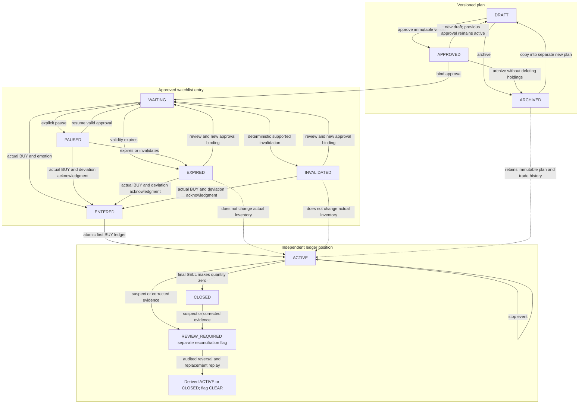

# SwingPilot AI — Product specification

Revision 2, proposed plan for approval, 13 October 2026. This revision follows [LOCAL_WORKFLOW.md](LOCAL_WORKFLOW.md): application, PostgreSQL and files run on the user's computer; AI uses the existing native Codex subscription; the existing IBKR plugin is the primary market source; incremental service subscriptions/credits are $0. No application implementation, installation, deployment or scheduled task is authorized by this document. See [ARCHITECTURE.md](ARCHITECTURE.md), [DATABASE.md](DATABASE.md), [API_DESIGN.md](API_DESIGN.md), [AI_SYSTEM.md](AI_SYSTEM.md), [RISK_ENGINE.md](RISK_ENGINE.md), [MONITORING.md](MONITORING.md), [PRICE_VALIDATION.md](PRICE_VALIDATION.md), [NOTIFICATIONS.md](NOTIFICATIONS.md), [UX_PLAN.md](UX_PLAN.md), and [ROADMAP.md](ROADMAP.md).

## 1. Product and intended user

SwingPilot AI helps a personal Hebrew-speaking swing trader turn stock screenshots into reviewed plans, monitor eligible setups, record manually executed US stock trades, and review performance and emotions. It has a Hebrew RTL interface with dark mode enabled by default, real local persistence, exact financial calculations, immutable history, and a local background worker. The user makes every trading decision and executes separately at the broker. AI proposes interpretations, not authoritative prices, calculations or trades.

The browser connects to a local Next.js/Node server backed by local PostgreSQL and private files. Native Codex, signed into the existing account, can handle approved research/AI jobs through a narrow authenticated local bridge **only after supported access is proven**. A website button persists a request awaiting Codex; it is not a synchronous paid AI API call. Existing native IBKR plugin access is not automatically available to the website/server.

The local computer must be awake, online, signed into its relevant user session, and running the server/database/worker and required Codex/plugin session. Closing the website is supported. Sleeping, shutting down, losing network access or exhausting included Codex usage interrupts work; the app reports the interruption and safely recovers due work. No always-on remote service is included.

Success means complete, retrievable trading records and honest review assistance. No profitability target or causal psychology claim is promised.

## 2. Confirmed scope and updated constraints

| ID | Requirement | Observable acceptance criterion | Delivery |
| --- | --- | --- | --- |
| P01 | NYSE/Nasdaq US stocks; long swing positions; days to weeks | Supported identities/contracts are validated; short/fractional/unsupported opening fills rejected | Phases 1–3 |
| P02 | Manual execution; whole shares | Every fill is entered/corrected by the user; no plugin brokerage order tools are invoked | Phase 2 |
| P03 | Capital/risk/exposure settings | Exact deterministic previews, auditable cash events, dated valuation and frozen approval/risk snapshots | Phases 1–2 |
| P04 | Weekly screenshot shortlist | Local private upload, explicit Codex job, confirmed/corrected symbols before research | Phase 4 |
| P05 | Real research and five additional candidates | Evidence-backed screening of a documented supported universe; exclude original/held/duplicate/ineligible names; return fewer with a reason when coverage/criteria do not support five | Phases 3–4 |
| P06 | Editable structured AI plans | Entry/zone/stop/invalidation/targets/sizing/indicators/horizon/thesis/risks reviewed; immutable versions; user approval | Phases 2 and 4 |
| P07 | Waiting for Entry | Approval/version binding and WAITING/PAUSED/INVALIDATED/EXPIRED/ENTERED; expiry cannot erase actual holdings | Phase 2 |
| P08 | Two daily checks while website closed | Local dispatcher retains 22:40 Asia/Jerusalem and official-close +15-minute probes on exchange trading days; exact native Codex/plugin dispatch is a feasibility gate; machine availability is explicit | Phase 5, G0-L4 |
| P09 | Verified market data and honest alert modes | Raw field/units/time/contract/session/coverage evidence; price validation; LIVE-compatible facts only for LIVE_ENTRY_READY; completed history for EOD_SETUP_REVIEW | Phases 3–5, G0-L2/L3 |
| P10 | Mandatory purchase emotion | Every BUY/ADD commits with explicitly selected emotion response atomically, including honest UNKNOWN/DECLINED with required context | Phase 2 |
| P11 | Active position management | Actual buys/exits, FIFO partial results, stops/corrections and closure remain traceable; AI never closes positions | Phase 2 |
| P12 | Active AI advice | Codex job returns HOLD/REDUCE/EXIT/ADD/REVIEW_REQUIRED with evidence and pinned ledger revision; user records all actual changes | Phase 4 |
| P13 | Journal/performance/psychology | Actual ledger/emotions and deterministic metrics; Codex narratives separately identified; sparse/unknown data disclosed | Basic Phase 2; advanced Phase 7 |
| P14 | Hebrew RTL responsive UI with dark mode as default | First visit, reload and sign-in render dark mode on desktop/mobile, including when the OS uses a light theme; no light-theme flash; keyboard/contrast/bidi/mobile critical flows pass; mobile access depends on local network exposure gate | Every phase |
| P15 | Notifications and desired iPhone PWA | First release local inbox + tested Codex/OS desktop display while tabs closed; iPhone private HTTPS/install/Web Push are later zero-fee gates | Foundation/lifecycle desktop subset; Phase 6 |
| P16 | Own login and local persistence | Maintained session integration, standard password verification, owner checks/local RLS, private files, verified local OS-owner recovery and separate-medium encrypted backup/restore | Phases 1–2 and release gate |
| P17 | $0 additional recurring service fees | Existing Codex/IBKR only; no hosted services, paid entitlements, credits, token-billed fallback or automatic upgrade; quota/billing uncertainty pauses work | Gate 0 and every phase |

IBKR **read-only market data** is now in scope. Brokerage integration that places/cancels orders, automated execution, shorts, options, crypto, margin, fractional shares, multi-currency and social features remain outside V1. Holding/trade facts come from the user's manual journal, not an assumed brokerage synchronization.

Original iPhone/PWA/push goals remain desired; this revised local/$0 constraint makes them conditional on a proven route. A blocked gate is disclosed and requires an explicit scope decision; it is not silently dropped or solved by purchasing infrastructure.

## 3. Release boundaries

### First usable local manual journaling MVP

Complete Phases 1–2 and the core release gate. The user signs into their local app, configures cash/risk policy, creates/edits/approves a manual JOURNAL_ONLY long-stock plan, manages Waiting for Entry, records an actual buy plus emotion, manages additional buys/stops/partial exits, closes the position, and retrieves history/basic results. Minimal instrument identities must come from a current reliable listing/contract reference, not fictional seed records.

Actual fills and optional dated MANUAL valuation marks are persisted locally with provenance/ledger revision. Manual marks support self-reported journal-only risk previews and cannot generate live/EOD setup alerts. The first release includes the local inbox and a documented, independently tested desktop notification path when tabs are closed; browser notifications alone are insufficient. It need not claim automatic IBKR or AI integration before their gates pass.

Own login, owner authorization, exact calculations, atomic execution/emotion, immutable corrections, idempotent/concurrent commands, protected files, export, encrypted daily backups to an existing separate drive/location, tested restoration, and visible runtime failures are release-critical. Loopback operation is the default. Private LAN exposure requires trusted HTTPS and a separate auth/network review. No remote hosting is needed for local journaling.

### Integrated local AI/data release

Complete Phases 3–5 and the relevant Gate 0 proofs. The app may use actual supported native Codex → bridge operations and verified raw IBKR observations; it must not present a model-retyped quote as provider evidence. Jobs expose awaiting Codex/running/awaiting authorization/quota/data/blocked/failed states. Included-usage exhaustion queues or stops work without buying credits or invoking a paid model/API.

Unproven automatic native dispatch means **automatic monitoring BLOCKED**. Explicit user-driven Codex work or source-reviewed imports can remain useful and are visibly manual. A fully automatic claim requires supported scheduling, raw evidence capture, exact time/session semantics and closed-page verification. A local worker cannot assume undocumented native-plugin credentials exist.

### Complete desired V1

Complete Phases 3–8, with genuine data/history/calendar coverage, validated AI results, supported automatic dispatch, desktop notifications, advanced insights and proven recovery. Desired iPhone PWA/private access/Web Push is included only after a no-additional-fee private HTTPS/device/permission/network route is proved. If no $0 route is feasible, the mobile/remote feature stays BLOCKED pending scope approval; desktop and inbox continue. No implicit free always-on cloud service substitutes for the local computer.

### Demo and source distinction

| Area | Development allowance | Real-use requirement |
| --- | --- | --- |
| Price/chart previews | Separate DEMO historical fixtures, no alerts | Exact licensed raw observations with source/field/time/units/coverage, or distinctly manual marks |
| AI workflows | Isolated fixture results for validation tests | Native Codex-authored result plus source manifest and strict local validation; job waits if unavailable |
| Calendar/runtime | Frozen time, simulated sleep/DST/quota faults | Vetted exchange sessions, local due dispatcher, missed-run recovery and supported native dispatch proof |
| Notifications | Mock sender/device responses | Real desktop display test; conditional iPhone device test; acceptance is not observation/acknowledgment |
| Journal/security | Isolated test identities/database/files | Own authenticated local ledger, intact audit and tested backup restore; no fixture trades mixed in |

## 4. Price, coverage and cost gates

The user's current IBKR settings report US real-time **NON_CONSOLIDATED** entitlement, API access enabled, listed fees waived, and current total/snapshot cost $0 with nightly counters. Limited AAPL/JPM observations were marked REALTIME with recent trade times. This is evidence of the current account/settings sample, not permission to invoke all request types at zero cost or proof of all-market/history coverage. Account identifiers are never copied into docs/logs.

The observed AAPL raw last approximately 3.43 against bid/ask approximately 343 is an unresolved scale/serialization mismatch. PRICE_VALIDATION must retain and compare the exact envelope, documented units, broker UI and compatible timestamped reference/history. **Never automatically multiply by 100 or infer which field is correct.** Unresolved inconsistency blocks dependent prices, sizing, advice and entry-readiness alerts. Actual historical fills entered by the user remain recordable with their manual source.

Last, bid and ask are distinct observations with separate verifiable timestamps; fetch time alone is not observation time. Missing timestamp, unsupported contract/session, outlier/spread/crossed market, unknown unit or history mismatch produces REVIEW_REQUIRED/price-blocked state. Current quote cannot prove a daily close before close or the order of intraday stop/target touches.

NON_CONSOLIDATED is never labeled NBBO, consolidated exchange coverage or full-market volume. Missing complete volume/history/actions/sector/universe facts disable dependent predicates/modules and show coverage gaps. LIVE_ENTRY_READY requires an approved LIVE-compatible predicate and all current quality/risk/coverage gates; it remains advisory. EOD_SETUP_REVIEW requires completed eligible session history and asks for next-session/current-price review.

Prove native connector billing semantics from supported guidance/current entitlements before bulk calls. A tool named snapshot is not proof it avoids regulatory snapshot charges. No paid regulatory snapshot, entitlement change, model API, credit purchase, commercial tunnel/domain/cloud host, or automatic upgrade is authorized. Unknown charge behavior blocks that call; computer/electricity/internet/existing Codex subscription are outside incremental service fees.

## 5. End-to-end journey

1. Start the local services/Codex session, sign in, configure capital/risk and review availability/source badges. A page explains that closing tabs is supported, sleeping the machine pauses work.
2. Upload screenshots into private local storage. The UI records an AWAITING_CODEX job. On a supported explicit user action or proven scheduled dispatch, native Codex retrieves only approved inputs through the bridge.
3. Codex submits extracted candidates; user corrects ambiguity/duplicates and confirms eligible listing identities. Tool/source evidence is captured verbatim through a proven mechanism, not fabricated from prose.
4. Fetch only verified no-additional-charge IBKR data/history that the plugin actually exposes. Local PRICE_VALIDATION verifies timestamp/units/contract/session/coverage. Block unsupported or mismatched facts; show missing coverage rather than inventing indicators.
5. Screen the documented supported universe deterministically and request selective Codex interpretation. Return five additional valid names when available, fewer with coverage/filter reasons otherwise.
6. Request a structured plan. Job waits for Codex/authorization/quota when necessary. Local validators compute risk, price/stop/target constraints and sizing. User edits and approves one explicit version; unsupported/manual evidence remains JOURNAL_ONLY.
7. The previous active approval continues monitoring while a new draft is edited until explicit reapproval/pause. Local due jobs run both required session checks only through proven dispatch; current quotes/history satisfy only their approved compatible rule modes. Quality/quota/machine failures produce status notices, not recommendations.
8. Review inbox/desktop notice and evidence; user separately places a broker order. Record actual fills, fees, time and mandatory emotion. One transaction writes ledger/emotion/position/watchlist/audit; actual risk breaches are recordable with acknowledgment.
9. Manage active exposure, FIFO results, dated marks and stop events. On-demand Codex advice reads a pinned ledger revision and produces a proposal; HOLD/REDUCE/EXIT/ADD never changes holdings.
10. Record added buys with emotion, partial/final exits and correction batches. Quantity reaching zero closes the trade. Plan expiry/AI recommendations cannot delete or close it.
11. Review deterministic journal/results and optionally request a Codex psychology/weekly review. Unknown emotions, missing valuations and insufficient samples stay explicit. Export and backup data; verify restore.
12. If the computer slept/offline/quota expired, inspect missed/blocked jobs. On wake/reconnect, recover durable work safely, discard obsolete alerts and require fresh reevaluation. Optional phone access is available only on the verified private network/VPN and trusted HTTPS path.

Manual journaling starts with user-authored plans/fills and remains available while data/AI services are unavailable.

## 6. Lifecycle and exceptional transitions

The versioned plan, approved watchlist and actual ledger position are separate aggregates. Authentication/ownership, expected revisions and atomic server checks protect all transitions.

- Saving creates immutable versions; last approval continues monitoring until explicit reapproval/pause. Reapproval updates the same unentered watchlist binding, supersedes obsolete undelivered signals, and preserves historical evidence. Archive suppresses future monitoring without altering ledger quantity.
- ENTERED is terminal for its initial watchlist entry. V1 has one trade per plan and one active trade per instrument/portfolio. ADD uses the existing active position. A new independent cycle after closure needs another plan/trade.
- ACTIVE/CLOSED derive from positive/zero effective quantity. REVIEW_REQUIRED is a separate reconciliation flag. An audited correction can recompute closed to active but cannot masquerade as a fresh trade.
- PRICE_VALIDATION failure, WAITING_DATA, AWAITING_CODEX, authentication/quota blockage, missed schedule and desktop delivery failure are job/evidence/notification states, not proof that a plan invalidated or a position closed. Never substitute stale data or generated prose.
- Actual broker fills above limits/outside a plan remain recordable with acknowledged breach flags. Wrong ownership/currency/instrument, invalid quantities and chronological oversell remain integrity errors requiring reconciliation. Reversals/replacements commit together and preserve the original events.
- Missing historical stop or nonpositive initial-risk baseline preserves cash/P&L but R is null with a reason. Stops/partial exits/adds/preferences do not reset initial R; correction replay is explicitly versioned.
- A model recommendation cannot approve, modify stop orders, buy/sell or close a trade. Local bridge permissions exclude all brokerage execution tools and direct generic SQL/ledger mutation.

## 7. Financial, AI and psychology correctness

Use exact decimal arithmetic and declared rounding outside AI. Whole-share sizing respects fee/slippage-inclusive stop loss, cash/exposure/sector caps and current complete evidence. FIFO allocates fees once; original first-BUY-batch R is frozen; external funding and internal cash events remain distinct. MANUAL marks, validated LIVE/NON_CONSOLIDATED observations, completed EOD history and unknown marks are different sources, never interchangeable.

Native Codex receives a minimal authorized input manifest and submits schema-validated proposals with fact IDs. The local server validates ownership, price evidence, indicators, quantities, conditions and versions. Missing raw provider evidence, invalid fields, stale inputs, model refusal or quota exhaustion blocks the affected output. The app does not extract hidden native credentials, reuse cookies or pay for API access to make a button instant.

BUY emotion is an explicit self-report, including honest UNKNOWN plus reason or DECLINED under the canonical vocabulary. Unknown/declined responses are excluded from directional psychology claims; no automatic neutral default or inferred emotion. Insights state sample/date/coverage and contributing trades, distinguish correlation from causation, and avoid diagnosis. Sparse data yields insufficient-data conclusions.

## 8. Release acceptance and unresolved assumptions

| Area | Acceptance | Evidence |
| --- | --- | --- |
| Local identity/data | Own login, standard password verification, secure sessions, loopback default, trusted owner-scoped DB/file access; no hidden token sharing | Auth/RLS/API/file denial tests and local OS-owner recovery drill |
| Integrity | Atomic BUY+emotion, exact financial fixtures, idempotent/concurrent commands and correction history | Unit/database/contract/E2E lifecycle and recovery checks |
| Price truth | Raw evidence/time/units/session/coverage verified; AAPL mismatch resolved by evidence or stays blocked | PRICE_VALIDATION test corpus and dated provider/UI reconciliation |
| Scheduling | Both times retained through DST/early closes; tabs closed works; sleeping/offline/quota events visible; obsolete signals suppressed | Supported native dispatch proof and local restart/wake simulations |
| Notifications | Durable inbox and observed desktop notice independently of tabs; native/service accepted vs display vs acknowledgment distinct | Real desktop closed-tabs test; conditional phone gate |
| Accessibility | Hebrew RTL/bidi, keyboard/focus/contrast, readable phone layout and chart alternatives | Automated checks plus manual screen-reader/desktop/mobile sampling |
| Backup | Encrypted daily DB+file copy to existing separate medium and tested clean restore | Actual restore drill and medium availability; absence blocks release or requires explicit accepted risk |
| Cost | $0 added service/credit spending; uncertain billing/usage stops affected work | Current entitlement guidance, included-usage-only failure test and no paid fallback config |

Gate 0 must prove supported bridge/raw capture, connector billing/coverage, price integrity, exact two-check dispatch, closed-page/awake-machine behavior, sleep/auth/quota recovery and desktop notice display. iPhone private HTTPS/push has a distinct optional zero-fee feasibility gate. These are **UNRUN** except limited prior quote observations and user-reported fee settings; no application gates/tests have passed.

Assumptions to resolve: user's OS, supported native bridge/scheduler mechanisms, plugin raw result access, quote/history breadth, official listing/calendar availability, private network/HTTPS trust and separate backup medium. These are feasibility decisions rather than reconfirming the trading scope. An unsupported gate produces an explicit blocker/manual workflow, never undocumented automation or a paid fallback. Approval of this plan is the next checkpoint; application implementation remains paused.
