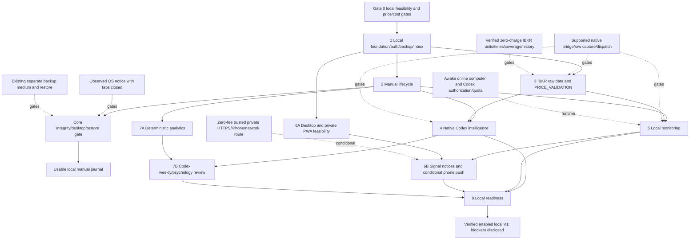

# SwingPilot AI — Local development roadmap

Revision2, updated17 October2026. Independent Phase8 local-readiness diagnostics/hardening/runbooks implemented/cloud-tested(v0.8). Full Phase8/overall release acceptance remains incomplete: native data/cost/scheduling, actual Windows/browser/device and deferred backup/restore evidence remain absent. Latest supplied Windows report is automatedv0.2 only. PHASE8_DELIVERY/PHASE8_WINDOWS/LOCAL_RUNBOOK are current. Next milestone: actual Windows acceptance and resolution of existing gates; zero later numbered development phases remain. Phase numbering does not waive unfinished acceptance.

## 1. Estimates, sequence and releases

Effort is **person-days for one experienced full-stack engineer**, about six focused hours/day, including ordinary review, tests and docs. Assume one personal USD account, long whole-share US stocks, familiar TypeScript/Postgres, access to the user's local OS and existing Codex/IBKR session, modest bounded workload and no brokerage execution. Estimates exclude acquiring hardware, paid services, provider approval delays and undocumented native integrations. Unsupported native dispatch is a blocker, not an engineering promise that enough days can overcome it.

| Milestone | Effort range | Cumulative | Meaning |
| --- | --- | --- | --- |
| Gate 0 | 4–8 days | 4–8 | Supported bridge/raw evidence, cost, price, schedule and notification feasibility |
| 1 Foundation | 7–11 days | 11–19 | Local secure persistent shell and minimal inbox/desktop path |
| 2 Lifecycle | 12–18 days | 23–37 | Usable manual local journal after core release gate |
| 3 Market data | 9–15 days | 32–52 | Read-only IBKR evidence and price/coverage validation |
| 4 Codex intelligence | 10–17 days | 42–69 | Durable jobs awaiting Codex and grounded proposals |
| 5 Monitoring | 8–14 days | 50–83 | Proven local dispatch/recovery and honest live/EOD modes |
| 6 Notifications/mobile | 5–10 days | 55–93 | Robust desktop notices; conditional private PWA/push |
| 7 Advanced journal | 8–13 days | 63–106 | Deterministic analytics and Codex insights |
| 8 Readiness | 7–11 days | 70–117 | Local V1 operational proof and documented blockers |

Unbuffered manual release is about 5–8 engineering weeks; full desired V1 about 14–24. With 15–25% contingency, allow roughly 27–47 person-days (6–10 weeks) and 81–147 (17–30 weeks). These ranges are estimates, not promised dates or evidence of working integrations. If bridge/raw-data/scheduler/mobile feasibility fails, report the narrower functional release and blocked feature; never assume a paid route or invent a completion date. Parallel-compatible streams help a team, but one engineer's effort remains mostly sequential.

Every phase's **incremental recurring service cost is $0**. Existing Codex subscription, hardware, internet and electricity are baseline costs outside this target. Free software does not supply free backup media or an always-awake machine. If no acceptable zero-fee service path exists, stop that integration and seek a scope decision; do not auto-upgrade, buy credits, add entitlement or consume paid snapshots.

## 2. Gate 0 — Prove the local operating model

Gate 0 is a prerequisite, not one of the eight development phases. Its first cloud/offline pass executed read-only listing lookups, a cloud inventory and 11 successful offline diagnostic tests. Windows host, native bridge, actual notifications/scheduling and backup restoration remain unproven. See PHASE0_WINDOWS.md; no automation was created and no full gate passed.

- **G0-L1 Native bridge/AI:** prove supported native Codex → authenticated local bridge access, scoped job pickup/submission, exact raw IBKR tool-event transport and included-subscription-only behavior. Native plugin capability is not presumed available to Node. No hidden token files, cookie sharing, GUI scraping, undocumented dispatch or paid API fallback. If unsupported, retain explicit reviewed imports/manual Codex and mark automatic features BLOCKED.
- **G0-L2 Entitlement/charges/coverage:** verify current $0 nonconsolidated entitlement and connector billing semantics, available contract/listing/calendar/history/action/sector/universe endpoints. Never infer snapshot tool name means zero charges. No paid regulatory snapshots/subscription changes. Unknown billing blocks bulk calls.
- **G0-L3 Price truth:** reconcile exact AAPL last approximately 3.43 versus bid/ask approximately 343 using envelope/units, broker UI and compatible timestamped reference/history. No ×100 heuristic. Verify per-field timestamps and session/contract/coverage; missing or mismatched facts remain blocked.
- **G0-L4 Scheduling/runtime:** prove both 22:40 Asia/Jerusalem and calendar close +15-minute checks through supported local due dispatcher/native dispatch. Test DST/early close/holidays, tabs closed with machine awake, sleep/wake/missed jobs, offline reconnect, IBKR authorization expiry and Codex quota exhaustion. Codex tasks are not presumed exact-time/frequency-unlimited.
- **G0-L5 Desktop:** observe an authorized test notice on the actual OS with all tabs closed; distinguish worker/native acceptance, OS display and user acknowledgment. A browser-only notification implementation cannot pass.
- **G0-L6 Phone:** evaluate private LAN or existing trusted VPN, device-trusted HTTPS, installed iPhone PWA, explicit permission and local Web Push sender at zero new fee. No paid domain/tunnel/Apple membership/cloud provider is assumed. Away-from-home reachability and machine availability are explicit. Failure blocks desired mobile/remote capability, not desktop journaling.
- Confirm local OS supervision/startup policy, own-login recovery, separate backup medium and exact restore workflow; record costs/source rights/limitations/owner and go/no-go in DECISIONS/TASKS/VALIDATION_STATUS. Supported capability evidence may still require a bounded implementation spike **after** plan approval.

The reported current fee screen and two read-only quote observations are limited facts, not passed gates. All decisions below are conditional on proof; inability to prove automatic native plugin access does not authorize replacement services.

Current continuation decision: unresolved quote/native gates block automatic market features, not the read-only local shell or isolated schema work. Windows Phase 0 smoke is user-reported. Independent Phase 1 work proceeds under D028; backup verification is deferred under D027 and remains a release limitation. Do not interpret the dependency diagram as evidence all gates passed.

## 3. Phase 1 — Local project foundation

**A. Objective.** Establish the actual local runtime, identity, persistence and Hebrew UX safely before financial records.

**B. Features.** Next.js/TypeScript/Node local shell; local PostgreSQL; app-owned single-owner login/recovery; onboarding/settings; RTL responsive navigation with dark mode as the default from first render; private files; minimal durable inbox and desktop test path; runtime health; encrypted backup baseline.

**C. Technical tasks.**

1. Initialize approved tooling, runtime/package lock, lint/types/unit/E2E checks and isolated local test database/files. No cloud account or hosted tier is required.
2. Bind loopback by default; configure OS-appropriate startup/supervision for server/database/worker, health/version/config and graceful stop. Separate local development/test/personal data paths; secrets stay outside Git/webroot.
3. Use maintained Auth.js integration, standard Argon2id verification, protected sessions, rate-limited login and verified local OS-owner recovery. No signup/SMTP/reset-service subscription or custom cryptography.
4. Create profiles/portfolios, narrow validated instruments, owner context/RLS, composite-owner FKs, cash/audit/idempotency records and private object metadata/download authorization. The DB is never browser/LAN-exposed.
5. Build RTL/bidi-safe components, auth/onboarding/settings/navigation and runtime-status panels. Add minimal inbox/outbox and explicit non-trading desktop test command with no permission assumption.
6. Define authenticated native bridge contracts/job inbox skeleton with least privilege. Do not assume native plugin portability. Set encrypted DB+file backups to existing separate medium and demonstrate a clean restore.

**D. Dependencies.** Approved plan, Gate 0 local OS/login/file/backup decisions, supported libraries and filesystem access. Native data/AI gates can remain blocked without invalidating the manual foundation.

**E. Deliverables.** Protected local shell/pages, migrations/RLS/roles, private-file/download service, startup/health/runbook, minimal inbox/desktop path, bridge interface contract, tests and backup/restore evidence.

**F. Verification.** Real local auth/logout/recovery; wrong-owner API/RLS/file denial; no browser DB/secret access; fresh schema bootstrap; preferences persistence; Hebrew keyboard/mobile/bidi review; startup/restart and clean restore; actual closed-tabs desktop test.

**G. Definition of Done.** Own login and local recovery work; owner boundaries hold; services survive supported restart; private files inaccessible without authorization; no hidden native credentials; minimal desktop path is observed; backups include DB/files on separate medium and restore successfully; core checks pass.

**H. Risks and challenges.** OS differences, insecure LAN exposure, file/DB ownership leaks, missing backup drive and unsupported desktop dispatch. Mitigate loopback first, narrowly scoped auth/RLS/files, OS-specific runbook and recorded blockers rather than paid infrastructure.

**I. Complexity and effort.** High, **7–11 days**; own local identity, OS lifecycle and backup responsibilities replace hosted managed services.

**J. Cost impact.** **$0 additional recurring service fees**; open-source libraries/local runtime. Existing hardware/electricity/internet/Codex outside target; absent separate medium is a release blocker or explicit risk decision, not free disaster protection.

**K. Priority.** **MVP-critical.** Native automatic data access and desired remote phone access are distinct gates.

## 4. Phase 2 — Trading lifecycle

**A. Objective.** Deliver a truthful complete local manual plan-to-closed-trade journal.

**B. Features.** Manual immutable plan versions/approvals/watchlist; JOURNAL_ONLY risk previews from dated manual valuations; buy plus emotion; ADD; active trades; stop history; partial/final exits; FIFO P&L/R; cash events; audited corrections; basic journal/export; durable local notices.

**C. Technical tasks.**

1. Implement exact long-stock calculations with fees/slippage, cash/exposure/sector limits, whole-share sizing, FIFO fee allocation, original-R, partial results and independently derived fixtures.
2. Add version/approval/watchlist/trade/ledger/batch/emotion/management/note/valuation/mark entities and constraints. MANUAL provenance never becomes live provider evidence.
3. Implement owner-authenticated canonical `/api` commands with expected revisions/idempotency/locks; atomic execution+emotion and reversal+replacement; one active trade per instrument/portfolio; oversell/short rejection.
4. Build editor/watchlist/positions/detail/purchase/exit/journal/basic results with all loading/error/mobile/reconciliation states. Each BUY has explicit emotion including honest UNKNOWN/DECLINED categories, never silent defaults.
5. Keep active approved monitoring binding through new draft edits until explicit reapproval/pause; plan expiry/archive cannot alter actual inventory. Record genuine risk breaches with acknowledgment instead of hiding fills.
6. Add dated manual portfolio marks, auditable funding/internal cash events, owned export and local inbox events. Test financial data recovery from backup; desktop notices identify records without leaking private values.

**D. Dependencies.** Phase 1, financial/schema contracts, real validated listing reference, minimal local notice/backup path. No live quote, paid model, Codex quota or working native automatic bridge is necessary to record actual manual trades.

**E. Deliverables.** Complete manual lifecycle pages/APIs, SQL ledger transactions/replay, TypeScript previews, FIFO/valuation tests, owned exports and release evidence.

**F. Verification.** Independent financial fixtures; DB/RLS/rollback/duplicate/concurrent fill/correction tests; E2E approval→buy+emotion→ADD→partial exit→final close; corrected closure→active; plan invalidation preserving holdings; risk-breach recording; local persistence/export/restore and accessible phone viewport.

**G. Definition of Done.** No BUY without committed emotion; no partial correction; retries create one event; impossible oversell/zero/negative quantities rejected; accurate breaches remain recorded; FIFO fees/P&L and frozen R reconcile; unknown marks produce null; no hard deletion; core release gate passes.

**H. Risks and challenges.** Decimal drift, concurrent sells, chronology correction, missing manual marks and conflating plan/position. Mitigate exact arithmetic/SQL transactions, stable effective ordering/replay, explicit source coverage and separate aggregates.

**I. Complexity and effort.** High, **12–18 days**; history/integrity work remains unchanged by moving locally.

**J. Cost impact.** **$0 additional recurring service fees**; local disk/DB/backup growth. No API credits/data subscription/cloud storage; existing media availability must be verified.

**K. Priority.** **MVP-critical.** Complete this phase plus the core gate for personal manual journaling.

### Core release gate after Phases 1–2

Own login/session/local OS-owner recovery; loopback/private access controls; owner/RLS/file denial; server secret isolation; independent financial fixtures; atomic buy+emotion; idempotency/concurrency; immutable correction history; actual positions preserved after plan expiry; no production fixtures; Hebrew accessible critical flows; local inbox and observed desktop path while tabs closed; encrypted separate-medium DB+file backups and clean restore; visible runtime/missed/blocked state. Never postpone these controls to Phase 8.

## 5. Phase 3 — IBKR data and price validation

**A. Objective.** Accept only supported, no-additional-charge, verifiable raw market evidence before any automated readiness claim.

**B. Features.** Read-only native IBKR source; instrument/contract validation; raw last/bid/ask; per-field times/units/feed/session; NON_CONSOLIDATED coverage; PRICE_VALIDATION; licensed history/chart/indicators where available; bounded cache and documented universe.

**C. Technical tasks.**

1. Implement a provider-neutral local evidence contract; native Codex/plugin result reaches the bridge only through the Gate 0 proven supported mechanism. Preserve exact raw envelope/tool event/source IDs, not model-retyped numbers.
2. Verify allowed existing entitlement/request types and connector billing semantics; prohibit paid regulatory snapshots/order tools/subscription changes. Unknown billing/entitlement blocks calls and bulk work.
3. Validate contract identity/currency/units/timestamps/session, last/bid/ask compatibility/spread/outliers; retain mismatch evidence. Resolve AAPL scale only from documented source reconciliation; no automatic ×100.
4. Add coherent source/time/coverage cache keys, budgets/retries, local private raw evidence retention and explicit expired-authorization/data/price-blocked states.
5. Integrate only actually available licensed daily history/corporate actions; compute indicators with minimum lookbacks. Current quote does not prove daily close; nonconsolidated volume cannot support full-volume predicates.
6. Build research charts/factual tables and marked positions with source/mode/coverage. Record supported screening universe/sector/action/history gaps; disable affected calculations instead of fetching a paid fallback.

**D. Dependencies.** Phase 1 local bridge/security; G0-L1 raw transport and G0-L2/L3 billing/price evidence; Phase 2 risk/ledger for portfolio integration. Missing history may block research/EOD modules independently of valid current quotes.

**E. Deliverables.** Read-only bridge data adapter, raw evidence/validation storage, PRICE_VALIDATION engine/history, dated marks/charts, deterministic indicators/screen features where supported, capability/coverage registry.

**F. Verification.** Exact-envelope and unit/timestamp mismatch fixtures including AAPL; contract/field-age/session/coverage gates; NON_CONSOLIDATED != NBBO/full volume; stale/unknown fee/auth failure tests; independently derived indicators; bounded actual raw tool/source/UI reconciliation with verified no-additional-charge behavior.

**G. Definition of Done.** Valid fields have verifiable observed time/units/contract/source; unresolved AAPL stays blocked; no scaled guesses/model prices; data labels reflect actual coverage; no charge uncertainty hidden; missing history disables dependent output; source facts match captured raw tool evidence.

**H. Risks and challenges.** Native raw evidence unavailable, serializer defect, unknown snapshot charges, history/corporate-action gaps. Mitigate gate evidence and conservative blocked/manual mode; no hidden token sharing, scraping or paid provider/API escape route.

**I. Complexity and effort.** High, **9–15 days**, conditional on supported connector access. Unsupported capabilities remain blocked and do not magically fit the estimate.

**J. Cost impact.** **$0 additional recurring service fees** using existing verified entitlement only. Gate unknown per-request costs before calling; no paid quote/data upgrade.

**K. Priority.** **Required for integrated data release.** Manual journal survives blockage; valid LIVE/EOD/readiness capabilities depend on the exact proven facts.

## 6. Phase 4 — Native Codex trading intelligence

**A. Objective.** Make subscription-based Codex work explicit, durable and locally validated instead of pretending the website owns a billed model API.

**B. Features.** Screenshot recognition, confirmed tickers, grounded plan proposals/research, up to five additional supported-universe candidates, active enum advice, pending job/history/usage states and manual source-reviewed fallback.

**C. Technical tasks.**

1. Implement private image upload/limits/authenticated download; persist request as awaiting Codex. Native Codex pickup occurs on explicit user action or a supported proven scheduled dispatch.
2. Build scoped authenticated bridge tools for approved input reads, job claims/checkpoints and schema-limited evidence/draft/analysis submission. No generic SQL, plan approval or brokerage execution capability.
3. Define versioned manifests/schemas/prompts/fact IDs; validate provenance/price/indicators/conditions/numeric constraints on the local server; reject unsupported model claims.
4. Extract symbols with ambiguity/user confirmation; run quantitative screening locally over documented supported data first, then selective Codex explanation; fewer-than-five is an honest coverage/filter result.
5. Add durable queued/awaiting Codex/authorization/quota/running/failed/cancelled handling, expected versions, stale-result review and retry ceilings; preserve external work ambiguity without buying credits.
6. Wire scanner/editor/advice/history UI and evaluation corpus; derive resource estimates from included usage/latency observed in Gate 0, not API token prices. Manual import visibly retains its manual/unverified status.

**D. Dependencies.** Phase 1 authenticated bridge/jobs/files, Phase 2 plan/ledger contracts, Phase 3 verified facts/coverage, G0-L1 supported native subscription workflow. The website cannot directly invoke installed plugins without proof.

**E. Deliverables.** Native bridge tool contracts, durable Codex job flow/history, screenshot/candidate review, structured plan/advice validators, grounded output evaluations and included-usage-only controls.

**F. Verification.** Native session→bridge scoped reads/results; adversarial image/ticker/schema/provenance tests; price mismatch rejection; unique additional candidates; concurrent draft/ledger stale output; unauthorized bridge call; expired plugin auth/quota/external timeout; explicit user pickup and persisted unfinished job after browser restart.

**G. Definition of Done.** Request button clearly creates waiting job; valid outputs link source/model/schema/ledger versions; Codex cannot approve/execute/alter holdings; quota exhaustion stops/queues with no paid fallback; missing raw facts fail validation; actual supported workflow is documented and exercised.

**H. Risks and challenges.** Unsupported native bridge/job dispatch, usage caps, unavailable plugin, prompt injection/schema-valid hallucination. Mitigate scoped supported mechanisms, local deterministic validation, explicit manual mode and blockers; never assume API entitlement from subscription.

**I. Complexity and effort.** High, **10–17 days**, provided native capabilities pass Gate 0. Automation may remain blocked even when user-driven Codex works.

**J. Cost impact.** **$0 additional recurring service fees/credits**; existing included Codex usage only. Quota depletion defers jobs rather than creating token-billed calls.

**K. Priority.** **Required for integrated AI release**; automatic pickup is gated, not presumed. Manual journaling remains independent.

## 7. Phase 5 — Local automated monitoring

**A. Objective.** Reliably evaluate eligible approved conditions while tabs are closed, with the computer awake and supported native dispatch available.

**B. Features.** Fixed 22:40 Asia/Jerusalem and separate regular close +15-minute probes; exchange sessions/DST/holidays/early closes; current-source PRICE_VALIDATION; compatible LIVE/EOD rules; outbox signals; explicit due/missed/late/blocked states; sleep/auth/quota recovery.

**C. Technical tasks.**

1. Maintain vetted session calendar/UTC instants and both schedule identities; local durable dispatcher queries due jobs and uses leases/fencing/idempotent run keys. OS supervision replaces Edge/cron hosting.
2. Integrate only Gate 0 proven documented native Codex/plugin dispatch. Test scheduler expression/frequency/time precision for both requirements; unsupported dispatch leaves automatic monitoring BLOCKED, with manual recheck.
3. Fetch only verified-charge raw facts and validate field time/units/coverage/session. Finalized daily rules await completed eligible history; quotes before close cannot satisfy them.
4. Evaluate deterministic approved predicates/risk/exposure locally; LIVE_ENTRY_READY requires approved LIVE-compatible conditions and all freshness/price gates. EOD_SETUP_REVIEW is completed-session next-session guidance; both advisory.
5. Store input/evaluation/reason; atomically deduplicate signal/inbox/outbox. Both probes remain even if after-close precedes fixed check; same evidence/session/setup cannot create duplicate notices.
6. Recover missed/sleep/offline/auth/quota jobs with bounded retries and visible run status; obsolete entry alerts expire without replay. Require fresh reevaluation after wake/reconnect; alerts on operational failure contain no entry recommendation.

**D. Dependencies.** Phase 2 approved/risk contracts, Phase 3 verified data/calendar, durable local jobs/bridge, G0-L4 supported two-check/native dispatch and machine availability. Manually authored plans can be monitored; AI plan generation is not required.

**E. Deliverables.** Local due dispatcher/worker/startup config, schedule/evaluation/signal/outbox records/APIs, health/history/status UI, sleep/reconnect/quota recovery and replay runbook.

**F. Verification.** Frozen-clock US/Israel DST mismatch/early-close/holiday cases; both schedule identities; computer awake with all tabs closed; actual supported native dispatch; sleeping past deadline then wake; plugin auth/usage/network failures; worker crash/replay; quote-vs-daily predicate gating; mismatched AAPL produces no readiness; duplicates yield one event.

**G. Definition of Done.** Both required checks proven on supported local runtime; no fabricated always-on availability; sleep gaps visible; fresh valid evidence only for readiness; native dispatch unresolved means blocked status rather than success; deterministic conditions and dedup/recovery work; no execution mutation.

**H. Risks and challenges.** Machine sleeps, task limits/precision, native session expires, quote lacking timestamp/history and missed opportunities. Mitigate explicit availability, startup watchdog, durable due keys, stale-signal suppression and honest manual/block states. No remote cloud fallback is budgeted.

**I. Complexity and effort.** High, **8–14 days**, after dispatch proof; unsupported exact-time access is an external feasibility blocker.

**J. Cost impact.** **$0 additional recurring service fees**; local worker and verified existing IBKR/Codex limits only. Awake machine electricity/network are baseline; quota limitation defers work.

**K. Priority.** **Required for automatic integrated release**, feasibility gated. Manual journal/user-driven reviews continue while blocked.

## 8. Phase 6 — Desktop notifications and conditional private mobile

**A. Objective.** Deliver trustworthy notices outside open tabs and evaluate the desired iPhone experience without adding paid infrastructure.

**B. Features.** Robust local inbox/desktop sender, delivery/display/ack history, preferences/deep links, subscription/session/runtime notices; desired private PWA/HTTPS/install/iPhone push only if zero-fee supported route exists.

**C. Technical tasks.**

1. Extend the Phase 1 minimal inbox/desktop path with outbox leases/retries/event keys, actual OS/Codex notice mechanism, minimal privacy-preserving payload and protected evidence deep links.
2. Persist channel preference and distinguish accepted by native/OS sender, observed display and user acknowledgment. Browser notifications alone cannot claim delivery after all tabs close.
3. Verify app-closed/machine-awake behavior and failure/sleep replay without obsolete setup notices; show last successful check and actionable auth/quota/data errors with no trading recommendation.
4. Gate private LAN/existing VPN exposure: owner auth, firewall/binding boundaries and device-trusted HTTPS using an existing no-fee route. No paid domain/tunnel/certificate service/cloud relay assumed.
5. If feasible, build manifest/icons/service worker, Home Screen instructions, explicit permission, local VAPID sender/subscriptions, expired endpoint cleanup and iPhone deep links. Service worker excludes private account data from broad caches.
6. Test real iPhone trust/install/closed-app push; disclose away-from-home private link reachability and computer availability. If no zero-fee route, keep desired mobile/remote feature BLOCKED and request scope decision rather than provisioning paid alternatives.

**D. Dependencies.** Phase 1 desktop/auth/local supervision; Phase 5 real outbox; G0-L5 real OS display and G0-L6 private HTTPS/phone feasibility. PWA assets/UI can proceed separately, but production access/push requires the device/network gate.

**E. Deliverables.** Durable desktop notice pipeline/inbox/preferences/history, actual closed-tabs display evidence, auth-safe deep links, and conditional private PWA/push artifacts or explicit blocker report.

**F. Verification.** Real OS notice while all tabs closed; accepted-vs-displayed-vs-read distinction; duplicate/denied/sleep/auth failures; privacy/cache/deep-link tests; if feasible, actual iPhone HTTPS trust/install/permission/closed-app delivery/revocation/reinstall and off-LAN link behavior.

**G. Definition of Done.** Durable inbox and observed desktop path work independently of tabs; no stale buy notices replay after wake; protected links/records persist. Phone success requires real-device proof; a failed gate is documented as BLOCKED and no remote always-on/cost claim is made.

**H. Risks and challenges.** OS permission/session availability, private TLS trust, unreachable phone links, machine sleep and platform push prerequisites. Mitigate tested install/network guidance, distinct statuses, inbox fallback, and supported no-fee route rather than a hidden cloud dependency.

**I. Complexity and effort.** Medium–High, **5–10 days**, dependent on OS/device/network. Infeasible phone route yields a blocker instead of an unlimited custom networking effort.

**J. Cost impact.** **$0 additional recurring service fees**. No paid domain/tunnel/Apple membership/push SaaS. Existing trusted network/VPN/media are assumptions to verify, not automatic free resources.

**K. Priority.** **Desktop/inbox release-critical subset already in Phase 1–2; full desktop reliability required.** iPhone PWA/remote access/Web Push remain **desired later, conditional on zero-fee gate**; scope decisions are explicit.

## 9. Phase 7 — Advanced journal and Codex review

**A. Objective.** Produce reproducible performance and evidence-linked psychology insight from real local history.

**B. Features.** Fee-inclusive cohorts/results, FIFO partial exits, original R, cash-flow-adjusted metrics where defined, adherence/emotion comparisons, sample/coverage warnings, weekly Codex jobs/history, owned exports.

**C. Technical tasks.**

1. Define trade/date/cohort/fee/ADD/R/capital/valuation rules and independently derived metric fixtures. Incomplete or invalid marks cannot become a fully valued equity curve.
2. Add efficient local SQL read models/indexes and versioned metric snapshots tied to effective ledger revision; no remote analytics service.
3. Build charts/tables/drill-through with sample/exclusion/unknown details. Missing NON_CONSOLIDATED/full-volume market facts never become financial performance assumptions.
4. Link adherence to frozen approved plan and actual management/fills; retain manual exception/context without guessing intent.
5. Persist a weekly/performance/psychology request awaiting Codex; deliver minimal private manifest/deterministic results via supported bridge; validate result/coverage/evidence and stale input before showing it.
6. Exclude UNKNOWN/DECLINED from directional claims; enforce insufficient-sample response/no causality/diagnosis; add review history/exports and selective reuse while included quota is available.

**D. Dependencies.** Phase 2 ledger/emotions/plan/valuation truth; Phase 4 native Codex bridge for actual AI review. Deterministic analytics work without plugin access; no push dependency.

**E. Deliverables.** Local performance/psychology APIs/read models, adherence history, accessible analytics/enhanced journal, awaiting-Codex review workflow, evidence/exports and metric documentation.

**F. Verification.** Independent fee/partial/R/cash-flow/ADD fixtures; correction recompute and zero/unknown samples; wrong-owner aggregate denial; Codex schema/grounding/stale-input/quota tests; E2E filter→source trade→request review→waiting→validated result→export; accessible Hebrew charts.

**G. Definition of Done.** Numbers trace to effective ledger/definitions; no invented records/emotions/marks; sparse results explicit; request cannot assume instant completion; quota blocks defer without charge; model narratives are distinct and cannot rewrite facts.

**H. Risks and challenges.** Misleading drawdown/denominators, sparse samples, outcome bias and private journal leakage. Mitigate exact documented formulas/coverage, minimal scoped bridge inputs, cautious framing and independent fixtures.

**I. Complexity and effort.** High, **8–13 days**; correct metric/adherence definitions remain more work than chart rendering.

**J. Cost impact.** **$0 additional recurring service fees**. Local queries/storage and existing Codex included usage only; delayed review on quota exhaustion, no billed model fallback.

**K. Priority.** **Required advanced journal capability after manual MVP**. Basic journal already works in Phase 2; actual AI review remains native-bridge gated.

## 10. Phase 8 — Local production readiness

**A. Objective.** Prove local personal-use reliability, privacy, correctness, recovery and zero-additional-service behavior.

**B. Features.** Full regression/security; local installation/startup/update/rollback; encrypted backups/restore; auth/session/bridge supervision; data/license/charge controls; sleep/quota incidents; desktop/conditional phone verification; final docs/status.

**C. Technical tasks.**

1. Recheck app-owned login/recovery/Argon2id/session/rate/CSRF boundaries, trusted DB owner context/RLS/roles, file/download/bridge permissions, loopback/LAN/firewall configuration and secret isolation. No scraping hidden credentials.
2. Validate configured caps, provider/request billing denylist, included-usage stop behavior, cache/raw-evidence retention, disk cleanup, local CPU/memory job bounds and privacy-redacted logs.
3. Exercise price mismatch, unavailable history, Codex/plugin expiration/quota, sleep/network/worker/database restart, skipped/duplicate schedules and obsolete notices; show reason/last success/next safe action.
4. Finish OS install/start/restart/update/data-safe migrations and rollback; backup encrypted DB+files/evidence to separate existing medium, restore into clean local environment and reconcile latest manual fills.
5. Run actual desktop closed-tabs and conditional iPhone private-network tests; measure workload/source freshness and bridge/scheduler precision. Unsupported automatic/mobile gates remain blockers, not "passed" checkmarks.
6. Update source specs/ADRs/tasks/validation/runbooks/cost assumptions; prepare concrete reviewable release evidence. User approval is still needed for unapproved implementation or network exposure changes; no paid provisioning.

**D. Dependencies.** Integrated accepted Phase 1–7 artifacts within proven scope; OS/device/session/access availability; Gate 0 evidence current; existing separate backup medium. First-release security/integrity already passed earlier.

**E. Deliverables.** Local release candidate, regression/validation report, actual restore proof, startup/update/incident/price/sleep/quota runbooks, cost guard review and honest capability/blocker matrix.

**F. Verification.** Full risk-based tests plus small no-charge actual native source/bridge smoke; RLS/file/auth/bridge negative tests; exact price/unit/coverage corpus; both schedules/DST/missed/recovery; real desktop notice; conditional phone; clean migration/restore; no API credits/paid request under injected quota/billing failure.

**G. Definition of Done.** No unresolved financial/security/integrity blockers; price-quality decisions evidence-based; truthful availability/notification states; encrypted separate-medium backup restores; no automatic paid path; each enabled feature has actual proof; blocked desired features explicitly identified and scope decision recorded.

**H. Risks and challenges.** Native updates break tools, hardware unavailable, backup absent, inaccurate "live" labels and unauthorized networking. Mitigate version/capability checks, startup health, retained exact evidence, gates, tested separate-medium recovery and loopback default.

**I. Complexity and effort.** High, **7–11 days** if earlier acceptance holds; unsupported bridge/mobile/backup cannot be concealed inside contingency.

**J. Cost impact.** **$0 additional recurring service fees**. Verify account remains on existing included usage/entitlement and no credit/paid-call fallback exists. Hardware/electricity/baseline subscription are disclosed separately.

**K. Priority.** **Core subset MVP-critical; complete phase required for the enabled local V1 scope.** No automatic/full-mobile claim without its gate.

## 11. Dependencies, independent streams and critical paths

Review milestones in numerical order; compatible streams can begin when contracts are frozen. Native feasibility blockers are explicit rather than arrows implying portable paid APIs.

**Manual critical path:** plan approval/Gate 0 local identity/desktop/backup decisions → Phase 1 → Phase 2 → core release gate. Native market/AI automation is not required to capture actual trades. An absent backup medium or closed-tabs desktop path cannot be mislabeled resolved.

**Integrated automatic path:** foundation → supported native raw source/price gates → Phase 3 → native Codex/rule integration → Phase 5 → real desktop notices → final readiness. Codex/AI journal and desired phone can form separate critical streams. Any unsupported native dispatch blocks automatic operation regardless of progress elsewhere.

**Parallel-compatible work:** Phase 3 source/price work alongside lifecycle UI; desktop/private HTTPS feasibility alongside scanner/editor design; deterministic analytics alongside monitoring; financial/security review in every phase. Freeze shared schema/API/source-state contracts first and give agents bounded ownership. With one engineer, estimates sum; background waits and feasibility do not equal productive parallel engineering.

## 12. Development workflow and phase handoff

Maintain TASKS.md milestones with ready/in progress/blocked/verified, owner, acceptance, exact evidence and next task. VALIDATION_STATUS.md distinguishes proposed/unrun/passed/failed/skipped/blocked gates. Plans and test cases are not passing evidence. Use small feature branches/commits and PR review for each bounded milestone; do not generate the whole application in one change.

Suggested implementation prompt after approval:

> Implement only ready Phase N tasks in docs/TASKS.md. Read AGENTS.md and revision-2 LOCAL_WORKFLOW, PRODUCT_SPEC, ARCHITECTURE, DATABASE, API_DESIGN, PRICE_VALIDATION, RISK_ENGINE and TEST_PLAN. Use local runtime, existing Codex/IBKR included capabilities and zero additional service spending. Preserve immutable financial history/own login/backup. Request analysis must remain a durable awaiting-Codex job; native tool/raw-data/scheduler access requires supported proof. Reject AAPL scaling guesses, stale/nonconsolidated misuse and paid fallback. Deliver small reviewable changes; run affected independent unit/DB/API/E2E/OS checks, update docs/tasks/validation with actual results, report blockers/unrun checks, and stop at the phase gate.

Review financial/RLS/correction/price/native-bridge/schedule logic with relevant specialists and independent fixtures. Tests run against isolated local DB/files/identities; mocks cover clocks/plugin/quota/delivery failures, while bounded verified-no-charge real source/bridge/desktop/device checks prove external behavior. No broker-order tools are part of tests. Maintain focused regression when shared state/source contracts change; preserve prior accepted lifecycle workflows.

At each conversation boundary, record phase/branch/commit, exact completed artifacts, last test command/result, unrun gates, OS/native version/capability changes, unresolved blockers/owner and next ready task. A new chat reads these source docs and repository status, then resumes without overwriting prior work. Architecture/source/cost/scope changes become DECISIONS.md entries. Implementation, actual schedules, network exposure and paid actions are not authorized by this plan.
