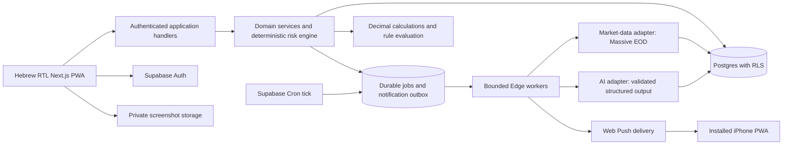

# SwingPilot AI — architecture, service limits and cost review

> **SUPERSEDED — historical revision-1 research.** The user now requires local operation with existing Codex/IBKR and $0 additional service subscriptions. Hosted subscriptions, API-token budgets and EOD-only default below are not active recommendations. Read [LOCAL_WORKFLOW.md](../LOCAL_WORKFLOW.md), [COSTS.md](../COSTS.md) and [ARCHITECTURE.md](../ARCHITECTURE.md) for revision 2.

**Reviewer:** Full Stack Architect & Developer / DevOps. **Checked:** 2026-10-13. **Status:** planning proposal; no application implementation or infrastructure deployment.

## Recommendation

Use a TypeScript modular application: Next.js for the Hebrew RTL interface and authenticated request handlers; Supabase Postgres, Auth and private Storage; Supabase Cron and short Edge workers for server-side jobs; a market-data adapter initially backed by Massive Basic; an AI adapter initially evaluated with OpenAI GPT-6 Luna; direct standards-based Web Push. Keep financial calculations, entry rules and screening deterministic. Use Vitest, database integration checks and Playwright, with real iPhone testing for installation and push.

Start development on free tiers. For a dependable personal production journal, recommend Supabase Pro for backups and removal of inactivity pausing, with Vercel Hobby only while the usage qualifies as personal and non-commercial. A free-tier pilot is reasonable if its limits are accepted and an independent backup-and-restore process is operating; it is not a reliability guarantee. Market-data delivery and licensing must pass a real-account acceptance check before market-dependent production features launch.

Avoid a separate Python service, Redis, vector database, Kubernetes, native mobile app or brokerage connector in V1. These add operating work without solving the confirmed personal-use requirements. Small indicator calculations can run in bounded TypeScript jobs. Reconsider a separate worker only after measurement shows CPU or runtime limits are materially constraining the work.

Browser credentials must never include market-data, AI or privileged database keys. User writes execute with the user's authorization context or through explicitly checked transaction functions. Workers use a narrowly controlled service identity. Jobs store tenant ID, input snapshot/version, attempt, lease, due time, result and failure code. Generated analyses reference immutable data snapshots and never alter an approved plan or execution history without a user action.

## Verified service costs and limits

USD monthly list prices; tax, currency conversion, domain registration and account-specific terms are excluded. Free quotas are allowances, not a promise that the whole product will always be free.

| Provider/service | Purpose | Verified free allowance / constraint | Fixed monthly cost proposal | Variable costs / upgrade reason | Alternatives |
| --- | --- | --- | --- | --- | --- |
| Supabase | Database, authentication, files, workers | Free: 500 MB database, 1 GB files, 50,000 MAU, 500,000 Edge invocations, 5 GB egress; inactivity pause after one week; no automatic backups | $0 development; Pro from $25 for one included Micro project | Pro includes 8 GB disk, 100 GB files and 2M Edge calls; excess disk $0.125/GB, files $0.0213/GB, Edge $2/M; additional Micro projects from $10/month | Self-hosted Postgres/Auth/storage increases operational responsibility; splitting Neon/Auth/storage adds services. [Official pricing](https://supabase.com/pricing) |
| Vercel | Next.js UI/API hosting | Hobby $0, personal/non-commercial only; quota exhaustion can suspend features | $0 eligible personal app; Pro $20 for one developer seat | Metered compute/transfer/builds beyond included usage; Pro includes $20 usage credit; additional developer seats cost extra | Cloudflare Workers with OpenNext, or a managed Node host, after deployment compatibility checks. [Pricing](https://vercel.com/pricing), [Hobby rules](https://vercel.com/docs/plans/hobby) |
| Massive Stocks Basic | EOD candles, listing reference, corporate actions | $0; 5 calls/minute; two years history; individual usage; EOD, not current quotes | $0 initially | Starter $29 provides 15-minute delayed data; Advanced $199 provides real-time data for eligible non-professional individual use. Starter does not satisfy live-price requirements | Twelve Data / Alpha Vantage below. [Official stocks pricing](https://massive.com/pricing?product=stocks) |
| OpenAI API | Image recognition and structured explanations | GPT-6 Luna: image inputs and structured outputs; no supported free API tier listed | Usage based; no monthly model subscription assumed | Standard short-context input $0.10/M tokens and output $0.50/M; cache writes and tools can add charges; Batch/Flex 50% Standard rate; actual model access is account dependent | Stronger OpenAI model selectively, or another provider evaluated on the same dataset. [Model and rates](https://developers.openai.com/api/docs/models/gpt-6-luna) |
| Web Push | Notifications | iOS 16.4+ Home Screen app, user permission from a direct interaction; Apple Developer Program membership unnecessary | No Apple membership fee for this design | Existing worker/network usage; delivery is best effort, not guaranteed | In-app inbox remains mandatory; optional email requires separate provider evaluation. [WebKit requirements](https://webkit.org/blog/13878/web-push-for-web-apps-on-ios-and-ipados/) |
| TradingView Lightweight Charts | Candle charts | Open-source Apache-2.0 library; preserve LICENSE/NOTICE and required TradingView attribution/link | No chart-service subscription proposed | Data still has provider costs and licensing; RTL surrounding layout does not imply chart text is fully RTL | SVG/chart primitives if custom financial charts are unnecessary. [Official repository license guidance](https://github.com/tradingview/lightweight-charts/blob/master/README.md) |
| Built-in platform logs + application run history | Errors and job status | Included platform allowances are limited; preserve operational events in bounded application tables | No separate logging service initially | Retention/volume can trigger storage or platform usage; external monitoring costs require evaluation before adding it | Optional external error tracker later; do not assume its current free terms |

GPT-5 Mini is marked deprecated on the current official model card. Do not choose it for a new system solely from an older price comparison. [Current model card](https://developers.openai.com/api/docs/models/gpt-5-mini)

### Alternatives that materially affect the decision

**Twelve Data:** Basic lists 8 API credits/minute and 800/day; credits are charged per endpoint and symbol, so batching does not mean one credit for many symbols. Its pricing differentiates Basic internal non-display use from paid internal display. Resolve personal chart-display permission before selecting it. [Individual pricing](https://twelvedata.com/pricing)

The default real-time feed covers approximately 5% of total US trading activity, despite covering listed symbols broadly. Full consolidated historical/EOD data is documented as available after midnight ET on the next trading day. This makes it unsuitable as a drop-in guarantee of complete volume and fresh EOD at the 22:40 Jerusalem checkpoint. Display/non-display rights and any AI processing rights must match the account's intended use. [Official US coverage and timing](https://support.twelvedata.com/en/articles/9935903-us-equities-market-data), [usage policy](https://support.twelvedata.com/en/articles/5332349-commercial-and-personal-usage)

**Alpha Vantage:** Free service is 25 requests/day; real-time and 15-minute delayed US data require paid access. It cannot support two uncached 30-symbol scans per day on that allowance. Suitable as a small research fallback after endpoint and licensing checks, not the recommended primary scheduler feed. [Official support and limits](https://www.alphavantage.co/support/)

**Cloudflare Workers:** Paid starts at $5/month, including 10M requests/month; additional requests $0.30/M and CPU $0.02/M ms beyond included CPU. Free includes 100,000 requests/day, but runtime limits require validation. It can reduce hosting subscription cost when Vercel Hobby is ineligible, with added Next.js/OpenNext deployment and runtime compatibility work. Do not migrate solely for a $20 theoretical saving before testing the app's actual requirements. [Official Workers pricing](https://developers.cloudflare.com/workers/platform/pricing/)

## Timing and EOD constraints

Define “official close” in V1 as the **regular equity session close**, normally 16:00 America/New_York; early-close dates use the published 13:00 close. Distinguish this from after-hours end and provider daily-data publication. NYSE lists 2026 early closes on November 27 and December 24, both 13:00 ET. [Official NYSE hours/calendar](https://www.nyse.com/trade/hours-calendars)

The following conversions were checked using Python's IANA `zoneinfo` for `America/New_York` and `Asia/Jerusalem`; they are timezone calculations, not vendor delivery promises.

| Example US trading date | Regular close in Jerusalem | 22:40 Jerusalem corresponds to | Meaning of requested checkpoint |
| --- | --- | --- | --- |
| 2026-01-15 | 23:00 | 15:40 ET | Twenty minutes before close |
| 2026-03-09 through 2026-03-26, on trading days | 22:00 | 16:40 ET | Forty minutes after close during spring DST mismatch |
| 2026-03-27; 2026-10-13 | 23:00 | 15:40 ET | Before close |
| 2026-10-26 through 2026-10-30 | 22:00 | 16:40 ET | After close during autumn DST mismatch |
| 2026-11-02 | 23:00 | 15:40 ET | Before close again |
| 2026-11-27; 2026-12-24 | 20:00 (early close) | 15:40 ET | Long after the early regular close |

Keep both requested runs. They are separate job reasons even when the post-close run occurs before the 22:40 run. Cache a shared market snapshot where appropriate and deduplicate user notifications by plan version, condition, session and evidence snapshot.

**At 22:40:** trigger an auditable check on every US trading day. With EOD access, often only the preceding session is available. Record `WAITING_FOR_CURRENT_SESSION_DATA` or `EOD_REVIEW_ONLY` instead of fabricating a current-price entry signal. A previous-session result may be a research reminder if its date and limitation are explicit.

**After close:** initially schedule at official regular close +15 minutes. This fifteen-minute offset is a product proposal, not a provider SLA. Fetch the expected US session, verify the data's date/session coverage and completeness, and retry with bounded backoff if unavailable. Close +15 may still be too early for the free feed. Exact Massive Basic same-day publication time and finalization guarantees were **not verified** from the reviewed official public documentation; treat them as unknown until a real-account check or provider confirmation establishes them.

Massive Basic supports historical aggregates/reference data but excludes quotes, snapshots, WebSockets and flat files. A REST `OK` status alone does not demonstrate live freshness; verify timestamps and feed entitlement independently. [Official entitlement/freshness guidance](https://massive.com/knowledge-base/article/how-quickly-can-i-access-massives-market-date)

Use `provider`, `feed_mode`, `exchange_session_date`, `session_scope`, `bar_start/end`, `received_at`, `coverage`, `adjustment_basis`, `completion_status` and snapshot hash in the normalized data contract. Provider timestamps are not necessarily the time the last trade occurred. Explicitly define whether a daily bar uses regular-session trades, aggregate-eligible trades across broader hours or an official auction close. If a needed distinction cannot be verified, suppress that rule's evaluation.

A completed daily candle can support **“EOD conditions matched; review for a future session”**. It cannot support **“buy now at the current price.”** Even a live market-data upgrade must check timestamp freshness, session eligibility, bid/ask coverage when needed and present the time and source. A 15-minute delayed plan remains delayed.

The industry is preparing 23/5 trading for December 6, 2026, with a new overnight session and changed trade-date conventions; the regular 16:00 ET closing benchmark remains. Keep the calendar and provider normalization versioned and reverify publication/session semantics before that cutover. This is an upcoming migration risk, not an additional V1 overnight-trading feature. [Massive's current industry migration guidance](https://massive.com/blog/us-equities-move-to-23-5-trading)

## Scheduler and worker suitability

Vercel Hobby cron is inadequate for the requested minute: its minimum cadence is daily per job and its invocation may fall anywhere within the scheduled hour. Pro supports minute scheduling, but Supabase already provides a scheduler that can dispatch server-side work without website activity. [Official Vercel cron limits](https://vercel.com/docs/cron-jobs/usage-and-pricing)

Supabase Cron can execute SQL/functions/HTTP; the published recommendation is at most eight concurrent jobs and under ten minutes per job. Use one cheap UTC minute tick that evaluates due times generated from the exchange calendar plus Jerusalem checkpoint, rather than fixed UTC cron expressions for seasonal dates. [Official Supabase Cron](https://supabase.com/docs/guides/cron)

Free Edge workers are limited to 150 seconds wall time, 2 seconds CPU per request and 256 MB; paid wall time is 400 seconds. Background-task helpers do not remove these worker limits. Thirty per-ticker requests at 5/minute require roughly six minutes of request-budget time, so a single free worker must not wait through the whole queue. [Official Edge limits](https://supabase.com/docs/guides/functions/limits)

Proposed execution contract:

1. Maintain calendar rows for NYSE/Nasdaq regular sessions, holidays and early closes, checked against official calendars. Cache Massive's market-status/holiday endpoints as operational input, with a freshness threshold and independent calendar fixtures. They are documented on all plans. [Official calendar endpoints](https://massive.com/knowledge-base/article/does-massive-have-a-market-holiday-or-status-page)
2. Generate two due jobs per trading session; unique `(tenant, session, run_reason)` prevents duplicate logical runs. Record delayed/missed starts instead of claiming exact-time service availability.
3. SQL tick dispatches only when work is due. Claim jobs with leases; an expired lease makes interrupted work recoverable. Never rely on a detached promise surviving after an HTTP response.
4. Reserve a shared provider call budget in the database before every request. Initially target four calls/minute for a five-call limit, including retries and interactive requests. Use `Retry-After` and jitter for transient failures; 403 entitlement failures are configuration failures, not retry storms.
5. Fetch grouped daily data where suitable; filter to the user's instruments before further processing. Process small batches of historical candidates and persist the continuation and next eligible request time. Avoid recursive worker invocation chains.
6. Evaluate immutable approved-plan rules and deterministic risk limits. Write outcomes and notification outbox in the same database transaction. Do not call an LLM for every monitoring comparison.
7. Send notification outbox entries separately, with subscription-specific attempt state, event IDs/tags, expiry and retry limits. Provider acceptance means accepted for delivery, not device display or user acknowledgement. An ambiguous network result can produce duplicates; exactly-once physical push delivery is not promised.
8. Preserve the in-app inbox, detect abandoned jobs and expired leases, recover pending work, and expose the last successful run, data age and latest error. Suppress outdated setup notifications after data/plan validity expires.

## Market screening and cache economics

Massive's grouped daily market summary is included in Basic and returns all-stock OHLC/volume for one specified date in one request. This enables broad cheap first-pass screening and a much smaller history-fetch shortlist. It does not remove the need to validate exchange, security type, corporate actions, data completeness and eligible-session semantics. [Official grouped endpoint](https://massive.com/docs/rest/stocks/aggregates/daily-market-summary)

Proposed steps: cache listing reference; exclude non-NYSE/Nasdaq instruments and disallowed security types; filter a fresh daily summary for price/liquidity; fetch history for a bounded shortlist; compute indicators and score deterministically; select five distinct candidates outside the uploaded list. Return fewer than five, with a clear reason, when fewer pass. Do not fill the quota with invented candidates. Save filter settings, universe date and provenance so results are reproducible.

Fetch candles once per required session and reuse them for research, plans, charts and both scheduled checks. Compute indicators locally from validated bars. Save cached data by provider, instrument, session scope and adjustment mode. Never mix split-adjusted historical prices with unadjusted execution prices without an explicit conversion.

Avoid full-market multiyear retention on a 500 MB database. Illustrative storage assumptions: 500 shortlisted instruments ×252 bars ×200 bytes/base row =25.2 MB base data; an assumed 3× factor for index/tuple overhead gives 75.6 MB. This is sizing arithmetic, not a measured database size. A 4,000-instrument ×504-bar dataset at the same assumptions would require about 1.21 GB, exceeding the free database allowance. Measure actual table/index sizes before committing a cache policy; retain user execution history permanently until user-authorized deletion.

## Quantitative monthly usage scenario

Assumptions: one personal user; four weekly scans; ten uploaded-list names plus five discoveries per scan; eight screenshots/month; twenty active-trade recommendations/month; four journal reviews; 30 watched stocks and 22 trading days. Token assumptions below include **all billed output, including reasoning**, and estimated image-input equivalents; they are not guaranteed token counts. Standard short-context Luna rates apply, with no tools, cache writes, residency premium or stronger-model escalation.

| Operation | Calls/month | Assumed input/call | Assumed billed output/call | Calculation | Estimated API cost |
| --- | ---: | ---: | ---: | --- | ---: |
| Screenshot extraction | 8 | 4,000 | 500 | 32,000 input ×$0.10/M +4,000 output ×$0.50/M | $0.0052 |
| Structured stock plans, including discovered candidates | 60 | 5,000 | 3,000 | 300,000 input ×$0.10/M +180,000 output ×$0.50/M | $0.1200 |
| Active-position assessments | 20 | 6,000 | 2,500 | 120,000 input ×$0.10/M +50,000 output ×$0.50/M | $0.0370 |
| Journal/psychology reviews | 4 | 10,000 | 6,000 | 40,000 input ×$0.10/M +24,000 output ×$0.50/M | $0.0160 |
| Total | 92 | 492,000/month | 258,000/month | $0.0492+$0.1290 | **$0.1782** |

Add 20% extra token usage for retries: about **$0.214/month** under these assumptions. Ten times this workload at the same model/rates is approximately $2.14. This is a mechanical scenario; image tokenization, evaluation failures, longer reasoning, model changes and escalation can materially change the invoice. Reserve a proposed $5/month application AI budget initially, use estimated-cost admission controls plus actual-usage reconciliation, and measure the first ten representative runs before publishing an expected bill. A ChatGPT subscription does not establish API credit. Provider prepayment minimums and tax treatment were not verified.

Market monitoring performs 22×2×30 =1,320 deterministic stock assessments/month, with zero scheduled LLM calls. Grouped retrieval can reduce the minimum scan data requests to 44/month plus publication retries, metadata and research history requests. Per-ticker fallback would be 1,320 requests plus extras, still requiring rate-limited chunks. A UTC SQL tick every minute is about 43,200 ticks in a 30-day month; conditional dispatch keeps Edge invocations much lower. Even an Edge tick per minute would fit 500,000 invocations in this one-user scenario, but database job-log retention and runtime load must be measured.

Eight compressed 2 MB screenshots/month add about 16 MB/month; an optional 90-day screenshot retention scenario is roughly 48 MB before backup copies; canonical default retention is 30 days (roughly 16 MB at this workload). User-selectable preservation for journal evidence overrides automatic deletion of that evidence. Raw images and extracted data should not be retained forever merely for AI caching.

| Deployment option | Fixed subscriptions | Estimated scenario AI | Exclusions/condition |
| --- | ---: | ---: | --- |
| Development / personal pilot, all eligible free tiers | $0 | ~$0.22 | No automatic DB backup; free pause/quota limits; independent backup required for actual journal data |
| Recommended personal production: Supabase Pro + eligible Vercel Hobby + Massive Basic | $25 | ~$0.22 | EOD review-only monitoring; one Supabase Micro project; external backup copies and domain/SMTP costs excluded |
| Commercial hosting or team features requiring Vercel Pro | $45 | ~$0.22 | Single developer seat; Massive individual license cannot automatically cover a commercial/multiuser product |
| Personal production plus Massive Starter | $54 | ~$0.22 | 15-minute delayed data remains unsuitable for live execution alerts |
| Personal production plus Massive Advanced | $224 | ~$0.22 | Real-time account entitlement/agreement checks still required; does not by itself promise instantaneous push |

## Authentication, push and operational prerequisites

Prefer allowlisted Google OAuth for the initial personal app. Supabase's built-in email sender is restricted to project-team recipients and currently two emails/hour, with no delivery SLA; production email login/recovery requires configured custom SMTP or an email hook. SMTP price/free allowance remains **unknown** until a provider is selected and its current terms verified. Email credentials must remain server side. [Official SMTP limitations](https://supabase.com/docs/guides/auth/auth-smtp)

Use HTTPS, a manifest with `standalone` display, appropriate icons and a service worker. Provide Hebrew installation instructions, capability detection and an explicit enable-notifications control. Never cache private API/financial records indiscriminately in the service worker. Push sends occur on the server while the website is closed; the PWA is not the background scheduler. Deno/Web Crypto support for the chosen Web Push implementation must pass a real Edge smoke test before making runtime compatibility claims.

Keep notification text private by default on the lock screen, use authenticated deep links, and store subscriptions per device. Expired subscriptions are deactivated; login/session expiry does not turn a received message into unauthenticated journal access. If push is denied or unavailable, the durable inbox and monitoring history still work.

Backups require separate treatment of database records and file objects: Supabase database backups include storage metadata but not file contents. Pro daily backups alone do not restore deleted screenshots. Proposed production goal: daily independent export plus file-copy policy, 24-hour recovery point and a four-hour restoration target, validated in a restore drill; these are project acceptance targets, not hosted SLAs. [Official backup scope](https://supabase.com/docs/guides/platform/backups)

## Decisions and unknowns to resolve during implementation approval

1. Confirm personal, non-commercial single-user usage for hosting and data licensing; do not assume a public repository or custom domain changes the license either way.
2. Verify Massive account access to grouped historical summaries, reference/corporate actions and latest completed session; measure real EOD availability across ordinary days, early closes and corrections. Until then the delivery time is unknown and monitoring remains review-only.
3. Confirm market-data terms for caching/retention, displaying derived values, sending minimum necessary data to an external AI processor, notifications and future redistribution. The pricing pages alone do not resolve those rights.
4. Evaluate Luna on Hebrew output, screenshot OCR, ticker validation and strict schema behavior before pinning the production model. Define an allowlisted stronger-model fallback and actual spend limit; do not treat a low token price as an accuracy finding.
5. Establish deployment region, scheduler health visibility and independent backups. Never assume scheduled requests prevent free-tier inactivity pausing.
6. Use official NYSE/Nasdaq calendars and IANA timezones; define regular-session close and coverage explicitly, and recheck upcoming 23/5 provider semantics.

Verification for this planning review: official pricing/doc pages were read on the checked date; timezone examples and cost arithmetic were checked locally. No vendor-account entitlement, real EOD timing, production restore, device delivery or runtime library test has been performed. These remain explicit acceptance tasks rather than completed evidence.
